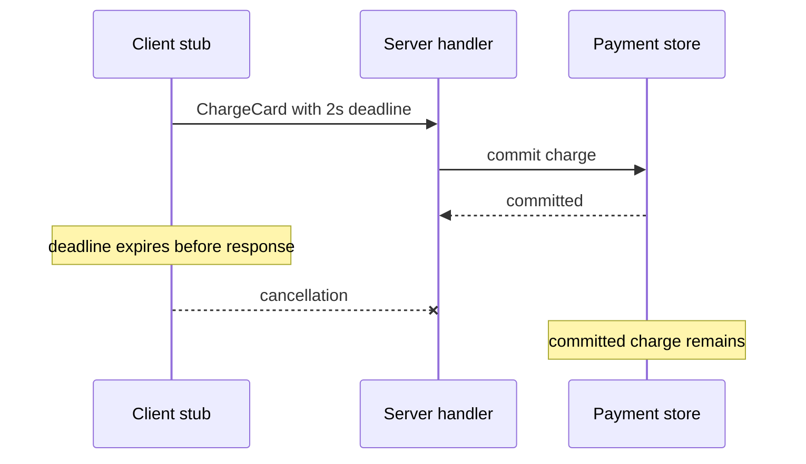

# gRPC: A Focused Overview

> **Who this is for**: Engineers evaluating typed service-to-service RPC or integrating an existing gRPC service.

> **Key insight**: Generated call syntax preserves a typed contract, but the call still has network ambiguity, deadlines, compatibility rules, and retry semantics.

---

## Run one generated unary call

The [quick-start files](examples/grpc_quickstart/) contain one `.proto` contract, asynchronous
Python server, and generated-stub client. From that directory, generate the bindings and run them:

```bash
python -m venv .venv
source .venv/bin/activate
python -m pip install grpcio grpcio-tools
python -m grpc_tools.protoc -I. --python_out=. --grpc_python_out=. orders.proto
python server.py
```

In a second terminal:

```bash
python client.py
```

The first terminal prints `server ready on 127.0.0.1:50051`; the client prints:

```text
order ord_42: shipped
```

The `.proto` file is the input, `grpc_tools.protoc` produces `orders_pb2.py` and
`orders_pb2_grpc.py`, server registration binds the generated service interface, and the client
stub serializes `GetOrderRequest` over the channel. Missing generated modules fail at import;
starting the client before the server produces `UNAVAILABLE` or `DEADLINE_EXCEEDED` within
the RPC's two-second budget. The client calls the stub directly: an earlier unbounded
`channel_ready()` wait would happen outside that budget. If readiness is checked separately,
give that wait its own explicit deadline.

> **Production:** The example is deliberately restricted to loopback and uses plaintext only for
> that local proof. A deployed channel requires verified TLS or mutual TLS, application
> authorization, bounded message sizes, health/readiness behavior, and deadline propagation as
> described below.

---

## 1️⃣ The Mental Model

**gRPC** makes a remote operation look like a typed method call while retaining distributed-system controls such as deadlines, cancellation, metadata, and status codes.

```text
orders.proto
    │ protoc + plugins
    ├──────────────> generated Python client stub
    └──────────────> generated Go server interface

client stub ══ HTTP/2 + protobuf messages ══> server handler
```

Protocol Buffers are gRPC's default interface definition language and message format. The `.proto` contract generates types and client/server bindings for supported languages.

---

## 2️⃣ Service Definition

```proto
syntax = "proto3";

package orders.v1;

service OrderService {
  rpc GetOrder(GetOrderRequest) returns (Order);
  rpc WatchOrder(WatchOrderRequest) returns (stream OrderUpdate);
}

message GetOrderRequest {
  string order_id = 1;
}

message Order {
  string order_id = 1;
  string status = 2;
  optional string tracking_number = 3;
}

message WatchOrderRequest {
  string order_id = 1;
}

message OrderUpdate {
  string event_id = 1;
  Order order = 2;
}
```

Field numbers identify data on the wire. Never change or reuse a deployed number. When removing a field, reserve its number and preferably its name.

---

## 3️⃣ Four RPC Shapes

| Shape | Request | Response | Example |
|-------|---------|----------|---------|
| Unary | One | One | Fetch an order |
| Server streaming | One | Many | Watch order updates |
| Client streaming | Many | One | Upload telemetry batches |
| Bidirectional streaming | Many | Many, independently | Interactive control channel |

Streaming is not automatically reliable replay. The application still decides message identity, offsets, acknowledgement, ordering, resumption, and what happens after a broken connection.

---

## 4️⃣ Deadlines, Cancellation, and Status

gRPC clients should set a realistic deadline on every call. The official behavior has no universal default deadline, so an omitted deadline can leave a caller waiting indefinitely.

```python
# Generated modules come from orders.proto.
async def get_order(stub, order_id: str, access_token: str):
    return await stub.GetOrder(
        orders_pb2.GetOrderRequest(order_id=order_id),
        timeout=2.0,
        metadata=(("authorization", f"Bearer {access_token}"),),
    )
```

The server must stop spawned work when the request is cancelled; cancellation does not roll back changes already committed.

Use status codes by meaning:

| Status | Typical meaning | Retry? |
|--------|-----------------|--------|
| `INVALID_ARGUMENT` | Input invalid regardless of current state | No |
| `NOT_FOUND` | Requested entity absent | Usually no |
| `FAILED_PRECONDITION` | State must change before retry | Not yet |
| `ABORTED` | Higher-level read-modify-write conflict | Retry whole sequence |
| `RESOURCE_EXHAUSTED` | Quota or capacity exhausted | Only with policy/backoff |
| `UNAVAILABLE` | Transient service failure | Often, for safe/idempotent calls |
| `DEADLINE_EXCEEDED` | Caller deadline passed | Outcome may be ambiguous |

Automatic retry requires an explicit service policy and safe operation semantics. An RPC library cannot determine whether repeating `ChargeCard` is safe.

---

A deadline can expire after the business effect has committed.



Cancellation stops waiting and asks the handler to stop remaining work. It cannot erase the committed charge; retry the same business operation identity or reconcile its outcome.

---

## 5️⃣ Compatibility Rules

Safe Protobuf evolution commonly includes adding a new field. Old readers preserve or ignore unknown fields depending on the operation and runtime; new readers see a default/unset value from old writers.

**ProtoJSON** is Protocol Buffers' specified JSON mapping; its compatibility rules differ from the
binary wire format. Do not:

- Change existing field numbers.
- Reuse a removed number.
- Change semantics while leaving the wire type compatible.
- Assume adding an enum value is safe for every generated client's exhaustive switch.
- Confuse binary wire compatibility with ProtoJSON compatibility.

```proto
message Order {
  reserved 3;
  reserved "legacy_tracking_code";

  string order_id = 1;
  string status = 2;
  optional string tracking_number = 4;
}
```

Run a schema compatibility check in CI before generating and publishing clients.

---

## 6️⃣ Operational Fit

gRPC works particularly well between controlled services because it provides generated clients, connection reuse, streaming, health checking, and consistent call metadata.

Account for:

- HTTP/2-aware ingress, proxies, service mesh, load balancers, and observability
- TLS or mutual TLS plus application authorization
- Maximum inbound/outbound message sizes
- Connection age, keepalive, graceful drain, and load balancing behavior
- Deadlines propagated with enough remaining budget for downstream work
- Retry budgets and idempotent operations
- **Server reflection**—runtime discovery of service and schema descriptors—exposure policy, plus
  separate health/readiness behavior

Browsers cannot use the ordinary native gRPC stack directly in the same way as backend clients. **gRPC-Web** and a compatible proxy or server bridge expose supported gRPC services to browser applications, with transport and streaming capabilities that must be checked for the chosen implementation.

---

## 7️⃣ When to Use It

Choose gRPC for owned, polyglot service-to-service systems where generated contracts, compact messages, streaming, and controlled infrastructure are advantages.

Prefer REST when broad third-party accessibility, ordinary browser tooling, CDN caching, or easy manual inspection dominates. Prefer WebSocket when the main requirement is a browser-friendly, long-lived application channel with a custom message protocol.

---

## References

- [gRPC core concepts and lifecycle](https://grpc.io/docs/what-is-grpc/core-concepts/)
- [gRPC deadlines](https://grpc.io/docs/guides/deadlines/)
- [gRPC status codes](https://grpc.io/docs/guides/status-codes/)
- [Protocol Buffers language guide](https://protobuf.dev/programming-guides/proto3/)
- [gRPC-Web](https://grpc.io/docs/platforms/web/)

---


## Recap

- The proto generates types and stubs while the server still implements behavior.
- A deadline bounds the RPC wait, including connection progress when no unbounded readiness wait precedes it.
- Committed effects survive cancellation and need idempotent recovery.

## Check yourself

**ChargeCard commits before a 2s deadline expires, but the response is lost. Does DEADLINE_EXCEEDED prove no charge?**

<details><summary>Reasoned answer</summary>

No; the client stopped waiting, while commit is already durable. Retry requires the same business idempotency identity, not a new charge.

</details>

**A retired field number is reused for a different meaning. Can old binary clients safely ignore the change?**

<details><summary>Reasoned answer</summary>

No. They still interpret that tag using its previous type and semantics. Reserve removed field numbers instead.

</details>

**Try it:** Stop the local server and run client.py. Then change its RPC timeout to 0.2 seconds and call a server handler that sleeps one second. Leave the elapsed-time and status assertions blank.

Hint: Channel creation is not a successful RPC, and a missing peer differs from a slow accepted RPC.

<details><summary>Solution</summary>
The absent peer fails UNAVAILABLE (or DEADLINE_EXCEEDED under a different readiness policy) within its bound; the slow handler exceeds the 0.2-second RPC deadline. Keep the deadline on the RPC and measure elapsed time; do not reintroduce an unbounded channel_ready before it.
</details>

**Next**: [RESTful APIs](restful/README.md)
