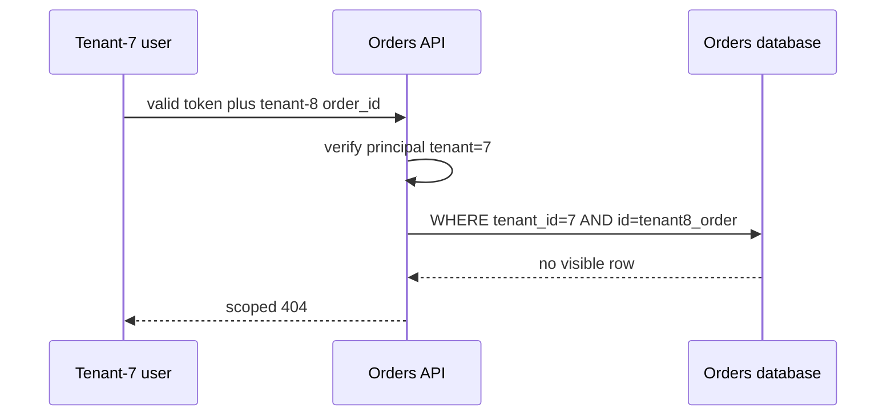

# REST API Security

> **Who this is for**: API practitioners who need security decisions visible at every resource boundary. Assumes [Resource and URI Design](03_resource_and_uri_design.md).

> **Key insight**: API authorization is a decision over principal, operation, object relationship,
> property, and current state—not a one-time token check.

---

A tenant-7 user requests tenant 8's order using a valid tenant-7 access token.
Authentication succeeds. An unscoped lookup leaks the order; a query constrained by
`tenant_id=7 AND id=requested_id` returns no visible row. The checks below explain where
that trusted tenant predicate comes from and why neither UUID secrecy nor a valid token
can replace it.

## 1. Security Is a Decision Stack

TLS and a valid token are necessary, not sufficient.

```text
request
  → trusted network edge and TLS
  → authenticate principal
  → authorize operation
  → load object through tenant/owner scope
  → authorize object relationship
  → authorize readable/writable properties
  → validate data and state transition
  → enforce rate, quota, size, and cost
  → execute transaction
  → filter response
  → audit sensitive outcome
```

OWASP's API Security Top 10 emphasizes object-level authorization, authentication, property authorization, resource consumption, function authorization, sensitive business flows, SSRF, misconfiguration, inventory, and unsafe third-party API use because API incidents usually exploit ordinary missing boundaries.

---

## 2. Authentication and Authorization

**Authentication** establishes a principal. **Authorization** decides what that principal may do to this operation, object, and property now.

Represent users, API clients, service accounts, and workers consistently:

```python
from dataclasses import dataclass
from enum import StrEnum


class PrincipalKind(StrEnum):
    USER = "user"
    API_CLIENT = "api_client"
    SERVICE = "service"


@dataclass(frozen=True)
class Principal:
    id: str
    kind: PrincipalKind
    tenant_id: str | None
    capabilities: frozenset[str]

    def can(self, capability: str) -> bool:
        return capability in self.capabilities
```

Authentication controls:

- Verify issuer, audience, signature algorithm, expiry, and not-before rules for tokens.
- Rotate keys and define revocation/short-lived credential behavior.
- Keep API keys hashed or encrypted as appropriate and show a secret only once.
- Use separate credentials, audiences, and scopes across environments.
- Never accept identity from untrusted client-supplied forwarding headers.

Authorization belongs close to the resource query and transition, not only in route naming or UI controls.

---

## 3. Object-Level Authorization (BOLA/IDOR)

**Broken Object Level Authorization (BOLA)**, often expressed as an **Insecure Direct Object
Reference (IDOR)**, occurs when a caller substitutes an object identifier and the server retrieves
or mutates it without checking that caller's relationship to the object.

The vulnerable shape authenticates a user then fetches any supplied ID:

```python
async def load_order_unsafely(session, order_id: str):
    # ❌ The principal exists, but the query ignores its tenant boundary.
    return await session.get(Order, order_id)
```

Scope the lookup:

```python
from sqlalchemy import select


async def load_visible_order(session, order_id: str, principal: Principal):
    statement = select(Order).where(
        Order.id == order_id,
        Order.tenant_id == principal.tenant_id,
    )
    return await session.scalar(statement)
```

For example, an authenticated tenant-7 user can replace their order ID with tenant-8's `order_id`.
The unscoped lookup returns tenant 8's row and discloses or mutates it. Adding the tenant predicate
derived from the trusted principal—not from the submitted path or body—makes that substitution
return no visible row.

Apply this to members, nested resources, bulk items, file keys, job results, webhook subscriptions, exports, and indirect references in bodies. A globally unique or unguessable ID is not authorization.

For update/delete, include the authorization/concurrency scope in the atomic statement so a race cannot swap the checked object before mutation.

### Where Tenant Identity Comes From

Distinguish the *claimed* tenant (whatever the request presents) from the *authorized* tenant (what the principal is actually allowed to act as):

- **Path** (`/tenants/{tenant_id}/orders`) — readable and easy to log, but purely an addressing detail. Never treat its presence as authorization.
- **JSON Web Token (JWT) claim** (`tenant_id` inside a signed claim container) — trustworthy only
  after the verifier pins the algorithm and validates the signature, issuer, audience, expiry, and
  expected token profile, and only when the issuer contract says this claim represents current
  tenant entitlement. When that contract is absent or entitlement changes faster than token
  lifetime, resolve allowed tenants server-side instead.
- **Header** (`X-Tenant-Id`) — common in service-to-service calls where the caller isn't a user with a token scoped to one tenant. Trust it only from an authenticated, allow-listed internal caller (e.g., a gateway), never from an arbitrary client.
- **Subdomain** (`acme.api.example.com`) — convenient for multi-tenant SaaS routing and cache separation at the edge, but still just an address; resolve it to a tenant record and re-verify against the principal exactly like a path segment.

Whichever source a request uses, re-derive the tenant from the authenticated principal and compare. If the path/header/subdomain tenant doesn't match the principal's tenant, reject the request — don't silently switch context to whatever was requested.

### Defense in Depth: Database-Level Enforcement

PostgreSQL row-level security enforces a tenant predicate only after it is enabled. This schema
excerpt assumes `orders.tenant_id` is a UUID. Run requests as a non-owner role with neither
superuser nor `BYPASSRLS`; table owners normally bypass RLS unless it is forced:

```sql
ALTER TABLE orders ENABLE ROW LEVEL SECURITY;
ALTER TABLE orders FORCE ROW LEVEL SECURITY;
CREATE POLICY tenant_isolation ON orders
  USING (tenant_id = nullif(current_setting('app.tenant_id', true), '')::uuid)
  WITH CHECK (tenant_id = nullif(current_setting('app.tenant_id', true), '')::uuid);
```

After checking membership, use parameterized `SELECT set_config('app.tenant_id', :tenant_id, true)`
inside the same explicit transaction as the query. The final `true` makes the setting transaction-local,
preventing pool reuse from inheriting another request's tenant. An absent setting sees no tenant rows.
Run the complete positive/negative [RLS and pool-reuse lab](../../fundamentals/database/13_multi_tenancy.md);
the schema excerpt alone does not create a secure role or authenticate a tenant.

This doesn't replace the `WHERE tenant_id = ...` check in application code — it's a second, independent layer that still holds if one query, one ORM shortcut, or a future change forgets the filter. RLS can't express authorization that isn't a row filter (e.g., "only admins may update `status`"), so keep it as a backstop, not a substitute for scoping every query explicitly.

### What Makes a Tenant ID "Valid"

A path template like `{tenant_id}` isn't enumerated — it matches any string (or whatever type/pattern you declare), so the space of possible values is unbounded by design. That's normal, not a scaling flaw: the route's *contract* is fixed and finite (one template), while a specific *request* is checked in layers:

1. **Syntactic** — does the value match the declared type/pattern (a UUID regex, `Path(..., pattern=...)`)? A malformed ID fails at routing/parsing, before it touches the database.
2. **Existence** — does a tenant with that ID exist at all? A well-formed but unknown ID should return a scoped not-found (see the test matrix below), not a 500 or a response shape that reveals which IDs are real.
3. **Authorization** — does the *authenticated principal* have a relationship to that tenant? This is the BOLA check above — it answers "may this caller act as this tenant," not "is this ID well-formed."

Conflating step 1 (the ID parsed) with step 3 (the caller may use it) is exactly the BOLA gap.

---

An authenticated tenant-7 caller controls the requested order ID, but not the trusted tenant predicate.



Changing the requested ID does not change the verified principal. Removing tenant_id from the query exposes tenant 8 even though token validation still succeeds.

---

## 4. Function and Property Authorization

Routes such as admin imports, refunds, impersonation, support lookup, and report export need explicit capabilities. Hiding them from documentation is not access control.

Separate public input, persistence, and output models:

```text
public update fields        internal fields
display_name               tenant_id
timezone                   role/is_admin
notification_preferences  fraud_score
                           account_balance
                           password_hash
```

Avoid generic “apply every JSON field to the model” utilities. Define writable fields per operation and filter output fields by contract. Graph-shaped/nested objects need the same property checks at every level.

---

## 5. Browser Boundaries: CORS and CSRF

**CORS** is a browser policy controlling whether frontend JavaScript may read/call cross-origin resources. It is not authentication and does not block curl, servers, or direct attackers.

- Allow exact origins rather than reflecting arbitrary input.
- If credentials are allowed, do not combine them with wildcard origins.
- Allow only required methods and headers.
- Include `Vary: Origin` when the response varies by origin and can be cached.

**CSRF** matters when browsers automatically attach ambient credentials such as cookies. Protect state-changing requests with appropriate `SameSite` cookies, CSRF tokens, and/or strict origin checks. A bearer token explicitly added by application code has a different threat model, but token theft through **cross-site scripting (XSS)**—attacker-injected browser script that can steal or misuse explicitly managed credentials—remains critical.

Do not perform unsafe actions with `GET`; browser navigation and prefetch can trigger them.

---

## 6. Resource Consumption and Abuse

Rate limiting is one control in a wider budget system:

| Dimension | Example limit |
|-----------|---------------|
| Request rate | Requests per principal/IP/tenant |
| Concurrency | Active expensive operations |
| Payload | Header, body, multipart part, decompressed size |
| Query | Page size, filter clauses, graph depth, regex policy |
| Cost | Rows scanned, LLM tokens, emails, payment attempts |
| Storage | Upload bytes, retained exports, webhook subscriptions |
| Business flow | Reservations, password resets, coupon attempts |

Apply cheap edge limits and authoritative identity/tenant quotas. A per-IP limit alone punishes shared networks and is easily distributed by attackers.

Return `429` with stable error details and retry guidance where appropriate. Never promise that all rejected expensive work is free—parsing, authentication, and queueing already consume resources.

---

## 7. Injection, URLs, Files, and Dependencies

- Bind SQL values and allowlist public sort/filter fields.
- Avoid shell commands; if unavoidable, pass fixed argument arrays without a shell.
- Validate redirects and outbound URLs against an explicit policy.
- Treat URL-fetch, import, image proxy, and webhook target features as **server-side request forgery
  (SSRF)** surfaces: attacker-controlled destinations can make the server reach private, link-local,
  or metadata services unavailable to the attacker directly.
- Resolve and validate all IP addresses, block private/link-local/loopback/metadata ranges, control redirects, and isolate egress.
- Stream uploads with byte limits; verify type from content, generate storage keys, scan where required, and serve from a non-executable origin.
- Set outbound timeouts, response limits, TLS verification, and schema validation for third-party APIs.

Dependency responses are untrusted input. A compromised provider must not be able to set internal object ownership, write arbitrary files, or inject credentials into logs.

---

## 8. Secrets, Errors, and Audit Evidence

Never log:

- Authorization/cookie headers
- API keys, reset links, or webhook signing secrets
- Full payment or health records
- Unredacted request/response bodies by default
- Query strings containing credentials or personal data

Log stable identifiers, principal/tenant, operation name, authorization outcome, response class, latency, and a request ID. Sensitive audit events need actor, target, action, outcome, policy/reason, time, and correlation—but not the secret used.

Public errors must not include stack traces, SQL, internal hostnames, storage keys, or raw dependency bodies. Preserve those details in access-controlled internal telemetry.

---

## 9. Security Verification

Test a matrix, not one happy-path token:

| Case | Expected result |
|------|-----------------|
| No credential / invalid / expired / wrong audience | Authentication rejected |
| Valid identity, missing function capability | Forbidden |
| Same-tenant allowed object | Success |
| Other tenant's guessed ID | Scoped not-found/forbidden policy |
| Attempt to set hidden property | Rejected or ignored per explicit policy |
| Oversized/decompression-bomb payload | Rejected before expensive processing |
| Duplicate/racing state transition | One valid outcome; conflict/idempotent replay |
| Internal/metadata outbound URL | Rejected and audited |
| Error path | No secret or internal detail leakage |

Use static analysis, dependency scanning, schema fuzzing, and an authorization test fixture that makes cross-tenant cases easy to write.

---

## References

- [OWASP API Security Top 10 — 2023 edition](https://owasp.org/API-Security/editions/2023/en/0x11-t10/)
- [OWASP REST Security Cheat Sheet](https://cheatsheetseries.owasp.org/cheatsheets/REST_Security_Cheat_Sheet.html)
- [OWASP SSRF Prevention Cheat Sheet](https://cheatsheetseries.owasp.org/cheatsheets/Server_Side_Request_Forgery_Prevention_Cheat_Sheet.html)
- [FastAPI API Security](../../fundamentals/fastapi/11_api_security.md)

---


## Recap

- Authentication identifies a caller; authorization decides which objects and actions it may use.
- The trusted tenant predicate must not come from an unchecked request identifier.
- RLS is effective only when enabled with a non-bypass runtime role and correct transaction context.

## Check yourself

**A user has a valid token for tenant 7 and submits tenant_id=8. Which value may scope the query?**

<details><summary>Reasoned answer</summary>

The authenticated entitlement supplies allowable scope. The submitted value is only an address and must be rejected unless that relationship is authorized.

</details>

**Does FORCE ROW LEVEL SECURITY make a superuser obey tenant policies?**

<details><summary>Reasoned answer</summary>

No. Superusers and BYPASSRLS roles remain privileged. Test the actual restricted application role.

</details>

**Next**: [Versioning, Compatibility, and OpenAPI](09_versioning_compatibility_and_openapi.md)
