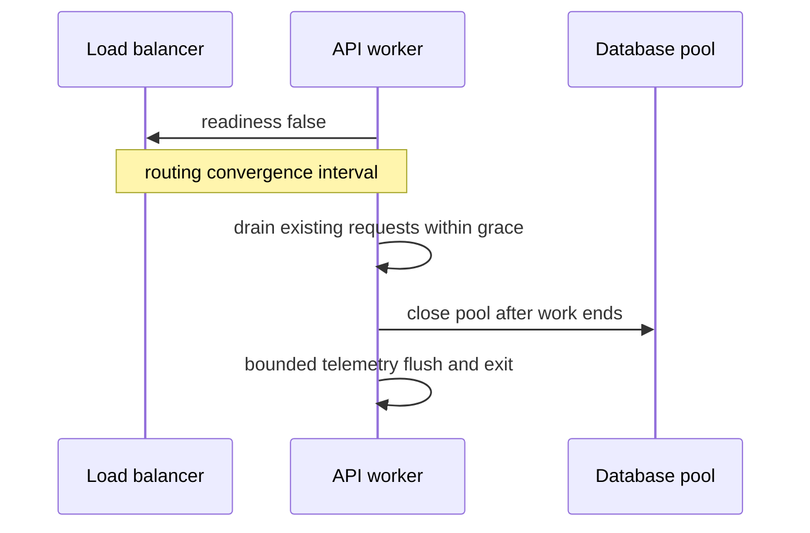

# Testing, Observability, and Operations

> **Who this is for**: Teams taking a RESTful API from correct local behavior to a dependable production service. Assumes the preceding REST chapters.

> **Key insight**: Tests prove selected contracts before release; telemetry and runbooks prove and restore those contracts under real failure.

---

## 1. Test the Contract, Not Only Functions

A useful test portfolio covers different failure boundaries:

| Layer | Proves | Example |
|-------|--------|---------|
| Unit | Domain rule in isolation | Cancellation allowed only while pending |
| Schema | Documents/examples match types | Every OpenAPI example validates |
| Endpoint/component | Routing, validation, auth, error mapping | Cross-tenant ID returns scoped `404` |
| Database integration | Transactions, constraints, query behavior | Two conditional updates cannot both win |
| Consumer/provider contract | Deployed sides honor agreed examples | Old client decodes new additive response |
| End-to-end | Gateway, TLS, identity, service, dependencies | Real token reaches staging operation |
| Property/fuzz | Parser and invariant behavior over generated input | Unknown JSON shapes never cause `500` |
| Load/resilience | Limits and failure recovery | Dependency slowdown triggers admission control |

More end-to-end tests are not automatically better. Keep the majority deterministic and close to the behavior, then use a smaller set to prove infrastructure wiring.

---

## 2. Endpoint Test Matrix

For each operation cover:

- Minimum valid and representative full request
- Malformed encoding and wrong media type
- Missing, unknown, boundary, null, and oversized fields
- Missing/invalid/expired/wrong-audience credential
- Missing function capability
- Same-tenant allowed and cross-tenant denied objects
- Allowed and forbidden property updates
- Current-state conflict and stale `If-Match`
- Duplicate idempotency key with same and different body
- Dependency timeout, unavailable, malformed response, and partial failure
- Stable error type/code and no sensitive detail
- Cache and rate-limit headers where applicable

Authorization tests should build at least two tenants by default so the unsafe query is easy to catch.

---

## 3. Run the two-tenant contract fixture

The [complete app and tests](../examples/rest_contract/) supply the missing route, two-tenant
data, trusted-principal test override, problem response and public response model. From the
repository root, in the FastAPI environment:

```bash
python -m pytest -q apis/examples/rest_contract
```

Five cases pass: own order returns only public fields; another tenant's order and a missing
order both return the same scoped problem contract; operation IDs are unique; and without
the explicit test override the app returns 401. The override is a test fixture, never a
production authentication policy. Install the real verified identity dependency before
exposing this app. The in-memory dictionary proves route-policy behavior, while the
[PostgreSQL tenant lab](../../fundamentals/database/13_multi_tenancy.md) proves database enforcement.

In `app.py`, temporarily remove the tenant predicate and rerun the suite: the cross-tenant
case fails. Restore it and the case passes. That failure distinguishes a useful authorization
test from merely checking that any valid token gets a 200.

---

## 4. Observe the Request Lifecycle

Use the **RED** signals per stable operation:

- Rate: accepted and rejected requests
- Errors: status class plus stable problem code
- Duration: latency distribution, not only average

Add saturation and dependency signals:

- In-flight requests and admission rejections
- Worker/event-loop lag, threads, CPU, memory
- Database pool wait and query latency
- Outbound pool wait, connect, TLS, and response time
- Cache hit/miss/validation rate
- Retry attempts and amplification

Label metrics with normalized route/operation ID, method, status class, and bounded error code. Never label with raw `/orders/ord_123`, user ID, request ID, or arbitrary exception text; high cardinality can make telemetry itself fail.

---

## 5. Correlation and Tracing

Use distinct identifiers:

| Identifier | Scope |
|------------|-------|
| Request ID | One inbound API request and its logs |
| Trace ID | Distributed call graph across services |
| Idempotency key | Logical retryable operation |
| Resource/job/event ID | Durable business entity |

Propagate standard trace context through trusted services and return a safe request ID for support. Do not let an arbitrary external request ID overwrite internal uniqueness; validate or generate your own and preserve the external value separately if useful.

Trace spans should show queue wait, auth, database, outbound dependencies, serialization, and retries. Sampling must retain enough errors and slow traces for diagnosis without collecting sensitive bodies.

---

## 6. SLOs and Alerts

Define service-level indicators from the consumer's outcome:

- Availability: valid requests that receive an acceptable response
- Latency: successful or all requests within a threshold
- Correctness/freshness where technically measurable

Exclude only traffic the contract clearly defines as invalid. A provider-caused `400` due to a breaking schema rollout is not magically healthy.

Alert on symptoms and budget burn rather than every individual failure:

- Fast/slow error-budget burn
- Sustained tail-latency increase
- Admission rejection or queue growth
- Dependency failure and retry amplification
- Sudden change in authorization denials or problem codes

---

## 7. Safe Rollout and Shutdown

Before deployment:

- Run compatibility diff and migration tests.
- Ensure database changes follow expand/migrate/contract.
- Verify gateway timeouts and limits match the contract.
- Canary by a controllable slice and compare errors/latency.
- Confirm rollback can read data written by the new version.

During shutdown:

1. Fail readiness so new requests stop arriving.
2. Drain in-flight requests within a bounded grace period.
3. Stop accepting background work and persist unfinished state.
4. Close pools and flush telemetry within their own deadlines.

Killing workers mid-request increases ambiguous outcomes. Idempotency and reconciliation remain necessary because no drain is perfect.

---

Shutdown must preserve resources until the requests that own them have drained.



Readiness changes propagate asynchronously. Keep the worker serving its admitted requests during routing convergence, then close the pool after dependent work finishes or its deadline expires. Forced termination still needs idempotent recovery.

---

## 8. Incident Diagnosis Path

```text
Is impact real for consumers?
  → which operation, version, tenant cohort, and region?
  → edge rejection, queueing, application, database, or dependency?
  → did retries amplify it?
  → can load be shed, feature disabled, or rollout reverted safely?
  → how are ambiguous writes reconciled afterward?
```

Useful runbook data:

- Current deploy and schema versions
- Dashboards by operation/problem code
- Logs/traces searchable by request and resource ID
- Dependency and database health
- Feature flags and rollback constraints
- Retry/idempotency/reconciliation procedure
- Owner and escalation contacts

---

### Work one incident from observation to recovery

At 10:00 a release doubles connection hold time for `GET /orders/{order_id}`. This is a
worked diagnostic scenario, not a reported production measurement:

| Signal | Before | During incident | After admission cap and lease fix |
|---|---:|---:|---:|
| Request p99 | 180 ms | 2.4 s | 190 ms |
| Pool-wait p95 | 4 ms | 1.8 s | 6 ms |
| Query p95 after checkout | 25 ms | 26 ms | 25 ms |
| Used connections / ceiling | 12/20 | 20/20 | 13/20 |

The query duration barely changes, so adding an index cannot remove the dominant wait.
Trace the connection checkout through response completion: a new code path retains it
while waiting on another service. Cap admitted requests to stop the queue growing, then
release the connection before remote I/O or revert the compatible code change. Retrying
every queued request would add demand to the same finite pool.

Suppose the latency objective allows 1% of valid requests above 500 ms. Over five minutes,
600 of 10,000 valid requests exceed it: 6% bad / 1% allowed = 6x budget burn. The accepted
traffic and rejected-overload traffic must follow the published SLI policy; dropping
rejections from the chart cannot make the user experience healthy. Use a sustained window
and the [multi-window SLO owner](../../infrastructure/observability/05_alerting_and_slos.md)
to choose paging severity.

Before reverting, check that old code can read values already written by the release.
Drain the affected pods using the sequence above; keep the pool alive for existing requests.
Recovery requires falling pool wait and restored latency without growing rejections.
For writes that timed out, reconcile the original idempotency identities and compare effect
counts before allowing customer retries. An empty incident queue alone does not prove no
payment was duplicated.

## 9. Production Readiness Checklist

- Contract, examples, and implementation pass conformance checks.
- Negative, authorization, concurrency, and compatibility tests exist.
- Load test includes realistic dependency and database behavior.
- Metrics use bounded dimensions and trace the full critical path.
- A service-level objective (SLO)—the reliability target evaluated from measured service-level
  indicators—plus dashboards, alerts, owner, and runbook is published.
- Deployment drains safely and rollback is data-compatible.
- Unknown write outcomes can be queried or reconciled.
- Logs and traces are useful without leaking sensitive content.

---


## Recap

- Two-tenant tests expose unscoped lookups that a happy-path test misses.
- Separating pool wait from query duration locates the dominant latency.
- Recovery requires restored outcomes and reconciliation, not only a green process health check.

## Check yourself

**New pods accept a changed enum and write it to storage. Why can reverting the deployment still fail?**

<details><summary>Reasoned answer</summary>

Old code must read data already written by new code; binary rollback alone does not undo the data compatibility change.

</details>

**Queries remain fast but pool wait rises after a connection leak. Should retries increase?**

<details><summary>Reasoned answer</summary>

No. They increase demand on exhausted capacity. Bound admission and repair connection ownership; verify wait and rejection rates recover.

</details>

**Try it:** Add a third order belonging to tenant 8 to examples/rest_contract/app.py. In test_app.py, leave the expected GET status from a tenant-7 principal blank.

Hint: Public IDs do not establish tenant authority.

<details><summary>Solution</summary>
Assert 404 and no protected fields for tenant 7, then override the trusted principal to tenant 8 and assert the allowed public response. This changes the resource identity while preserving the authorization rule.
</details>

**Next**: [WebSocket Deep Dive](../websockets/README.md)
