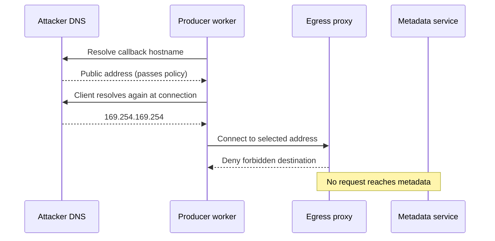

# Webhook Signatures, Security, and SSRF

> **Who this is for**: Producers and consumers protecting both inbound event authenticity and outbound request destinations. Assumes the producer and consumer architecture chapters.

> **Key insight**: Signatures move message authenticity to a shared secret; destination policy separately prevents an authenticated customer configuration from steering requests into trusted networks.

---

## 1. Two Different Security Boundaries

```text
consumer protects inbound endpoint         producer protects outbound network
┌──────────────────────────────┐           ┌──────────────────────────────┐
│ Was body sent by provider?   │           │ Is callback URL safe?        │
│ Was it modified/replayed?    │           │ Where did DNS resolve?       │
│ Is this expected account?    │           │ Can redirects reach internals?│
└──────────────────────────────┘           └──────────────────────────────┘
       signatures/replay defense                  SSRF/egress controls
```

**Server-side request forgery (SSRF)** occurs when an attacker-controlled callback URL makes the
producer request an otherwise unreachable internal, link-local, or metadata service.

TLS is required on both sides, but it does not replace message authentication: anyone can send HTTPS to a public consumer endpoint, and a compromised/misissued destination is not necessarily the expected producer.

---

## 2. Sign Identity, Time, and Exact Body

A robust **hash-based message authentication code (HMAC)** proves possession of a shared secret and
detects modification of the exact bytes. Its input binds:

```text
message_id.timestamp.raw_body
```

- The raw body provides integrity.
- The message ID supports durable deduplication.
- The signed timestamp bounds replay of captured requests.
- Separators and field character rules prevent ambiguous concatenation.

Example headers:

```http
Webhook-Id: evt_01J8Q9M4D7
Webhook-Timestamp: 1784716200
Webhook-Signature: v1,1bB8...= v1,Qz91...=
```

Multiple signatures allow overlap during key rotation. The consumer accepts any currently valid secret; the producer signs with old and new keys during the migration window.

Use a reviewed provider library/specification when integrating with an existing service. Header names and signature construction differ across providers; never adapt one provider's example by guesswork.

---

## 3. Complete HMAC Implementation

The following `webhook_security.py` matches the import in [Consumer Design](03_consumer_design.md). It expects raw high-entropy secret bytes. If secrets are stored base64-encoded, decode them once before calling these functions.

```python
import base64
import binascii
import hashlib
import hmac
import time
from collections.abc import Iterable


class VerificationError(ValueError):
    """The webhook authentication data is missing, stale, or invalid."""


def _signed_content(*, body: bytes, message_id: str, timestamp: int) -> bytes:
    if not message_id or len(message_id) > 200 or "." in message_id:
        raise VerificationError("Invalid message identifier")
    return (
        message_id.encode("utf-8")
        + b"."
        + str(timestamp).encode("ascii")
        + b"."
        + body
    )


def sign_webhook(
    *,
    body: bytes,
    message_id: str,
    timestamp: int,
    secrets: Iterable[bytes],
) -> str:
    content = _signed_content(
        body=body,
        message_id=message_id,
        timestamp=timestamp,
    )
    signatures: list[str] = []
    for secret in secrets:
        if len(secret) < 24:
            raise ValueError("Webhook secrets must contain at least 192 bits")
        digest = hmac.new(secret, content, hashlib.sha256).digest()
        signatures.append(f"v1,{base64.b64encode(digest).decode('ascii')}")
    if not signatures:
        raise ValueError("At least one signing secret is required")
    return " ".join(signatures)


def verify_webhook(
    *,
    body: bytes,
    message_id: str | None,
    timestamp: str | None,
    signature_header: str | None,
    secrets: Iterable[bytes],
    tolerance_seconds: int = 300,
    now: int | None = None,
) -> None:
    if message_id is None or timestamp is None or signature_header is None:
        raise VerificationError("Missing webhook authentication header")
    if len(signature_header) > 4096:
        raise VerificationError("Signature header is too large")

    try:
        timestamp_value = int(timestamp)
    except ValueError as exc:
        raise VerificationError("Invalid timestamp") from exc

    current_time = int(time.time()) if now is None else now
    if tolerance_seconds <= 0:
        raise ValueError("A positive replay tolerance is required")
    if abs(current_time - timestamp_value) > tolerance_seconds:
        raise VerificationError("Webhook timestamp is outside the allowed window")

    content = _signed_content(
        body=body,
        message_id=message_id,
        timestamp=timestamp_value,
    )
    supplied = [
        item.removeprefix("v1,")
        for item in signature_header.split()
        if item.startswith("v1,")
    ]
    if not supplied or len(supplied) > 10:
        raise VerificationError("No supported signature")

    # Compare decoded MAC bytes; malformed Unicode/base64 is an authentication failure.
    candidates = []
    for value in supplied:
        try:
            decoded = base64.b64decode(value, validate=True)
        except (ValueError, binascii.Error):
            continue  # A malformed rotation candidate cannot authenticate the request.
        if len(decoded) == hashlib.sha256().digest_size:
            candidates.append(decoded)
    if not candidates:
        raise VerificationError("Malformed webhook signature")

    matched = False
    for secret in secrets:
        if len(secret) < 24:
            raise ValueError("Webhook secrets must contain at least 192 bits")
        expected = hmac.new(secret, content, hashlib.sha256).digest()
        for candidate in candidates:
            matched |= hmac.compare_digest(candidate, expected)

    if not matched:
        raise VerificationError("Invalid webhook signature")
```

The public error intentionally does not reveal whether the ID, timestamp, or signature was wrong. The example exception text is suitable for controlled tests/log classification, not direct reflection to an attacker.

Store seen event IDs durably. Timestamp validation alone does not stop a captured request being replayed repeatedly within the allowed window.

---

## 4. Verification Order

Consumer ingress order:

1. Accept HTTPS only and enforce edge connection/body limits.
2. Read a bounded raw body.
3. Fetch required headers without normalizing their values.
4. Verify signed timestamp and signature with constant-time comparison.
5. Parse the same bytes.
6. Validate event ID matches the signed message ID.
7. Validate expected producer/account/subscription context.
8. Insert into the unique durable inbox.
9. Return a generic response.

Do not log the secret, full signature header, or sensitive raw body on failure.

---

## 5. Key Generation, Storage, and Rotation

- Generate secrets with a cryptographically secure random generator, not passwords or tenant IDs.
- Use a different secret per endpoint/subscription and environment to limit blast radius.
- Store encrypted or in a secret manager; restrict support/UI access.
- Show the secret once and offer an explicit rotate action.
- During rotation, produce/accept both old and new signatures for a bounded window.
- Audit secret creation, reveal, rotate, revoke, and verification failures.
- Never embed secrets in callback URLs or source-controlled fixtures.

HMAC means producer and consumer share a secret. Asymmetric signatures can reduce provider-side verification-key distribution risk: producer signs with a private key and consumers verify with public keys. They add key discovery, rotation, algorithm, and library complexity. Use a reviewed scheme rather than inventing one.

IP allowlists and **mutual TLS (mTLS)**—certificate authentication of both client and server—can add
defense in depth but do not replace payload signatures and event deduplication. Provider IP ranges
change, proxies hide source addresses, and mTLS still needs event identity/replay semantics.

---

## 6. Outbound Webhook URLs Are SSRF Input

A producer that lets customers register a URL operates a server-side request primitive:

```text
attacker registers http://169.254.169.254/... metadata endpoint
producer worker sends request from trusted network
attacker learns response timing/status or triggers internal action
```

Other targets include loopback, **RFC 1918 private IPv4 address space**, IPv6 local addresses,
internal DNS, Kubernetes services, admin panels, and cloud metadata services.

### Registration validation is not enough

DNS can change after validation, return multiple addresses, or rebind between lookup and connection. Redirects can point from a safe public URL to an internal target.

---

## 7. Layered SSRF Defense

### URL policy

- Require `https`.
- Allow only documented ports, normally 443.
- Reject URL user info, fragments, ambiguous encodings, and unsupported host forms.
- Parse with one standards-compliant library and use its normalized host.
- Apply length limits.

### Address policy at connection time

- Resolve all A and AAAA results through a controlled resolver.
- Reject loopback, private, link-local, multicast, unspecified, reserved/special-use, and metadata destinations, including IPv4-mapped IPv6 forms.
- Connect only to a validated resolved address while verifying TLS hostname against the original host.
- Revalidate on every new connection and DNS refresh.

### Redirect policy

Disable redirects by default. If supported, cap hops and repeat the full scheme/host/DNS/address validation at every hop. Never forward signatures or sensitive headers across a changed origin without an explicit contract.

### Network architecture

- Run delivery workers in an egress-isolated network with no route to internal control planes or metadata services.
- Enforce destination policy at an egress proxy/firewall as well as application code.
- Use cloud metadata protections such as **AWS Instance Metadata Service Version 2 (IMDSv2)**,
  whose session token adds a request barrier, as defense in depth.
- Limit response bytes, timeouts, concurrency, and bandwidth.

Application URL validation alone is bypass-prone. The network must make forbidden destinations unreachable.

---

Which address does the worker actually connect to? A second DNS lookup can differ from the validated first answer.



Checking the first DNS result does not constrain a later connection. Bind the transport to the approved address while preserving TLS hostname verification, and enforce forbidden-destination policy at egress as an independent boundary. Redirects require the same checks.

---

## 8. Endpoint Ownership and Abuse

Sending test events to an unverified URL can itself become reflected traffic. Ownership verification should use a bounded challenge and rate limits, and must still pass SSRF controls.

Prevent abuse:

- Cap endpoints/subscriptions per tenant.
- Rate-limit verification and test delivery.
- Do not let users choose arbitrary methods, headers, bodies, or source identity.
- Sign a fixed challenge/event contract.
- Pause endpoints with persistent failure under a published policy.
- Prevent endpoints targeting the provider's own public state-changing APIs where credentials/cookies could matter.

---

## 9. Security Test Matrix

- Body whitespace/key order changed after signing
- Old/future timestamp and replay within valid window
- Wrong endpoint/environment secret and rotation overlap
- Duplicate event ID with new signature timestamp
- `http`, unusual ports, URL credentials, encoded host tricks
- IPv4/IPv6 loopback, private, link-local, and cloud metadata addresses
- Public hostname resolving to private IP or changing after registration
- Redirect from public to forbidden destination
- Huge/slow response and TLS hostname/certificate failure
- Secrets/signatures absent from logs, UI, errors, and tracing

---

## References

- [Standard Webhooks specification](https://github.com/standard-webhooks/standard-webhooks/blob/main/spec/standard-webhooks.md)
- [OWASP SSRF Prevention Cheat Sheet](https://cheatsheetseries.owasp.org/cheatsheets/Server_Side_Request_Forgery_Prevention_Cheat_Sheet.html)
- [GitHub: validating webhook deliveries](https://docs.github.com/en/webhooks/using-webhooks/validating-webhook-deliveries)

---


## Recap

- Identity, timestamp and raw bytes are bound by the MAC.
- Malformed signatures fail authentication; valid signatures still need durable replay protection.
- DNS validation must constrain the connection actually made and every redirect.

## Check yourself

**a valid evt_1 request is captured and replayed 20 seconds later under a 300-second tolerance; is HMAC enough?**

<details><summary>Reasoned answer</summary>

Its signature and timestamp remain valid, so only the durable event-ID guard prevents a second effect. Leave the duplicate-effect assertion for the learner.

</details>

**The first DNS answer is public and the connection resolves to a private address. Did the first check protect it?**

<details><summary>Reasoned answer</summary>

No. The lookup and connection used different decisions. Pin the approved destination with correct TLS identity and enforce egress restrictions.

</details>

**Try it:** Call verify_webhook with a valid signed body and a header containing both a malformed v1 candidate and a valid candidate. Then alter one byte of the body. Leave the expected outcomes blank.

Hint: Candidate parsing is independent; every accepted candidate still signs the same exact bytes and delivery metadata.

<details><summary>Solution</summary>
The valid candidate succeeds despite a malformed sibling; altering the body fails VerificationError. Non-ASCII or invalid Base64 alone must also become VerificationError, never an uncaught comparison/type error.
</details>

**Next**: [Retries, Idempotency, Ordering, and Replay](05_retries_idempotency_ordering_and_replay.md)
