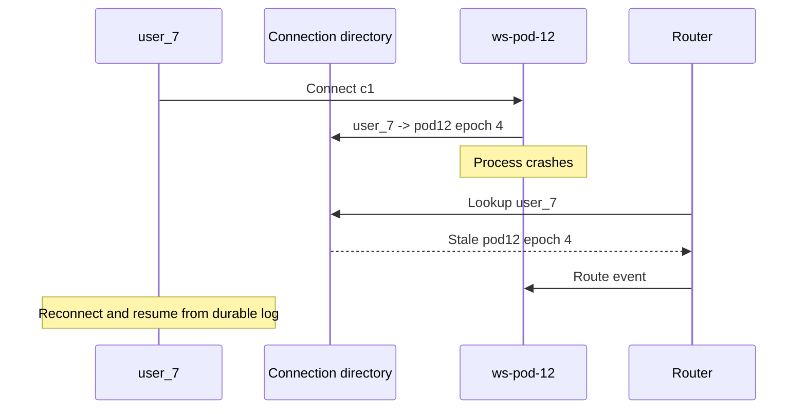

# Scaling WebSockets and Distributed Architecture

> **Who this is for**: Engineers moving from one-process connection managers to a multi-instance or multi-region WebSocket service. Assumes [Reliability](03_reliability_reconnection_and_flow_control.md) and [Security](04_authentication_and_security.md).

> **Key insight**: Each socket has one live owner; scaling works by routing messages to that owner while durable state and replay live outside the connection process.

---

## 1. A Connection Has One Live Owner

A WebSocket terminates on one process at one moment.

```text
client A ──> pod 1: local socket A
client B ──> pod 2: local socket B

event produced on pod 1 cannot call socket B directly
```

An in-memory set is correct only inside one process. Multiple workers in the same container already have separate memory. Adding a load balancer does not merge their registries.

Separate three responsibilities:

1. **Connection plane** — owns sockets, authentication context, queues, subscriptions.
2. **Message/event plane** — moves events to the instances that need them.
3. **Durable state plane** — stores business state, event log/resume positions, and authorization data.

---

## 2. Reference Architecture

```text
                         ┌──────────── durable event log ────────────┐
business services ─outbox┤ Kafka / stream / database event table    │
                         └────────────────┬──────────────────────────┘
                                          │
                               routing/fan-out workers
                                          │
                     ┌────────────────────┴───────────────────┐
                     ↓                                        ↓
                 WS pod 1                                 WS pod 2
              sockets A, C                              sockets B, D
                     │                                        │
                     └──────── clients and browsers ──────────┘
```

The durable log supports replay after disconnect. A low-latency pub/sub layer may also distribute ephemeral state such as typing indicators where loss is acceptable.

Do not use one mechanism for every message without considering semantics:

| Message | Suitable backend |
|---------|------------------|
| Payment/order state transition | Durable outbox + event log/stream |
| Chat message requiring history | Durable message store/log |
| Presence heartbeat | Time-to-live (TTL) lease store or ephemeral pub/sub; expiry removes stale ownership after a process disappears |
| Cursor movement/typing indicator | Best-effort pub/sub, coalescing allowed |

Redis Pub/Sub is low latency but does not retain missed messages. Redis Streams, Kafka, or a database event log provide different durability/replay and operational trade-offs.

---

### Start with two gateways, then make routing more selective

With two gateways and 100 small user events per second, broadcast sends 200 gateway
copies per second. Each gateway filters for its own authorized connections; both gateways
must receive their copy, so a competing-consumer group that divides events between them
would lose notifications. Each socket still has exactly one live owner.

At 200 gateways, the same stream creates 20,000 copies per second. If one hot tenant owns
most traffic, first measure bytes and fan-out CPU. Tenant/topic subscriptions can reduce
unrelated delivery; a per-user directory can target the exact gateway at the cost of leases,
stale routes and reconnect races. Choose that extra state only when the observed broadcast
cost justifies it. Neither routing choice supplies durable delivery by itself.

## 3. Routing Strategies

### Broadcast to every WebSocket instance

Each instance receives every event and sends only to its local matching sockets. Simple, but broker and CPU cost grows with fleet size and total event volume.

### Partition by topic or tenant

Instances subscribe only to relevant partitions/topics. Efficient fan-out, but dynamic subscription churn and hot tenants complicate balancing.

### Connection directory

A distributed directory maps user/topic to owning instance. A router sends directly to that instance.

```text
user_7 → ws-pod-12, connections [c1, c9]
```

The directory is a hint, not a perfect source of truth. Entries can outlive crashed processes. Use leases/TTL, instance epochs, and idempotent cleanup.

### Sticky sessions

Affinity can keep reconnects on one backend and support connection-specific state, but it does not distribute events across pods, preserve state after failure, or eliminate skew. Keep important state external even with stickiness.

---

A remote directory cannot atomically observe a gateway process disappearing.



The directory is a leased routing hint. On reconnect, c9 registers epoch 5; a late cleanup for epoch 4 must delete only if its connection ID and epoch still match. Missed events are recovered from a durable cursor, not from a directory entry.

---

## 4. Presence Is Approximate Distributed State

“Online” may mean:

- At least one live connection exists.
- A heartbeat arrived within N seconds.
- The app is foregrounded and acknowledged presence.
- The user was active recently.

Define it. Mobile suspension, abrupt failure, multiple devices, and delayed cleanup make exact instant presence impossible.

A lease model is common:

```text
presence key: tenant/user/connection
value: instance ID, connected_at, last_seen
TTL: renewed by bounded heartbeat
```

Aggregate per-user presence from unexpired leases. Do not execute correctness-critical business logic solely because a presence key exists.

---

## 5. Fan-out and Slow Consumers

A global broadcast to one million sockets is a distributed workload, not a loop.

Plan:

- Topic partitioning and hot-key behavior
- Serialization once vs per recipient customization
- Per-connection authorization and field filtering
- Queue byte/message caps
- Coalescing for state updates
- Durable replay for non-droppable events
- Maximum fan-out rate per tenant/event producer

One slow socket must not block a broker consumer or other sockets. The broker handler routes into bounded local queues; dedicated sender tasks drain them. When full, apply the message-specific policy from [Flow Control](03_reliability_reconnection_and_flow_control.md).

---

## 6. Capacity Model

Measure rather than estimate from file descriptors alone:

```text
connections per instance limited by min(
  file descriptors,
  memory / bytes per connection,
  heartbeat CPU/network,
  event serialization/fan-out CPU,
  broker throughput,
  load balancer limits,
  acceptable reconnect and drain time
)
```

Track:

- Open/accepted/rejected connections
- Connections by instance, protocol version, and region
- Handshake and authentication latency
- Messages/bytes in and out
- Outbound queue depth/bytes and slow-consumer closes
- Heartbeat misses and abnormal closures
- Broker lag, dropped events, replay rate
- Event-loop lag, CPU, memory, file descriptors
- Reconnect rate and connection duration

Avoid user/topic/connection IDs as metric labels.

---

## 7. Deployments and Graceful Drain

Rolling a process closes its connections. A safe sequence:

1. Mark instance unready for new handshakes.
2. Continue serving existing sockets for a bounded drain period.
3. Notify clients of restart/reconnect policy if the protocol supports it.
4. Stop broker intake or transfer partitions.
5. Flush bounded outbound queues only within the grace deadline.
6. Close sockets with an appropriate restart/going-away code.
7. Remove/expire connection-directory leases.

Clients must reconnect with jitter and resume/snapshot. A long drain reduces disruption but slows deployments; define a maximum connection age if old versions otherwise live indefinitely.

---

## 8. Multi-Region Design

Choose consistency and routing intentionally:

- Connect clients to nearest healthy region.
- Keep a connection within one region until reconnect.
- Decide where each topic/entity is authoritative.
- Route commands to the owning region or globally consistent service.
- Replicate events with documented delay and ordering scope.
- Generate globally unique IDs or partition-scoped sequences.
- Recover from an entire region without replaying unsafe commands.

A single global total order is expensive and often unnecessary. Per-document or per-order ordering usually matches the domain better.

---

### Replay a gateway crash through a rollout

`user_7` processed event 43 on c1/epoch 4 at pod12. Pod12 crashes after event 44 commits to
the durable log but before delivery. The directory temporarily still names pod12; routing
44 there fails. The client reconnects as c9/epoch 5 on pod18, authenticates, registers its
new route, and asks for events after 43. Event 44 is replayed and the client advances its
cursor only after application processing.

A late pod12 cleanup must use compare-and-delete on `(user_7,c1,4)`. An unconditional
`DELETE user_7` erases c9's healthy route. During planned drain, stop new upgrades, tell
clients to reconnect with jitter, and keep old sockets until a bounded deadline; the same
epoch and replay rules cover the overlap. If event 44 has expired, use the snapshot/resume
contract from the reliability lesson instead of claiming lossless replay.

For regions, extend this only with an explicit command authority. A single active home
region can fence commands with an ownership epoch before failover; replicas may still
serve suitably fresh reads. Two active regions need a stated conflict policy for concurrent
commands. Moving a WebSocket connection alone neither transfers database authority nor
makes asynchronous replication current. Test failback with the same fencing and cursor
checks as failover.

## 9. Failure Scenarios

Test:

- One process crashes without cleanup.
- Broker connection drops while sockets stay open.
- Broker redelivers or reorders events.
- Hot tenant dominates one partition/instance.
- Directory points to a dead or restarted instance.
- Regional network partition splits producers and sockets.
- Deployment closes a large fleet simultaneously.
- Replay storage is unavailable or resume position expired.

The fallback should be explicit: disconnect and resume, serve a fresh snapshot, degrade ephemeral features, or reject new commands. Silent divergence is not a fallback.

---

**Next**: [Implementation, Testing, and Operations](06_implementation_testing_and_operations.md)
