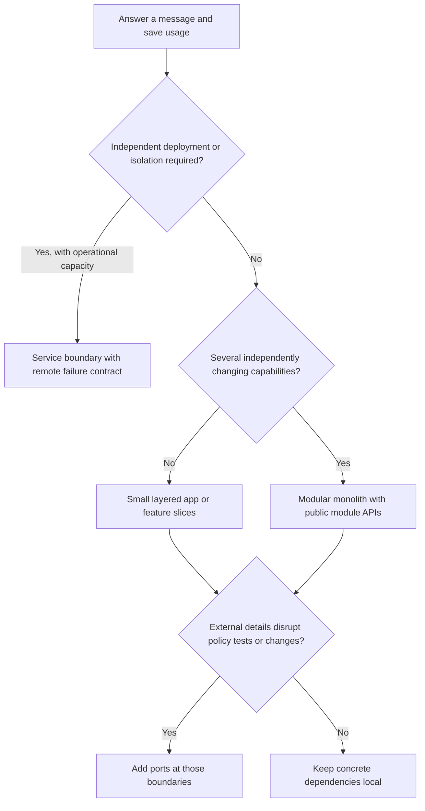
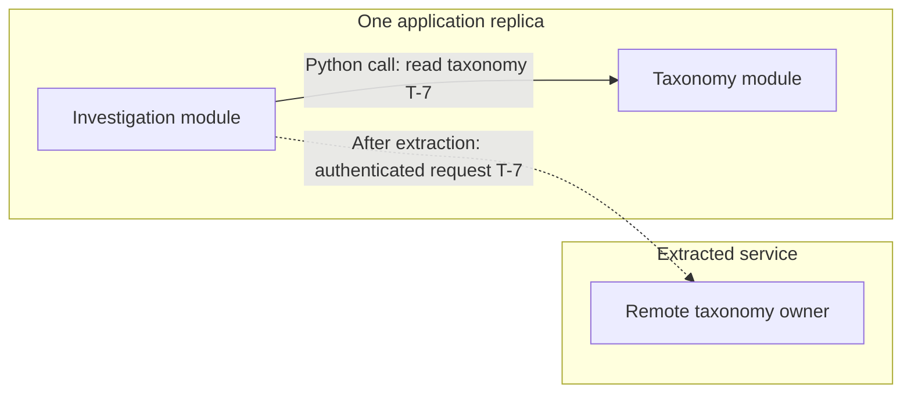

# Choose a code structure from the change you need to support

> **Role:** decision guide. **Prerequisites:** Python functions, imports and basic backend request handling.

Suppose an AI application must answer a message, save the answer and record usage. Today one
team ships it as one application. Tomorrow the provider SDK may change, conversation retention
rules may change, or the usage team may need its own release schedule. Those are three different
pressures. A useful design identifies which boundary absorbs each change.

For that starting situation, a **modular monolith organized by business capability, with use-case
slices and selective ports**, is a reasonable baseline. The rest of this guide shows what that
choice buys, where a simpler structure is enough, and when another design earns its cost.

## Separate four decisions before comparing architecture names

A *deployment unit* is code released and run together. A *module* owns a capability, exposes a
contract and controls its implementation. An *import dependency* means one source module knows
another module's definitions. An *interaction* is an actual call or message at runtime. These
boundaries can coincide, but they need not.

| Question | Choices | Decision for the answer-message application |
|---|---|---|
| What ships together? | Monolith, independently deployed services | Agents, conversations and usage ship together initially |
| What belongs together in code? | Technical layers, business modules, use-case slices | Business modules, with slices when a module grows |
| Which code may depend on which details? | Direct implementation dependencies, ports/adapters, Clean/Onion dependency rules | Agent generation depends on a small provider contract; simple owned SQL can remain concrete |
| How do capabilities cooperate? | Direct calls, events, durable workflows | Direct calls for required completion; durable events if later consumers may lag |

Hexagonal architecture addresses inside/outside dependency boundaries. A modular monolith adds
business ownership within a deployment. Neither implies the other. Clean and Onion approaches
also protect inner policy from outer details; they are related approaches, not mandatory extra
layers to stack on top. The number of circles in a diagram does not prescribe a number of Python
packages. See [Cockburn's original explanation](https://alistair.cockburn.us/hexagonal-architecture)
and [Martin's dependency rule](https://blog.cleancoder.com/uncle-bob/2012/08/13/the-clean-architecture.html).

This decision tree starts with the smallest structure that addresses an observed pressure:



Notice that ports remain a decision after choosing deployment and ownership. Moving usage to its
own server does not automatically isolate its code from a vendor SDK. Adding a provider port does
not let the usage team deploy independently.

## One deployable application can run in several processes

A modular monolith describes business modules shipped together. It does not mean a deployment has
one process. The same application can run four HTTP workers or several replicas behind a load
balancer; each process has its own memory and constructed clients. Calls between modules inside
one process remain ordinary Python calls. Sharing the same code does not make memory shared
between those workers.

Compare the same investigation and taxonomy capabilities under three runtime choices:

| Arrangement | Investigation asks taxonomy | What scales/releases together | First important limit |
|---|---|---|---|
| One application, one worker | Public Python module API | Both capabilities | One blocked worker affects both |
| Same application, four workers | Public API within the receiving worker | Both capabilities | Each worker owns separate pools/caches; shared database load multiplies |
| Independently deployed services | A versioned remote contract | Capabilities can scale/release separately | Timeout may mean remote work succeeded but its response was lost |

The deployment boundary is visible here; boxes within the application do not need HTTP:



The dashed alternative changes failure semantics as well as transport. A port can keep caller code
stable only if its success/failure contract still fits. Replacing a synchronous read with an event
that promises a result later changes the application interaction; the same method name cannot
hide that difference. Likewise, separate services improve isolation only when shared databases,
quotas and dependency chains do not recreate the same bottleneck.

Use [modular-monolith evolution](modular_monolith/03_operate_and_evolve_boundaries.md) for the
transaction and extraction decisions. Inside either topology, the
[design-pattern lessons](design_patterns/README.md) explain the smaller choices: selecting behavior,
translating vendor models, wrapping actions and expressing rules. Those choices remain useful even
when the application never becomes a set of services.

## A small layered application can be a sound starting point

For an internal tool with two endpoints and one owner, this structure may be sufficient:

```text
app/
  routes.py       # HTTP input, authorization, response mapping
  service.py      # answer_message: order the work and own completion
  database.py     # parameterized SQL and transaction lifecycle
  provider.py     # provider request/response translation
```

The route calls `answer_message`; the service calls the provider, then commits the answer and usage
together. A **transaction script** is a procedure implementing a business operation in a sequence
of steps. It is often appropriate when rules are simple. A **service layer** gives entry points a
stable application operation to call; it need not be a class or a separate file for every action.
[Cosmic Python's service-layer chapter](https://www.cosmicpython.com/book/chapter_04_service_layer)
develops that application boundary.

The first limitation appears when `service.py` becomes the home of unrelated billing,
conversation and agent changes. Engineers editing one capability navigate several huge global
files. Moving those capabilities into owned modules makes changes local. A file count alone is
not the trigger: the important signal is unrelated work repeatedly colliding in the same code.

## Vertical slices keep one use case close together

A **vertical slice** groups the code needed for one user-visible operation. For example,
`answer_message` and `list_messages` are different slices, even though both touch conversations.
Here is a possible layout, not additional executable sample code:

```text
app/conversations/
  answer_message.py    # command input, orchestration, result
  list_messages.py     # read input, query, result
  rules.py             # shared retention/visibility rules when needed
```

Changing pagination should mostly affect `list_messages`; changing answer-generation policy
should mostly affect `answer_message`. This is the axis-of-change idea behind
[Bogard's vertical-slice architecture](https://www.jimmybogard.com/vertical-slice-architecture/).
A slice may use direct SQL for a simple read and a richer model for a complex write. There is no
requirement that every slice pass through identical repository and service interfaces.

But locality does not authorize duplicating a business invariant. If both slices determine
whether a conversation is visible, they must use the same owner for that rule. Share the policy
inside the module. Do not solve duplication by creating a global `BaseService` that unrelated
capabilities must inherit.

Feature folders alone are not a complete vertical-slice design: a giant
`conversations/service.py` can still mix every use case. Conversely, a slice need not be one file;
split it when the reader can no longer follow the operation comfortably.

## A modular monolith adds business ownership

When the application has distinct agents, conversations and usage capabilities, give each a
public Python API and owned data. They still ship as one application:

```text
app/
  bootstrap.py
  agents/          api.py, provider adapters
  conversations/   api.py, answer/list slices, owned SQL
  usage/           api.py, counting rules, owned SQL
  workflows/       answer_message.py
```

Here `workflows/answer_message.py` coordinates module APIs. Conversations does not write usage
tables, and usage does not import conversation internals. Changing conversation storage therefore
requires preserving its public contract, not inspecting arbitrary callers for hidden SQL.

The benefit depends on enforcing those rules. A shared database connection can support a local
transaction without giving every module permission to use every table. A common deployment also
means a bad release or exhausted connection pool can affect all modules. Ownership gives change
isolation; it does not create process isolation.

Follow the [worked modular-monolith path](modular_monolith/README.md) for the complete package,
request trace, rollback test and boundary guard. The recommendation to start together is
contextual: [Fowler's monolith-first argument](https://martinfowler.com/bliki/MonolithFirst.html)
emphasizes the cost of distribution and the difficulty of discovering stable boundaries early.

## Add stronger internal patterns where the rules justify them

Consider three changes to the same application:

| Change | Concrete design response | Cost and limit |
|---|---|---|
| Switch from one agent provider to another while retaining prompt/output policy | Introduce `Runner.run(prompt) -> str`, inject an adapter, translate vendor failures there | Contract tests are needed; a tiny port cannot hide every streaming or tool-use semantic |
| Enforce a complicated quota with reservations, expiry and cancellation | Give usage a domain model whose methods permit valid state transitions | More model code, but the invariant has one home; a domain model is unnecessary for a simple counter |
| Serve a dashboard with a shape unlike the write model | Start with a dedicated query; consider CQRS if separate read/write models materially simplify it | A separate asynchronous projection adds lag, replay and reconciliation obligations |

**Domain-driven design (DDD)** uses business language and explicit model boundaries to guide
design. A *bounded context* is a boundary within which a model and its terms have a consistent
meaning. It can inform module ownership without requiring aggregates, repositories or events for
every table. A module is a code boundary; it is not automatically a correctly discovered bounded
context.

**CQRS** separates the model used to change state from the model used to read it. It does not
require separate services, event sourcing or a broker. Separate functions named `create` and
`get` alone do not explain a meaningful modeling choice. Read
[Fowler's CQRS discussion](https://martinfowler.com/bliki/CQRS.html) before paying for a separate
projection. Event sourcing—persisting changes as the authoritative event history—is a distinct
decision and outside this path.

## Extract a service for a concrete operational need

Suppose the agent runner now requires GPU capacity and the provider team must release it several
times per day without redeploying conversations. A service boundary can separate deployment and
capacity. Keep the local orchestration contract, but replace the in-process provider with a remote
adapter. The new adapter must define timeouts, authentication, retry behavior and ambiguous results.

This is a real additional cost: a local call either returns or raises in the current process;
a remote timeout may occur after the remote work succeeded. Cross-service writes no longer share
the simple local transaction. [The evolution lesson](modular_monolith/03_operate_and_evolve_boundaries.md)
works through that transition. Microservices are not the required final stage of a successful
monolith.

Other styles solve different pressures. A **pipeline** is useful when documents pass through
ordered, independently testable transformations; see the [RAG processing example](llm_systems/03_retrieval_augmented_generation.md).
A **plugin architecture** is useful when third parties supply implementations through a stable
extension contract, but adds compatibility and trust decisions. Event-driven cooperation fits
independent reactions that may lag; [events and projections](event_driven_architecture/01_events_and_projections.md)
teaches that mechanism. These are conditional continuations, not packages every backend needs.

## Try the decision under a changed requirement

Your three-person team owns the entire application. Conversations and usage must commit together.
The agent provider changes quarterly. A proposal introduces three services, a broker and a generic
repository base class. Which parts address an actual requirement? Now change the scenario: an
independent team must deploy a GPU runner without restarting the application.

<details><summary>Reasoned answer</summary>

Initially, use modules for ownership and a shared local transaction for the coupled writes. A
provider port makes the changing external boundary explicit. Neither independent deployments nor
asynchronous consistency is required, so three services and a broker introduce failure modes
without satisfying a stated need. A generic repository adds value only if there is a real shared
contract; table CRUD by itself is not such evidence.

With the GPU team's independent release requirement, extracting the runner becomes defensible.
Keep conversation and usage atomic locally, define a remote runner contract, and address duplicate
provider execution after timeouts. Merely adding another interface cannot create independent
deployment. The requirement changed the deployment choice, not every internal module's structure.

</details>
