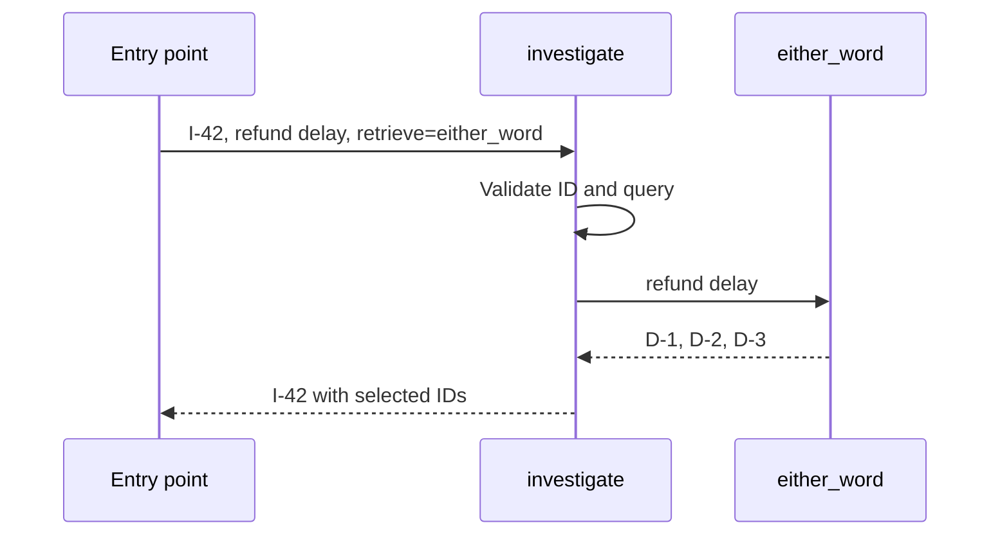
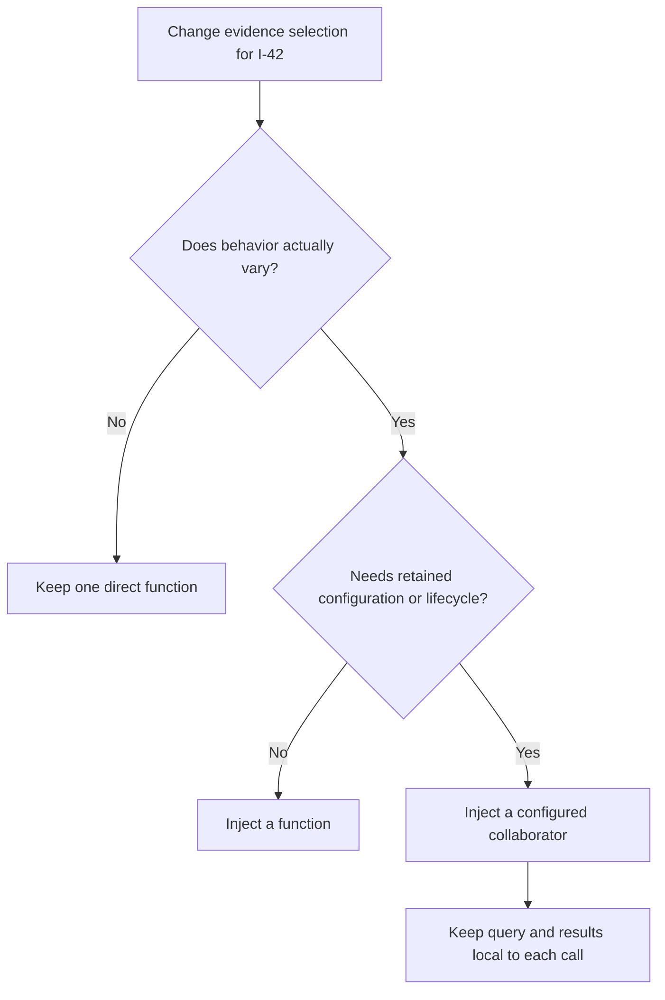

# Find the changing decision before choosing a pattern

> **Role:** foundation. **Prerequisites:** Python functions, classes, annotations and exceptions.
> No architecture-pattern vocabulary is assumed. Examples use Python 3.11+.

Investigation `I-42` asks for evidence about `refund delay`. Today the application selects documents
containing either word. Tomorrow a reviewer wants only documents containing both words. The
investigation still needs the same result: an investigation ID and the selected evidence IDs.
Only the selection rule changed.

That is a useful place for a **seam**: an explicit point where one piece of behavior can be supplied
without rewriting its caller. A design pattern gives a recurring arrangement like this a name.
The name helps people discuss the design; the arrangement earns its place by containing a concrete
change.

## Pass the behavior that the caller needs

Here is a complete small example. Run it with Python, or trace the two calls by hand. The documents
are already represented as IDs in this first example; the next lesson implements actual matching.
The local functions perform no network access and retain no request data.

```python
from collections.abc import Callable

Retrieve = Callable[[str], tuple[str, ...]]


def investigate(
    investigation_id: str, query: str, *, retrieve: Retrieve
) -> tuple[str, tuple[str, ...]]:
    if not investigation_id.strip() or not query.strip():
        raise ValueError("investigation_id and query must be nonempty")
    return investigation_id, retrieve(query)


def either_word(query: str) -> tuple[str, ...]:
    # Deterministic fixture for this one request, not a search implementation.
    return ("D-1", "D-2", "D-3") if query == "refund delay" else ()


def both_words(query: str) -> tuple[str, ...]:
    return ("D-2",) if query == "refund delay" else ()


print(investigate("I-42", "refund delay", retrieve=either_word))
print(investigate("I-42", "refund delay", retrieve=both_words))
```

The output is:

```text
('I-42', ('D-1', 'D-2', 'D-3'))
('I-42', ('D-2',))
```

`retrieve=either_word` passes the function object. It does not run that function. Inside
`investigate`, `retrieve(query)` performs the call. Replacing the argument with `both_words` changes
the chosen behavior while preserving the action's input validation and result shape.

**Dependency injection** means that a caller receives a collaborator from outside instead of
constructing or locating it internally. A collaborator can be a function, an object or an ordinary
value. Here the dependency is one function parameter; no container or base class is required.
[Cosmic Python's bootstrapping chapter](https://www.cosmicpython.com/book/chapter_13_dependency_injection)
develops the same separation between construction and application execution.

Follow the first invocation to see which participant owns each decision:



The entry point selects the collaborator. The action decides when to call it and how its result
participates in the use case. The collaborator owns evidence selection. If a selection function
raises, the action above also raises; injection does not supply retries, fallback or rollback.
Those behaviors need their own explicit owners when the application requires them.

## A contract says more than the shape of a function

`Callable[[str], tuple[str, ...]]` describes one string argument and a tuple of string results.
The alias `Retrieve` gives that repeated type a meaningful name. The application still needs a
behavioral agreement: returned strings identify selected evidence, an empty tuple means no match,
and each invocation returns its own result without modifying another request's result.

A function returning `("permission denied",)` has the right type shape but violates that meaning.
A useful contract test supplies known documents and verifies the selected IDs. A type checker
cannot infer the business meaning of those strings.

Python annotations also do not automatically validate data at runtime. A wrongly implemented
collaborator may return `None`, and the interpreter will not reject it merely because of the
annotation. Check external input where it enters, test implementations against the intended
contract, and use static checking as an additional tool. See the
[Python typing documentation](https://docs.python.org/3.14/library/typing.html), checked 2026-10-30.
The [typing lesson](../../fundamentals/core_concepts/typing/typing.md) explains the wider workflow.

For a single operation, `Callable` is usually enough. A **Protocol** names the required shape of an
object without requiring every implementation to inherit from a common base. This explanatory
excerpt describes a collaborator that exposes a named `retrieve` method:

```python
from typing import Protocol


class EvidenceReader(Protocol):
    def retrieve(self, query: str) -> tuple[str, ...]: ...
```

An implementation with a compatible method can satisfy that contract structurally. The consumer
would call `reader.retrieve(query)` instead of `retrieve(query)`. Choose that form when the named
method improves the contract or the object owns related configuration; renaming a function into a
one-method class alone does not change its guarantees. Protocol annotations do not verify
semantic behavior or make an incompatible remote API compatible.

In the [hexagonal course](../hexagonal_architecture/05_design_ports_and_adapter_contracts.md),
application I/O capabilities have explicit **ports**: contracts owned by the application that
concrete integrations implement. The pure matching functions here are not I/O. Once retrieval
calls a database or external search service, follow that course's I/O-port rule and define success
and failure meaning at the boundary.

## Keep syntax, design intention and deployment separate

A function is a Python mechanism. Passing it into another function can implement dependency
injection. Selecting among interchangeable retrieval behaviors is the intention called
**Strategy**, which the next lesson develops. One line of code can participate in both ideas:
one describes how the collaborator arrives, the other describes why its behavior varies.

These distinctions prevent two common mistakes. First, a class hierarchy is not necessary just
because the behavior has a pattern name. Second, adding a Protocol does not make a local call
safe to replace with a remote one. A remote lookup introduces timeout, authorization and ambiguous
failure behavior even if it returns the same tuple on success.

| Change to `I-42` | Decision that needs an owner | Small starting shape |
|---|---|---|
| A reviewer chooses either-word or both-word matching | Selection behavior | Pass a callable |
| Each deployment has a different maximum result count | Stable selection configuration | Configured callable or closure |
| Retrieval comes from a vendor API with different field names | External representation and failures | Application port plus adapter |
| A second team must deploy retrieval independently | Release and runtime boundary | Service design, beyond a Python interface |

The [architecture decision guide](../01_architecture_decision_guide.md) compares the last two
boundaries with business-module ownership. Here we stay inside one process and learn the smallest
code arrangements first.

## Add an object when it owns useful configuration

Suppose every investigation handled by one process uses a maximum of two evidence IDs. A callable
object can retain `limit=2` while each invocation receives a new query and returns a new tuple.
That configuration has a longer lifetime than one investigation, which gives the object a purpose.
The next lesson implements this arrangement.

Now suppose the same object also has `self.results`, a list to which every request appends. Request
`I-43` may observe IDs from `I-42`. Injection has made the dependency explicit, but has not made its
mutable state private to a request. The result should instead be a local variable returned from
each call. Shared resources with mutable state need a deliberate concurrency and lifetime policy.
The [concurrency foundations](../../fundamentals/concurrency/01_state_and_safety.md) own that next
step; a frozen wrapper around a mutable client would not make the client immutable.

This decision tree asks what the proposed object would actually own:



The branch to an object follows a state or lifecycle requirement, not the number of pattern names
in the design. A direct function remains a sound choice when its caller has no real substitution
or boundary need. Do not introduce a registry merely because a function has a name.

## Recognize the first failure before adding another pattern

If an investigation unexpectedly returns every document, first inspect which retrieval function
was supplied and what its matching rule means. This is a behavioral-selection error. If one
request includes another request's IDs, inspect retained mutable state and object lifetime. This
is a state-isolation error. If the provider hangs, it is an external-call policy problem; another
class around the same call will not bound its duration.

A small verification should therefore change the dependency and check the observable result,
then invoke the same dependency twice with different inputs and check that results remain
independent. Do not test only that an object has a method with the expected name.

Continue to [select behavior and construct dependencies](02_select_behavior_and_build_dependencies.md)
for an executable matching example, configuration validation and the construction boundary.

## Recap

- The investigation kept its input/result contract while a passed function changed selection.
- Injection makes the collaborator explicit; Strategy describes interchangeable behavior.
- An annotation describes shape, while examples and contract tests establish intended semantics.
- A configured object can retain stable settings; request-specific results need their own lifetime.
- A Python seam does not supply remote-call guarantees or independent deployment.

## Check yourself

**Q: The action now calls `both_words(query)` directly. Can its caller select either-word matching
by passing `retrieve=either_word`?**

<details><summary>Answer</summary>

No. Accepting a parameter is insufficient if the action ignores it. The selected dependency must
be used at the actual call site. The direct reference has moved the selection decision back into
the action, so its implementation must change to select the other behavior.

</details>

**Q: A retriever is injected correctly but returns the same mutable list on every call. What
happens if the caller appends a diagnostic ID?**

<details><summary>Answer</summary>

Another request can observe that appended ID because the calls share the same list object.
Injection controls dependency supply, not ownership of returned values. Return a fresh immutable
result or explicitly document and manage shared state. The tuple contract in this lesson avoids
caller mutation of the returned sequence.

</details>

**Q: Would introducing `EvidenceReader` prove that a vendor returns IDs the caller may access?**

<details><summary>Answer</summary>

No. The Protocol describes the interface shape. The integration must enforce the relevant access
boundary and return meaningful evidence IDs. A correct signature cannot establish authorization
or semantic compatibility.

</details>
