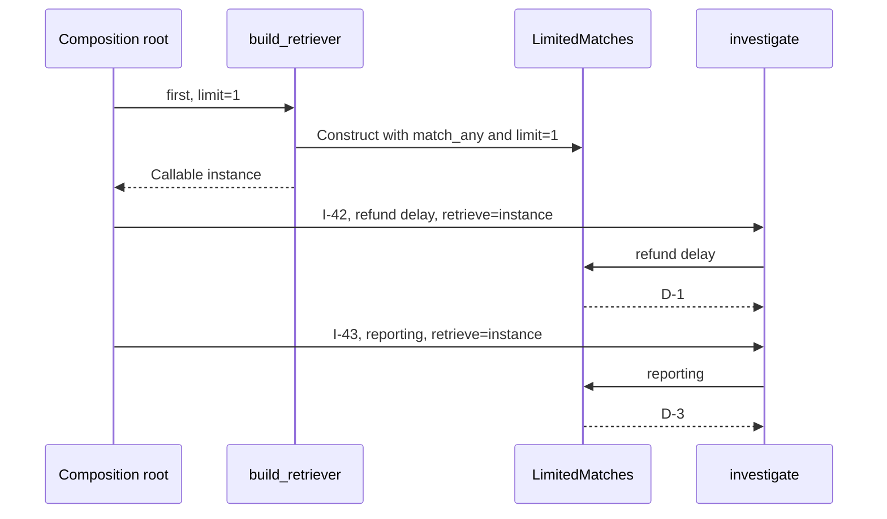

# Select retrieval behavior and construct it at the edge

> **Role:** tutorial. Read [the callable seam](01_choose_the_smallest_abstraction.md) first.
> Python 3.11+ and the standard library are enough. Commands run from the repository root.

An investigation action receives one retrieval callable. We now replace the previous lesson's
fixed responses with three actual selection policies over the same tiny document collection.
The question is how to choose a policy while keeping construction out of the action.

## Run one action with three choices

Run the [complete example](examples/selection.py):

```bash
python3 architecture/design_patterns/examples/selection.py
```

Expected output:

```text
any: I-42 -> D-1, D-2, D-3
all: I-42 -> D-2
first: I-42 -> D-1
```

The action has the same ID, query and return shape each time. Only the injected retrieval
behavior changes. All data is local and immutable; there is no database, broker or provider.
This is a deterministic selection example, not a production search engine. Authorization,
remote timeouts and resource cleanup enter only if the dependency becomes an external capability;
[ports and adapters](../hexagonal_architecture/05_design_ports_and_adapter_contracts.md) and
[runtime composition](../hexagonal_architecture/06_compose_the_runtime_at_the_edge.md) own those
continuations.

If Python reports that it cannot open the file, run the command from the repository root. If
`all` returns every ID after an edit, inspect the matching rule or selected factory; a successful
process exit alone does not establish the behavior contract.

The corpus makes each result explainable:

| Document | Text | Any word from `refund delay`? | Every word? |
|---|---|---|---|
| D-1 | refund policy | Yes: refund | No: delay is absent |
| D-2 | refund delay | Yes | Yes |
| D-3 | delay reporting | Yes: delay | No: refund is absent |

The `first` choice uses any-word matching and returns at most one ID in corpus order. It therefore
returns D-1. It does not rank D-1 as more relevant than D-2; a limit and a relevance score are
different rules.

## Strategy owns the replaceable selection rule

A **Strategy** is interchangeable behavior behind a shared caller contract. Here the contract is
`Retrieve = Callable[[str], tuple[str, ...]]`: give a query, receive selected evidence IDs. The
application action can use any strategy that keeps that meaning.

This explanatory excerpt from the example implements all-word matching:

```python
def match_all(query: str) -> tuple[str, ...]:
    words = frozenset(query.casefold().split())
    return tuple(
        document.document_id
        for document in DOCUMENTS
        if words and words.issubset(document.text.casefold().split())
    )
```

`casefold()` gives case-insensitive comparison for these words; splitting on whitespace produces
the query's tokens. `issubset` asks whether every query word occurs in a document. For D-1,
`{"refund", "delay"}` is not a subset of `{"refund", "policy"}`, so its ID is omitted. The
`words` check prevents an empty query from matching every document through the mathematical
rule that the empty set is a subset of every set. The action separately rejects blank input
before calling its collaborator.

Any-word matching instead asks whether the token sets have a nonempty intersection. Both
functions return tuples and retain no per-call state. A new strategy does not require a new
subclass because Python can pass either function directly.

The configured choice is an object because it retains two values: a retrieval callable and a
limit. Its `__call__` method makes instances callable with the same syntax as a function. This
explanatory excerpt contains the complete class body from the example:

```python
@dataclass(frozen=True)
class LimitedMatches:
    retrieve: Retrieve
    limit: int

    def __post_init__(self) -> None:
        if type(self.limit) is not int or not 1 <= self.limit <= 100:
            raise ValueError("limit must be an integer between 1 and 100")

    def __call__(self, query: str) -> tuple[str, ...]:
        return self.retrieve(query)[: self.limit]
```

For `LimitedMatches(retrieve=match_any, limit=1)`, a call first finds D-1, D-2 and D-3, then takes
the first item. The object composes existing behavior instead of inheriting the matching
algorithm. Freezing the dataclass prevents reassignment of these two attributes; it does not
make an arbitrary object stored in `retrieve` thread-safe or deeply immutable.

The constructor rejects zero, negative, excessively large and non-integer limits. The exact
`type` comparison intentionally also rejects `True`, which Python otherwise treats as an
integer for many operations. These bounds are the example's contract, not universal search
limits. `limit` is used only by the `first` mode.

Notice the mechanism's first performance limit: slicing the tuple bounds the returned IDs,
not the amount of matching work. A remote retriever must receive a provider-supported limit
or pagination contract if bounding cost is part of the promise. A wrapper around an unbounded
query cannot retroactively save work already performed.

## A factory owns construction, while a registry owns the available names

A **factory** is code that constructs or supplies a configured collaborator. A **registry** is
an explicit mapping from a known name to an implementation or factory. Neither requires a
framework.

The example's factory function has this full body; its types and implementations are defined
earlier in [selection.py](examples/selection.py):

```python
def build_retriever(mode: str, *, limit: int = 1) -> Retrieve:
    factories: dict[str, Factory] = {
        "any": lambda: match_any,
        "all": lambda: match_all,
        "first": lambda: LimitedMatches(retrieve=match_any, limit=limit),
    }
    try:
        factory = factories[mode]
    except KeyError:
        raise ValueError("mode must be one of: all, any, first") from None
    return factory()
```

`Factory` means a zero-argument callable returning a retrieval callable. The two calls therefore
happen at different times. `factory()` obtains the strategy during construction. Later,
`retrieve(query)` executes that strategy for an investigation. The lambdas in this small mapping
are factories; storing `LimitedMatches(...)` directly as a value would construct it while
building the mapping, even if another mode were selected.

An unknown name raises a configuration error. Silently falling back to any-word matching could
broaden results when the operator intended all-word matching, so this example fails explicitly.
The registry is an allowlist. Do not turn an untrusted request string into an arbitrary Python
import path. If a product permits users to choose modes, validate and authorize that choice
at its input boundary; a registry by itself supplies no authorization policy.

There is little benefit in a mapping when two branches are clearer as an `if` statement. Use a
registry when named choices are a useful explicit set, not as a requirement of the Factory name.

Some pattern literature uses more specific names. A **simple factory** such as `build_retriever`
selects construction in ordinary code. **Factory Method** uses an overridable creation method so
subclasses choose a product. **Abstract Factory** exposes creation operations for a family of
compatible products. This example needs neither subclass-controlled construction nor a family
of products, so it does not introduce those structures.

## Separate construction time from request time

The **composition root** is the process edge where concrete collaborators are assembled. The
example's `demo()` plays that role for one short-lived command. A server would normally construct
its chosen reusable collaborator during startup, then pass it explicitly for each request.
The action continues to be an ordinary function; no service locator or prebound action object
is needed. [Cosmic Python's bootstrapping discussion](https://www.cosmicpython.com/book/chapter_13_dependency_injection)
explains why one assembly point keeps construction knowledge out of use cases.

This diagram separates the one construction decision from two later invocations:



The retained configuration is the same for I-42 and I-43. Their local token sets and result tuples
are different. Reusing the object is safe for this implementation because the matching functions
only read the immutable corpus and the object does not store requests or results.

If a future implementation stores a request's tenant identity on that shared object, another
request can overwrite or reuse it. Keep identity as explicit invocation data, or create an
appropriate per-request collaborator. Likewise, sharing a process-lifetime database pool is
different from sharing one mutable transaction between concurrent requests. The
[runtime composition lesson](../hexagonal_architecture/06_compose_the_runtime_at_the_edge.md)
explains startup failure, cleanup and the lifetime boundaries of real clients and transactions.

Moving a slow blocking network call into a callable does not make it asynchronous. A synchronous
strategy and an async strategy have different invocation contracts: the latter returns an
awaitable that its caller must await. Introduce that contract deliberately when moving to
[async application capabilities](../hexagonal_architecture/02_build_one_vertical_slice.md).

## Keep registration explicit as import behavior evolves

A decorator can populate a global registry when a module is imported. That creates an additional
condition: the module body must have executed before someone reads the registry. A missing entry
may then mean either unsupported configuration or an implementation module that was never loaded.

**GA, checked 2026-10-30:** Python 3.15 supports explicit lazy imports. Opting into laziness can
delay module execution and its registration side effects until an imported name is used. Ordinary
eager imports retain their existing behavior. See the
[3.15 release notes](https://docs.python.org/3.15/whatsnew/3.15.html) and
[PEP 810's side-effect discussion](https://peps.python.org/pep-0810/#how-do-lazy-imports-affect-modules-with-import-time-side-effects).

The local factory mapping above names its dependencies directly and is built when called. If
registration is required in a larger plugin system, make loading and registry verification explicit
startup work. This example uses no lazy-import syntax and stays compatible with Python 3.11+.

## Verify the behavior that selection is meant to preserve

After running the baseline, execute its contract checks:

```bash
python3 architecture/design_patterns/examples/selection.py --check
```

Expected output:

```text
unknown mode rejected: mode must be one of: all, any, first
invalid limits rejected
empty input rejected before retrieval
strategy contracts and request isolation verified
```

The checks compare selected IDs for the same query, verify empty-result and case-handling behavior,
reject invalid configuration, prove invalid action input never reaches retrieval, and call a
shared strategy with different requests before checking the original result again. These establish
the local semantic contract. They do not establish quality, authorization or cost guarantees for
a real search provider.

When shipping a configurable strategy, record its safe name and configuration version with
aggregate result-count and latency measurements. Do not log raw investigation queries merely to
diagnose selection. A sudden change in empty-result rate after a configuration rollout is a reason
to compare the selected strategy and restore the previous validated configuration. Before changing
providers, extend contract tests to include translated failure and response behavior in the
[adapter lesson](03_adapt_translate_and_simplify.md).

## Recap

- Strategy lets one action use different selection rules through the same behavioral contract.
- A function carries stateless behavior; a callable object can retain stable configuration.
- A factory obtains the collaborator; a registry maps permitted names to construction choices.
- Construction lifetime and request lifetime are separate decisions, even with explicit injection.
- A result limit applied after retrieval does not bound upstream work or provider cost.

## Check yourself

**Q: Replace `lambda: LimitedMatches(...)` in the registry with `LimitedMatches(...)`. What
changes?**

<details><summary>Answer</summary>

Construction happens as the dictionary is created, even if another mode is selected. The entry
also stops matching the registry's factory contract: calling it with no arguments now attempts a
retrieval call without a query. A registry of instances can be valid, but its consumer must return
an instance directly and its construction/lifetime policy must be deliberate.

</details>

**Q: A future retriever returns ten million IDs and `LimitedMatches(limit=1)` keeps the first one.
Has the limit protected retrieval cost?**

<details><summary>Answer</summary>

No. The underlying call has already produced its whole tuple before slicing starts. Push a
limit or pagination contract into that retrieval operation if bounding upstream work is required.
The current limit only bounds the result returned to the action.

</details>

**Q: An injected strategy writes every result into `self.last_result`. Does passing it explicitly
prove that concurrent requests are isolated?**

<details><summary>Answer</summary>

No. Injection establishes the source of the dependency. Both requests can still hold the same
object and mutate the same attribute. Keep per-call results local; if retained mutable state is
necessary, define its owner, synchronization and lifetime separately.

</details>

## Try it: limit only documents matching every query word

Add a `first_all` factory choice that returns at most one all-word match. Keep the `investigate`
function unchanged. The constructor already accepts a retrieval callable; choose which one to
supply. Predict the result for `refund delay` before running the changed program.

<details><summary>Worked solution</summary>

Immediately after the local factory mapping is created, before the lookup, add this assignment
(an explanatory excerpt):

```python
factories["first_all"] = lambda: LimitedMatches(retrieve=match_all, limit=limit)
```

Also include the new name in the configuration error message and the demo's list of modes.
All-word matching first returns only D-2, then the limit preserves that one ID. The new line is
`first_all: I-42 -> D-2`. By contrast, `first` returns D-1 because it limits the broader any-word
result. The action does not change: composition selects which behavior is limited.

</details>
