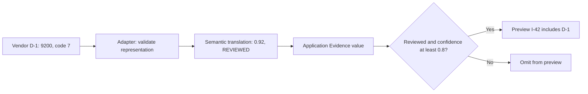

# Translate a vendor's interface without inheriting its model

> **Role:** tutorial. Read [callable contracts](01_choose_the_smallest_abstraction.md) and
> [behavior selection](02_select_behavior_and_build_dependencies.md) first. Python 3.11+ and the
> standard library are enough; commands run from the repository root.

Investigation I-42 now gets evidence from a vendor. The vendor returns a case reference, a numeric
review code and confidence in basis points. The application wants reviewed evidence with confidence
of at least 0.8. Putting `review_code == 7` in every caller would make the vendor's vocabulary part
of each business decision. We need to locate that interpretation before adding more consumers.

## Run one translated investigation preview

Run the [complete local example](examples/boundaries.py):

```bash
python3 architecture/design_patterns/examples/boundaries.py
```

Expected output:

```text
preview: I-42 -> D-1
translation: 9200 -> 0.92; 7 -> reviewed
unknown status rejected: unsupported review code
```

The example uses public, deterministic fixture data. It makes no network call and saves no state.
Its preview selects evidence; it does not promise an accepted or durable investigation. Real client
lifetimes and external-call controls belong to [runtime composition](../hexagonal_architecture/06_compose_the_runtime_at_the_edge.md)
and [bounded provider calls](../../fundamentals/fastapi/safe_and_scalable_api_calls/README.md).
If the file cannot be opened, run from the repository root. If D-2 appears in the result after an
edit, inspect review-state mapping and eligibility; successful execution alone is not enough.

These are the vendor records returned for `refund delay`:

```json
[
  {"case_ref": "D-1", "snippet": "refund policy", "confidence_bp": 9200, "review_code": 7},
  {"case_ref": "D-2", "snippet": "refund delay", "confidence_bp": 9900, "review_code": 2}
]
```

For this **fictional vendor contract**, code 7 means a human review has completed, code 2 means
review is pending, and one basis point is 1/10,000 of the confidence scale. These meanings are
assumptions of the fixture, not universal status codes. D-1 becomes reviewed evidence at 0.92;
D-2 becomes pending evidence at 0.99. Only D-1 satisfies both application conditions.

## Adapter changes the interface presented to the caller

An **Adapter** makes an available interface usable through the interface its caller expects. The
vendor takes a keyword named `phrase` and returns raw dictionaries. The application-facing
`EvidenceReader` accepts a query and returns a tuple of typed `Evidence` values. This is a richer
contract than chapter 2's ID-only retriever because the preview must now inspect review state and
confidence. It is a deliberate contract change, not an invisible substitution of incompatible data.

This explanatory excerpt shows the adapter's complete body; the types and translation function
are defined in [boundaries.py](examples/boundaries.py):

```python
def read_vendor_evidence(query: str, *, search: VendorSearch) -> tuple[Evidence, ...]:
    try:
        records = search(phrase=query)
    except TimeoutError:
        raise EvidenceUnavailable("evidence lookup timed out") from None
    if not isinstance(records, list) or any(not isinstance(row, dict) for row in records):
        raise InvalidVendorResponse("invalid evidence collection")
    return tuple(translate_record(row) for row in records)
```

The adapter owns the call shape and the response boundary. It rejects a malformed collection,
then translates every record before returning any result. That all-or-error policy prevents a
partially interpreted batch from looking like a complete search result. A different product could
permit partial results, but the port would need to expose completeness explicitly.

The adapter also translates a known transport timeout into `EvidenceUnavailable`, an exception
whose meaning belongs to the application. An unsupported field or status becomes
`InvalidVendorResponse`, which tells the application that retrying the same response is unlikely
to help. An unrelated programming exception is not relabelled as a dependency outage. In a real
SDK integration, catch the specific documented timeout class for that SDK.

The safe exception text contains no vendor message or response body. `from None` suppresses the
underlying exception's display in ordinary chained tracebacks; diagnostic tooling must still avoid
logging raw payloads or inspecting sensitive exception context indiscriminately. The broader
[port-contract lesson](../hexagonal_architecture/05_design_ports_and_adapter_contracts.md) explains
which failure distinctions deserve to cross the boundary.

[Cockburn's original ports-and-adapters description](https://alistair.cockburn.us/hexagonal-architecture)
places this technology translation outside application policy. A directory called `adapters`
helps locate it; caller-owned success and failure meanings make the boundary useful.

## An Anti-Corruption Layer preserves meaning, not just field names

Renaming `case_ref` to `evidence_id` adapts a representation. Dividing confidence by 10,000 and
interpreting a review code translate semantics: the units and states mean something different on
each side. An **Anti-Corruption Layer** protects an internal model from another system's meanings.
It can be implemented by a few translation functions inside an adapter. It need not be a separate
service or an extra package around every integration.

This is the central translation excerpt:

```python
# Explanatory excerpt; record shape and text fields are checked earlier in translate_record.
STATUS_MAP = {2: ReviewStatus.PENDING, 7: ReviewStatus.REVIEWED}

if type(score) is not int or not 0 <= score <= 10_000:
    raise InvalidVendorResponse("invalid confidence basis points")
if type(review_code) is not int or review_code not in STATUS_MAP:
    raise InvalidVendorResponse("unsupported review code")
```

After those checks, construction uses `confidence=score / 10_000` and
`review_status=STATUS_MAP[review_code]`. The integer check intentionally rejects booleans, which
Python otherwise treats as integer-like values. The range check prevents 12,000 from becoming a
trusted confidence of 1.2. The explicit status map prevents a new code, such as 99, from silently
becoming reviewed evidence.

Follow the same record through the translation and decision:



The adapter translates what the vendor says; the application decides whether that meaning is
eligible. If product policy changes its threshold from 0.8 to 0.9, the vendor scale remains the
same. If the vendor changes from basis points to percentages, the threshold remains the same
while the translation changes. Keeping those owners separate prevents one change from silently
altering the other.

A deeper semantic mismatch cannot always be mapped. Suppose the vendor redefines code 7 to mean
“machine checked,” while the application requires human review. Renaming it to `REVIEWED` would
now invent an assurance the vendor did not provide. The integration must obtain the missing fact,
expose a distinct state or reject that capability. An interface cannot manufacture equivalence.
This is the concern addressed by [Microsoft's Anti-Corruption Layer guidance](https://learn.microsoft.com/en-us/azure/architecture/patterns/anti-corruption-layer),
checked 2026-10-30.

## A Facade simplifies a subsystem's public operation

A second caller should not have to remember the sequence “retrieve, apply eligibility, collect
IDs” just to preview an investigation. A **Facade** provides a simpler supported entry point over
that subsystem. Here it is a plain function with explicit dependencies:

```python
# Explanatory excerpt; Preview, EvidenceReader and eligible are defined in boundaries.py.
def preview_investigation(
    investigation_id: str, query: str, *, read: EvidenceReader,
) -> Preview:
    if not investigation_id.strip() or not query.strip():
        raise ValueError("investigation_id and query must be nonempty")
    candidates = read(query)
    return Preview(
        investigation_id,
        tuple(item.evidence_id for item in candidates if eligible(item)),
    )
```

The facade gives callers one application-level question: which evidence can this investigation
preview? `eligible` owns the pure business rule. The reader owns obtaining and translating the
evidence. `preview_investigation` coordinates those steps and returns a small result. It is also
an application-service boundary; a function can play that role without a service class.

The baseline builds its reader with `partial(read_vendor_evidence, search=fake_search)`.
`functools.partial` retains the supplied keyword argument, leaving the query to be supplied later.
It is explicit construction like the configured callable in chapter 2, not a global lookup.
Passing a different compatible reader changes the evidence source without changing the facade.

A facade does not inherently fix vendor coupling. If it returns the original dictionaries, callers
still need `review_code` and `confidence_bp`. Conversely, an adapter may translate one interface
without simplifying the overall use case. These intentions can coexist in one small function, but
naming the intention helps decide which code should change:

| Change | Responsible boundary | What stays stable |
|---|---|---|
| Vendor changes `phrase` to `search_text` | Adapter call shape | Application's query argument |
| Vendor changes confidence units | Semantic translation / Anti-Corruption Layer | Application's 0–1 scale |
| Product changes reviewed-evidence threshold | Application eligibility rule | Vendor decoding |
| Callers need one operation instead of several internal steps | Facade | Supported application result |

Do not add an adapter when two local interfaces already match and there is no translation to own.
Do not add a facade that only forwards an already simple function unless it creates a real public
ownership boundary. An Anti-Corruption Layer is useful when semantics differ; a new folder alone
cannot demonstrate that need.

## Test the interpretation before swapping implementations

Run the local contract checks:

```bash
python3 architecture/design_patterns/examples/boundaries.py --check
```

Expected output:

```text
invalid values and unknown meanings rejected
scale boundaries and reviewed-only eligibility verified
known timeout translated without exposing vendor message
facade accepts a different reader without vendor fields
```

These checks use scale boundaries, invalid values and pending review to verify business meaning.
A test that only asserts “the adapter returned an `Evidence` object” could miss a score multiplied
by 100 or a pending record incorrectly treated as reviewed.

When replacing a real vendor, retain contract fixtures for documented responses and failure cases,
then exercise the actual adapter against a controlled integration environment. The local fake does
not verify SDK behavior, network deadlines, authentication or access filtering. With tenant data,
query authorization must be part of the capability contract; hiding an SDK does not authorize
its results.

Watch translation-rejection rates, dependency latency and empty-result changes by adapter version.
A rise in `unsupported review code` after a provider update is a compatibility incident, not a
reason to silently default to reviewed. Preserve the previous compatible adapter/configuration for
rollback, confirm the new semantics, update mapping fixtures, then release the new mapping. Do not
record raw evidence text, credentials or full vendor responses in ordinary logs.

## Recap

- The adapter reconciles the caller's interface with the vendor's call and response shapes.
- Semantic translation preserves units and review meaning; it cannot invent missing assurances.
- The application owns its eligibility threshold after translation into its own model.
- A facade exposes one useful operation without requiring callers to coordinate subsystem steps.
- Unknown meaning is a contract failure, while a known timeout is a distinct availability failure.

## Check yourself

**Q: The vendor returns `review_code=99` with confidence 10,000. Should the application accept it
because confidence is maximal?**

<details><summary>Answer</summary>

No. Confidence and review status are independent facts. The translation has no supported meaning
for code 99, so it rejects the record before eligibility runs. Guessing reviewed would allow an
unknown external state to satisfy a business prerequisite.

</details>

**Q: A new facade returns the raw vendor dictionaries. Can callers now ignore the vendor model?**

<details><summary>Answer</summary>

No. They still need to interpret numeric codes and units. The facade may simplify invocation, but
semantic coupling remains until a boundary translates the representation into application meaning.

</details>

**Q: The vendor changes code 7 from human reviewed to machine checked. Can updating the field name
preserve the current application contract?**

<details><summary>Answer</summary>

No. The required fact has changed, not merely its spelling. The adapter must obtain reliable human
review evidence, expose another supported outcome, or reject the capability. Keeping the same
Python type cannot preserve an assurance the external system no longer provides.

</details>

## Try it: translate a rejected review without weakening eligibility

The vendor documents code 4 as “human review rejected.” Add `REJECTED` to `ReviewStatus` and map
code 4 to it. Keep the existing `eligible` function unchanged. What should the preview do with a
code-4 record at confidence 10,000? Use the existing record as a fixture and vary only those fields.

<details><summary>Worked solution</summary>

Add `REJECTED = "rejected"` to the enum and `4: ReviewStatus.REJECTED` to `STATUS_MAP`.
The translated value is meaningful, so it need not raise `InvalidVendorResponse`. However,
`eligible` requires the exact `REVIEWED` state, so it returns false even at confidence 1.0.
This preserves the distinction between a known negative outcome and an unknown response shape.
Assert both the translated status and the false eligibility result. The facade remains unchanged.

</details>
