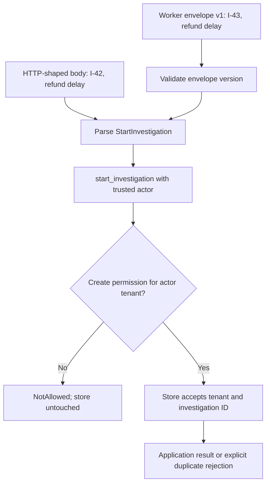

# Give a requested operation one application handler

> **Role:** tutorial. Read [explicit collaborators](01_choose_the_smallest_abstraction.md) and
> [construction at the edge](02_select_behavior_and_build_dependencies.md) first. Commands run
> from the repository root with Python 3.11+ and the standard library.

A route and a worker can both request an investigation about `refund delay`. If each entry point
implements authorization, duplicate handling and persistence separately, one may accept a request
the other rejects. Give the requested operation one owner. Represent its input as a value and let
both entry points invoke the same application function with their explicit collaborators.

## Run the same use case through two entry points

Run the [complete example](examples/commands.py):

```bash
python3 architecture/design_patterns/examples/commands.py
```

Expected output:

```text
http: 201 I-42
worker: accepted I-43 for acme
duplicate: 409; stored records: 2
```

These are HTTP-shaped and worker-shaped Python functions, not a running server or queue. They
receive already decoded dictionaries and a trusted fixture actor. The store is a sequential,
in-memory fake. It demonstrates invocation and explicit rejection; it provides no durability,
database isolation, broker acknowledgement or real authentication. The
[API/worker implementation lesson](../hexagonal_architecture/07_apply_the_pattern_to_apis_and_workers.md)
and [minimal durable task](../../background_work/foundations/03_minimal_durable_task.md) own those
continuations.

The first call creates I-42 and the second creates I-43. Repeating I-42 is rejected under this
example's duplicate policy, so the store still contains two records. If an edit produces three
records, inspect the duplicate policy and key. If the file cannot be opened, run from the
repository root.

## Command data represents intent, not an accomplished fact

A **command** asks an owner to perform an operation. `StartInvestigation` says what the caller
wants; it does not prove the investigation was accepted. The command can fail validation, be
refused by authorization, or conflict with existing state. An event named `InvestigationStarted`
would instead describe something that has already happened.

The example's command shape is:

```python
# Explanatory excerpt: validation is implemented by __post_init__ in commands.py.
@dataclass(frozen=True)
class StartInvestigation:
    investigation_id: str
    query: str
```

The complete constructor checks types, rejects blank or padded IDs, bounds the ID to 64 characters,
and rejects blank queries or queries longer than 5,000 characters. These are local example limits,
not framework defaults. They apply to direct application callers as well as transport parsing.
Annotations alone would not enforce them. Both fields are strings, so the frozen value has no
nested mutable request collection to leak between invocations.

A command groups meaningful use-case input rather than arbitrary function arguments. It can be
stored, compared, logged selectively or carried to a handler without tying the action to an HTTP
request object. It should not contain a live database session, SDK client or a closure that only
makes sense in the current process.

The classical object-oriented Command pattern packages a request with executable behavior, often
through an `execute()` method. A backend commonly separates the request data from its handler so
transport data can be decoded independently of runtime dependencies. This chapter uses that
message-plus-handler form. Neither form automatically supplies persistence, retries, cancellation
or undo. [Cosmic Python's command chapter](https://www.cosmicpython.com/book/chapter_10_commands)
develops intent versus fact and single-owner command handling; the pattern does not require its
particular message-bus implementation.

## A plain function can own the application operation

The **handler** is the application operation that interprets the command and coordinates its
collaborators. Here it is one function; no state requires a handler class:

```python
# Explanatory excerpt from commands.py; the port's atomicity contract is discussed below.
def start_investigation(
    command: StartInvestigation, *, actor: Actor, store: InvestigationStore,
) -> AcceptedInvestigation:
    if not actor.tenant_id or "investigations:create" not in actor.permissions:
        raise NotAllowed("investigation creation is not permitted")
    return store.accept(tenant_id=actor.tenant_id, command=command)
```

`Actor` is a trusted context value containing the subject, tenant and resolved permissions.
`InvestigationStore` is an application-facing Protocol: its `accept` operation must create one
record for a tenant/ID pair or reject an existing pair. The handler checks authority before invoking
that capability, and obtains tenant identity from the trusted actor rather than the submitted body.
The concrete store owns the atomic persistence operation; the handler is still the catalog entry
point through which callers request the use case.

Trace both entry points into that shared owner:



The two transports differ in input/output representation. The authorization and acceptance
operation are the same. A single handler does not mean one running process: many processes may
execute the same application function, so the real store must enforce its uniqueness contract
across those processes.

This is also an **application-service boundary**: the public operation an entry point can invoke.
The term describes responsibility, not a mandatory `Service` class. When an operation grows, keep
business decisions in their natural domain owner and give the handler the collaborators it needs.
A generic handler that receives an unrestricted container and looks up arbitrary services hides
those dependencies again.

## Transport input cannot grant itself authority

Consider an HTTP body with an extra `"tenant_id": "victim"` field. If the handler copied that value
into the storage key, a caller authorized for tenant `acme` could try to write into another tenant.
The example rejects unknown payload fields and supplies tenant identity through a separate actor
argument. A body field named `permissions` likewise has no authority.

The trusted actor is constructed directly only because this is a local teaching fixture. A real
route obtains it from validated identity and authorization resolution. A real worker resolves
execution authority from a trusted acceptance record or a properly authenticated message contract;
merely receiving a message from a queue does not establish the original user's permissions.
The [background authorization lesson](../../background_work/operations/01_security_and_authorization.md)
owns that longer-lived boundary.

The command describes **what** is requested; trusted context establishes **who may request it**.
Whether authorization is evaluated at acceptance, execution or both is a business/security contract
for durable work. Keeping a separate argument makes that choice visible; an `Actor` dataclass alone
is not an authentication mechanism.

## One failure can have different transport representations

The handler returns `AcceptedInvestigation` or raises a named application exception. The HTTP-shaped
entry point translates those outcomes; the worker-shaped entry point leaves them for its caller:

| Application outcome | HTTP-shaped result in the example | Worker-shaped result |
|---|---|---|
| Accepted record | `201` with investigation ID | `AcceptedInvestigation` value |
| Invalid input | `400`, `invalid_command` | `InvalidCommand` exception |
| Missing create authority | `403`, `not_allowed` | `NotAllowed` exception |
| Existing tenant/ID pair | `409`, `already_exists` | `AlreadyExists` exception |

The example's `201` reflects record creation, not completed analysis or durable task submission.
In an asynchronous API, an accepted work contract may use `202`; the status must match what was
actually made durable. HTTP response formatting belongs at the transport boundary, so a worker
never needs an HTTP exception class to understand rejection.

A worker consumer must distinguish a permanent rejected command from a transient dependency
failure. Repeatedly retrying an unsupported schema or missing permission is unlikely to repair it.
The broker's settlement and dead-letter policy is outside this local function; define that policy
in the [worker and recovery path](../../background_work/reliability/05_reconciliation_dlq_and_observability.md).
Unexpected programming failures should remain distinguishable rather than being converted into
successful acknowledgements or a misleading `already_exists` result.

## A command needs an explicit wire contract before it crosses a process

The worker-shaped example accepts this envelope:

```json
{
  "schema_version": 1,
  "payload": {"investigation_id": "I-43", "query": "refund delay"}
}
```

The entry point accepts only version 1 and the two expected payload fields, then constructs the
same command value as the HTTP entry point. Unknown versions fail before any store call. This
makes a representation change visible: adding a new required field may require supporting both
versions during a rollout, rather than deserializing whatever fields happen to match today's
constructor.

The JSON envelope is a boundary format, while the dataclass is an internal value. A dataclass is
not automatically a safe serializer, and sending a Python pickle to another process does not
create a trusted contract. For actual delivery, define message size, identity/provenance,
compatibility and retained failure handling through the
[message-contract lesson](../../infrastructure/messaging/05_message_contracts_and_outbox.md).

Keep command dispatch explicit while the set is small. An entry point can call
`start_investigation(...)` directly. A registry mapping validated command types to handlers becomes
useful when a shared consumer actually receives several operations, but it adds no durability and
must not let untrusted input choose arbitrary imports or methods.

## Transaction ownership belongs to a capability, not the command name

`MemoryStore` first checks `(tenant_id, investigation_id)`, then inserts a result into a dictionary.
That is enough for this single-threaded example. It is not proof of atomic uniqueness in concurrent
workers: two actors can both observe absence before either writes. A production store must enforce
its promise with the database's constraints and transaction behavior.

The current architecture convention favors a cohesive operation such as `store.accept(...)` when
one store can complete the read/decision/write transition atomically. A **Repository** exposes
persistence through a domain-oriented access contract. A **Unit of Work** gives several related
persistence operations one commit/rollback owner when the application genuinely needs to coordinate
them. Neither abstraction requires one repository per table or an extra class for this handler.
The [port and transaction-owner lesson](../hexagonal_architecture/05_design_ports_and_adapter_contracts.md)
contains the full alternatives and their concurrency reasoning.

Now suppose acceptance must also publish a request to a worker. A database commit followed by a
broker send can fail between the two. Putting both calls inside a command handler does not close
that window. Record publication intent atomically with acceptance and recover delivery through
an [outbox](../../background_work/reliability/01_atomic_transitions_and_outbox.md). The command is a
useful unit of intent; durable state and recovery rules supply the guarantee.

Duplicate execution also needs a chosen contract. This example rejects duplicates. If callers
instead need retry-safe replay of the original result, introduce a stable operation key, verify
that repeated input has the same meaning, and store/retrieve the result under a durable policy.
See [idempotency and external effects](../../background_work/reliability/03_idempotency_and_external_effects.md).
An immutable command or an ID field alone does not make remote effects happen only once.

## Verify the shared decision, then harden its real boundaries

Run the semantic checks:

```bash
python3 architecture/design_patterns/examples/commands.py --check
```

Expected output:

```text
invalid input, forged context and denied callers reach no store operation
entry points produce the same application result in fresh stores
unknown command schemas rejected before execution
duplicate policy and tenant-scoped identifiers verified
```

The checks verify that rejected requests never call the store, compare both entry points against
fresh stores, reject unknown versions and exercise duplicate/tenant key behavior. They demonstrate
the handler contract with a sequential fake. A real database test must verify uniqueness under
concurrent requests and recovery around commit; a live worker test must verify settlement after the
business outcome becomes safe.

Operationally, measure outcomes by command type, schema version and stable rejection reason.
Trace a safe correlation identifier through the entry point, handler and persistence call. Avoid
logging raw query text or full commands. A spike in invalid-schema rejections after a consumer
rollout suggests producer/consumer incompatibility; restore the prior compatible consumer or deploy
a translator before replaying retained messages. A spike in duplicate conflicts needs examination
of caller retry behavior and operation keys, not a blanket switch to success responses.

When acceptance triggers independent reactions, continue to
[local events and dispatch](../event_driven_architecture/02_local_events_and_dispatch.md). When the
status/dashboard view needs a different representation from writes, continue to
[CQRS with one database](../event_driven_architecture/03_cqrs_read_and_write_models.md). Neither follows
automatically from introducing a command object.

## Recap

- A command carries a requested operation; it can still be invalid, unauthorized or conflicting.
- One plain application handler gives multiple entry points the same decision owner.
- Trusted actor context is supplied separately from untrusted command input.
- Entry points translate transport representations and failures; application semantics stay shared.
- Atomic persistence, replay and delivery require explicit guarantees beyond the command value.

## Check yourself

**Q: A worker calls the same handler as HTTP, but supplies permissions read directly from its JSON
payload. Has reuse preserved authorization?**

<details><summary>Answer</summary>

No. The handler assumes its actor argument is trusted context. If the worker lets the sender invent
that context, the trust boundary is broken before the shared function runs. Resolve authority from
the authenticated message contract or durable acceptance record, then call the handler.

</details>

**Q: A command contains an investigation ID and is a frozen dataclass. Will a second delivery be
harmless?**

<details><summary>Answer</summary>

Not automatically. Freezing prevents ordinary field reassignment, not execution. This example
rejects an existing tenant/ID pair, while a different store could repeat an effect. Retry-safe
replay requires a documented durable policy that binds the key to the same operation and result.

</details>

**Q: Two workers both check that I-42 is absent, then insert it. Does a Protocol promising one
record prevent the race?**

<details><summary>Answer</summary>

No. The Protocol states the obligation; the implementation must enforce it. Use database-enforced
uniqueness and appropriate transaction handling, then test concurrent attempts against that store.
The sequential dictionary fake cannot establish the production concurrency guarantee.

</details>

## Try it: preserve rejection across another entry point

Add a small CLI-shaped function accepting an ID and query plus keyword-only `actor` and `store`
arguments. It should construct `StartInvestigation` and call the same handler. Do not duplicate the
permission check. Predict what happens with the denied fixture actor, and verify that store call
count stays zero.

<details><summary>Worked solution</summary>

This is an explanatory excerpt to add after the handler in `commands.py`:

```python
def cli_entry(
    investigation_id: str, query: str, *, actor: Actor, store: InvestigationStore,
) -> AcceptedInvestigation:
    command = StartInvestigation(investigation_id, query)
    return start_investigation(command, actor=actor, store=store)
```

With a denied actor, `NotAllowed` propagates and the store is untouched. With an allowed actor and a
fresh store, the result matches the HTTP and worker application result. A real CLI may catch the
exception to print a safe message and choose a nonzero exit code; that presentation decision does
not belong inside the shared handler.

</details>
