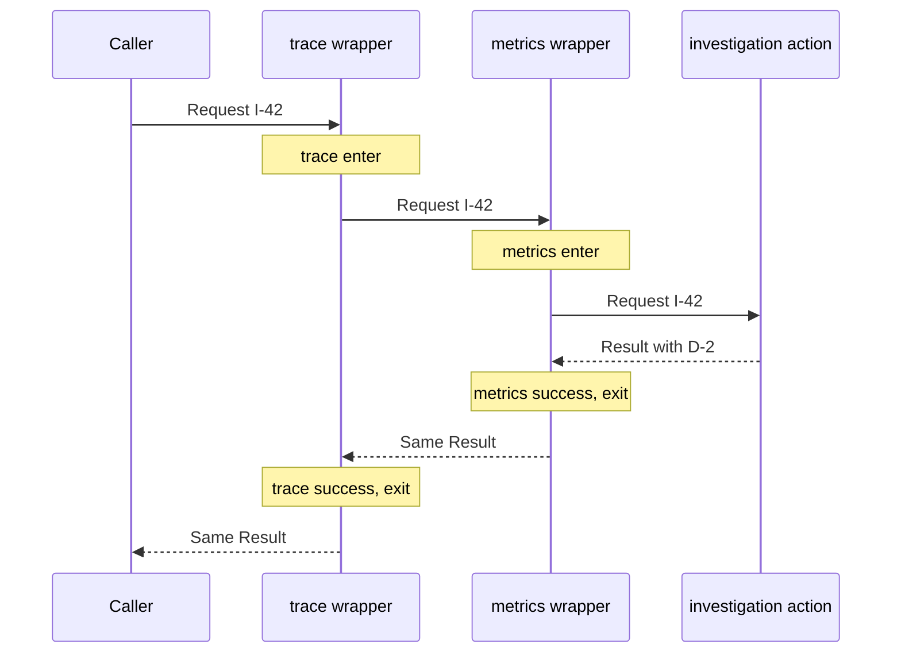
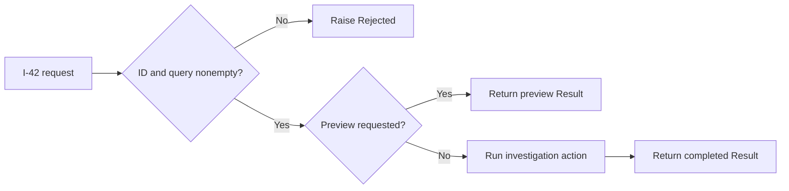

# Wrap an operation and decide when a chain should stop

> **Role:** tutorial. Read [selection and construction](02_select_behavior_and_build_dependencies.md)
> first. The baseline is synchronous Python 3.11+ with no framework or external service.

Investigation I-42 now needs two kinds of surrounding behavior. Instrumentation must observe the
operation before and after it runs. A preview request must return without executing the operation.
Both involve calling other functions, but they have different control-flow contracts: a wrapper
surrounds a call, while a chain step can decide that no later call should happen.

## Run the successful call and the early exit

From the repository root, run the [complete local example](examples/wrappers.py):

```bash
python3 architecture/design_patterns/examples/wrappers.py
```

Expected output:

```text
wrapped: completed I-42 -> D-2
trace:enter | metrics:enter | action | metrics:success | metrics:exit | trace:success | trace:exit
preview: preview I-42
chain: validate | preview
rejected: investigation_id and query must be nonempty
chain: validate
```

The first invocation reaches the action and returns D-2. The preview invocation stops before the
action. The invalid preview stops even earlier, at validation. These are deterministic local
traces, not production telemetry. The action uses a fixed evidence fixture; the list collecting
trace labels belongs to this demonstration and is cleared between invocations.

If `action` appears in the preview trace, the chain forwarded a handled request. If a blank query
produces a preview result, the chain order allowed preview handling to bypass validation. Those
observable failures distinguish a useful chain test from merely checking that each function exists.

## A wrapper keeps the call contract while adding behavior

A **Decorator** in design-pattern vocabulary adds behavior around a collaborator while preserving
the interface through which the caller uses it. Python function wrappers can express that intent
without an object hierarchy. Here an `Action` accepts a `Request` and returns a `Result` before
and after wrapping.

This explanatory excerpt is the complete wrapper factory from the example. `trace` records only
fixed labels; it never receives the query, a credential or a provider response:

```python
def instrument(label: str, trace: list[str]) -> Callable[[Action], Action]:
    def decorate(inner: Action) -> Action:
        @wraps(inner)
        def wrapped(request: Request) -> Result:
            trace.append(f"{label}:enter")
            try:
                result = inner(request)
            except Exception:
                trace.append(f"{label}:error")
                raise
            else:
                trace.append(f"{label}:success")
                return result
            finally:
                trace.append(f"{label}:exit")
        return wrapped
    return decorate
```

There are three times to distinguish. `instrument("trace", trace)` chooses configuration and
returns a decorator. Applying that decorator to `inner` returns `wrapped`. Only calling the
returned wrapper executes the entry label and the investigation.

The `else` block runs only after `inner` returns normally. An ordinary application exception caught
by `except Exception` therefore produces an error label, not a success label. The bare `raise` preserves the original exception. The `finally`
block records exit on either route; it does not turn a failure into a result. A real cleanup
operation placed there must avoid masking the original error with an unrelated cleanup failure.

`functools.wraps` copies useful metadata and makes the original callable available through
`__wrapped__`. Otherwise two wrappers might both appear as `wrapped` in tools that inspect their
names. Metadata preservation does not prove that a wrapper forwards arguments, returns results
or propagates exceptions correctly; those behaviors still require tests.
[Python's functools reference](https://docs.python.org/3.14/library/functools.html#functools.wraps),
checked 2026-10-30.

## Python's decorator syntax is an application mechanism

The `@` syntax applies a callable to a definition and binds the returned object to that name.
A function decorator can return a wrapper, but it can also register a function and return it
unchanged. A class decorator such as `@dataclass` can transform a class. Consequently, an `@` line
alone is not evidence of the GoF Decorator's behavioral wrapping intent.

The baseline applies wrappers explicitly so construction order stays visible. This explanatory
excerpt is the relevant assignment:

```python
wrapped = instrument("trace", trace)(instrument("metrics", trace)(action))
```

The metrics wrapper is constructed around `action`, then the trace wrapper is constructed around
that result. Calling `wrapped(request)` starts at the outside. Equivalent stacked `@` syntax on a
function definition would list trace above metrics. The
[Python decorator lesson](../../fundamentals/core_concepts/language/decorators.md) owns the deeper
language mechanics and registration forms; here the design question is the behavior being added.

Follow the outer call inward and the result back outward:



The last wrapper entered finishes first because its caller is waiting for its result. Reversing
the construction order reverses which observer includes the other observer's work. An exception
also travels outward through the waiting calls; both `finally` blocks run, while neither records
success in this implementation.

For real instrumentation, this placement affects meaning. A timer outside retry logic measures
the whole logical operation, including waits and attempts. A timer inside it measures individual
attempts. Neither number is inherently wrong, but naming both simply `latency` hides a material
difference. The [resilience lesson](../resilience/01_failure_budgets_and_isolation.md) owns retry
budgets and the rule that one layer controls a physical dependency retry.

## A chain can handle, reject or forward

A **Chain of Responsibility** passes a request through candidate handlers until one accepts
responsibility or the chain ends. In this example, each step has one of three outcomes:

| Step outcome | Concrete representation | Dispatcher behavior |
|---|---|---|
| Continue | Return `None` | Try the next step |
| Handled | Return a `Result` | Return immediately |
| Rejected | Raise `Rejected` | Stop with that failure |

The explicit `None` sentinel matters. A successful result with no matching evidence is still a
handled request. Testing only whether a result is truthy could confuse a legitimate empty result
with a request nobody handled. This example's `Result` dataclass is always truthy, including when
its evidence tuple is empty; the explicit sentinel keeps the contract valid if a different
result representation is introduced later.

This explanatory excerpt is the complete dispatch loop:

```python
def dispatch(request: Request, steps: tuple[Step, ...]) -> Result:
    for step in steps:
        result = step(request)
        if result is not None:
            return result
    raise Rejected("no step handled the request")
```

`make_chain` assembles validation, preview handling and the ordinary action in that order.
Validation forwards a valid request by returning `None`. Preview returns a result only when the
request asks for a preview; otherwise it forwards. The final action handles the normal request.
Nothing in the dispatch loop knows how evidence selection works.

The diagram shows why the two early exits have different results:



For a blank query with `preview=True`, validation rejects before preview is considered. Moving
preview ahead of validation would change the contract, even if all three step implementations
remain individually correct. Treat chain order as part of behavior and test its negative path.

A pipeline usually means every applicable transformation contributes to the output in a defined
order. This chain can stop at the first handler. HTTP middleware often combines both shapes: it
surrounds a downstream call and can decline to make that call. Use the control-flow contract, not
the word middleware, to reason about a particular framework. The
[FastAPI middleware lesson](../../fundamentals/fastapi/05_middleware.md) explains ASGI ordering and
its framework-specific limits.

## Keep rejection and instrumentation out of hidden retry policies

The example lets unexpected exceptions propagate. Replacing them with an empty successful result
would make a failed investigation appear to have found no evidence. Retrying every exception
would treat invalid input like a transient outage and could repeat completed effects. Wrapping
an action does not make its effects safe to repeat.

The baseline is synchronous. An async wrapper must await the inner coroutine inside its
`try`/`finally`; timing only the creation of a coroutine object does not measure its execution.
Adding `async def` around a blocking call does not make that call nonblocking. Let cancellation
propagate after cleanup instead of turning it into an empty result or a retry. Python documents
that `asyncio.CancelledError` directly subclasses `BaseException` and that swallowing it can break
structured-concurrency behavior.
[Asyncio task cancellation](https://docs.python.org/3.14/library/asyncio-task.html#task-cancellation),
checked 2026-10-30. The [async production path](../../fundamentals/concurrency/async/02_production_patterns.md)
owns the executable async continuation.

For production wrappers, record bounded operation names, outcome categories and durations. Keep
metric labels independent of request IDs and raw queries. Diagnose a changed success/error ratio
by checking whether failure was swallowed, whether a short-circuit path was counted as executed
work, and where the wrapper sits. Version wrapper and chain order with the application; roll back
the whole configuration when its semantics regress, instead of changing individual handlers in
isolation.

## Verify order, failure and short-circuit behavior together

Run the example's checks:

```bash
python3 architecture/design_patterns/examples/wrappers.py --check
```

Expected output:

```text
wrapper entry, reverse unwind, metadata and swapped order verified
exception propagated after both cleanup paths
chain forwarding, handling, rejection and empty-result semantics verified
```

The failure test asserts that the same exception object reaches the caller after both wrappers
record exit. The chain tests prove that preview never reaches the action, invalid preview never
reaches preview handling, an empty evidence result is handled, and an exhausted chain rejects.
These are the behaviors a refactor of wrapper construction or handler order could accidentally
change.

## Recap

- A wrapper preserves the callable contract while adding behavior around execution.
- Python's `@` syntax can express wrapping, registration or other transformations.
- Calls enter wrappers from outside inward and finish in reverse order.
- A chain step explicitly forwards, handles or rejects; order determines which checks can run.
- Exceptions and cancellation retain their meaning only if surrounding code preserves them.

## Check yourself

**Q: The action raises after metrics entry. Which success labels should the baseline emit?**

<details><summary>Answer</summary>

Neither wrapper emits success. Metrics records error and exit, re-raises, then trace records error
and exit. Their `else` blocks are skipped. If trace records success, an inner wrapper swallowed
or translated the exception into a normal result.

</details>

**Q: A preview request has a blank query. Why is moving validation after preview a behavior change?**

<details><summary>Answer</summary>

Preview returns a handled result, so dispatch stops and later validation never runs. A check's
presence in the chain is insufficient; it must occur before every path that could complete the
request without it.

</details>

## Try it: observe the whole chain

The baseline instruments the ordinary action separately from preview dispatch. Change the
composition so one trace wrapper observes validation, preview and action. Supply a small callable
that invokes `dispatch(request, chain)`, then pass that callable into `instrument`. Predict the
labels for a valid preview and an invalid preview.

<details><summary>Worked solution</summary>

This explanatory excerpt belongs after `chain` has been assembled with the local `trace` list:

```python
def handle_request(request: Request) -> Result:
    return dispatch(request, chain)

observed_chain = instrument("trace", trace)(handle_request)
```

A valid preview produces `trace:enter`, `validate`, `preview`, `trace:success`, `trace:exit`.
An invalid preview produces `trace:enter`, `validate`, `trace:error`, `trace:exit`.
The wrapper now observes the whole request contract, including early termination; the action
still does not run for either preview case.

</details>
