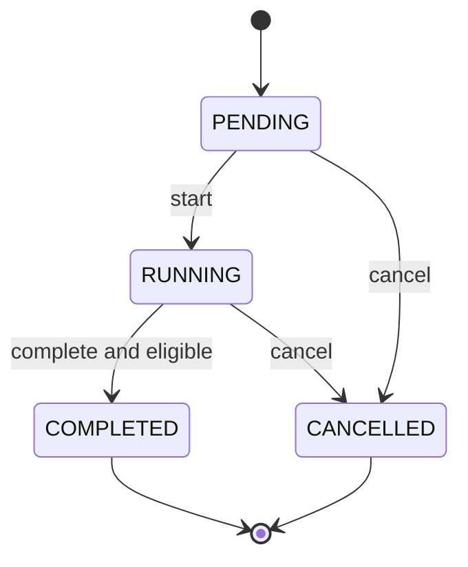
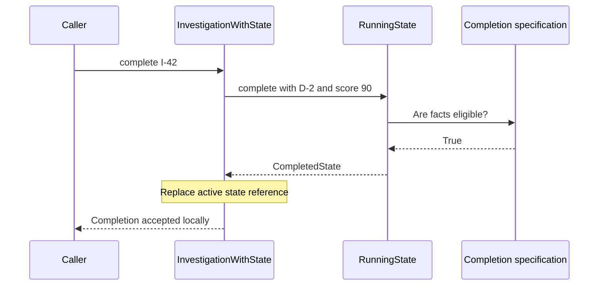

# Separate completion rules from lifecycle behavior

> **Role:** tutorial. Read [callables and configured behavior](02_select_behavior_and_build_dependencies.md)
> first. Examples use Python 3.11+ and local values; no database or workflow engine is required.

Investigation I-42 has evidence D-2 and a review score of 90. The completion rule requires at
least one evidence item and a score of 80 or more. Those facts satisfy the rule. But if someone
has cancelled the investigation, completion must still be refused.

There are two decisions to preserve: whether facts satisfy a reusable business condition, and
whether the current lifecycle permits an operation. A **Specification** expresses the first
condition. A state model expresses the second. Keeping their owners explicit prevents a high
score from accidentally reopening a cancelled investigation.

## Run the rule and the two lifecycle representations

From the repository root, run the [complete example](examples/rules.py):

```bash
python3 architecture/design_patterns/examples/rules.py
```

Expected output:

```text
eligible I-42: True
table: PENDING -> RUNNING -> COMPLETED
table after cancel: complete is illegal from CANCELLED
object running: Collect evidence, complete review or cancel.
object cancelled: No further work is permitted.
object after cancel: complete is illegal from CANCELLED
```

The table and object implementations are alternatives for representing the same local lifecycle.
The example runs both so their behavior can be compared; an application should choose one owner
for its transitions. Both reject completion after cancellation even though the evidence remains
eligible.

The score is a supplied integer in this teaching model, not a guarantee that a model-generated
answer is correct. The local example makes no provider calls, performs no authorization and keeps
no durable state. [Durable state-machine design](../../background_work/workflows/01_state_machine_design.md)
is the continuation when work must survive a process loss or concurrent command delivery.

## Start with a predicate that reads facts

A **predicate** is a function returning true or false for a candidate value. It answers a question
without performing the action whose permission is being considered. The example's frozen
`ReviewFacts` contains an evidence-ID tuple and a validated integer score from 0 through 100.
This explanatory excerpt is its simplest rule:

```python
def has_evidence(facts: ReviewFacts) -> bool:
    return bool(facts.evidence_ids)
```

For D-2, the tuple is nonempty and the result is true. For an empty tuple, it is false. Calling the
predicate does not complete, save or cancel an investigation. That matters because a caller may
ask the question during validation, display and later execution; asking twice must not perform
the operation twice.

A **Specification** gives a matching rule a reusable identity separate from the candidate it
evaluates. A named predicate is already a useful Python implementation of that idea. When a rule
retains a threshold or is combined with other rules, a small callable object can represent the
configuration explicitly. Evans and Fowler describe separating matching requirements from the
candidate and developing parameterized/composite forms in their
[Specifications paper](https://martinfowler.com/apsupp/spec.pdf).

The following explanatory excerpt shows the configured score rule's evaluation; construction in
the complete example validates that `minimum` is an integer between 0 and 100:

```python
def __call__(self, facts: ReviewFacts) -> bool:
    return facts.confidence >= self.minimum
```

`ConfidenceAtLeast(80)` evaluates the same threshold for every candidate. Changing a candidate's
score from 90 to 79 changes the answer without changing the rule object. Changing the threshold
to 95 creates a different configured rule; it should not silently rewrite a global threshold
while another request is being evaluated.

## Compose rules when the same combination has meaning

An investigation may complete only if both evidence and score requirements hold. The example
represents that combination as `AllOf`, whose complete class body is shown in this explanatory
excerpt:

```python
@dataclass(frozen=True)
class AllOf:
    rules: tuple[Rule, ...]

    def __call__(self, facts: ReviewFacts) -> bool:
        return all(rule(facts) for rule in self.rules)
```

`Rule` is `Callable[[ReviewFacts], bool]`, so a plain function and a configured object participate
in the same composition. `AllOf((has_evidence, ConfidenceAtLeast(80)))` first checks evidence,
then checks the score only if the first answer was true. Python's `all` short-circuits at the
first false value. No predicate may rely on another predicate performing a side effect first.

These values show the intermediate reasoning, including the threshold boundary:

| Evidence | Score | Evidence predicate | Score predicate | Combined result |
|---|---:|---|---|---|
| D-2 | 90 | True | True | True |
| None | 90 | False | Not evaluated | False |
| D-2 | 79 | True | False | False |
| D-2 | 80 | True | True | True |

For a single use, `has_evidence(facts) and facts.confidence >= 80` may be easier to read. The
object earns its place when named configurations or compositions are reused and passed around.
Do not build a general expression language for two fixed conditions. `AllOf(())` follows the
usual empty-conjunction rule and returns true; if rules become user-configurable, validate the
allowed composition instead of assuming an empty configuration means deny.

A predicate evaluating loaded Python objects also does not automatically become an efficient
SQL filter. Fetching every investigation before applying it can be both expensive and inconsistent
with the database's current state. The [query-performance lesson](../../fundamentals/database/11_query_performance.md)
owns query execution; a database version of a business rule needs matching semantics and its own
verification at that boundary.

## An enum names states; a transition table limits movement

A **state** describes the investigation's current lifecycle position. An enum limits the
recognized names, but does not by itself prevent assigning `COMPLETED` to a cancelled run.
A **transition** combines the current state with an event and derives an allowed next state.
The caller requests an operation; it does not choose an arbitrary target.

Here **event** is state-machine vocabulary for an input trigger. `START`, `COMPLETE` and `CANCEL`
request transitions; they do not claim that the work already happened. This differs from the
**domain event** meaning used in [command handling](04_commands_and_application_handlers.md):
a fact such as `InvestigationCompleted` describes an accepted transition. When the state is durable,
external consumers must hear that fact only after the owning transaction commits, with retained
intent if delivery must survive a crash. The [local-event lesson](../event_driven_architecture/02_local_events_and_dispatch.md)
develops that boundary.

The example uses the following small table:

| Current state | Event | Next state | Additional requirement |
|---|---|---|---|
| PENDING | start | RUNNING | None |
| PENDING | cancel | CANCELLED | None |
| RUNNING | cancel | CANCELLED | None |
| RUNNING | complete | COMPLETED | Completion specification passes |
| Any other pair | Any event | No transition | Reject |

This diagram draws the same graph and makes the terminal boundaries visible:



There is no arrow out of CANCELLED or COMPLETED in this example. A repeated completion is
therefore rejected, not silently treated as an idempotent success. If the API needs idempotent
replay, it must define that response contract explicitly; adding a terminal state does not define
it automatically.

The transition function first establishes whether a pair is legal, then evaluates any guard.
A **guard** is a condition that must hold for an otherwise legal transition. This explanatory
excerpt contains the complete function; `TARGETS` is the preceding table expressed as a dictionary:

```python
def transition(current: Investigation, event: Event, *, rule: Rule) -> Investigation:
    target = TARGETS.get((current.status, event))
    if target is None:
        reject(current.status, event)
    if event is Event.COMPLETE:
        require_completion(current.facts, rule)
    return replace(current, status=target)
```

`reject` raises `TransitionRejected`; `require_completion` raises if the specification is false.
Only after both checks pass does `replace` create the next frozen value. A failed guard leaves
the original investigation unchanged. From CANCELLED, lookup fails before the score rule runs,
so even a rule that always returns true cannot override cancellation.

## Use State objects when several behaviors belong together

The **State pattern** delegates state-dependent behavior to an object representing the active
state. It changes where behavior lives, not which transitions are legal. Robert Nystrom develops
that distinction from a state-machine baseline in the
[author's State chapter](https://github.com/munificent/game-programming-patterns/blob/master/book/state.markdown).

For this small graph, the table is the easier default. Imagine the application also has several
state-specific operations: guidance for the user, permitted edits, completion decisions and
cleanup instructions. Repeating a large state switch in each operation makes related behavior
hard to keep together. State objects can group it, at the cost of more classes and a graph that
must be reconstructed across those classes.

The example includes an actual object alternative. The context retains one active `state`
reference. Its methods delegate to that object, as this explanatory excerpt shows:

```python
def handle(self, event: Event, *, rule: Rule) -> None:
    self.state = self.state.on(event, self.facts, rule)


def guidance(self) -> str:
    return self.state.guidance()
```

`PendingState.on(start, ...)` returns a `RunningState`. `RunningState` owns both its event behavior
and its guidance. These are the complete class bodies of two states from the canonical example:

```python
class RunningState(State):
    status = Status.RUNNING

    def on(self, event: Event, facts: ReviewFacts, rule: Rule) -> State:
        if event is Event.COMPLETE:
            require_completion(facts, rule)
            return CompletedState()
        if event is Event.CANCEL:
            return CancelledState()
        return super().on(event, facts, rule)

    def guidance(self) -> str:
        return "Collect evidence, complete review or cancel."


class CancelledState(State):
    status = Status.CANCELLED

    def guidance(self) -> str:
        return "No further work is permitted."
```

The common `State.on` implementation rejects every event not handled by a subclass. CancelledState
inherits that rejection. After cancel, the context replaces its RunningState with CancelledState;
calling `guidance()` now returns the cancelled message, and `handle(complete)` reaches the rejecting
implementation. No separate `if self.status == ...` is needed in either context method.

For successful completion, follow the delegated decision and the single reference change:



If the specification is false, RunningState raises instead of returning a new object. Python does
not perform the assignment in `handle`, so the active reference remains RunningState. The table
and object versions enforce the same guard. They are two representations of the same policy,
not two layers to run in sequence.

## A local transition is not a durable concurrency boundary

Suppose two workers load RUNNING from a database. One locally completes it while the other locally
cancels it. Both local decisions can be valid against their own old input. If both then write
unconditionally, the later write overwrites the first. Neither frozen dataclasses nor State
objects solve that race.

The authoritative store must compare the expected state/version and commit only the winning
transition. If that transition creates work, record its intent atomically with the new state.
The [state-machine design lesson](../../background_work/workflows/01_state_machine_design.md)
separates modeling, persistence and execution; the
[relational persistence lesson](../../background_work/workflows/state_machines/persistence/01_relational_current_state.md)
implements the database boundary.

Store a known status and definition version rather than persisting arbitrary Python class
instances as the business contract. On restart, load authoritative facts and choose the supported
state representation. A new state introduced by a release may be unreadable by old code, so test
mixed-version readers before rollout and define whether rollback can still interpret existing
records. The [release guide](../../operations/deployment/02_ci_cd_and_releases.md) owns the broader
compatibility procedure.

Useful operational evidence includes rejected transition counts by fixed state/event names,
conflicting-version counts, time spent in active states and the definition version used for a
decision. An unexpected rise in `complete is illegal from CANCELLED` may indicate late workers
or duplicate delivery; it is not a reason to remove the guard. Reload current state and resolve
the late result through the recovery policy. A guard failure with valid RUNNING state instead
points to missing evidence, a changed threshold or incorrect facts.

## Verify predicates and transitions as different contracts

Run the example's checks:

```bash
python3 architecture/design_patterns/examples/rules.py --check
```

Expected output:

```text
predicate boundaries, unchanged facts and short-circuit composition verified
table and State objects agree on every status/event pair
failed guard preserves state; passing predicate cannot override cancellation
```

The tests include the exact score boundary, missing evidence, repeated pure evaluation,
short-circuit composition, every state/event pair, failed-guard state preservation and cancellation
with an always-true rule. These checks verify local code behavior. They do not simulate two workers
committing to a real database; use the linked persistence tests for that guarantee.

## Recap

- A Specification evaluates candidate facts; it does not perform the approved action.
- Named predicates are enough until reusable configuration or composition needs an object.
- A transition table admits state/event pairs; a guard then constrains a legal transition.
- State objects group state-dependent behavior and replace the active behavior reference.
- Only the authoritative persistence boundary can decide between competing durable transitions.

## Check yourself

**Q: I-42 is CANCELLED, but its evidence and score still satisfy the completion rule. Can a
passing Specification authorize completion?**

<details><summary>Answer</summary>

No. Eligibility and lifecycle legality answer different questions. The table has no CANCELLED
completion entry, and CancelledState inherits rejection. Both refuse before using the completion
rule. A changed eligibility rule cannot silently create a new transition.

</details>

**Q: A predicate sends a notification before returning true. What goes wrong when it participates
in `AllOf`?**

<details><summary>Answer</summary>

The notification becomes dependent on predicate order and whether earlier predicates pass.
Repeated evaluation can send it again, while short-circuiting can skip it. Keep the condition pure;
perform effects through the action after deciding and preserving the relevant transition.

</details>

**Q: Two workers have independent RunningState objects. One cancels and one completes. Which
object proves the database outcome?**

<details><summary>Answer</summary>

Neither. Each describes a local decision against its input. The database's conditional update,
lock or other explicit concurrency owner establishes which transition commits. Reload that
record before deciding what to do with a losing or late result.

</details>

## Try it: change eligibility without changing the lifecycle

A new review policy requires a score of at least 95. Assemble a new rule using the existing
predicates, then attempt completion for I-42 with D-2 and score 90. Do not edit `TARGETS` or the
State classes. Predict the resulting state in both implementations.

<details><summary>Worked solution</summary>

This explanatory excerpt replaces only the configured rule:

```python
strict_rule = AllOf((has_evidence, ConfidenceAtLeast(95)))
```

Both implementations raise `completion requirements not satisfied` and remain RUNNING.
The state/event pair is legal, but the new guard is false. Raising the score to 95 then allows
completion from RUNNING; it still does not allow completion from CANCELLED. Configuration changes
eligibility while the lifecycle continues to own permitted movement.

</details>
