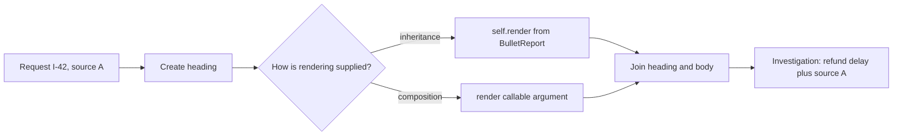
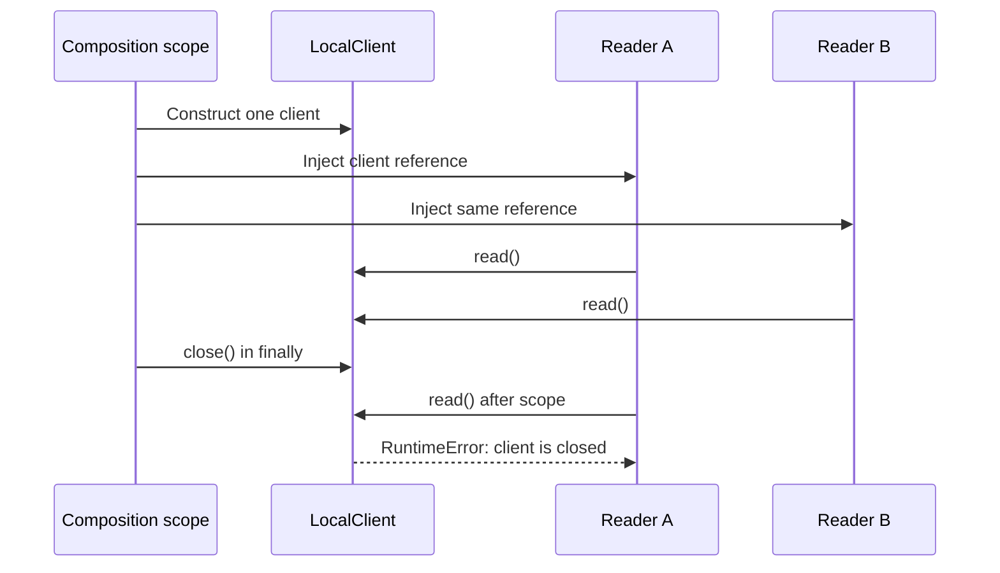

# Choose construction and lifetime machinery from the work it owns

> **Role:** decision guide. Read [behavior and construction](02_select_behavior_and_build_dependencies.md)
> first. This chapter assumes Python classes, inheritance and exceptions; the
> [context-manager lesson](../../fundamentals/core_concepts/control_flow/context_managers.md)
> explains the `with` syntax used for resource ownership.

An investigation request needs a query and evidence. A report needs a heading and a rendering
policy. Two components need to share a client. These requirements sound like invitations to add
Builder, Template Method and Singleton. First ask what state or ordering the extra machinery
would own. A constructor already groups inputs, a function already sequences steps, and bootstrap
can already pass the same object to two consumers.

Use keyword construction when inputs are ready together; consider a builder when collecting them
is itself a staged operation. Use a composed function when only a step varies; consider Template
Method when an existing class extension contract owns the algorithm. Create shared resources at
an explicit lifetime boundary. The following comparisons show what changes those choices.

## Run the three comparisons

The complete standard-library example is [construction.py](examples/construction.py). From the
repository root, run:

```bash
python3 architecture/design_patterns/examples/construction.py
```

Expected output:

```text
builder: snapshots contain 1 then 2 sources; first stays unchanged
invalid build: evidence must not be empty
template and composed function: identical report
after scope: client is closed
exception path: client closed
```

The client is a local lifetime probe: it opens no sockets and stores no credentials. The checks
establish object ownership and cleanup, not real pool concurrency or provider reliability. The
[runtime composition lesson](../hexagonal_architecture/06_compose_the_runtime_at_the_edge.md)
owns startup, shutdown and partially acquired real resources.

## A builder earns its place when construction has a lifecycle

Start with a complete value. Keyword arguments make the two pieces visible without another API:

```python
# Explanatory excerpt from construction.py; InvestigationRequest is defined there.
request = InvestigationRequest(query="refund delay", evidence=("source A",))
```

The request is a frozen dataclass containing a tuple of strings. `frozen=True` prevents ordinary
field reassignment, while the tuple avoids a shared mutable evidence list. Frozen dataclasses do
not recursively freeze arbitrary nested values, and annotations do not validate inputs. Here an
explicit `__post_init__` rejects blank queries and empty or blank evidence. See the
[dataclass mechanisms](../../fundamentals/core_concepts/data_models/dataclasses.md) and
[official dataclass documentation](https://docs.python.org/3.14/library/dataclasses.html).

Now suppose several local parsing steps supply evidence one piece at a time. Until a source has
arrived, there is no valid request to execute. A **Builder** owns this incomplete construction
state and produces a complete value at a named finalization point. Its purpose is the staged
assembly, not the presence of fluent `.with_x()` method names.

The example's relevant implementation is:

```python
# Explanatory excerpt; InvestigationRequest supplies final validation.
class EvidenceBuilder:
    def __init__(self, query: str) -> None:
        self.query = query
        self._items: list[str] = []

    def add(self, item: str) -> None:
        self._items.append(item)

    def build(self) -> InvestigationRequest:
        return InvestigationRequest(query=self.query, evidence=tuple(self._items))
```

Follow the collection state rather than the class names:

| Step | Builder's evidence | Previously built request |
|---|---|---|
| Create builder | `[]` | No valid request yet |
| Add source A, then build | `[A]` | First request contains `(A,)` |
| Add source B, then build again | `[A, B]` | First stays `(A,)`; second contains `(A, B)` |

`tuple(self._items)` takes a new immutable snapshot. Passing the mutable list straight through
would make a previous request change when the builder receives another source. That would violate
the application's assumption that the evidence it accepted is the evidence it will execute.
Building too early raises `ValueError` at finalization because the final value owns validity.

This builder is deliberately a small comparison, not a recommendation to wrap every list. If one
function gathers all evidence, a local list plus `InvestigationRequest(...)` is usually sufficient.
A builder becomes more useful when several construction steps need a shared API, validation must
happen at completion, or the same assembly sequence emits different representations. Keep one
builder per assembly. A process-shared mutable builder can mix requests or tenants.

A builder also does not make a network workflow durable. If collecting evidence must survive a
restart, store progress using [workflow state](../../background_work/workflows/01_state_machine_design.md);
a Python object's unfinished fields vanish with its process.

## Template Method gives an inheritance contract ownership of ordering

The report always creates a heading, renders evidence, and joins the two. A **Template Method**
places that algorithm in a base-class method, with selected steps supplied by subclasses. In this
excerpt, `run` owns order and `render` is the extension point:

```python
# Explanatory excerpt from the complete example.
class ReportTemplate:
    def run(self, request: InvestigationRequest) -> str:
        heading = f"Investigation: {request.query}"
        body = self.render(request.evidence)
        return f"{heading}\n{body}"

    def render(self, evidence: tuple[str, ...]) -> str:
        raise NotImplementedError


class BulletReport(ReportTemplate):
    def render(self, evidence: tuple[str, ...]) -> str:
        return "\n".join(f"- {item}" for item in evidence)
```

`BulletReport().run(first)` resolves `run` on the base class, then resolves `self.render` on the
subclass. The caller gets the same algorithm with a different rendering step. This can be useful
when a framework already exposes a documented subclass contract. The subclass must honor the
step's input/output requirements; inheriting a method name does not prove that its result is valid.

The algorithm's two designs differ only in how the variable step arrives:



Both paths produce the same report. With composition, `render_report(request, render)` receives a
function and owns the same order. It is already the Strategy mechanism from chapter 2. Changing
rendering at one call site does not need another class; a test can pass a deterministic function.

Choose inheritance when the base class's protected extension points are a useful, stable contract.
If every variation needs to override `run` as well, the supposedly fixed algorithm is not fixed.
That is a signal to simplify the abstraction or compose independently changing steps. A deep
hierarchy makes it harder to discover which method owns order and harder to change that order
without affecting unrelated subclasses. Neither approach provides rollback for external effects
performed by a step; the owning use case must still define failure behavior.

## Shared lifetime does not require a global Singleton

The classical **Singleton** pattern controls construction so callers obtain one instance through a
global access point. It combines two decisions: how many instances exist and how consumers find
them. Most backend sharing requirements only need the first decision within a particular scope.

Bootstrap can construct one client and pass it to both readers. The local example does exactly
that; `reader_a is reader_b` is true inside the context. Exiting the context closes the client,
including when an operation raises. The owners are visible in this trace:



A retained reference does not retain permission to use a closed resource. The constructor's owner
must enclose every consumer's lifetime. For an HTTP application this often means lifespan owns
clients/pools, while requests own transaction sessions. Do not share a mutable database session
merely because sharing the underlying engine is correct.

`@lru_cache` can reuse a factory result, but it does not express disposal, tenant isolation or
exactly-once construction under concurrent cache misses. The
[functools documentation](https://docs.python.org/3.14/library/functools.html) explicitly allows
multiple underlying calls before the first value is cached. Cache invalidation can also create a
new resource without closing the old one. For resources needing cleanup, use explicit ownership;
[contextlib](https://docs.python.org/3.14/library/contextlib.html) documents the `finally` mechanism
used by the example.

One object per process is not one object per deployment. Four worker processes can each own a pool
of ten connections, giving up to forty connections before other services are counted. Conversely,
a client created before process forking may carry unsafe inherited connections. Construct it in
the lifecycle its library supports. A global instance is neither a concurrency guarantee nor a
cross-process coordination protocol.

## Recognize when a choice has stopped fitting

| Symptom | Likely ownership error | Verification and correction |
|---|---|---|
| An accepted request gains another request's evidence | Mutable builder/result state escaped its assembly | Build two values, mutate the builder, compare the first; use immutable snapshots and per-assembly scope |
| Changing one report breaks unrelated subclasses | Base algorithm and hooks vary on different axes | Compare concrete outputs of each subtype; split the unstable algorithm or inject the varying behavior |
| Tests pass alone but fail after another test | Hidden shared object retains state | Construct fresh collaborators in tests; make lifecycle explicit |
| `client is closed` during normal requests | Consumers outlive the resource owner | Trace startup/shutdown and task completion; close after dependent tasks stop |
| Connections multiply after scaling workers | Budget assumed one pool across the deployment | Measure connections per process and total; size the fleet budget before rollout |

When migrating a shared resource, first move construction into bootstrap while preserving behavior,
then pass the same explicit instance to callers, then remove global lookups. Verify normal and
exception cleanup before rollout. For a real adapter, record active resources and failed cleanup
without logging credentials. Changing a provider or model also needs the
[provider compatibility and evaluation path](../llm_systems/01_provider_abstraction.md).

## Decision exercise

The current investigation has all evidence before execution, a single report format and two
readers in one process. A proposal adds a fluent builder, five report subclasses and a global
cached client. Which additions have earned their cost? Now change the requirement: evidence
arrives through several independent parsing steps, and a framework requires a report subclass.
Finally deploy four worker processes: how many clients exist?

<details><summary>Reasoned answer</summary>

Initially, keyword construction and a plain report function are sufficient. Bootstrap may share
one owned client across the two readers, but a global lookup adds no needed capability. With staged
parsing, a per-assembly builder can own incomplete inputs and produce an immutable validated value;
a local list remains sufficient if one function still owns all steps. The framework's stable
subclass interface can justify Template Method, provided its order and extension points fit the
operation. Four processes normally construct four clients. Nothing in a local singleton or
injection scheme coordinates construction across those processes, and their total connection
budget must be counted separately.

</details>
