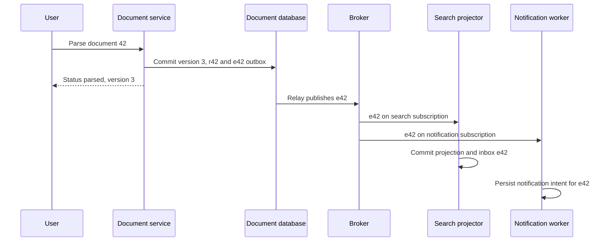

# Build event-driven systems around facts and recoverable projections

**Role: foundation.** Read the [broker decision guide](../../infrastructure/messaging/01_broker_decision_guide.md) and [contracts/outbox lesson](../../infrastructure/messaging/05_message_contracts_and_outbox.md). This chapter composes those guarantees into an application; the existing Kafka and background-work collections own broker and workflow implementations.

## A command asks for work; an event reports a completed fact

Tenant 7 submits document 42. `ParseDocument` is a command: the parser may reject it because the document is missing, unauthorized or unsupported. `DocumentParsed` is an event: the owning service has already committed the result. Calling both “messages” is fine at the transport layer, but the distinction tells consumers whether they may reject a request or must reconcile a fact that already happened.

A **domain event** describes a change inside one service's model. It may contain internal objects and change with that service. An **integration event** is a published contract for other services: stable identifiers, documented meaning, minimal data, and compatible evolution. Publishing a serialized ORM object turns private fields and incidental schema changes into cross-service dependencies.

Start with one concrete state transition:

| State | Before e42 | After e42 |
|---|---|---|
| Authoritative document row | tenant 7, document 42, version 2, `pending` | version 3, `parsed`, result `r42` |
| Search projection | version 2, no extracted text | eventually version 3, text indexed |
| Outbox | no e42 | e42 owed to the transport |

The document transaction determines truth. Search is a **projection**, a derived model optimized for a query. It can lag without changing whether parsing succeeded. Keeping these owners explicit prevents the UI from confusing “not indexed yet” with “the parse failed.”

## Let independent consumers own independent progress

The API commits result `r42` and outbox event `e42`. The relay publishes it. Search updates its projection; notifications may tell the user. They do not share a consumer checkpoint because their successes are independent.



The diagram's database-to-broker arrow abbreviates the outbox relay, not a magical distributed commit. Search can fail while the notification path advances. That independence is useful only if operators can see each subscriber's lag and the product tolerates the resulting inconsistency.

Use the [canonical outbox](../../infrastructure/kafka/reliability/04_transactional_outbox_and_cdc.md) instead of a direct publish after commit. The [contracts lesson](../../infrastructure/messaging/05_message_contracts_and_outbox.md) owns the envelope and inbox transaction. The sequence above reuses those mechanisms rather than adding a second implementation.

## Choose choreography until a lifecycle needs an explicit coordinator

With **choreography**, subscribers react to facts. Search and analytics are good examples: they do not decide whether the original parse succeeds. Adding another independent projection does not require editing the document service's internal workflow.

Now change the requirement: reserve a paid parsing allowance, parse the document, charge the actual usage, and release the reservation if parsing fails. There is a business lifecycle spanning outcomes and deadlines. If each service reacts to another's events without one durable process record, an operator must reconstruct whether the reservation is still owed by joining many logs.

**Orchestration** puts that process state in a durable coordinator. It sends commands, records replies and schedules compensating actions. A compensation is a new business action, such as releasing an unused reservation; it is not time travel that erases a completed external action. The [task-or-workflow lesson](../../background_work/foundations/02_task_or_workflow.md) teaches when to add that state. [AWS saga orchestration guidance](https://docs.aws.amazon.com/prescriptive-guidance/latest/cloud-design-patterns/saga-orchestration.html), checked 2026-10-30.

| Requirement | Suitable starting point | Why |
|---|---|---|
| Index and report facts independently | Choreography | Consumers own derived state and independent lag |
| Enforce a deadline across reserve, parse and settle | Orchestration | One durable actor owns progress, timeouts and compensation |
| Change three tables in one service | One database transaction | No need to distribute an invariant that can remain local |

Do not split a service merely to obtain “event-driven architecture.” A local transaction is easier to reason about than an unnecessary distributed saga.

## Make eventual consistency visible to the user

If document status returns version 3 while search has indexed only version 2, the user may see a stale search result. Give the response the authoritative version and expose `indexing` separately. The UI can show the committed document directly while search catches up, or a bounded read can wait until the projection checkpoint reaches the required version. Infinite polling is not a consistency strategy; set a deadline and display a truthful pending state.

For a single-document snapshot projection, version checks can prevent stale overwrites. This explanatory SQL excerpt assumes the table and event have already been validated and the inbox shares this transaction:

```sql
UPDATE document_search
SET indexed_version = :incoming_version,
    result_ref = :result_ref
WHERE tenant_id = :tenant_id
  AND document_id = :document_id
  AND indexed_version < :incoming_version;
```

Given current version 3, delayed version 2 changes zero rows. That is correct when each event contains a complete replacement snapshot. It is **not** correct for deltas such as “add three pages”: skipping an earlier delta loses information. Delta projections need contiguous sequence checks, replay or authoritative-state reconciliation. The insert path for a previously unseen document also needs an atomic upsert; the excerpt only demonstrates the stale-update guard.

## Rebuild a projection without replaying every real-world action

Treat a rebuild as a separate consumer and output generation. For search generation `search-v2`, create fresh tables/indexes and checkpoint state; replay retained events in the required order, then compare counts and representative queries with the authoritative source. Keep processing live changes until the new generation catches up, switch reads atomically, and retain the old generation briefly for rollback.

If history is incomplete, take an authoritative snapshot with a defined change-log boundary, then apply later changes. A wall-clock timestamp guessed between export and subscription can lose updates. Use the database/log system's supported consistent snapshot and checkpoint protocol. The [CDC relay lesson](../../infrastructure/kafka/reliability/06_cdc_outbox_relay.md) develops the log-position boundary.

Rebuild code must not send historical emails or re-charge usage. Separate pure projection handlers from outbound side-effect handlers. Keep deletion events or tombstones through the replay horizon, and apply current authorization/deletion policy before exposing rebuilt data. A six-month-old event can describe a document that was erased yesterday.

## Operate a graph of obligations

Measure source-to-projection freshness, oldest outbox age, subscriber lag, duplicate rate, unknown schema versions and aggregate sequence gaps. Attach event ID, correlation ID and safe tenant identifiers to traces; avoid raw document text and unbounded per-event metric labels. A green broker dashboard cannot prove the search projection matches current business state.

When search lags, first identify whether the outbox is unpublished, the subscriber is behind, or a sequence/schema failure blocks an aggregate. Pause only the affected path if possible. Replay a bounded batch after repair and compare derived rows with source versions. If a poison event blocks a strict ordered sequence, skipping it needs a documented reconciliation decision.

Test duplicates, reversed snapshot order, a missing delta, relay crashes, a consumer restart after commit, incompatible payloads and deletion during rebuild. Include a test that disables outbound side effects during replay. Success means projections converge within the documented freshness target and irreversible work is not repeated.

**Production readiness:** each fact has an owner; cross-service events have stable contracts; acceptance uses an outbox; consumers have independent progress and idempotency; users see pending consistency; replay preserves deletion/security; and every subscriber has an owner and recovery procedure.

## Recap

- Commands request a decision; events publish facts already committed by an owner.
- Independent projections need independent progress and can legitimately lag.
- Choreography fits independent reactions; a cross-service deadline often needs durable orchestration.
- Rebuilds create new derived state and must separate historical data from real-world side effects.

## Check yourself

**Q: Version 5 arrives before version 4. Can the projector discard 4?**

<details><summary>Answer</summary>

Only if version 5 is a complete authoritative snapshot for the projected fields. If events are deltas, version 4 may carry an indispensable change. Detect the sequence gap and replay or reconcile instead of inferring that a larger number contains all earlier information.

</details>

**Q: A rebuild restores a document deleted yesterday because its old creation event is still retained. Where is the design incomplete?**

<details><summary>Answer</summary>

The replay path did not apply deletion history or current deletion policy before exposing derived data. Retain and process deletion markers for the replay horizon, reconcile against authoritative state, and enforce current access rules at query time. An immutable event history does not grant permission to republish erased content.

</details>
