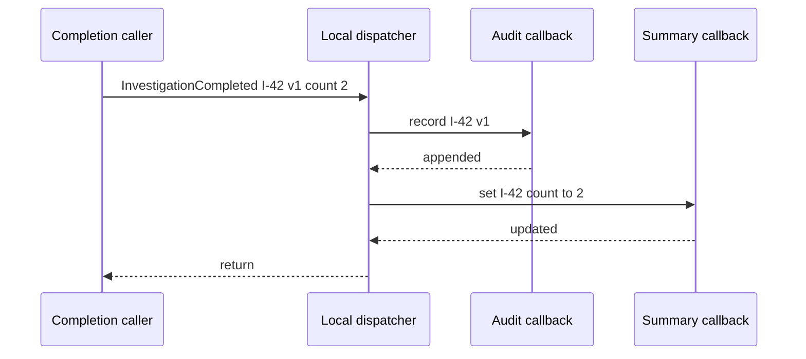
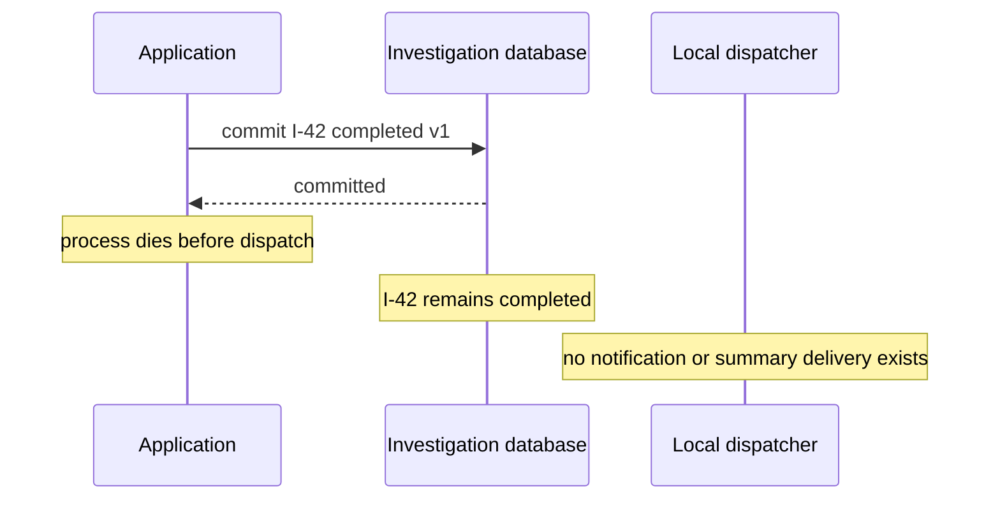

# Let one local fact trigger independent reactions

> **Role: tutorial.** Assumes Python functions, dataclasses and exceptions. Baseline: Python 3.11+
> standard library. No broker, database server or async framework is required.

Investigation `I-42` has collected two evidence sources. Completing it should update a dashboard
summary and record an audit entry. If the completion function imports every downstream component,
adding another reaction changes that function even though its completion rule has not changed.
A local event lets the function describe what happened and lets a separate dispatcher choose the
reactions. Start by watching that separation work.

## Run one completion and two reactions

From the repository root, run the [complete local example](examples/local_events.py):

```bash
python3 architecture/event_driven_architecture/examples/local_events.py
```

Expected output:

```text
I-42 completed version=1 audit=1 summary=2
```

The script uses only an investigation object, an audit list and a summary dictionary. It checks
that completion happened once and that both callbacks received the result. These values live in
memory: **this baseline has no durability**, so restarting the process loses all of them. The
[commit and delivery section](#separate-a-local-transition-from-a-committed-fact) below explains
what must change when a reaction cannot be lost. No real audit record or notification is sent.

If Python reports that it cannot open the file, run the command from the repository root. An
`AssertionError` means the observed state no longer matches the documented callback contract;
inspect the named assertion instead of treating a printed line as proof.

## Separate the fact from the response to that fact

Here is the event definition from the example:

```python
from dataclasses import dataclass

@dataclass(frozen=True)
class InvestigationCompleted:
    investigation_id: str
    version: int
    evidence_count: int
```

The fields answer three questions: which investigation changed, which version that transition
produced, and what the completed result contained. They do not tell a notification handler how to
send a message. A **domain event** describes something meaningful that happened in the business
model. `InvestigationCompleted` is a fact; `SendCompletionEmail` would request a particular action.

`frozen=True` prevents ordinary field reassignment, so one callback cannot accidentally replace
the count that the next callback reads. It is shallow immutability: mutable lists inside a frozen
dataclass would still need their own protection. This event contains only immutable scalar values.

The model's `complete()` method checks that the investigation is running and has evidence,
changes its status, increments its version, and returns the fact. The caller then dispatches it.
This excerpt shows the actual assembly; `record_audit` and `update_summary` are the callbacks
already defined in the full source:

```python
investigation = Investigation("I-42", evidence_count=2)
event = investigation.complete()
dispatch(event, (record_audit, update_summary))
```

The table separates the state change from the effects of its announcement:

| Step | Investigation | Audit list | Summary dictionary |
|---|---|---|---|
| Construct the model | running, version 0 | empty | empty |
| `complete()` returns | completed, version 1 | empty | empty |
| First callback returns | completed, version 1 | `(I-42, 1)` | empty |
| Second callback returns | completed, version 1 | `(I-42, 1)` | `I-42: 2` |

Notice that neither callback makes the original completion valid. Its rule was checked before
announcement. If a quota reservation is required before completion, make that part of the
application operation and its transaction; hiding it in an optional subscriber would allow a
completed investigation whose required reservation failed.

## Observer describes the relationship; a domain event describes the meaning

**Observer** is the arrangement in which an observable change notifies registered listeners.
Here the listeners are ordinary functions supplied explicitly to a dispatcher. A dispatcher is
just the code that selects or invokes handlers for a message. For one event type, a tuple is enough;
a generic event superclass and global registry would add no needed capability.

This is the complete dispatch function, excerpted with its type alias from the source:

```python
from collections.abc import Callable

Handler = Callable[[InvestigationCompleted], None]

def dispatch(event: InvestigationCompleted, handlers: tuple[Handler, ...]) -> None:
    for handler in handlers:
        handler(event)
```

Observer and domain events answer different questions. Observer describes who hears about a
change; a domain event gives that change a business meaning. An Observer can announce a window
resize without modeling a business fact. A domain event can instead be stored and delivered
later without using local callbacks at all.

Trace what one dispatch call does before assuming that an event bus creates background work:



The caller waits for both callbacks. Their order is the tuple order; there is no queue, network
handoff or parallel execution. A slow callback makes this call slow. Changing the functions to
`async def` and awaiting each one would preserve that sequential dependency; async syntax alone
would not make delivery durable. [Cosmic Python's local message-bus chapter](https://www.cosmicpython.com/book/chapter_08_events_and_message_bus)
also separates local handler dispatch from external messaging.

This arrangement helps when reactions change independently. For two stable, required operations,
calling two functions directly can remain clearer. Use a fact when multiple consumers should
interpret the same result independently, not merely to avoid writing an explicit function call.

## Make the failure policy visible

Now insert a failing notification callback between audit and summary. Run the provided failure
probe; it catches the deliberate error so the process can check the remaining state:

```bash
python3 architecture/event_driven_architecture/examples/local_events.py --failure
```

Expected output:

```text
attempt=1 completed=True audit=1 summary=False error=notification unavailable
attempt=2 completed=True audit=2 summary=False error=notification unavailable
```

On attempt 1, audit appends its entry. Notification raises `RuntimeError`; the exception leaves
the loop, so summary never runs. Python exception propagation does not undo an earlier append or
the investigation's status change. Attempt 2 dispatches the **same event**, repeats audit, and
fails at the same point. It does not call `complete()` again: that would be a new attempted
business transition and is rejected because the investigation is already completed.

The selected policy is **fail fast**: stop at the first failed callback and report that failure.
Other policies are possible, but each needs an explicit contract:

| Policy | What happens after notification fails? | Remaining obligation |
|---|---|---|
| Fail fast, as above | Summary is skipped; caller receives an error | Determine what already succeeded before retrying |
| Collect failures and continue | Summary runs; caller receives a failure list | Retain or otherwise act on failures that matter |
| Persist independent delivery work | Each consumer can resume from recorded progress | Operate durable intent, retry and duplicate handling |

Catching exceptions and continuing only changes which callbacks run. It does not save failed
work for a restart. The final exercise implements that distinction explicitly. Likewise,
parallel dispatch would need a policy for partial success, cancellation and ordering; it would
not restore all-or-nothing behavior.

When subscribers genuinely need different recovery policies, their independence must exist in
stored progress, not just in a dictionary of function names. The
[command-versus-event discussion](https://www.cosmicpython.com/book/chapter_10_commands) is useful
for separating a rejected request from a failed reaction to an already accepted fact.

## Separate a local transition from a committed fact

The example's event describes an in-memory transition. In a persistent application,
`model.complete()` can produce a **pending domain event** while a transaction is still open.
At that point the transaction could roll back. A completed Python object is not proof that the
database accepted the change. Discard pending events on rollback; do not notify external consumers
that completion succeeded before the owning transaction commits.

Moving dispatch after commit fixes that false-announcement problem, but introduces a second
failure window. This trace assumes the investigation is now stored in a real persistent database:



After restart, the row still says completed, but nothing records which reactions are owed. A new
process cannot recover a lost callback invocation merely by rebuilding the handler tuple. Returning
an HTTP error after a commit also creates ambiguity for the client; retrying the original command
needs its own [idempotency contract](../../background_work/reliability/03_idempotency_and_external_effects.md).

When a reaction is a durable obligation, persist its intent with the business update. An **outbox**
is a table of messages owed to a publisher; its insert and the business transition commit in the
same transaction. A relay later sends those messages. Publication can repeat after a crash, so
consumers must also handle duplicates. The
[message-contract and outbox lesson](../../infrastructure/messaging/05_message_contracts_and_outbox.md)
teaches that protocol and its executable inbox example. Local dispatch alone claims none of those
guarantees.

An internal domain event and an external integration event need not have the same shape. Internal
code can evolve together; another service needs a versioned contract, stable event identity and
a defined disclosure boundary. Translate internal state into the published fields intentionally.
For example, sending evidence counts may be appropriate while broadcasting raw investigation
queries to every consumer may expose information they do not need.

## Diagnose the boundary that actually failed

For local callbacks, record the event type, a safe correlation identifier, handler name, duration
and outcome. Use bounded handler names as metric labels, not unique investigation IDs. Do not log
raw evidence or queries. If completion succeeds but summary is absent, inspect callback outcomes
and ordering before checking a broker that this path never used.

A useful production decision checklist is:

- Define whether each reaction is optional or durable, and whether it participates in acceptance.
- Keep required invariants inside their owner; test rejection before any fact is published.
- Test failure in the second callback and repetition of the same event, as this example does.
- If loss is unacceptable, adopt the linked durable protocol and test its commit/publish crash gap.
- When adding a listener, assess its extra latency and side effects; rolling it back does not undo
  already sent notifications or replay events missed while it was absent.

The durable production continuation is [events and recoverable projections](01_events_and_projections.md).
It adds consumer progress, ordering, replay and contract evolution once this local mechanism is clear.

## Recap

- A domain event describes a business transition; a local dispatcher chooses its callbacks.
- Callback registration reduces direct coupling without adding concurrency or persistence.
- Earlier callbacks and model mutations survive a later exception unless an explicit transaction
  or compensation changes them.
- Dispatching after commit avoids announcing rolled-back work, but durable intent is needed to
  survive the crash before delivery.

## Check yourself

**Q: Audit succeeded, notification failed, and the process restarted. Which callbacks will the
new process automatically resume?**

<details><summary>Answer</summary>

None in this example. Its model, event and callback progress were in memory. Even in the persistent
variant, saving the investigation row alone would not record delivery work. Resuming requires
stored intent and a progress/retry protocol. Retrying the whole event blindly can repeat audit.

</details>

**Q: Summary must be correct before the API may report completion. Should it remain an independent,
best-effort subscriber?**

<details><summary>Answer</summary>

No. That changed requirement makes the summary part of the acceptance contract. If both writes
belong to one database, coordinate them in one local transaction. If summary belongs to another
system, expose pending completion or another explicitly asynchronous promise and track the work
durably. A listener tuple cannot create atomicity across those systems.

</details>

## Try it: continue while retaining the failure result

Change the requirement: local summary should still update when notification fails, and the caller
must learn exactly which callback failed. Start from `dispatch`; create a `failures` list, put the
`try` block **inside** the loop, and append `(handler.__name__, error)` on failure. Return the list.
The result is still local diagnostic information, not a durable retry record.

<details><summary>Worked solution and check</summary>

The full source includes `dispatch_collecting_failures`. Its core is this explanatory excerpt:

```python
def dispatch_collecting_failures(event, handlers):
    failures = []
    for handler in handlers:
        try:
            handler(event)
        except Exception as error:
            failures.append((handler.__name__, error))
    return failures
```

Each callback gets its own exception boundary, so a failure does not skip later callbacks. The
caller must inspect the returned failures; ignoring them would silently discard work. Ordinary
exceptions are collected; process-exit exceptions are not swallowed.

Run the solution from the repository root:

```bash
python3 architecture/event_driven_architecture/examples/local_events.py --exercise
```

Expected output is `continued=audit,summary failed=notify retry_record=False`. The assertions check
both continued execution and the retained failure identity. Restart survival still requires the
outbox/recovery continuation.

</details>
