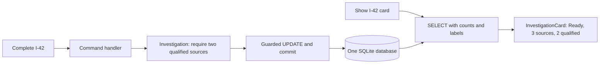
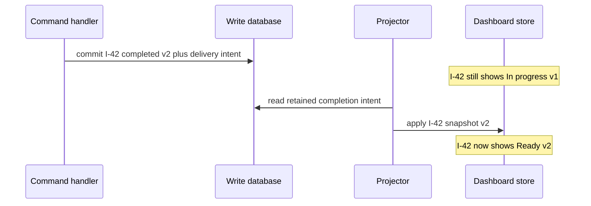

# Give writes and reads the models they actually need

> **Role: tutorial.** Assumes Python functions, dataclasses and exceptions. The small SQL bridge
> below explains the database operations used here. Baseline: Python 3.11+ with standard-library
> `sqlite3`. The example runs locally and creates no files or external services.

Completing investigation `I-42` is a decision: it must still be running and have at least two
evidence sources whose confidence is 80 or higher. Showing it on a dashboard is a different job:
return a title, a friendly status label and evidence counts. Loading a mutable business object
just to serialize that card mixes two models with different reasons to change.

**CQRS**, Command Query Responsibility Segregation, separates the model that changes state from
the model that answers reads. We will keep one database and ordinary function calls. The useful
split here is an invariant-owning `Investigation` versus a read-only `InvestigationCard`.
[Fowler's CQRS explanation](https://martinfowler.com/bliki/CQRS.html) describes this modeling choice
and cautions against adopting its complexity without a need.

## The database vocabulary needed for this example

A table stores rows with named columns. `investigations` stores one row per investigation;
`evidence` stores one row per source, linked by `investigation_id`. A primary key prevents duplicate
identities. A foreign key prevents evidence from referring to a nonexistent investigation.

`SELECT` reads rows; `INSERT` adds one; `UPDATE` changes matching rows. A `WHERE` clause limits which
rows an operation may affect. A transaction groups changes: `COMMIT` accepts them together and
`ROLLBACK` discards them. A Python exception by itself does not roll back SQL; the example's
transaction context manager explicitly does that. Read the
[database foundations](../../fundamentals/database/01_databases_and_schemas.md) for the broader model.

## Run a rejected write and a successful completion

From the repository root, run the [complete example](examples/cqrs.py):

```bash
python3 architecture/event_driven_architecture/examples/cqrs.py
```

Expected output:

```text
I-42 In progress sources=2 qualified=1 version=0
rejected: completion requires two sources with confidence >= 80
I-42 Ready sources=3 qualified=2 version=2
old_card=In progress; fresh_query=Ready
```

The script starts with evidence `D-1` at confidence 90 and `D-2` at 50. A first completion request
fails. It then adds `D-3` at 85, completes the investigation, and queries the card again. Assertions
check that the rejected write left the earlier card unchanged and that the final counts and
version are correct.

This is a same-process, in-memory SQLite demonstration. It does not prove PostgreSQL concurrency,
HTTP authorization, cross-process durability, or an asynchronous projection. The later sections
identify those production boundaries. If `sqlite3` cannot be imported, the Python distribution lacks
that optional module; use a Python build that includes it. An `AssertionError` points to a changed
invariant or query result in the source, not a successfully verified tutorial.

## The write model decides whether the transition is allowed

The mutable `Investigation` contains the status and evidence needed for completion. The example
shares the fixed policy constants `QUALIFYING_CONFIDENCE = 80` and `REQUIRED_SOURCES = 2` between
the relevant decisions. This is its business method, shown as an excerpt:

```python
def complete(self) -> None:
    if self.status != "running":
        raise ValueError("only a running investigation can complete")
    if sum(item.confidence >= QUALIFYING_CONFIDENCE for item in self.evidence) < REQUIRED_SOURCES:
        raise ValueError("completion requires two sources with confidence >= 80")
    self.status = "completed"
```

An **invariant** is a condition the accepted state must preserve. Here the method refuses to
complete with insufficient qualified evidence. The source IDs have a unique database key, so
inserting the same source twice cannot inflate the count. `Evidence` also validates the confidence
range before an application write.

Walk through the first request. The model has two sources, but only `90 >= 80` is true. The count
is therefore 1, and the method raises before changing `status`. The transaction rolls back, leaving
both status and version unchanged. Adding the third source raises the qualified count to 2. A
second completion request can now change `running` to `completed`.

A **command handler** coordinates one requested action: load the current state, ask the model to
decide, and persist the accepted change. `complete_investigation()` is such a function. Its SQL
updates only the expected investigation version and running status. It checks that exactly one row
changed. The version is a revision number, incremented by each accepted change; a failed comparison
means the caller must reload and decide again instead of overwriting a newer state.

The example uses SQLite's `BEGIN IMMEDIATE` before loading, which reserves the writer position
for this short transaction. All its writes go through the shown functions. The version predicate
makes the expected revision explicit, but this script is not a portable concurrency proof: database
isolation and retry behavior must be tested on the intended engine. The
[port and transaction lesson](../hexagonal_architecture/05_design_ports_and_adapter_contracts.md)
teaches ownership of that larger contract.

## The read model answers a presentation question

The dashboard does not need a `complete()` method or every evidence object. It needs a **DTO**, a
data transfer object: a value containing the fields needed by its caller. The example's query
returns this separate immutable representation:

```python
from dataclasses import dataclass

@dataclass(frozen=True)
class InvestigationCard:
    investigation_id: str
    title: str
    status_label: str
    evidence_count: int
    qualified_count: int
    version: int
```

`get_card()` reads the same database using one query. Here is its SQL, excerpted with named input
`I-42` and policy value 80; the actual Python binds both values through `?` parameters rather
than string interpolation. Sharing the confidence threshold keeps this display count aligned
with the write policy:

```sql
SELECT i.id, i.title,
       CASE i.status WHEN 'running' THEN 'In progress' ELSE 'Ready' END,
       COUNT(e.source_id),
       SUM(CASE WHEN e.confidence >= 80 THEN 1 ELSE 0 END), i.version
FROM investigations AS i
LEFT JOIN evidence AS e ON e.investigation_id = i.id
WHERE i.id = 'I-42'
GROUP BY i.id, i.title, i.status, i.version;
```

The join pairs the investigation with its evidence rows; `LEFT JOIN` also preserves an
investigation with no evidence. `COUNT(e.source_id)` counts actual matching sources. The `CASE`
inside `SUM` contributes 1 for a qualified source and 0 otherwise. `GROUP BY` combines those rows
into one dashboard result. The other `CASE` converts an internal state into display language.

For the initial data, that produces total 2 and qualified 1. After adding `D-3` and completing,
it produces total 3, qualified 2 and label `Ready`. The query does not instantiate the write model
or invoke its transition method. Changing the dashboard's label to `Completed` would change this
read representation without changing what completion permits.

This shared-store separation is one documented CQRS variant; separate databases are optional.
[Microsoft's CQRS guide](https://learn.microsoft.com/en-us/azure/architecture/patterns/cqrs)
describes both arrangements. Our implementation is deliberately smaller than a projection service.

## See the modeling boundary without inventing a network boundary

The two paths reach one database, but they serve different callers and carry different behavior:



The write path decides and mutates. The read path derives a response. Neither path needs an event
bus, separate service, or background worker. The distinction would remain if both functions lived
in the same Python file, as they do here. Merely moving identical CRUD methods into `commands/`
and `queries/` folders would not teach or establish this difference in models.

The similarly named concepts have different scopes:

| Decision | Meaning in this investigation example |
|---|---|
| Command-query separation, CQS | Distinguish operations that change state from operations that answer questions; this alone does not require different models |
| CQRS | Use a business model for completion and a distinct dashboard representation for reads |
| Event sourcing | Store an authoritative sequence of changes from which state is reconstructed; this example stores current rows instead |
| Asynchronous projection | Update a separate derived read store later; this example derives the card directly from the same database |

CQRS therefore does not by itself imply event sourcing, separate storage, asynchronous commands
or eventual consistency. A command may return an acceptance result or revision without returning
the entire read model; API response conventions do not decide whether the model split exists.
The [Cosmic Python CQRS chapter](https://www.cosmicpython.com/book/chapter_12_cqrs) develops the
practical pressure to avoid forcing read queries through write-oriented domain objects.

## A read result is a snapshot, never permission to bypass a write rule

The demo retains its first `InvestigationCard` in `initial`. After the database changes, that Python
value still says `In progress`. Re-querying returns `Ready`. No background projector is lagging:
the old object simply captured the answer at an earlier time.

The same issue appears when a browser displays a `Complete` button. Another request could cancel
or complete the investigation before the user clicks it. The command handler must reload and
recheck the authoritative state. A read DTO's counts or UI flags are useful previews, not a grant
to skip validation. In the example, calling completion again is rejected even if a caller retained
an earlier running card.

`frozen=True` helps prevent accidental mutation of a DTO; it is not an authorization or database
security boundary. A production read endpoint still needs caller and tenant checks, and the write
endpoint needs its own authorization. Keep confidential evidence out of the dashboard query if its
caller does not need it. A version field tells the caller which snapshot was returned; it does not
keep that snapshot current forever.

## Add a stored projection only when reads need it

Suppose the dashboard becomes expensive because it aggregates millions of evidence rows. First
inspect the query and indexes; separating models does not remove database work. The
[query-performance lesson](../../fundamentals/database/11_query_performance.md) owns that diagnosis.
If a precomputed read store is justified, a **projection** is derived data maintained from the
authoritative writes. It may be updated in the same transaction or asynchronously, depending on
the required consistency and storage boundary.

With an asynchronous projector, a new state can commit before the dashboard catches up:



Now there are two stored states and a real lag interval. The UI can show the accepted command's
version and a pending refresh until the projection reaches it; it should not report a rejected
completion merely because the dashboard remains old. The write side remains authoritative for
new decisions.

The [events and projections lesson](01_events_and_projections.md) owns ordering, lag visibility,
rebuilds and safe replay. The [outbox lesson](../../infrastructure/messaging/05_message_contracts_and_outbox.md)
owns persisting update intent atomically. Those mechanisms become necessary because another
stored representation can fall behind or be lost, not because the code contains two dataclasses.

## Verify the invariants and operate the chosen arrangement

The source includes a second probe that attempts duplicate evidence, then attempts to add evidence
after completion:

```bash
python3 architecture/event_driven_architecture/examples/cqrs.py --exercise
```

Expected output:

```text
duplicate_rolled_back=True completed_write_rejected=True
```

The duplicate hits a unique key after the function has incremented the investigation version.
Rollback must remove that increment too. The test compares the entire before/after card, so it
would detect a version leak even if the evidence count happened to look correct. After completion,
the guarded write affects no running row and raises; the accepted card remains unchanged.

The example owns explicit SQL `BEGIN`, `COMMIT` and `ROLLBACK`. On Python 3.12+ it selects
`autocommit=True`; on 3.11 it uses `isolation_level=None`. Both arrangements let this example issue
its own SQL transaction boundaries. This differs from the newer recommended DB-API style with
`autocommit=False`; do not mix their implicit and explicit transaction assumptions. See
[Python's SQLite transaction documentation](https://docs.python.org/3.14/library/sqlite3.html#transaction-control),
checked 2026-10-30. The script closes its connection explicitly and needs no file cleanup.

| Symptom | Inspect first | Response |
|---|---|---|
| Rejected completion still changes a version | Transaction scope and exception handling | Roll back the whole write and rerun the rejection test |
| Dashboard count is wrong while stored evidence is correct | Join/card query and fixture with zero or duplicate sources | Correct the query; do not loosen completion rules |
| Same-store query is slow | Query plan, result size and indexes | Bound reads and tune the query before adding another store |
| Separate projection is stale | Source version, retained intent and consumer checkpoint | Repair and replay through the canonical recovery path |

Before production, verify caller/tenant authorization on both paths, test concurrent writes on the
real database, measure query latency and conflict rates, and retain schema compatibility during
rollout. Add a new read field before consumers require it; remove the old representation only after
those consumers migrate. For a separate projection, also test reconstruction, freshness alerts and
read switching before deleting the old store. Those are extra operational costs to justify.

Use ordinary CRUD when the same simple model serves both tasks well. Here CQRS earns its place
because completion owns evidence rules while the dashboard wants aggregated display fields. That
is a local choice for this capability, not a requirement for every table or service.

## Recap

- Completion loads authoritative evidence and checks an invariant before a guarded write.
- A dedicated read query builds a card without dragging write behavior into presentation.
- Both models can share one database; no event bus or separate read store is required.
- Returned cards are snapshots. Commands must recheck state even when the UI looked eligible.
- Storing a separate asynchronous projection adds lag and recovery work beyond the model split.

## Check yourself

**Q: A card says two sources qualify, but one source is removed before completion. Can the command
trust the card and set `status='completed'` directly?**

<details><summary>Answer</summary>

No. The card describes an earlier read. The write path must load the current evidence under its
transaction/concurrency policy and apply the rule again. A UI eligibility result cannot protect a
business invariant against intervening writes.

</details>

**Q: The team creates `commands/` and `queries/`, both passing the same mutable ORM object around.
Has it necessarily adopted the useful model separation taught here?**

<details><summary>Answer</summary>

No. The folders show organization, but the caller still shares one representation and potentially
its mutating behavior. Identify the write decision and the read contract first. CQRS has value when
separate models simplify those different responsibilities; files alone supply no such benefit.

</details>

## Try it: expose the remaining evidence requirement

Add a dashboard field `missing_qualified_count`. It should show 1 for the initial card and 0 for
the completed card. Keep the write rule authoritative. Hint: derive the display value from the
query's qualified count and clamp it at zero; do not add a write method to the DTO.

<details><summary>Reasoned solution</summary>

The read result already has `qualified_count`. A read mapper can calculate
`max(0, REQUIRED_SOURCES - qualified_count)` and place it in the card. Thus one qualified source yields 1, two or
more yield 0. Adding that presentation field requires no new database or event stream. The command
still reloads evidence and calls `complete()`: displaying zero missing sources is not proof that
completion remains valid at the instant the command runs. If the threshold becomes a configurable
business policy, give that policy one owner and have the display derive its preview from that
owner instead of maintaining an independently changing magic number.

</details>
