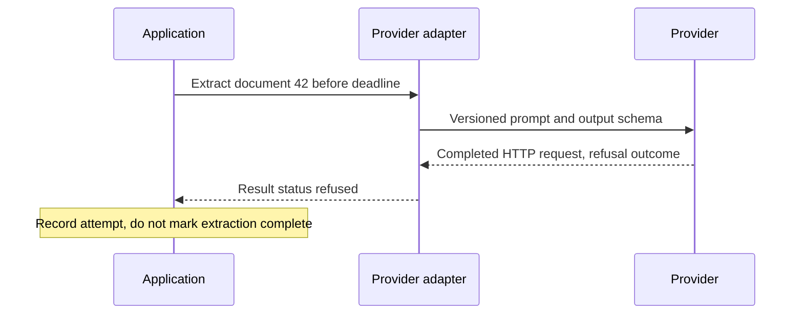

# Make provider outcomes explicit

Role: implementation. Prerequisites: [HTTPX lifetimes](../../fundamentals/httpx/01_mental_model.md),
[timeouts](../../fundamentals/httpx/03_timeouts.md), and [testing LLM code](../../operations/testing/13_testing_llm_code.md).
Baseline: Python 3.11+; provider-neutral document extraction. This lesson owns the application boundary,
not a particular model catalog or SDK installation.

## One successful HTTP response can have several application outcomes

Tenant 7 wants a title and a supporting quote for document 42. The provider returns HTTP 200.
That only tells us that an HTTP interaction succeeded. The generation may be complete, refused,
or cut short. Persisting all three as a completed extraction makes the document appear processed
when no usable answer exists.

Start with the complete offline [boundary example](examples/provider_boundary.py). From the repository root:

```bash
python3 architecture/llm_systems/examples/provider_boundary.py
```

Expected output:

```text
accepted document=42
refused: no write
incomplete: no write
unsupported quote: rejected
```

The script tests the deterministic boundary with a fake provider result. It makes no live model
claim. `Status` is an application-owned enum, and the adapter maps the provider's actual response
variants into it. `accept` checks completion before touching JSON, then verifies the requested
identity, field types and quote membership. If the refusal assertion fails, the application is
confusing a response with a usable result. Quote membership is only a narrow grounding check;
it does not prove that the title summarizes the document correctly.

The handoff is easier to see when the provider refuses:



The adapter translates transport-specific facts. The application decides the business result.
If an SDK is replaced, the mapping changes, while the “no completed extraction on refusal” rule
remains. This is the same boundary taught in [GenAI as an external capability](../hexagonal_architecture/08_treat_genai_as_an_external_capability.md).

## Design a narrow port, then negotiate capability

An extraction port should accept the authorized document text, prompt revision, schema revision,
deadline and output bound. It returns a normalized result with usage and provider request ID.
It should not expose an untyped `**kwargs` dictionary that every caller must understand.

A model's capability is a tested property of the configured model and API combination. A compact
application configuration might record these facts (illustrative data, not a provider API payload):

```json
{"adapter":"primary","structured_output":true,"tools":false,"streaming":false,"max_output_tokens":800,"schema_revision":"extract-v2"}
```

The workflow requires structured extraction and no tools. If a fallback lacks structured output,
choosing it merely because it generates text changes the workflow's guarantee. Either reject that
route or provide a separately evaluated parser/validation strategy. Likewise, a provider supporting
tools does not imply support for the same parallel tool semantics, context limit or JSON Schema subset.
Keep the capability matrix under tests and recheck it when changing model, SDK or API surface.

OpenAI distinguishes structured schema output from plain JSON output and exposes refusals outside
the successful schema path. The application still needs to validate its domain rules.
[Official structured-output documentation](https://developers.openai.com/api/docs/guides/structured-outputs), checked 2026-10-30.

## Bound one logical attempt across retries

Suppose the HTTP deadline is 8 seconds and the caller permits two provider attempts. If the SDK
silently performs three attempts inside each call, the service can issue six requests and exceed
both cost and latency budgets. Choose one retry owner and count actual attempts in telemetry.
Subtract elapsed time from the remaining deadline before a retry; a fresh 8 seconds each time
would turn an 8-second contract into a much longer one.

| Outcome | Application response | Why |
|---|---|---|
| Complete and domain-valid | Persist result with prompt/model/schema revisions | Reproducible usable result |
| Refusal | Record typed refusal; expose appropriate product state | Repeating the same input is not a transport repair |
| Incomplete | Record reason; possibly retry within a bounded policy | A larger output allowance consumes budget and may still fail |
| Rate limited or transient unavailable | Respect delay hints and remaining deadline; jitter | Simultaneous retries can intensify provider overload |
| Bad credentials, unsupported schema/model | Fail configuration gate and alert owner | Repeating the same invalid request wastes time |
| Timeout after request transmission | Mark outcome uncertain; reconcile side effects | Cancellation cannot undo remote work |

Pure text generation can often be repeated at a cost. A tool invocation that sends mail cannot be
repeated safely without a durable operation key and reconciliation. Keep generation attempts and
business operation identity separate; [idempotency](../../fundamentals/fastapi/safe_and_scalable_api_calls/11_idempotency.md)
owns that protocol.

Before production, verify refusal, truncation, schema mismatch, timeout, rate limit and unknown
response fields with recorded, redacted fixtures. Run a small explicit live smoke test after
configuration changes to check model access and request shape. A fake cannot verify those facts.
Track latency by outcome, actual attempts, usage, unsupported-response counts and provider request IDs.
Rollback the adapter/model configuration together with its capability matrix when fixture or smoke
checks fail; do not silently route every failed attempt to a less capable model.

## Recap

- Transport success precedes completion and domain-validity checks.
- The adapter translates provider facts; application rules decide whether to write a result.
- A fallback must preserve required capabilities and pass the same evals.
- One retry budget bounds elapsed time, actual attempts and spend.

**Check yourself: the provider returns valid JSON after an output-limit stop. Should it be accepted?**

<details><summary>Answer</summary>

No. Parseability does not establish completion. Inspect the finish/outcome metadata first; otherwise
a partial answer that happens to close its braces is incorrectly promoted to a completed extraction.

</details>

**Check yourself: the fallback supports tools but not the required schema. What changed?**

<details><summary>Answer</summary>

The available capability set no longer satisfies the extraction contract. The router must refuse
that route or use a separately evaluated validation path, even if the fallback is healthy and cheap.

</details>

**Try it:** add an `UNAVAILABLE` outcome to the example. Keep the caller from writing a result,
and assert that malformed complete output raises an error. Hint: status handling and JSON handling
belong to different stages.

<details><summary>Worked solution</summary>

Add the enum member; the existing non-complete guard returns `None`. Construct a complete result
with text `"{"`; `json.loads` raises `JSONDecodeError`. The adapter should translate a transient
transport exception into its explicit error contract, not fake a complete empty object.

</details>
