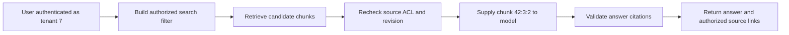

# Retrieve evidence that is relevant, current and authorized

Role: deep dive. Prerequisites: [prompt and schema design](02_prompt_and_schema_design.md),
[SQL transactions](../../fundamentals/database/01_databases_and_schemas.md) and
[search selection](../../infrastructure/search/01_search_decision_guide.md).
RAG means retrieval-augmented generation: the application retrieves evidence and supplies it to a
model. It does not train that evidence into the model or guarantee that the model will use it faithfully.

## First trace the answer without a vector database

Tenant 7 asks “How long do we retain reports?” Document 42 revision 3 contains “Reports are retained
for 30 days.” The smallest useful retrieval system can select that authorized document directly,
place its text and citation ID in the prompt, and ask for an answer with citations. Embeddings
become useful when there are too many documents to select explicitly: an embedding maps content
to a numeric vector, and similarity search proposes nearby vectors. Similarity proposes relevance;
it does not establish permission or truth.

Use this evidence record as the running example (application data, not a vendor request):

```json
{"tenant_id":7,"document_id":42,"revision":3,"chunk_id":"42:3:2","text":"Reports are retained for 30 days.","embedding_revision":"embed-v1","acl_revision":12}
```

The answer may cite `42:3:2`; the server resolves that identifier to an authorized source. Never let
a generated URL establish its own legitimacy. Verify that every cited ID came from the evidence
set actually supplied and that the user still has access before returning text or a download link.
Citation validity and claim support are different checks: an existing citation can be attached to
a claim it does not support.

This data path shows where permissions apply:



Checking access only after generation is too late: unauthorized text has already reached the
provider and may influence the answer. Apply tenant and document authorization during retrieval,
then recheck authoritative metadata to handle revocation or index lag. A cache key must include
the relevant authorization scope and revision; a shared “same question” cache can cross tenant boundaries.

## Ingest revisions as replaceable units

The ingestion worker reads an authorized object, extracts text in a bounded sandbox, splits it
into chunks and records chunk identities. Split along meaningful sections first, with a maximum
size for provider limits. Overlap can preserve a sentence crossing a boundary, but increases index
size, duplicate evidence and token cost. Measure retrieval recall with real questions rather than
assuming a universal chunk size.

For document 42, write all revision-4 chunks before atomically publishing the active revision.
Readers continue using revision 3 while revision 4 is incomplete. When the pointer changes, search
filters and authoritative checks exclude revision 3. A failed ingestion can be retried with stable
`document_id:revision:chunk` keys without creating duplicate candidates. Preserve the original
source offset/page number so a citation leads to the relevant passage, not merely the whole file.

| Event | Active source | Search generation | Reader action |
|---|---|---|---|
| Revision 3 ready | 3 | 3 | Answer with revision-3 evidence |
| Revision 4 ingestion started | 3 | 3 plus unpublished 4 | Keep using 3 |
| Revision 4 published | 4 | 4 | Reject stale revision-3 hits |
| Document deleted | Tombstone | Physical cleanup pending | Refuse retrieval immediately |

A tombstone is a durable record that the document must no longer be served. Write it before async
physical deletion so a lagging search replica cannot resurrect the content. Delete chunks, embeddings,
source objects and derived answer caches according to retention obligations; record completion per
store and verify repeated searches produce no authorized results. Backups need a restore-time
reapplication of deletion records. Deletion from an index alone is not deletion from all derived data.

## Diagnose retrieval and generation separately

If the answer is wrong, inspect the authorized retrieved chunks first. Missing evidence suggests
an ingestion, filter, query or ranking failure. Correct evidence with an unsupported answer suggests
a generation/prompt problem. These require different fixes.

Build a small fixture with document 42 plus a same-wording document owned by tenant 8. Ask tenant 7
for the retention period; only 42 should enter model input. Revoke access between search and source
fetch; the final check must remove the chunk or refuse the answer. Update the source to 60 days and
verify the newly published revision changes the evidence. These are integration assertions for the
chosen storage/search stack, not executed vendor tests in this repository.

Measure ingestion age, publication failures, deletion backlog, retrieval recall on labeled questions,
empty authorized result rate, citation validity and end-to-end latency. Recall@k is the fraction of
known relevant evidence items retrieved in the first k candidates; it must be measured within the
user's permitted corpus. Raise k only while checking added latency, context size and irrelevant evidence.
A stale-index runbook pauses answer generation for affected content, repairs/replays ingestion from
the authoritative source and compares revisions before republishing.

Hosted retrieval services expose provider-specific ingestion/filter/deletion behavior; check those
semantics before replacing the application-owned pipeline.
[OpenAI retrieval documentation](https://developers.openai.com/api/docs/guides/retrieval), checked 2026-10-30.

## Production-readiness checkpoint

- Authorization is enforced before model input and rechecked against authoritative metadata.
- Source, chunk, embedding and ACL revisions are recorded and independently changeable.
- Re-ingestion is idempotent; incomplete generations stay unpublished.
- Delete/revoke tests cover indexes, caches and restored backups.
- A no-evidence response is a valid product result; generation does not fill gaps silently.
- Index migration builds a new generation, evaluates it, then switches an active pointer; the old
  generation remains available for a bounded rollback while respecting deletion tombstones.

## Recap

- Retrieval selects evidence; generation writes an answer from that evidence.
- Tenant filters and source authorization apply before content reaches the model.
- Version publication separates a complete searchable revision from partial ingestion.
- A tombstone closes access immediately while asynchronous cleanup finishes.

**Check yourself: doubling k improves relevance tests but exposes tenant 8 text to the provider. Is the new configuration acceptable?**

<details><summary>Answer</summary>

No. The relevance test omitted the authorization boundary. Permission filters must apply to candidate
selection and source checks must occur before generation. Larger k must be evaluated within that
restricted corpus, not used to compensate for a cross-tenant search.

</details>

**Check yourself: why not delete old chunks before indexing a new revision?**

<details><summary>Answer</summary>

A crash between deletion and ingestion leaves no usable evidence. Publish a complete new generation
before retiring the old one, unless the old content must stop being served immediately, in which
case a tombstone takes priority over availability.

</details>

**Try it:** design the test for a delete arriving while a worker is generating an answer. Hint:
identify the last point at which the application can recheck the authoritative source.

<details><summary>Worked solution</summary>

Pause the worker after retrieval, commit the tombstone, resume generation, and recheck source access
before returning the answer or persisting it as current. Assert that no content/citation is exposed.
The already transmitted provider input cannot be recalled, so deletion policy must also account
for provider retention; the final check prevents further application disclosure.

</details>
