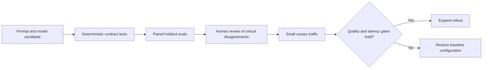

# Release behavior with evidence, not a successful demo

Role: implementation. Prerequisites: [retrieval](03_retrieval_augmented_generation.md) and
[deterministic LLM tests](../../operations/testing/13_testing_llm_code.md).
An eval is a measured sample of model behavior under a specified configuration. It estimates
whether a change helps the product; it does not prove all future outputs correct.

## Make one release decision locally

The extraction service has a baseline prompt and a candidate prompt. A synthetic result set lets
us test the release rule before paying for any model calls. From the repository root:

```bash
python3 architecture/llm_systems/examples/eval_gate.py
```

Expected output:

```text
ordinary: baseline=100% candidate=100%
security: baseline=100% candidate=50%
release blocked: security regression
```

The [complete script](examples/eval_gate.py) deliberately contains a failed security case. Its zero
exit code means the test successfully asserted that the candidate is blocked, not that the candidate
passed. A production gate should return a failing process status when rejecting a release.

This example separates the evaluator's correctness from the model's quality. The script proves
slice arithmetic and gating behavior on four synthetic observations. Live evaluations must supply
real outcomes; this is too small a sample for a quality estimate.

## Build a dataset that can reveal your failures

For document 42, include the question, authorized source revision, expected citation IDs, acceptable
answer criteria and expected abstention behavior. Prefer criteria over one exact sentence when
several phrasings are correct. Keep exact matching for fields where variation is a bug, such as IDs.

An illustrative fixture:

```json
{"case_id":"retention-no-evidence","slice":"abstention","question":"How long are reports retained?","sources":[],"criteria":{"must_abstain":true,"allowed_citations":[]},"dataset_revision":"docs-eval-v3"}
```

Start with representative production tasks, then add known failures and adversarial cases: missing
sources, contradictory revisions, malformed source text, injection attempts, unauthorized documents,
long inputs, languages the product supports and a provider refusal. Sanitization must preserve the
failure while removing unnecessary private data. Version the dataset and prevent test-set examples
from being copied into prompt demonstrations. Maintain a separate development set for iteration
and a holdout set for release decisions; once repeatedly optimized against, a holdout becomes a
training signal and needs replenishment.

Evaluate retrieval on evidence recall, extraction on domain correctness, and final answers on
support and usefulness. If retrieval already failed, a final-answer score alone cannot explain why.

## Decide what a grader can establish

Deterministic graders verify parseability, citation membership, ID equality and forbidden tool calls.
A model judge can assess support or usefulness, but its output is another fallible measurement.
Give it a narrow rubric, hide candidate identity, and compare it against human-labeled examples.
Swap answer order in pairwise comparisons to detect position bias. Report disagreement and inspect
it rather than averaging it away. Treat retrieved content as untrusted in the judge too.

For a factual support rubric, “pass” requires every material assertion to be supported by the
provided evidence; “fail” includes unsupported numerical claims; “uncertain” routes to review.
Keep the rubric, judge model revision and prompt under version control. A judge upgrade is a
measurement-system change: rerun both baseline and candidate with the same new judge before
comparing scores.

[OpenAI evaluation guidance](https://developers.openai.com/api/docs/guides/evaluation-best-practices)
describes task-specific eval design and human calibration; checked 2026-10-30.

## Compare paired cases and expose small samples

Run both releases on the same cases with the same retrieval snapshot. Count per-case regressions
and improvements, not only the two averages. Suppose baseline passes 90/100 and candidate 92/100.
The net gain of two can hide ten regressions and twelve improvements. If one regression grants
cross-tenant access, the aggregate gain is irrelevant to the security invariant.

Model sampling adds variation. Repeat selected cases, report sample counts and uncertainty, and
predeclare acceptable slice regressions. A result of 10/10 does not establish a 99.9% success rate.
Do not retry only failures and discard the original attempts: users would have experienced those
failures and the policy would add cost and latency. If retries are part of the product, evaluate the
whole retry policy and charge every attempt.

The release path ties offline evidence to production observations:



Offline checks cannot reveal every traffic shift. Canary monitoring should watch abstentions, user
corrections, token use, cost per accepted task and quality samples by slice. Drift means the inputs
or behavior have changed enough that the old evaluation may no longer represent the service. Add
new cases through a reviewed process; do not rewrite expected answers merely to make a candidate pass.

## What's changing

As checked on 2026-10-30, OpenAI's hosted Evals platform is scheduled to become read-only on
2026-10-31 and shut down on 2026-11-30. Keep datasets, grader definitions and release criteria
portable and versioned. This chapter's runner is local and does not depend on that hosted API.
[Deprecation notice](https://developers.openai.com/api/docs/deprecations).

## Recap

- Contract tests validate software; evals measure sampled behavior.
- Paired, versioned cases isolate the effect of a candidate change.
- Slice gates protect important failures that averages hide.
- Human calibration and canary evidence limit confidence in automated judges.

**Check yourself: a new judge gives the candidate 95% and an older stored baseline score is 90%. What comparison is missing?**

<details><summary>Answer</summary>

Rerun baseline and candidate under the same judge, rubric and dataset. The five-point difference
mixes a product change with a measurement change and cannot identify which caused it.

</details>

**Check yourself: a retry raises answer accuracy but doubles provider spend. What should the eval report?**

<details><summary>Answer</summary>

The end-to-end outcome plus latency, attempts and total cost of the retry policy. Discarding initial
failures makes a different system look better than the one users actually experience.

</details>

**Try it:** add a cost column to each fixture and reject a candidate whose cost per successful task
exceeds an illustrative limit. Hint: failed attempts still belong in the numerator.

<details><summary>Worked solution</summary>

Sum cost over every candidate attempt, divide by the number of accepted tasks, and reject zero
successes explicitly instead of dividing by zero. Apply the safety gate independently: a cheap
candidate that violates tenant isolation remains blocked.

</details>
