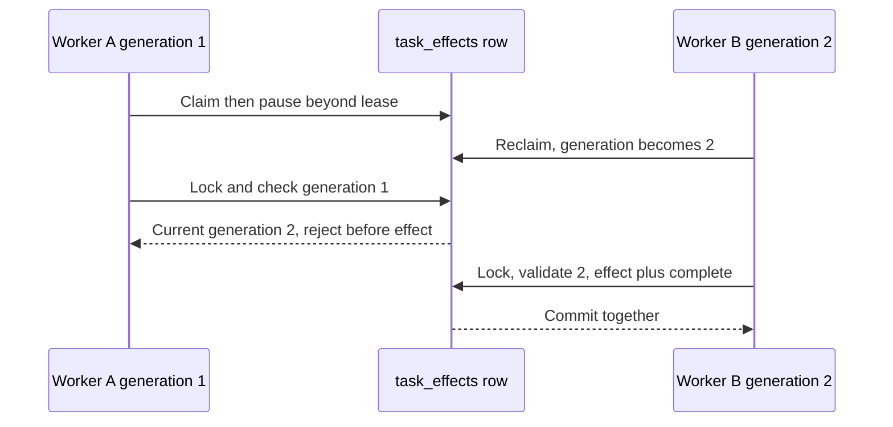

# Part 2: Worker Patterns

> **Who this is for**: Engineers implementing worker claim, heartbeat, execution, and acknowledgement
> behavior after choosing an orchestration pattern.

How the worker receives tasks, executes them, reports health, handles failures, and delivers results. The worker is the execution engine — everything else exists to support it.

> **Key insight**: A queue acknowledgement is a claim about durable effects, not merely evidence
> that the handler returned.

---

## 1. Task Pickup Strategies

### Pull-Based (Worker Polls Queue)

The worker pulls tasks from a queue (SQS, RabbitMQ, Redis list). The worker controls its own pace.

```
Queue: [task_3] [task_2] [task_1]
                                    ◄── worker.poll()
                          [task_1]  ──► worker processes
Queue: [task_3] [task_2]
                                    ◄── worker.poll()
                [task_2]            ──► worker processes
Queue: [task_3]
```

**Advantages:**
- Natural backpressure — worker only pulls when ready
- Worker can batch-pull multiple tasks at once
- Simple scaling — add more workers, they all pull from the same queue

**Disadvantages:**
- Polling interval adds latency (empty polls waste resources)
- Need visibility timeout management (what if worker crashes mid-processing?)

### Push-Based (Orchestrator Invokes Worker)

The orchestrator calls the worker directly (Lambda invoke, HTTP call, gRPC).

```
Orchestrator ── invoke(task) ──► Worker
                                  │── process
Orchestrator ◄── response ────────┘
```

**Advantages:**
- No worker polling interval before dispatch
- Orchestrator has direct control over which worker gets which task

**Disadvantages:**
- Orchestrator must manage concurrency (don't overload workers)
- Tighter coupling — orchestrator needs to know worker addresses/endpoints

### Event-Triggered

An event source (SQS + Lambda ESM, Kafka consumer group) automatically triggers the worker when a new task arrives.

```
Queue: new message arrives
  │
  └── Event Source Mapping triggers Lambda / container
      │
      └── Worker processes message
```

**Advantages:**
- Managed polling/scaling machinery, subject to configured quotas and concurrency
- Polling is owned by the integration rather than application code

**Disadvantages:**
- Less control over concurrency (need explicit limits like Lambda reserved concurrency, ESM MaximumConcurrency)
- Cold starts (Lambda)

---

## 2. Health Reporting

The worker must communicate its liveness to the orchestrator. How it does so depends on the orchestration pattern.

### Heartbeat to Orchestrator (Active)

Worker sends periodic signals. See [Orchestration Patterns: Heartbeat Monitoring](01_orchestration_patterns.md#pattern-2-heartbeat-monitoring).

```python
import asyncio
import httpx


class LeaseRenewalFailed(RuntimeError):
    pass


async def heartbeat_sender(job_id: str, url: str, interval: float = 30.0):
    failures = 0
    async with httpx.AsyncClient(timeout=5.0) as client:
        while True:
            try:
                response = await client.post(f"{url}/jobs/{job_id}/heartbeat")
                response.raise_for_status()
                failures = 0
            except httpx.HTTPError as exc:
                failures += 1
                logger.exception("heartbeat_failed", extra={"job_id": job_id, "failures": failures})
                if failures >= 2:  # before the 90-second lease can expire
                    raise LeaseRenewalFailed(job_id) from exc
            await asyncio.sleep(interval)
```

Run the heartbeat and bounded work in one `asyncio.TaskGroup`; if renewal fails repeatedly, the
exception cancels the work task before the orchestrator may legitimately reassign the lease. Work
that performs external effects must also carry the lease generation as a fencing token.

### Status Writes to Shared Store (Passive)

Worker periodically writes its status to a shared store (Redis, DynamoDB, PostgreSQL). The orchestrator reads it when needed.

```python
from datetime import UTC, datetime


async def update_progress(redis: Redis, job_id: str, progress: int, step: str):
    await redis.hset(f"job:{job_id}", mapping={
        "progress": progress,
        "step": step,
        "updated_at": datetime.now(UTC).isoformat(),  # aware RFC 3339-style UTC text
    })
    # TTL is a lease observation. Expiry means renewal was not observed; it
    # does not prove the process died.
    await redis.expire(f"job:{job_id}", 120)  # 2x heartbeat interval
```

Before assigning a replacement, a monitor marks the lease's owner/generation expired and issues a
new generation atomically. The replacement includes that generation in conditional writes so a
partitioned old worker cannot complete the same effect after it reconnects.

### Health Endpoint (Infrastructure-Level)

The worker exposes a `/health` endpoint. The orchestrator (or a load balancer / container orchestrator) pings it.

```python
# Worker exposes this
@app.get("/health")
async def health():
    return {"status": "healthy", "active_tasks": len(running_tasks)}
```

This is the pattern used by Kubernetes liveness/readiness probes, ECS health checks, and Bedrock AgentCore's `HealthyBusy` / `Healthy` ping states.

---

## 3. Result Storage Patterns

Where does the worker put the result when it's done?

### Direct Callback (Push Result to Orchestrator)

Worker POSTs the result directly to the orchestrator or a result endpoint.

```python
async def complete_task(orchestrator_url: str, job_id: str, generation: int, result: dict):
    async with httpx.AsyncClient(timeout=10.0) as client:
        response = await client.post(
            f"{orchestrator_url}/jobs/{job_id}/complete",
            json={"state": "succeeded", "generation": generation, "result": result},
        )
        response.raise_for_status()
```

The caller persists a pending completion delivery before attempting HTTP and retains it on timeout
or non-2xx. The receiver atomically checks job/owner/generation and stores the result; retries of
the same accepted result are idempotent. HTTP success acknowledges durable intake, not an unrelated
remote side effect. The signed durable delivery pattern is in [client delivery](03_client_delivery_patterns.md#pattern-5-webhook-client-callback).

**Best for:** Bounded small results when the orchestrator needs to react promptly.

### Write to Shared Store (Decoupled)

Worker writes the result to a store. The orchestrator (or client) reads it when ready.

```python
# Worker writes
await redis.set(f"result:{job_id}", json.dumps(result), ex=3600)

# Or to S3 for large results
s3.put_object(Bucket="results", Key=f"{job_id}.json", Body=json.dumps(result))
```

**Best for:** Large results, when multiple consumers need the result, when you want result persistence.

### Write to Database Row

Worker updates the job record directly.

```python
accepted = await db.fetchval(
    "UPDATE jobs SET status = 'succeeded', result = $1, completed_at = NOW() "
    "WHERE id = $2 AND generation = $3 AND status = 'running' "
    "AND lease_expires_at > clock_timestamp() RETURNING id",
    json.dumps(result), job_id, generation,
)
if accepted is None:
    raise LeaseRenewalFailed(job_id)
```

**Best for:** Simple architectures where the job table is the single source of truth.

### Comparison

| Strategy | Result Size | Latency | Coupling | Persistence |
|----------|-------------|---------|----------|-------------|
| Direct callback | Small (< 1 MB) | Lowest | High | No (transient) |
| Redis | Medium (< 50 MB) | Low | Low | TTL-based |
| S3 / Blob Storage | Any (GBs) | Medium | Low | Durable |
| Database row | Small–Medium | Low | Medium | Durable |

---

## 4. Graceful vs Ungraceful Failure

### Graceful Failure

The worker catches the error, reports it, and exits cleanly.

```python
async def run_task(job_id: str, task_token: str):
    try:
        result = await do_inference(job_id)
        await send_task_success(task_token, result)
    except Exception as e:
        # Graceful: explicitly report failure
        await send_task_failure(task_token, error=str(e), cause=traceback.format_exc())
        logger.error(f"Task {job_id} failed gracefully", exc_info=True)
```

**What the orchestrator sees:** An explicit failure signal with error details. Can make informed retry/escalation decisions.

### Ungraceful Failure

The worker crashes (OOM, SIGKILL, hardware failure, network partition). No callback is sent.

```
Worker: *crashes*
  │
  ├── No callback sent
  ├── No heartbeat sent
  │
  └── Orchestrator detects via:
      ├── Heartbeat timeout (Pattern 2)
      ├── HeartbeatSeconds expiry (Pattern 3 — Task Token)
      ├── Stale-job sweeper (Pattern 1 — Fire-and-Forget)
      └── Visibility timeout expiry → message reappears in queue
```

**What the orchestrator sees:** Silence. Must infer failure from absence of signal.

### Designing for Both

```python
async def run_task(job_id: str, task_token: str):
    async with asyncio.TaskGroup() as group:
        heartbeat = group.create_task(heartbeat_loop(job_id, task_token))
        try:
            async with asyncio.timeout(600):
                result = await do_inference(job_id)
                await send_task_success(task_token, result)
        finally:
            heartbeat.cancel()  # TaskGroup awaits cancellation before exiting
```

`heartbeat_loop` must raise on lost authority; TaskGroup then cancels and awaits inference.
The work must cooperate with cancellation and bound its own blocking I/O. The coordinator handles
the resulting exception group and persists retry/failure state. Do not convert a lost success
response into a contradictory failure: reconcile the token/result before retrying. A remote request
already sent cannot be undone by cancellation; fence it or give it a stable idempotency key.


---

## 5. Batch Collection

When the worker processes multiple items as a batch (e.g., batched LLM inference for throughput), it needs to collect individual requests into groups.

### Time-Window Batching

Collect items for a fixed time window, then process whatever has accumulated.

```python
async def batch_collector(queue: asyncio.Queue, window_seconds: float = 2.0, max_batch: int = 32):
    while True:
        batch = []
        deadline = asyncio.get_running_loop().time() + window_seconds

        # Collect until window closes or batch is full
        while asyncio.get_running_loop().time() < deadline and len(batch) < max_batch:
            remaining = deadline - asyncio.get_running_loop().time()
            try:
                item = await asyncio.wait_for(queue.get(), timeout=max(0, remaining))
                batch.append(item)
            except asyncio.TimeoutError:
                break  # Window closed

        if batch:
            await process_batch(batch)
```

### Size-Triggered Batching

Process when the batch reaches a target size. Use a timeout as a fallback for low-traffic periods.

```python
async def batch_collector(queue: asyncio.Queue, batch_size: int = 32, max_wait: float = 5.0):
    while True:
        batch = [await queue.get()]  # Block until at least one item
        deadline = asyncio.get_running_loop().time() + max_wait

        while len(batch) < batch_size:
            remaining = deadline - asyncio.get_running_loop().time()
            if remaining <= 0:
                break
            try:
                item = await asyncio.wait_for(queue.get(), timeout=remaining)
                batch.append(item)
            except asyncio.TimeoutError:
                break

        await process_batch(batch)
```

### Adaptive Batching

Adjust batch size based on current load. Under high load, batch more aggressively for throughput. Under low load, process quickly for latency.

```python
async def adaptive_batch_collector(queue: asyncio.Queue):
    min_batch, max_batch = 1, 64
    current_target = 8

    while True:
        batch = [await queue.get()]
        pending = queue.qsize()

        # Adapt: if queue is deep, batch more; if shallow, batch less
        if pending > current_target * 2:
            current_target = min(current_target * 2, max_batch)
        elif pending < current_target // 2:
            current_target = max(current_target // 2, min_batch)

        # Collect up to target
        while len(batch) < current_target and not queue.empty():
            batch.append(queue.get_nowait())

        await process_batch(batch)
```

---

## 6. Idempotency

Workers should be idempotent — processing the same task twice must produce the same result (or at least not cause harm). This matters because:

- Queue messages can be delivered more than once (SQS at-least-once)
- The orchestrator might retry on timeout (worker was actually alive, just slow)
- Network partitions can cause duplicate dispatches

### A claim is not proof that the effect completed

Setting `processed:{task_id}` before the effect creates a lost-work window: the worker can crash
after `SET NX` and every retry will skip an effect that never happened. Use a `claimed → complete`
record with an expiring lease, and couple `complete` to the durable business effect in one database
transaction whenever both live in the same store.

The claim row has a unique `task_id`, `state`, `generation BIGINT NOT NULL`, and
`lease_expires_at TIMESTAMPTZ NOT NULL`. This excerpt uses one asyncpg connection; the effect must
use that same connection and contain only local transactional writes.

```python
async def process_if_claimed(db, task_id: str, task_data: dict):
    generation = await db.fetchval(
        """
        INSERT INTO task_effects (task_id, state, generation, lease_expires_at)
        VALUES ($1, 'claimed', 1, clock_timestamp() + interval '2 minutes')
        ON CONFLICT (task_id) DO UPDATE
          SET state = 'claimed', generation = task_effects.generation + 1,
              lease_expires_at = EXCLUDED.lease_expires_at
        WHERE task_effects.state <> 'complete'
          AND task_effects.lease_expires_at < clock_timestamp()
        RETURNING generation
        """, task_id,
    )
    if generation is None:
        return False
    async with db.transaction():
        current = await db.fetchrow(
            "SELECT state, generation, lease_expires_at > clock_timestamp() AS live "
            "FROM task_effects WHERE task_id=$1 FOR UPDATE", task_id,
        )
        if (current["state"] != "claimed" or current["generation"] != generation
                or not current["live"]):
            return False
        await apply_business_effect(db, task_id, task_data)
        completed = await db.fetchval(
            "UPDATE task_effects SET state='complete' "
            "WHERE task_id=$1 AND generation=$2 AND state='claimed' RETURNING task_id",
            task_id, generation,
        )
        if completed is None:
            raise RuntimeError("lost claim")  # rolls the effect back too
    return True
```

Here is the race that the row lock closes:



If A instead locks and validates while its lease is live, B's reclaim waits for that transaction;
after A commits `complete`, B's predicate refuses it. Keep this transaction short. The lock orders
local effects; it does not fence a remote service. The complete protocol and recovery tests belong
in the [lease/fencing path](../../background_work/reliability/README.md).


The local integration fixture extracts the exact function above, creates two PostgreSQL connections,
forces A to resume after B reclaims, and injects a failure before the completion marker:

```bash
python -m pip install asyncpg==0.32.0
python architecture/long_running_tasks/examples/verify_claim_transaction.py
```

Run from repository root with Docker available. The fixture publishes only a random loopback port,
uses a unique disposable container, and removes it afterward. Expected output is `PASS generation 1
resumes after generation 2; only B's effect commits` and `PASS failure before completion rolls the
local effect back`. These checks verify local PostgreSQL effects; remote fencing remains a separate
receiver contract.

When the effect belongs to a remote service, use that service's idempotency key if available and
persist the returned operation ID. No local Redis flag can atomically prove an unrelated remote
effect completed.

### Idempotent Result Storage

If the result is already stored, a duplicate write is a no-op (or an upsert).

```sql
-- PostgreSQL: INSERT ... ON CONFLICT DO NOTHING
INSERT INTO results (job_id, result, created_at)
VALUES ($1, $2, NOW())
ON CONFLICT (job_id) DO NOTHING;
```

---

## 7. Concurrency Control on the Worker

How to limit how many tasks a single worker processes simultaneously.

### Semaphore (In-Process)

```python
import asyncio

_semaphore = asyncio.Semaphore(4)  # Max 4 concurrent tasks

async def handle_task(task):
    async with _semaphore:
        await process(task)
```

### Queue-Level (External)

- **SQS**: `MaximumConcurrency` on the Event Source Mapping
- **RabbitMQ**: `prefetch_count` on the consumer channel
- **Celery**: `--concurrency` flag on the worker
- **Kubernetes**: Horizontal Pod Autoscaler limits

### Resource-Based

Monitor GPU memory, CPU, or RAM and stop accepting tasks when saturated.

```python
async def can_accept_task() -> bool:
    gpu_util = get_gpu_utilization()  # nvidia-smi or pynvml
    return gpu_util < 0.85  # 85% threshold
```
