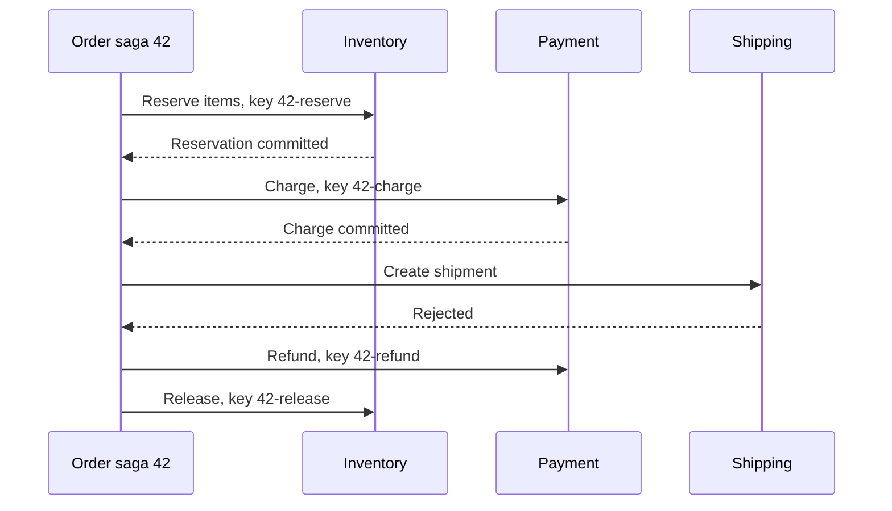
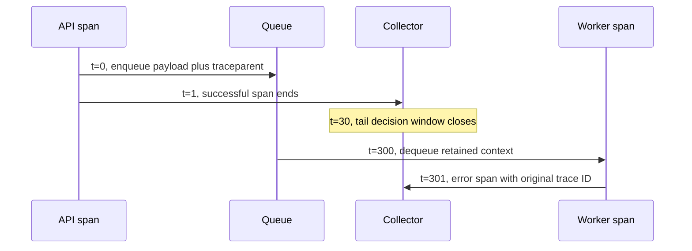

# Advanced Patterns: Sagas, Outbox, Delivery Semantics, Progress, Tracing

> **Who this is for**: Engineers hardening long-running work across transaction boundaries,
> cancellation, resumability, and tracing.

> Patterns that come up once you're past "send a message, hope it works." Each of these addresses a specific failure mode you will eventually hit in production and can't fix with retries alone.

> **Key insight**: Every cross-system guarantee ends at a transaction boundary, so recovery depends
> on an explicit durable fact at each boundary.

---

## 1. The Saga Pattern — Multi-Step Transactions Without a Distributed Commit

A **saga** is a sequence of local transactions across multiple services, each with a compensating action that undoes it. Instead of a single distributed transaction (which requires 2PC / XA, generally impractical), you do the work as a chain of local commits and rollbacks.

### The problem

```
Place order:
  1. Reserve inventory      (Inventory service)
  2. Charge payment         (Payment service)
  3. Create shipment        (Shipping service)
  4. Send confirmation      (Notification service)
```

Step 3 fails. Steps 1 and 2 already committed to their own databases. You need to **unwind** — release the inventory, refund the payment. Each service must know how to undo its own step.

The compensation is another committed action, not a rewind of all services:



A refund may itself time out. The saga retains `refund pending` and retries the same compensation
identity; it must not claim the order is fully compensated until the participants confirm it.

### Two flavors

**Choreography** — services listen for events and react. Step 1 emits `InventoryReserved`; payment service reacts, emits `PaymentCharged`; shipping reacts; etc. On failure, services emit compensating events (`InventoryReleased`, `PaymentRefunded`) that other services consume.

- Pros: loose coupling, no central controller.
- Cons: flow is implicit — you can't read the saga in one place. Hard to reason about "what is the state of this order right now" without event archaeology.

**Orchestration** — a saga orchestrator drives the flow explicitly. It knows the step order and, on failure, walks backwards calling compensating actions.

- Pros: the saga is visible as code, one place to read.
- Cons: the orchestrator is coupled to every participant. Good frameworks (Temporal, AWS Step Functions, Uber Cadence) make this robust; hand-rolling one is painful.

### Compensating actions are not rollbacks

- A local transaction can be truly rolled back.
- A compensating action is a **new transaction** that undoes the effect of a committed one. It may not be a perfect inverse (you can refund a payment, but you can't un-send an email).
- Compensations must themselves be idempotent — the compensator might be retried.
- Some actions are un-compensatable (sending physical mail). For those, the saga must make them the *last* step, so nothing earlier can fail after them.

### When to reach for a saga framework

If your workflow is:
- Long-running (minutes to days)
- Multi-service
- Needs durable state if the orchestrator crashes mid-flight

…use **Temporal** or **AWS Step Functions**. Don't build your own orchestrator unless you enjoy reimplementing distributed systems. Both frameworks handle durability, retries, versioning, and human intervention (manual approval steps).

---

## 2. The Outbox Pattern — Atomic "DB Write + Event Emission"

The classic bug:

```python
# ❌ Dual-write problem
db.orders.insert(order)
event_bus.publish("OrderCreated", order)
```

These are two separate writes to two separate systems. Either can fail after the other succeeded. You can crash after the DB commit but before publishing — now the DB has an order with no downstream reaction. Or the publish succeeds but the DB commit rolls back — downstream services react to an order that doesn't exist.

### The outbox

Write the event into the **same database transaction** as the business data, to an `outbox` table. A separate process reads the outbox and publishes events. Now the DB commit is the single source of truth — either the order exists and the event is in the outbox, or neither.

```sql
BEGIN;
INSERT INTO orders (id, total, ...) VALUES (...);
-- Allocate this sequence under the aggregate row lock in the same transaction.
UPDATE orders SET event_sequence = event_sequence + 1
 WHERE id = order_id
 RETURNING event_sequence;
INSERT INTO outbox (id, aggregate_id, aggregate_sequence, event_type, payload, status)
     VALUES (gen_random_uuid(), order_id, event_sequence,
             'OrderCreated', '{...}', 'pending');
COMMIT;
```

A publisher excerpt (requires `claim_generation BIGINT NOT NULL DEFAULT 0`, claim owner/expiry
columns and an application broker adapter; `import asyncio, secrets`):

```python
async def outbox_publisher():
    publisher_id = secrets.token_hex(16)  # unique per publisher incarnation
    while True:
        # Claim durably in a short transaction; row locks alone disappear as
        # soon as the SELECT's transaction ends.
        async with db.transaction():
            await db.execute(
                "UPDATE outbox SET status='pending', claim_owner=NULL "
                "WHERE status='publishing' AND claim_expires_at < now()"
            )
            events = await db.fetch(
                """
                WITH candidates AS (
                    SELECT o.id
                      FROM outbox AS o
                     WHERE o.status = 'pending'
                       AND NOT EXISTS (
                           SELECT 1 FROM outbox AS earlier
                            WHERE earlier.aggregate_id = o.aggregate_id
                              AND earlier.status IN ('pending', 'publishing')
                              AND earlier.aggregate_sequence < o.aggregate_sequence
                       )
                     ORDER BY o.aggregate_id, o.aggregate_sequence
                     LIMIT 100 FOR UPDATE OF o SKIP LOCKED
                )
                UPDATE outbox AS o
                   SET status='publishing', claim_owner=$1,
                       claim_generation=claim_generation + 1,
                       claim_expires_at=now() + interval '30 seconds'
                  FROM candidates AS c
                 WHERE o.id = c.id
                RETURNING o.id, o.claim_generation, o.aggregate_id, o.aggregate_sequence,
                          o.event_type, o.payload
                """,
                publisher_id,
            )
        for e in events:
            try:
                # The aggregate key keeps one aggregate on one ordered broker
                # partition; ordering across different aggregates is irrelevant.
                await broker.publish(
                    e["event_type"],
                    {"event_id": str(e["id"]), "sequence": e["aggregate_sequence"],
                     "payload": e["payload"]}, key=e["aggregate_id"]
                )
                updated = await db.fetchval(
                    "UPDATE outbox SET status='published', published_at=now() "
                    "WHERE id=$1 AND status='publishing' AND claim_owner=$2 "
                    "AND claim_generation=$3 RETURNING id",
                    e["id"], publisher_id, e["claim_generation"],
                )
                if updated is None:
                    log.warning("stale_publish_completion", event_id=e["id"])
            except Exception:
                log.exception("publish_failed", event_id=e["id"])
                # Leave the durable claim to expire; the next claimant retries.

        if not events:
            await asyncio.sleep(1)
```

Key details:
- `FOR UPDATE SKIP LOCKED` selects distinct rows, while the committed
  `publishing` owner/lease keeps them claimed after row locks are released.
- **At-least-once delivery** — the publisher can crash between publishing and updating status, causing a republish. Consumers must be idempotent.
- **Ordering boundary** — the sequence and earliest-pending query control normal publication,
  but lease expiry cannot revoke an already paused broker send. A late old owner can publish
  sequence 1 after the new owner sent 1 then 2. The generation predicate fences database
  bookkeeping, not the broker. Consumers deduplicate `event_id` and apply a per-aggregate
  sequence rule: ignore known duplicates, buffer/reconcile gaps, and reject stale updates.
  If strict log order itself is required, use a partition owner/producer protocol that the broker
  fences, or a properly configured CDC pipeline; a partition key alone is insufficient.
- **Garbage collection** — published events shouldn't live forever. A separate job deletes rows older than N days, or uses table partitioning by date.

The late-send schedule explains why consumer sequence checks still matter:

```mermaid
sequenceDiagram
    participant A as Publisher A generation 1
    participant D as Outbox
    participant B as Publisher B generation 2
    participant Q as Broker
    A->>D: Claim order42 sequence 1
    Note over A: Pause longer than lease
    B->>D: Reclaim sequence 1
    B->>Q: Publish sequence 1 then sequence 2
    A->>Q: Late publish of sequence 1
    A->>D: Mark published with generation 1
    D-->>A: Rejected; current generation is 2
```

The database rejects stale bookkeeping, but the broker already saw the late duplicate. Check this
failure with the local [ordering simulation](examples/recovery_contracts.py), which asserts that a
sequence-aware projection stays at 2 for delivery order `1, 2, 1` and identifies a missing sequence.

### Outbox + CDC (Change Data Capture)

An increasingly common variant: instead of a polling publisher, use Debezium / Postgres logical decoding to stream the outbox table directly to Kafka. The business/outbox transaction stays the same, while publication is driven by the commit log.
Measure throughput and operate replication slots, connector offsets, retention, replay and schema
compatibility; removing polling does not remove those recovery duties.

---

## 3. Delivery Semantics: At-Most-Once vs At-Least-Once vs Exactly-Once

Distributed systems offer three nominal guarantees. Only two are real.

| Semantics | What it means | How you get it | Cost |
|-----------|---------------|----------------|------|
| **At-most-once** | Each message delivered ≤ 1 time | Fire-and-forget; ack before processing | Messages can be lost on any failure |
| **At-least-once** | Each message delivered ≥ 1 time | Ack after processing; retry on failure | Messages can be processed multiple times |
| **"Exactly-once"** | Each message delivered exactly 1 time | Doesn't exist end-to-end without additional mechanisms | — |

### Why exactly-once is a myth (end-to-end)

The fundamental problem: between "I did the work" and "I told the broker I did the work," you can crash. After recovery, you don't know whether the broker saw your ack. You either redo the work (and risk re-executing the side effect) or skip it (and risk losing it). There's no way to know which happened without idempotency on the receiver side.

What vendors mean by "exactly-once":

- **Kafka "exactly-once semantics"** — a transactional read-process-write pipeline can commit
  consumed offsets and produced Kafka records atomically. A consumer can still receive records
  again before that transaction commits, and an output that leaves Kafka for a database or HTTP
  service needs its own transactional coupling or idempotency boundary.
- **SQS FIFO with deduplication** — dedup window of 5 minutes. Within that window, duplicates are dropped. Beyond it, duplicates slip through.

### The practical rule

**Target at-least-once delivery plus an effect that is atomically idempotent.**

Checking a dedup table and then performing the effect in a separate commit is still unsafe: a crash
after the effect but before the dedup insert repeats the effect. Put the dedup record and local
business write in one database transaction, use a conditional write, or send a stable idempotency
key to an external provider that stores the original outcome. Patterns:

- **Dedup table**: record processed message IDs; reject duplicates. Matches the idempotency-key pattern in [`safe_and_scalable_api_calls/11_idempotency.md`](../../fundamentals/fastapi/safe_and_scalable_api_calls/11_idempotency.md).
- **Upsert, not insert**: if the outcome is deterministic given the input, use `INSERT ... ON CONFLICT DO UPDATE` or equivalent.
- **Read-before-write**: for operations where idempotency is naturally expressible ("set balance to X" is idempotent; "increment balance by X" is not), express them in the idempotent form.

---

## 4. Progress Reporting, Cancellation, and Resumability

Long-running tasks need more than "started / finished / failed." Users want to see progress bars, cancel mid-flight, and have the task survive a worker restart without starting from scratch.

### Progress reporting

Write progress to a shared store (Redis, DB) keyed by task ID:

```python
@dramatiq.actor
def process_large_file(task_id: str, file_path: str):
    total = count_records(file_path)
    for i, record in enumerate(iter_records(file_path)):
        process(record)
        if i % 100 == 0:  # don't hammer Redis
            redis.hset(f"task:{task_id}", mapping={
                "status": "running",
                "progress": i,
                "total": total,
                "updated_at": time.time(),
            })
    redis.hset(f"task:{task_id}", "status", "done")
```

Client polls or subscribes (Redis pub/sub, WebSocket) for updates.

### Cancellation

Cooperative. The worker must check a cancellation flag; there's no portable way to preempt a running Python function safely. (The Dramatiq async-exception trick from §Time Limits applies but is best-effort.)

```python
@dramatiq.actor
def cancellable_work(task_id: str):
    for chunk in chunks:
        if redis.get(f"cancel:{task_id}"):
            log.info("task_cancelled", task_id=task_id)
            redis.hset(f"task:{task_id}", "status", "cancelled")
            return
        process(chunk)
```

User clicks "cancel" → API sets `cancel:{task_id}` → worker sees it on the next loop iteration and exits cleanly.

### Resumability

If the worker crashes mid-task, you don't want to start over on a 2-hour batch job. Two approaches:

**Checkpoint-based.** Periodically persist progress + any derived state. On restart, load the checkpoint and resume.

```python
@dramatiq.actor
def batch_job(task_id: str, input_ids: list[int]):
    start = redis.hget(f"task:{task_id}", "resume_from")
    start = int(start) if start else 0

    for i in range(start, len(input_ids)):
        result = process(input_ids[i])
        # The deterministic key makes a replay an upsert of the same result,
        # not a second side effect. Prefer one DB transaction for this upsert
        # and the checkpoint when both live in the same store.
        save_result_once(result_key=f"{task_id}:{input_ids[i]}", result=result)
        if i % 100 == 0:
            advance_checkpoint_if_results_exist(task_id, resume_from=i + 1)
```

**Sub-task decomposition.** Break the job into many small messages, each idempotent. The broker's at-least-once delivery + your idempotent consumer makes resume automatic — any sub-task the worker didn't ack gets redelivered. This is usually the better pattern when the work decomposes cleanly.

---

## 5. Distributed Tracing — Seeing Across Service Boundaries

When a request fans out through API → queue → worker → upstream → database, logs alone don't tell you the shape of the request. Distributed tracing (OpenTelemetry) assigns a **trace ID** to the initial request and a **span ID** to each segment of work; every segment references its parent. You end up with a tree of spans you can render as a timeline.

### What to instrument

The minimum useful instrumentation for a long-running-task architecture:

1. **HTTP ingress** — FastAPI's `opentelemetry-instrumentation-fastapi` auto-instruments every request. The instrumentation attaches context to the active execution scope; do not assume an undocumented `request.state` field.
2. **Broker enqueue / dequeue** — inject the trace context into the message headers on send; extract on receive. OpenTelemetry's semantic conventions define `messaging.*` attributes for this.
3. **HTTP client calls** — `opentelemetry-instrumentation-httpx` auto-propagates context via `traceparent` headers.
4. **Database calls** — `opentelemetry-instrumentation-sqlalchemy` adds spans for each query.

### Cross-service propagation

The trace context travels in the **`traceparent`** HTTP header (W3C standard). When your FastAPI service calls an HTTPX client, the instrumented client automatically adds this header. When the upstream is also instrumented, it picks up the header and its spans become children of yours.

For the **message broker leg** (API sends message → worker processes), you must manually thread the context:

```python
# API: inject trace context into message
from opentelemetry import propagate

def send_task(payload, actor):
    headers = {}
    propagate.inject(headers)                  # writes traceparent + tracestate
    actor.send_with_options(args=(payload,), kwargs={"_tracectx": headers})

# Worker: extract and continue the trace
@dramatiq.actor
def my_actor(payload, _tracectx=None):
    ctx = propagate.extract(_tracectx or {})
    with tracer.start_as_current_span("process_task", context=ctx):
        do_work(payload)
```

The context can connect spans in a backend that retains them. It does not keep the HTTP span
running, preserve sampling decisions indefinitely, or guarantee a complete trace after queue delay.

This timing shows a successful request followed by a late worker failure:



The message preserves identity through five minutes of queueing. A collector deciding after 30
seconds may already have evicted that trace. Context propagation cannot recreate an upstream span
that a sampler dropped.

### Choose who makes the sampling decision

A **head sampler** chooses at span creation, before the outcome is known. A 1% head sample cannot
later retain all errors: 99% of requests may never reach the collector. A **tail sampler** observes
completed spans in the collector, buffers them, and decides from error/latency attributes. Route
all spans for a trace to the same decision owner and size its memory for arrival rate times wait.
[OpenTelemetry sampling](https://opentelemetry.io/docs/concepts/sampling/), checked 2026-10-30.

For a bounded five-minute job, choose and test a decision window beyond the supported queue plus
execution delay, with trace-count/memory limits and eviction metrics. If that budget is excessive,
start a worker trace with a link to the ingress context and sample worker outcomes independently;
correlate them using a non-secret job ID. Document how the selected backend handles late spans,
decision caching and eviction. “Keep errors” means errors observed before that policy's decision,
not every error from an arbitrarily delayed job.

Rehearse t=1 ingress completion followed by t=301 worker failure, then inspect both trace IDs,
parent/link fields and collector dropped/evicted counts. Re-run after changing sampling policy;
no tracing backend was provisioned by the local ordering simulation.

---

## See also

- [02_worker_patterns.md](./02_worker_patterns.md) — worker patterns that consume these.
- [04_infrastructure.md](./04_infrastructure.md) — the Redis / SQS / Kafka pieces the outbox relies on.
- [`safe_and_scalable_api_calls/11_idempotency.md`](../../fundamentals/fastapi/safe_and_scalable_api_calls/11_idempotency.md) — the consumer-side idempotency that makes at-least-once safe.

## Check the boundary

**With a 30-second tail window and a five-minute queue delay, does propagating `traceparent`
guarantee retention of a worker error?**

<details><summary>Reasoned answer</summary>

No. Identity and retention are different state. The context permits correlation, while the
collector may decide and evict before the worker starts. Extend a bounded retention policy or use
linked worker traces with independent sampling, and verify the late-arrival case.

</details>
