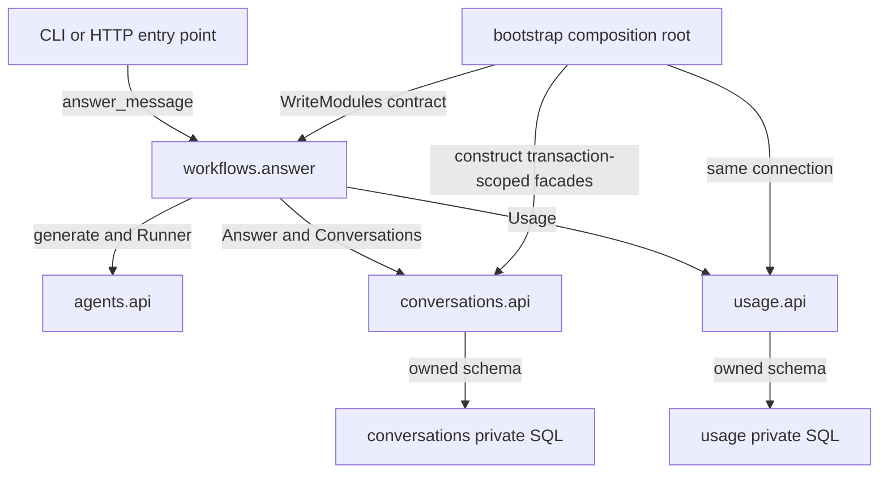

# Give each business capability an owner and a public contract

> **Role:** foundation. **Prerequisites:** typed Python functions and imports.

An application receives `answer_message(acme, C-1, R-1, "hello")`. It must generate an answer,
attach it to conversation `C-1`, and record one accepted answer for tenant `acme`. If every feature
can import every ORM model and write every table, a change to conversation retention can silently
break usage. Moving those files into three folders does not remove that dependency.

A **tenant** is a customer or account whose data must be scoped together; `acme` is this example's
tenant. A **modular monolith** gives related business behavior an owner, exposes a small contract to
other modules, and releases those modules together. It can run multiple replicas. “Monolith”
describes the deployment boundary, not a requirement for one machine or one enormous source file.

## Begin with the decisions each module owns

For this example, an **accepted answer** means a generated answer successfully recorded by the
application. Usage counts that event. It does not measure provider invocations, tokens, costs or
remaining quota. Naming the metric prevents a later retry from acquiring an accidental billing
meaning.

| Owner | Decisions and state | Public operation | What callers must not do |
|---|---|---|---|
| Agents | Valid prompt/output shape; provider translation | `generate(prompt, runner) -> str` | Depend on the provider's raw response object |
| Conversations | Tenant-scoped conversation existence; stored answers | `require`, `find_answer`, `append` | Read or write conversation tables directly |
| Usage | Accepted-answer ledger; one unit per recorded request | `record_answer`, `total` | Increment usage by modifying its private SQL |
| Answer-message workflow | Ordering and the requirement that answer + usage commit together | `answer_message(...) -> Answer` | Make either module commit independently |

An application-level *workflow* here is an ordinary Python function coordinating modules. It is
not yet a durable workflow engine. It disappears if the process dies. The distinction matters when
we later ask what happens between provider execution and database commit.

The module's **public API** is its supported Python call surface, not necessarily an HTTP
endpoint. Callers can know that `find_answer` returns an immutable `Answer` value without knowing
how it is stored. A **facade** is a small public surface over owned behavior; the `Conversations`
object groups transaction-scoped operations and consistently applies tenant scoping.

This separation of a module's public interface and internal implementation also appears in
[Spring Modulith's module model](https://docs.spring.io/spring-modulith/reference/fundamentals.html).
The principle does not require a module framework in Python.

## Keep the dependency graph one-way

The workflow knows three public APIs. None of the three modules knows the workflow or another
business module. The composition root constructs implementations; it is allowed to know details
because connecting details is its responsibility.

The arrows below are **source dependencies**, not the time order of execution:



If usage later needs to send a reminder, do not make it import the conversation storage and then
let conversations import usage for billing. That produces a cycle: neither module can be understood
or changed without the other. Put the combined use case above both modules, or define a deliberate
one-way public dependency if one capability naturally depends on the other. This example chooses
the stricter rule that sibling modules never import each other.

The `workflows/` package must also stay cohesive. It contains named cross-module use cases, not
every rule in the application. The accepted-answer counting rule belongs to usage; the workflow
decides when to request it. If almost every operation requires the same two modules to inspect each
other's state, revisit the split: they may belong to one capability.

## Modules contain use cases; use cases can be vertical slices

`conversations` is a business module. `list_messages` is a use case within it. A **vertical slice**
keeps the input, application operation and result for one use case near one another, instead of
scattering them across global controller/service/repository directories.

This possible production layout shows where code belongs as it grows. It is a design sketch;
the next lesson links a smaller executable package.

```text
app/
  main.py                       # mount HTTP routers, start runtime
  bootstrap.py                  # clients, pools, module construction
  workflows/
    answer_message.py           # cross-module completion policy
  agents/
    api.py                      # published generation contract
    execute.py                  # use-case slice when api.py grows
    ports.py                    # provider capability if needed
    adapters/provider.py        # provider-specific translation
  conversations/
    api.py                      # public operations and result values
    list_messages.py            # simple read slice; may use owned SQL
    retention.py                # shared rules inside this module
    adapters/postgres.py        # when a persistence boundary earns it
    migrations/                # owns changes to conversation tables
  usage/
    api.py
    rules.py                    # only once meaningful rules exist
    migrations/
  infrastructure/
    database.py                 # pool construction, no business tables
```

A small module can begin with `api.py` and private implementation files. Split into slices when
independent use cases become difficult to follow. Do not create empty `domain/`, `ports/` and
`repositories/` directories to match the sketch. A module can use a different internal structure
from its neighbor while preserving their shared rule about public imports.

For an HTTP application, a router parses and validates transport input, obtains authenticated
identity, invokes a use case and maps the result. It does not decide when an answer counts as
usage. [FastAPI's router composition](https://fastapi.tiangolo.com/tutorial/bigger-applications/)
helps assemble endpoints, but `include_router` itself enforces none of these ownership rules.

## Use a port when it expresses a useful consumer need

A **port** is a capability contract owned by its consumer. An **adapter** translates a concrete
implementation to that contract. Agents needs an answer string; it need not expose a provider SDK
response. This is the complete contract in the runnable example:

```python
from typing import Protocol


class Runner(Protocol):
    def run(self, prompt: str) -> str: ...
```

Any compatible object can satisfy the contract without inheritance. This structural typing gives
tests a deterministic fake and places vendor response translation at an explicit boundary. It does
not enforce timeouts, authorize tool execution or validate output by itself; those are behavior
requirements the implementation must satisfy.

By comparison, the first conversation module simply issues SQL through its public facade.
There is no promise that its implementation can switch database engines without edits. That is an
acceptable local choice when the public API already protects other modules and the queries are
simple. If domain policy becomes entangled with SQL, add a persistence port or move pure policy
out first. See [port contract design](../hexagonal_architecture/05_design_ports_and_adapter_contracts.md)
for that deeper choice.

## Data ownership continues past the import boundary

The following import is legitimate for a cross-module workflow:

```python
from modular_app.conversations.api import Answer, Conversations
```

But an otherwise clean workflow could still issue `UPDATE accepted_answers ...` through a raw
connection. Its imports would look fine while bypassing usage's rules. A real review therefore
checks both source dependencies and data access. Table ownership includes writes, schema changes
and the supported path for reads.

For cross-module reporting, first request data through the owner's query API. If latency or query
volume requires a combined report, define an explicit reporting contract or projection and its
freshness. A hidden join against private tables ties the report to both internal schemas. Calling
it “read-only” does not remove that coupling.

Separate database schemas can document ownership. Separate credentials can enforce more of it.
Neither is required for the small shared-transaction example, and Python's underscore convention
does not constitute a security boundary. Use module rules for maintainability; use authorization
and database controls for isolation against untrusted callers.

## Recap

- A module owns decisions and data; a public API prevents callers from depending on its details.
- A slice groups one use case inside that ownership structure; a module may contain many slices.
- A coordinating workflow can depend on several modules while keeping the modules independent.
- Ports protect meaningful implementation boundaries. They do not require every class to have an interface.
- Import checks cannot catch every violation of table ownership or create runtime isolation.

## Check yourself

**A module exposes SQLAlchemy entities as its public return values. Can its storage representation change freely?**

<details><summary>Answer</summary>

No. Callers may depend on mapped attributes, lazy loading or the ORM session lifetime. A stable
result value containing the required fields narrows that contract. It does not mean all internal
entities need a duplicate public DTO—only values actually crossing the boundary need a deliberate shape.

</details>

**Usage needs conversation metadata for a receipt. Should conversations import usage to make this bidirectional?**

<details><summary>Answer</summary>

Place receipt generation above both APIs, or choose a one-way public dependency with a clear owner.
The first approach matches this example's policy. Adding reverse imports creates a cycle and makes
the original ownership promise harder to keep. If the two capabilities cannot function without
repeated mutual inspection, reconsider the boundary rather than hiding imports behind a registry.

</details>

Next, [run the application and test those boundaries](02_build_and_test_a_modular_monolith.md).
