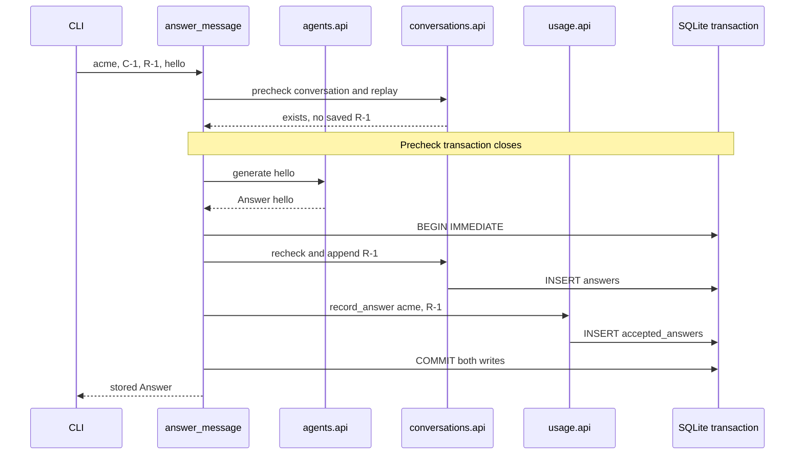

# Run three modules with one explicit completion boundary

> **Role:** tutorial. Read [module boundaries](01_define_module_boundaries.md) first.
> **Baseline:** Python 3.11+ with `sqlite3`; standard library only. Tested on Python 3.14.6.

The [complete example](examples/modular_app/demo.py) generates an answer, records it in a
tenant-scoped conversation, and records one accepted-answer unit. Running the same logical request
again returns the existing answer. A failed usage write removes the answer written earlier in the
same transaction. These are executable properties, not consequences of the folder names.

## Run the smallest complete application

From the repository root, use a `python3` interpreter that reports version 3.11 or newer:

```bash
cd architecture/modular_monolith/examples
python3 --version
python3 -m modular_app.demo
python3 -m unittest discover -s tests -v
python3 check_boundaries.py
```

On systems where `python3` is an older system Python, substitute your installed Python 3.11+
executable in each command. No package installation is necessary.

Expected demo output:

```text
R-1: Answer: hello
replay equals original: True
accepted answers: 1
```

The tests finish with `Ran 9 tests` and `OK`. The final command prints
`module import boundaries: PASS`. The demo creates a fresh database in a temporary directory and
cleans it up afterward. New transaction connections see committed state during the run; rerunning
the demo starts a new database. This is not a persistent application installation.

The source has these owners:

| File | Why it exists |
|---|---|
| [agents/api.py](examples/modular_app/agents/api.py) | Prompt/output policy and the provider `Runner` port |
| [agents/_fake.py](examples/modular_app/agents/_fake.py) | Deterministic implementation for the local exercise |
| [conversations/api.py](examples/modular_app/conversations/api.py) | Conversation lookup, tenant scoping and answer persistence |
| [usage/api.py](examples/modular_app/usage/api.py) | Accepted-answer ledger and totals |
| [workflows/answer.py](examples/modular_app/workflows/answer.py) | Cross-module ordering and replay semantics |
| [bootstrap.py](examples/modular_app/bootstrap.py) | Connection lifecycle and shared transaction construction |
| [tests/test_workflow.py](examples/tests/test_workflow.py) | Behavioral and boundary evidence |

The `_schema.py` files belong to their respective modules. Bootstrap calls their public schema
installation functions. This initialization is for a new local database, not a migration framework.

## Follow the first request before introducing a retry

`demo.py` creates `acme/C-1` and supplies a trusted tenant identifier, `R-1`, prompt `hello`, a fake
runner and a transaction factory. The application function receives specific collaborators rather
than looking them up in a global registry.

The first transaction checks that the conversation exists for this tenant and that `R-1` has not
already completed. It then closes. `generate` validates the prompt, calls the runner and validates
the result. Generation happens outside the write transaction so a slow provider does not hold a
database write lock for the duration of inference.

After generation, a new transaction checks existence and replay again. Another caller might have
completed while this one was generating. If no answer exists, the workflow stores the answer and
records usage. Only after both operations succeed does the transaction commit.

This sequence shows the successful `R-1` and the scope that can roll back:



Both module objects receive the same transaction connection. Separate module classes do not imply
separate transactions. If usage raises an exception, execution leaves the transaction context and
bootstrap rolls back the conversation insert too. If each module committed itself, the workflow
could no longer promise “answer and usage together.”

The final transaction body, excerpted from the complete source, makes that dependency visible:

```python
with transaction() as modules:
    previous = existing(modules)
    if previous:
        return previous
    answer = Answer(tenant, request_id, conversation_id, prompt, text)
    modules.conversations.append(answer)
    modules.usage.record_answer(tenant, request_id)
return answer
```

`WriteModules` is an explicit bundle of transaction-scoped facades. The transaction factory returns
a context manager yielding that bundle. It is a small **Unit of Work**: one owner determines whether
the participating changes commit or roll back. See [Cosmic Python's UoW discussion](https://www.cosmicpython.com/book/chapter_06_uow)
for the general pattern. The example intentionally uses concrete persistence facades; it does not
claim that the whole workflow satisfies a strict framework-independent hexagonal policy.

## Identify exactly what a replay guarantees

An **idempotent** operation preserves its intended effect when the same logical request is
repeated. Here the key is `(tenant, request_id)`. `R-1` alone would incorrectly merge requests from
different tenants. The saved answer also contains `conversation_id` and the exact prompt: reusing a
key with different input raises `RequestConflict` instead of returning an unrelated answer.

| Starting state / input | Result | New accepted-answer units |
|---|---|---|
| No `acme/R-1`; valid `C-1`, `hello` | Generate and commit answer | 1 |
| Saved `acme/R-1`; same conversation and prompt | Return stored answer before generation | 0 |
| Saved `acme/R-1`; prompt changed | Raise `RequestConflict` | 0 |
| `other/C-1` does not exist | Raise `MissingConversation` before generation | 0 |
| Two callers precheck before either commits | Both may generate; one saved answer wins | 1 total |

`BEGIN IMMEDIATE` serializes SQLite write transactions in this example. The second final transaction
therefore sees the first one's committed result before inserting. Primary keys also prohibit duplicate
answer and usage records. This is a local SQLite strategy, not a claim that a PostgreSQL deployment
should serialize all writes. A PostgreSQL version needs its own transaction/locking or conflict
handling design and concurrent integration tests.

The example explicitly controls transactions with `isolation_level=None` and `BEGIN IMMEDIATE`,
then commits or rolls back and closes each connection. See the
[Python 3.11 sqlite3 transaction documentation](https://docs.python.org/3.11/library/sqlite3.html#transaction-control).
Database locks still have a five-second wait limit here; saturation can raise an error.

⚠️ The guarantee is **one saved answer and one accepted-answer unit**, not one provider call.
The concurrent test deliberately synchronizes two provider invocations before either completion
write. A timeout or crash can also leave an external result unknown. The next lesson owns recovery
for that case. Nothing here implements provider billing, quota reservations or exactly-once execution.

## Let tests challenge the design

The nine tests cover behavior, compatibility and architectural constraints. Replay, conflicting inputs, wrong-tenant access
and provider failure test the public behavior. The failed-second-write test injects an error after
the answer insert, checks both effects are absent using a new transaction, then retries successfully.
The concurrent test demonstrates both the local guarantee and the external-call limit.

The migration test adds a nullable column and proves the existing writer and reader still work;
explicit SQL column lists make this possible. The remaining two tests verify imports in the actual
package and deliberately forbidden fixtures.
The [small guard](examples/check_boundaries.py) rejects these examples:

```python
# Invalid inside conversations: sibling modules do not depend on each other here.
from modular_app.usage.api import Usage

# Invalid inside workflows: only the public API is a supported import.
from modular_app.conversations._schema import SCHEMA
```

The policy allows the composition edges to construct concrete implementations. Otherwise modules
stay independent, workflows use public module APIs, and workflows cannot import bootstrap. Relative
imports are rejected by this teaching guard so its small resolver does not pretend to understand
import forms it has not implemented.

For a real repository, [Import Linter's protected contracts](https://import-linter.readthedocs.io/en/stable/contract_types/protected/)
can protect internals with an importer allow-list. Its
[forbidden contracts](https://import-linter.readthedocs.io/en/stable/contract_types/forbidden/)
also check indirect imports by default. Choose the semantics carefully: a caller using a public API
will legitimately depend transitively on the implementation behind it, even though a direct import
of that implementation should fail.

The supplied guard is deliberately narrower. Dynamic imports, re-export tricks, runtime attribute
access, SQL statements and external SDK dependency rules are outside its guarantee. Code review,
behavioral tests and database ownership checks remain necessary. Do not equate a green import
check with a proof that the architecture is sound.

## Know the boundary before adapting the example

The CLI uses fixed trusted identity; it is not an authentication example. An HTTP adapter must
derive tenant identity from authenticated context and enforce actor permissions before invoking
the workflow. Parameterized SQL and tenant predicates prevent some mistakes but do not implement
user-level authorization.

The example is synchronous. Do not paste blocking SQLite and provider calls into an async route
and assume `async def` makes them nonblocking. Choose an appropriate synchronous execution boundary
or implement async adapters with their own lifecycle. It also lacks provider deadlines, rate limits,
encryption/retention policy, migrations and telemetry. [The production continuation](03_operate_and_evolve_boundaries.md)
explains where these decisions belong.

## Recap

- Module APIs hide owned SQL; bootstrap gives cooperating facades one explicit transaction.
- Precheck avoids unnecessary work; recheck handles a completion that occurred during generation.
- A scoped request key and stored input distinguish replay from conflicting reuse.
- A second-write exception rolls back both local effects, but cannot undo external generation.
- Behavioral tests and import checks establish different, bounded properties.

## Check yourself

**What would happen if `Usage.record_answer` opened and committed a different connection?**

<details><summary>Answer</summary>

The two effects would no longer share one atomic completion boundary. In this SQLite setup it could
also contend with the write lock already held by the first connection. Even if both databases
accepted the writes, a later failure could leave only one effect committed. Preserve the shared
transaction or change the consistency contract and introduce durable coordination.

</details>

**The first caller times out after commit. A second caller sends the same key and prompt. Is generation repeated?**

<details><summary>Answer</summary>

If the answer committed and is still retained, the precheck finds it and returns it without
generation or another usage record. If the process instead died before committing, there is no
saved result and generation may repeat. The location of the failure changes the guarantee.

</details>

## Try it: provider output becomes invalid

Add a runner that returns an empty string. Use the existing provider-failure test as a scaffold,
but predict which exception the application raises and what both modules contain afterward.
Hint: the fake provider returned normally; validation still happens before the final transaction.

<details><summary>Worked solution</summary>

`generate` rejects the empty answer with `ValueError`. The precheck transaction made no writes,
and the final write transaction has not started. A new transaction sees no saved answer and usage
zero. Changing the output to a valid string and retrying the same request can succeed. This proves
output validation belongs before completion, even though the provider call itself succeeded.

</details>
