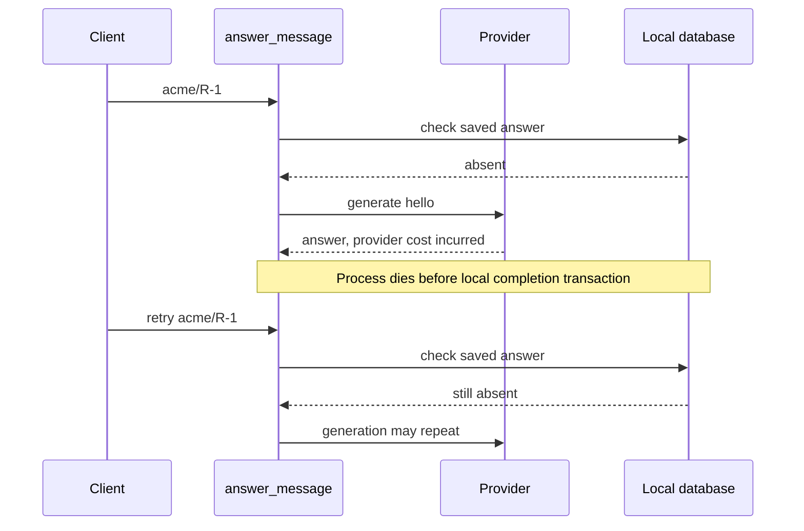
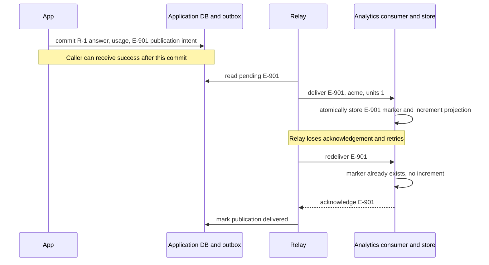
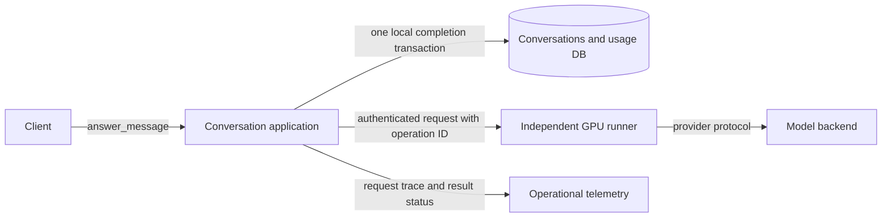

# Preserve the guarantees when the application grows

> **Role:** decision guide. Read and run [the local example](02_build_and_test_a_modular_monolith.md)
> first. This lesson develops production decisions; it is not a deployable production scaffold.

The local example protects answer storage and usage with one transaction. It cannot roll back a
provider call. That limit becomes the first design question when a real provider bills for work or
performs external actions. More modules, interfaces or folders cannot change which system owns
that external effect.

## Start with the crash between generation and commit

Request `acme/R-1` passes the precheck. The provider returns an answer and bills the account.
The application dies before saving anything. When the client retries, the database looks exactly
as it did before the first attempt. There is no retained evidence from which the workflow can
decide whether generation happened.

This timeline shows why a local replay key is insufficient:



The second call is not evidence that database idempotency failed. There was no database effect to
deduplicate. The first response was lost outside the database boundary. Choose a policy based on
what the external operation does:

| Requirement | Response to the ambiguity | Remaining limit |
|---|---|---|
| Repeated pure generation is acceptable within a cost budget | Retry with a bounded deadline and attempt budget; measure provider attempts separately from accepted answers | May spend twice and obtain different output |
| Provider offers documented idempotency/result lookup | Persist an operation ID and use the same provider key across retries; reconcile through its lookup API | Guarantee depends on provider retention and exact semantics |
| Generation must survive request/process loss | Persist a pending job before execution; worker owns attempts and saves completion | Durable work does not by itself make the external effect exactly once |
| Agent can send money, email or mutate external systems | Give each tool action its own authorization, idempotency/reconciliation contract and audit trail | Treat unknown results explicitly; blindly rerunning an entire agent can repeat side effects |

A durable job needs retained states such as pending, running and completed, plus a rule for retrying
abandoned work. That implementation belongs to the
[minimal durable-task lesson](../../background_work/foundations/03_minimal_durable_task.md).
Keeping this continuation separate prevents a small code-organization example from pretending to
be a complete workflow engine.

The sample's `accepted_answers` metric is therefore intentionally distinct from provider spend.
If a product introduces quotas, checking `total < limit` and later incrementing is insufficient:
two callers can both observe the same available unit. Usage needs an atomic reservation decision
and a policy for committing, releasing or expiring a reservation. That is a new invariant and
belongs to usage, not to scattered router checks. See the worked entitlement/quota distinction in
[SaaS lifecycle and entitlements](../saas_patterns/01_tenant_lifecycle_and_entitlements.md).

## Choose direct calls, local transactions or durable events by the promise

In the current product, a successful response promises both a stored answer and one accepted-answer
unit. Direct module calls sharing a transaction make this promise inexpensive to enforce. There is
no benefit in making usage asynchronous merely because an architecture diagram can contain events.

Now add an analytics dashboard that may lag by 30 seconds. Analytics does not need to participate
in completion. Record a durable publication intent alongside the answer, then let a relay deliver
it to analytics. This is a **transactional outbox**: business state and the intent to publish commit
together. If the process dies after commit, the intent remains for the relay to send later.

For example, a future integration event might have this contract. It is an illustrative payload,
not a message emitted by the runnable example:

```json
{
  "event_id": "E-901",
  "type": "answer.accepted",
  "schema_version": 1,
  "tenant_id": "acme",
  "request_id": "R-1",
  "conversation_id": "C-1",
  "units": 1
}
```

`E-901` identifies a publication that a consumer may receive more than once. The analytics consumer
must store its processed-event marker atomically with its projection update. That makes a redelivery
harmless. The payload omits the prompt and answer because counting does not require their sensitive
content. A module event is a supported data contract, not permission for consumers to read the
publisher's private tables.

This sequence separates the application commit from the analytics update and shows a harmless
redelivery of `E-901`:



The application transaction guarantees that a committed answer has publication intent. The
consumer's separate transaction guarantees that one event ID changes its projection at most once.
The time between those commits is projection lag. A relay crash can cause another delivery; it
cannot be made harmless by deleting publication intent before confirmed delivery. A broker may
sit between relay and consumer in a deployment; its acknowledgement and retention rules become
another explicit delivery boundary.

An in-memory event dispatcher can be useful for synchronous local notifications, but does not
retain publication intent after a crash. It also needs an explicit exception and transaction policy:
does handler failure abort the operation, or may the handler lag? Choosing a message bus does not
answer this automatically. The complete reliable-delivery mechanism is taught in
[message contracts and outbox](../../infrastructure/messaging/05_message_contracts_and_outbox.md).

If usage itself moves to asynchronous events, the product promise changes: immediately after answer
completion, the displayed usage total may be stale. A hard quota cannot safely depend only on that
lagging total. Keep admission/reservation synchronous and authoritative, or redesign the quota rule.
Make that choice before replacing a direct call with a publish operation.

## Operate by module and by use case

A modular monolith is one failure domain for many resource problems. A slow agent path can consume
threads, connections or memory needed by conversation reads. Resource limits belong at runtime
boundaries even when source dependencies are clean.

For `answer_message`, record separate timings for precheck, provider generation, final transaction
and total request latency. Count outcomes such as accepted, replay, input conflict, unavailable
conversation and provider failure. Use a request/correlation ID in traces and controlled logs;
avoid tenant IDs, request IDs and prompt text as unbounded metric labels. Keep prompts and answers
out of ordinary logs unless a documented access and retention policy requires them.

| Symptom | What to inspect | Recovery or corrective action |
|---|---|---|
| Provider spend rises while accepted-answer count stays flat | Attempts per logical request, timeouts, concurrent replays, failures after generation | Bound retries; reconcile unknown provider operations where supported; do not repair by inventing accepted answers |
| Database lock timeouts rise | Transaction duration, blocked writers, whether provider I/O moved inside a transaction | Restore short transactions; throttle writes; retry only within a bounded policy; capacity-test the target database |
| Answer exists but its required usage row does not | Same request/tenant key, migration history, raw writes, independently committed connections | Treat as invariant violation; identify scope, repair through a reviewed module-owned reconciliation path and fix the bypass |
| Usage projection lags beyond its promised freshness | Oldest unpublished outbox record and consumer backlog age | Restore relay/consumer, replay deduplicated events, show degraded freshness rather than a fabricated current total |
| One module failure makes every endpoint slow | Shared connection/thread pool and provider concurrency | Bound expensive work, reserve capacity where necessary, shed excess load; evaluate isolation if resource contention persists |

For an initial operational target, alert when an answer/usage consistency check finds any mismatch;
this invariant should not drift in the local design. Alert on the analytics projection's oldest
pending age exceeding its 30-second product promise for a sustained window. Set latency/error
thresholds from measured service objectives rather than copying arbitrary universal numbers.

Tenant predicates are necessary, but a raw tenant string from an HTTP body is not trusted identity.
The edge authenticates the caller; the application/module checks permission to act on that tenant
and resource. Background work must carry validated identity scope and apply an explicit policy for
permission changes between acceptance and execution. See [authentication](../../fundamentals/auth/README.md)
and [database tenancy](../../fundamentals/database/13_multi_tenancy.md) for implementation paths.

## Migrate an existing layered application one operation at a time

Suppose `services.py` directly updates both `messages` and `usage_totals`. Begin by writing down the
current observable promise: which input is accepted, which rows must commit together, what a replay
returns, and how tenant scope is enforced. Add a behavioral regression test around that promise.
It should not care whether the implementation is still in `services.py` or in new modules.

Move usage SQL behind a usage API, preserving the same transaction connection. Move conversation
SQL behind its API next. Route `answer_message` through those APIs, keeping a single commit owner.
Only then prohibit the old direct imports/writes. During an incremental migration, maintain a small
list of temporary exceptions with owners and removal conditions; a permanent wildcard exemption
would make the architecture check meaningless.

The rollback for a pure code move is to restore the old caller while keeping the still-compatible
module/data contract. Database changes need a different sequence. For example, to add a required
`model_version` to saved answers during rolling deployment:

1. Check that old writers name their INSERT columns and old readers select explicit columns,
   then add a nullable column so those writers can still insert rows. Positional
   `INSERT INTO answers VALUES (...)` would break when the table gains a column. The example uses
   explicit column lists and tests this additive migration.
2. Release new writers that populate it and readers that tolerate missing historical values.
3. Backfill where the value is known; use an explicit historical/unknown policy where it is not.
4. Once old writers are gone and data satisfies the chosen rule, tighten constraints and remove
   compatibility code in a later release.

Before step 4, rolling back the new code can remain compatible with the expanded schema. After
requiring a field old writers do not populate, blindly rolling back binaries may fail. Keeping old
and new contracts compatible across a rollout is called **expand/contract migration**. See
[release and migration sequencing](../../operations/deployment/02_ci_cd_and_releases.md) for deployment execution.

## Extract a service only after identifying the property it must gain

Suppose agent execution needs GPU scaling and independent releases. The application can retain
conversation and usage transactions while calling a separately deployed runner. The new topology
shows which boundary changes:



The remote runner now owns its availability and resource capacity. The caller needs a timeout,
bounded retry policy, authenticated contract, version compatibility and a decision about results
whose status is unknown. A provider port helps localize the replacement, but those behavioral
differences must be reflected in the contract and tests. “Replace a function with HTTP” is not the
whole migration.

Moving usage to a separate database is a harder change because it breaks the local completion
transaction. First identify every caller and table read, define an authoritative owner, and choose
whether usage may lag. If it may, use durable publication plus idempotent consumption. If it may not,
keep the shared atomic boundary or design a different business workflow; two sequential commits
cannot reproduce a single-database all-or-nothing promise.

Backfill the new store from a consistent snapshot and changes captured after that snapshot,
reconcile counts by tenant/request, and switch readers behind a reversible routing decision. Avoid
uncoordinated dual writes: failure between writes creates two disagreeing sources of truth. Keep a
single authoritative writer during cutover. These are acceptance requirements for an extraction
plan; executing that migration requires workload-specific tooling and tests beyond this sample.

## Production-readiness checklist for this design

- Each module has a named owner, public operations, owned tables and an enforced import policy.
- Critical cross-module invariants name one transaction owner or an explicit eventual-consistency contract.
- Duplicate keys, changed inputs, concurrent requests and failures between writes have tests on the target database.
- Identity comes from trusted authentication; authorization and tenant scope survive API and worker entry points.
- Provider deadlines, concurrency limits, retry budgets and unknown-result recovery are explicit.
- Metrics distinguish accepted answers, provider attempts and provider cost; traces expose module/transaction timing.
- Migrations preserve rolling-deployment compatibility; rollback and reconciliation have been exercised with representative data.
- Durable publication is used where a reaction must survive a crash; consumer replay and backlog recovery are tested.
- Resource exhaustion has a bounded response, and shared deployment risk is acceptable for the workload.

## Make the decision under a changed requirement

The dashboard can lag 30 seconds, but account quotas must never admit more than the purchased
allowance. A proposal moves both quota checks and analytics to the same asynchronous usage
consumer. Concurrent requests can each spend the final remaining unit before that consumer runs.
What should remain authoritative, and where does the asynchronous path fit?

<details><summary>Reasoned answer</summary>

Keep admission/reservation in an authoritative atomic operation before admitting costly work.
Two callers must compete for the same remaining allowance rather than reading a lagging projection.
Analytics can consume accepted/completed events later because its promise permits lag. Reservations
need explicit completion, failure and expiry rules; an uncertain provider outcome must not silently
release capacity in a way that permits unbounded spend. The usage module can own both policies,
but their communication and consistency requirements differ. Moving the module to a service does
not eliminate the need for those guarantees.

</details>
