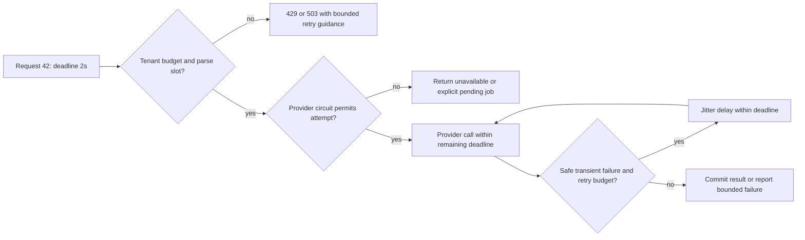
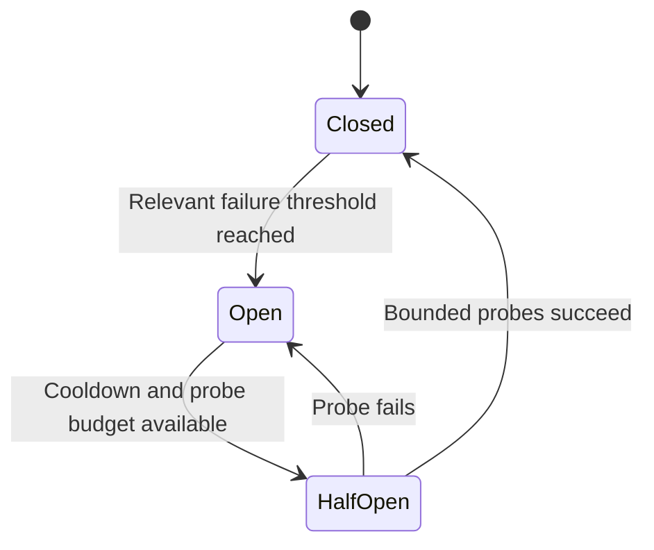
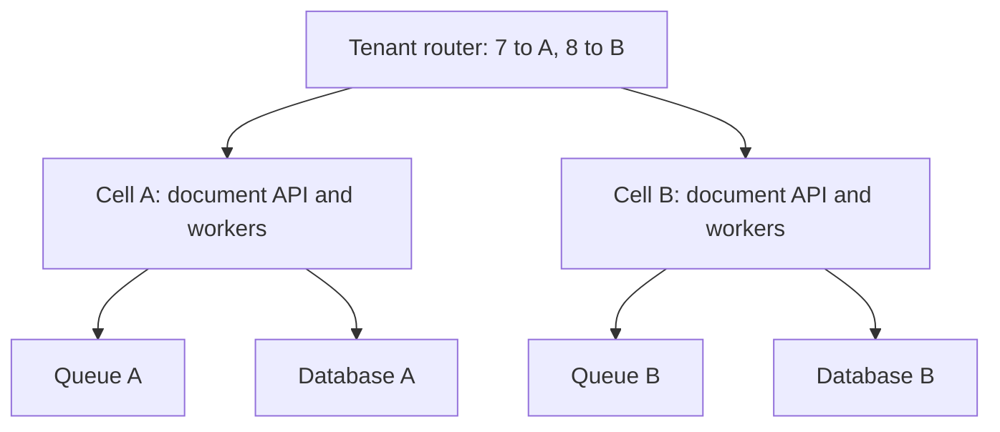
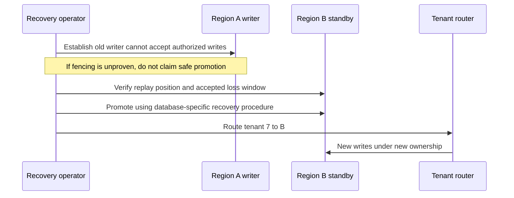

# Bound failure with deadlines, budgets and isolation

**Role: deep dive.** Prerequisites: [HTTPX timeouts](../../fundamentals/httpx/03_timeouts.md), [safe call patterns](../../fundamentals/fastapi/safe_and_scalable_api_calls/03_call_patterns.md), and [recovery objectives](../../fundamentals/database/08_backup_and_recovery.md). This chapter composes those existing implementation mechanisms into a service policy. It includes regional recovery decisions; deploying a multi-region database is outside its scope.

## One slow dependency can consume every request slot

The document API has a two-second response budget. Its extraction provider normally answers in 200 ms but now takes 15 seconds. Without bounds, each request holds a task, connection and memory while new requests arrive. More replicas can amplify load on the same unhealthy provider.

A **deadline** bounds the whole operation. Per-phase timeouts bound waits within it. A **bulkhead** reserves a finite set of slots for one class of work so its failure cannot consume all capacity. **Load shedding** rejects new work that cannot meet its promise instead of allowing an unbounded waiting queue. **Backpressure** communicates that constraint upstream so arrivals slow down.

Follow one request through the controls:

Admission happens before scarce provider work. A rejected request does not acquire the slot it is meant to protect. A fallback that uses the same saturated database or provider account is not independent capacity.

## Spend retry budget only when another attempt can help

Suppose the first attempt has a 600 ms limit, a retry may wait up to 150 ms, and the second attempt also has 600 ms. Their maximum 1,350 ms leaves 650 ms for admission, database work and response overhead under the two-second deadline. If the first attempt already consumed 1.8 seconds, the originally planned second attempt no longer fits. Recompute remaining time instead of resetting the deadline.

Retry only a transient class with a safe effect boundary. A timeout means the outcome is unknown, not necessarily absent. A billable parse or payment must carry a stable provider-supported idempotency key, or its outcome must be reconciled before repeating. Permanent validation and authorization failures are not made healthy by exponential backoff.

A per-request limit still allows a fleet-wide storm. At 1,000 original requests/s, one retry each doubles load to 2,000 attempts/s. A shared retry budget of 100 attempts/s caps added load at 10% for that period. Charge retries to a separate token bucket, bound burst size, and decide whether unused budget accumulates. Three layers each making three attempts can cause 27 deepest calls; assign one layer ownership of retries and account for SDK retries. [AWS Builders' Library](https://aws.amazon.com/builders-library/timeouts-retries-and-backoff-with-jitter/), checked 2026-10-30.

Jitter spreads retry times; it does not reduce the number of attempts. A circuit breaker reduces attempts when a dependency is already predictably failing. **Closed** permits normal calls; **open** rejects them locally; **half-open** permits a small probe after a cooldown. Count relevant provider failures, not every caller validation error. Bound probes across the fleet: 500 instances each sending ten probes can overwhelm a recovering dependency. Circuit breakers also introduce state and recovery delay, so use them when bounded concurrency and retries alone do not provide adequate protection.

The breaker owns this small state machine; the probe result changes permission for subsequent calls:

An open breaker does not cancel calls already in flight; their own deadlines still apply. Half-open limits are essential because recovery capacity may be smaller than normal demand.

## Keep tenant and dependency failures inside a boundary

Reserve separate pools for interactive requests and batch parsing. If batch workers hold every database connection, an HTTP bulkhead that only limits provider calls will not protect status reads. Isolation must include the bottleneck: connections, CPU, queue backlog, quotas and thread pools as appropriate.

A **cell** is a bounded copy of a service stack owning a subset of tenants. Route tenant 7 to cell A and tenant 8 to B; each has its own queue, workers and database capacity. A bad batch in A then need not exhaust B. A shared database or shared downstream account quota can defeat that separation. Keep routing simple, capacity-tested and stable, and roll out to one cell before the fleet. [AWS bulkhead/cell guidance](https://docs.aws.amazon.com/wellarchitected/latest/reliability-pillar/rel_fault_isolation_use_bulkhead.html).

The isolation claim depends on where shared resources sit. Here each cell owns its database and queue:

An overloaded queue A does not consume queue B storage or database B connections. A shared provider quota outside this diagram still couples the cells, so allocate or throttle it explicitly.

Do not remap tenant ownership with `hash(tenant_id) % current_cell_count` when adding cells: most mappings may change and state does not move with a hash. Store a tenant-to-cell assignment, provision the destination, copy and catch up data, pause/fence writes during the final ownership switch, then route to the new owner. This is a migration protocol, not merely a router configuration change. If the scale does not justify maintaining that protocol, per-tenant quotas in one stack may be the better starting point.

## Degrade only to a truthful product outcome

When the extraction provider is down, the API can still serve existing results and accept a durable job if storage, backlog capacity and the product's deadline allow it. Returning `202` after only an in-process task creates a false promise. Returning stale output as freshly computed creates a different false promise. State `pending`, `stale_as_of` or `unavailable` explicitly, and decide whether authorization permits the cached content under current tenant policy.

A fallback provider needs compatible schema, safety policy, region/data handling, quality evaluation and separate quota. It is a release change, not an automatic rescue merely because its HTTP endpoint is reachable. Stop accepting more durable work when oldest-job age threatens the maximum completion deadline, even if the queue can physically hold more messages.

## A second region adds another consistency boundary

**RPO** is the acceptable data-loss interval; **RTO** is the acceptable recovery duration. If the secondary database trails by 40 seconds, promising a five-second RPO is already impossible at that moment. DNS can switch traffic faster than a database can safely change writer, so DNS failover alone is not data failover.

| Design | Appropriate starting condition | Main cost/constraint |
|---|---|---|
| Backup and restore | Hours of recovery are acceptable | Restore, provisioning and validation dominate RTO |
| Active/passive warm standby | Minutes of recovery justify standby capacity | Replication lag, promotion, secrets and capacity readiness |
| Active/active with tenant ownership | Both regions must serve and tenants have one writer each | Ownership migration and regional dependencies still need fencing |
| Concurrent writes to the same data in multiple regions | A real requirement justifies conflict semantics | Conflicts, latency, consistency and operational complexity |

These choices require rehearsed recovery rather than a label on an architecture diagram. [AWS disaster recovery options](https://docs.aws.amazon.com/whitepapers/latest/disaster-recovery-workloads-on-aws/disaster-recovery-options-in-the-cloud.html).

For tenant 7, consider primary region A and standby B. A is unreachable from the control plane but may still accept some clients. Promoting B without fencing A creates two writers. **Fencing** means the old owner loses authority in a way the write destination enforces; an application boolean in B does not stop A.

Fencing might be a database-enforced leadership protocol or verified removal of the old writer's access, depending on the platform. Establish its behavior under partition before relying on it. Record the last durable replicated position, accepted loss, in-flight jobs and outbox state. The secondary must also have object data, keys/secrets, queues, provider connectivity and enough quota. A database replica alone is not a recovered application.

Failback is another migration: reconcile divergent or lost outcomes, replicate from the current authoritative writer, fence at the ownership handoff, and switch routing only after verification. Do not turn region A back on and let stale workers resume old leases. Reconcile ambiguous external effects using their stable idempotency keys.

## Test the protection, not just the healthy response

Inject latency and transient failures in a controlled environment. Measure admitted/rejected requests, in-flight calls, retry amplification, pool wait, oldest job age and successful completion latency. Verify status reads remain usable while parsing fails. Then remove the fault and observe recovery: a synchronized retry wave or all-at-once half-open probes is a failed test even if the service eventually recovers.

For a regional rehearsal, record actual detection, fencing, promotion, routing and validation times; compare their sum with RTO. Compare replicated positions and business outcomes with RPO. Test from clients that still resolve the old address. Verify secrets, storage references, DLQs and job leases in the recovered region. Keep a rollback/abort point before irreversible promotion and a reconciliation plan afterward.

**Production readiness:** one deadline owner; measured attempt limits; an aggregate retry budget; bounded queues/pools; explicit degradation; documented cell/tenant ownership; tested fencing; realistic RPO/RTO; and alerts on user impact plus the resource that enforces each bound.

## Decision exercise

A provider outage opens every instance's circuit breaker. After 30 seconds, 400 instances each send five probes. The provider recovers enough to serve 200 requests/s. Is the breaker protecting recovery?

Answer

Not yet. It releases 2,000 probes at roughly the same time, before ordinary traffic is considered. Bound and jitter probes, and coordinate or partition their budget so the fleet-wide total fits recovering capacity. Preserve the outer deadline and admission limit. A local safety control can create a global overload when multiplied across instances.

**Changed condition:** region A returns after B was promoted, and A still has queued jobs. Should its workers restart automatically?

Answer

No. Its ownership and leases may be stale, and some effects may already have committed in B. Keep A fenced, reconcile job/outbox positions and ambiguous effects, then migrate or retire stale work under the current owner. Restoring network reachability does not restore authority.

