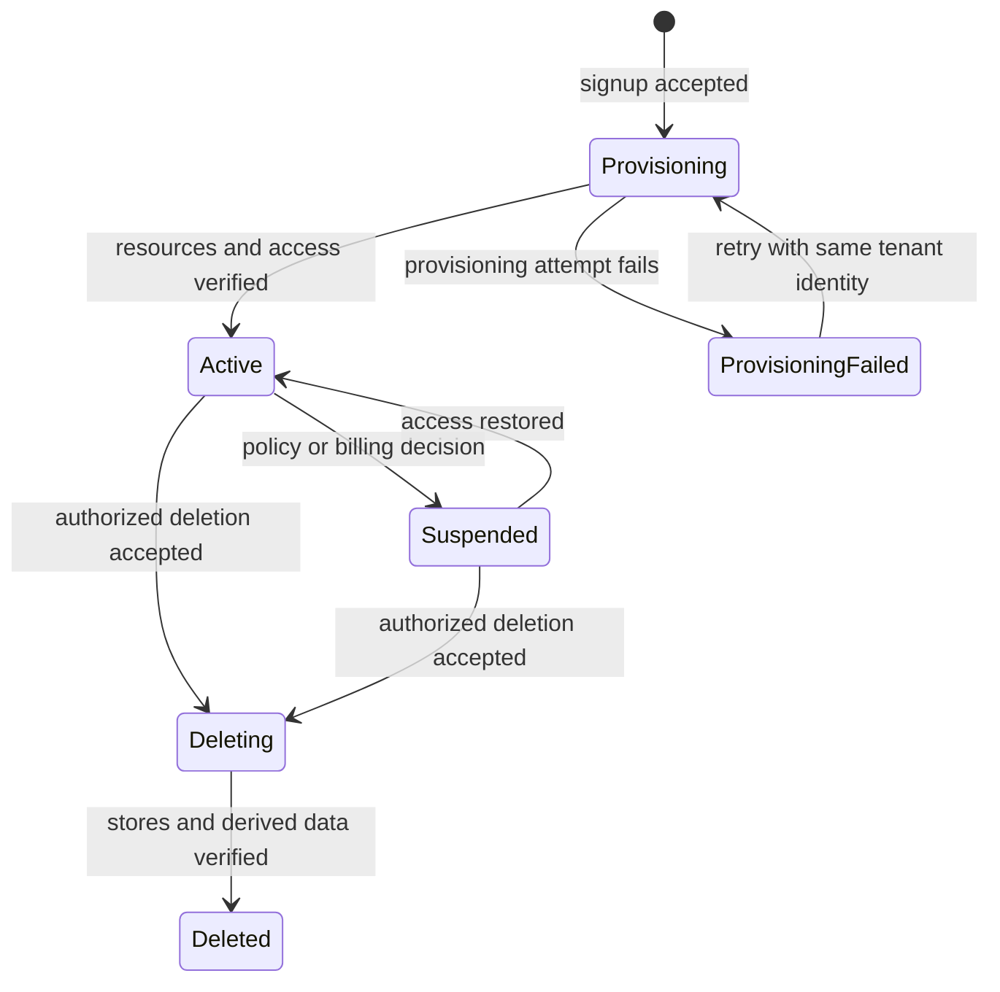
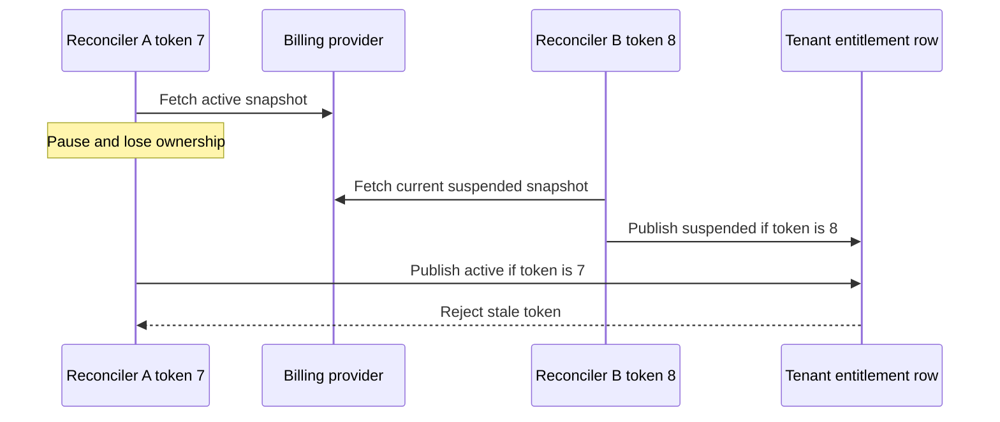

# Separate tenant lifecycle, feature access and consumption limits

Role: decision guide. Prerequisites: [tenant isolation](../../fundamentals/database/13_multi_tenancy.md)
and [durable webhook intake](../../apis/webhooks/03_consumer_design.md).
For a SaaS document service, model tenant state independently from the billing provider's latest
notification. An entitlement is permission to use a product feature; a quota limits how much of
that feature may be consumed. Neither replaces user authorization within the tenant.

## A successful payment page is not durable product authority

Tenant 7 signs up for document extraction. The browser returns from checkout before a webhook
arrives, or it closes without returning at all. Granting access only from the redirect loses one
case; trusting redirect query parameters permits forgery. Receive signed provider events through
an inbox, reconcile authoritative billing/entitlement state, and update an application-owned
entitlement projection. Webhook delivery may repeat or arrive out of order.

Use these separate application records (illustrative data):

```json
{"tenant_id":7,"lifecycle":"active","entitlement_revision":12,"features":["document_extract"],"monthly_document_limit":1000,"used":900,"reserved":50}
```

A user can submit a 20-document job only if the tenant is active, the feature is granted, the user
has the required role and `used + reserved + 20 <= 1000`. Admission must reserve quota atomically;
two concurrent readers cannot both spend the last allowance. A revoked feature should prevent new
work, while the product explicitly decides whether already accepted work finishes, pauses or cancels.

Stripe exposes subscription and entitlement changes through asynchronous events. The exact event
set is provider/version specific; the design here does not assume that one payment-success event
captures every lifecycle transition.
[Stripe subscription webhook guidance](https://docs.stripe.com/billing/subscriptions/webhooks), checked 2026-10-30.

## Make tenant state transitions durable and recoverable

The lifecycle should explain what the user sees during provisioning and deletion:



Provisioning is a workflow because database rows, object prefixes and optional dedicated resources
cannot usually share one transaction. Record each step and retry with stable identities. A failure
must not create a second tenant or grant access to half-provisioned storage. “Active” is published
only after required resources and isolation checks pass.

Suspension blocks appropriate new actions but need not destroy data. Deletion is a separate,
explicitly authorized workflow with retention/export requirements. Revoke access and new work first,
then remove tenant rows, objects, search projections, caches and credentials. Preserve a minimal
non-content tombstone or deletion ledger where needed to prevent late events and backup restores
from reviving the tenant. Mark deletion complete only after verification across the owned stores.

## Reconcile notifications instead of treating arrival order as truth

Suppose a cancellation event is processed, then an older activation event is delivered. Applying
“last delivery wins” would restore access incorrectly. If the provider offers a reliable per-object
version, compare it. Otherwise fetch authoritative current state after receiving the authenticated
notification and periodically reconcile missed events. A timestamp alone may not totally order
updates; avoid inventing guarantees the provider does not make.

Fetching current state is still vulnerable to concurrent publication. Handler A can fetch `active`,
handler B can fetch the later `suspended` state and publish it, then A can overwrite it with its
older snapshot. Serialize reconciliation for each tenant across webhook workers and scheduled
reconciliation. One durable owner fetches and publishes, with a monotonically increasing fencing
token checked by the publication transaction so an expired owner cannot write after its successor.
Keep network calls outside long database transactions; ownership and conditional publication are
separate short transactions. Coalesce arriving notifications into another reconciliation pass.
Where no authoritative revision exists, this controls local reordering but cannot eliminate provider
lag: sensitive operations still need a bounded freshness/revocation policy.

The stale fetch must fail at publication, not merely be noticed in a log:



B's newer ownership is a local publication order, not proof the provider itself has no lag. The
conditional write prevents A from restoring access after B suspended it; freshness policy still
bounds uncertainty in the upstream snapshot.

Test the race explicitly: pause A after its `active` fetch, expire A's ownership, let successor B
publish `suspended`, then resume A. Its old fencing token must cause the conditional write to fail,
and the final entitlement must remain suspended. Also verify a notification arriving during a fetch
causes a subsequent pass rather than being lost when the owner releases its work item.

Cache entitlements by tenant and revision with a defined expiry. An application must specify its
revocation window and fail behavior when the entitlement service is unavailable. A stale grace
period might be acceptable for viewing owned reports but unsuitable for an expensive export or
privileged administrative action. Make that choice per action, not with one global “fail open” flag.

Test duplicate events, reordered events, stale caches, concurrent quota claims, provisioning retries,
provider outages and deletion racing with queued work. Observe projection age, reconciliation drift,
provisioning failures, quota rejections and deletion backlog. A recovery runbook pauses new access
grants, reconciles affected tenants from the provider, reapplies local authorization policy and
compares entitlement revisions before resuming. It must not grant everyone access because billing
is temporarily unavailable.

Do not build a generic billing engine when a simple plan/feature table meets the product contract.
Provider-specific taxes, invoicing and payment processing are separate specialties; this lesson
owns application lifecycle and access decisions only.

**Decision exercise:** tenant 7 is suspended after a 100-document job was accepted and reserved.
Should workers automatically continue because quota was reserved?

<details><summary>Answer</summary>

A reservation proves capacity admission, not perpetual authorization. The product's explicit
in-flight-work policy controls continuation, and workers recheck the required lifecycle/authority
boundary before effects. If cancelling, settle consumed work and release only unused reservations;
do not erase the audit trail or refund remote work that already occurred.

</details>
