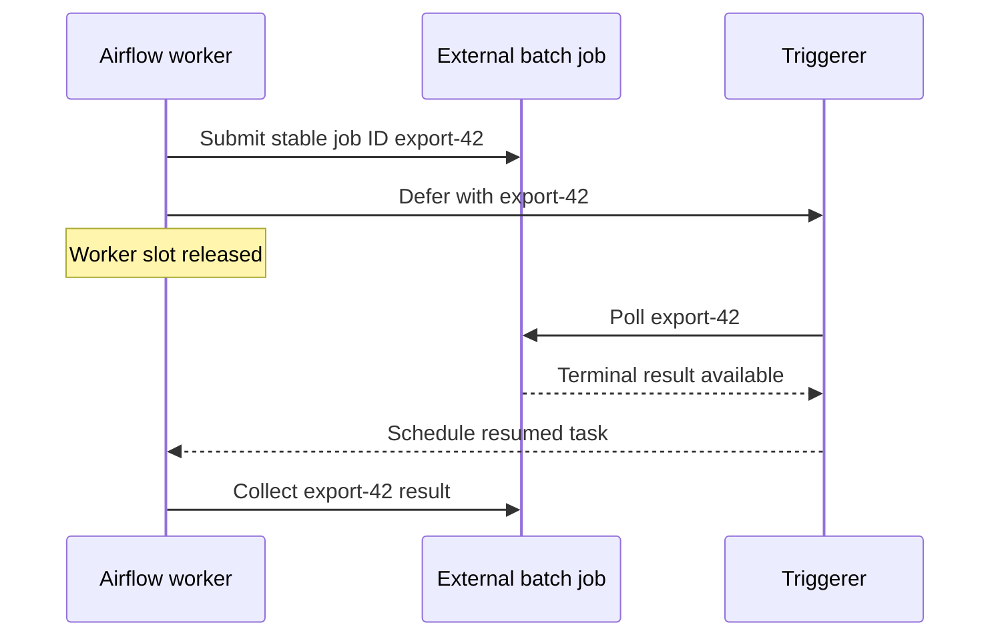

# Airflow Orchestrates Scheduled Data Workflows

> **Who this is for**: Backend and data engineers deciding whether a dependency-heavy batch or data pipeline belongs in Apache Airflow.

Before reading this, understand **[when a task becomes a workflow](../../foundations/02_task_or_workflow.md)** and **[task execution models](../../execution/02_task_execution_models.md)**.

These examples use Airflow 3’s public Task SDK. The [official supported-versions page](https://airflow.apache.org/docs/apache-airflow/stable/installation/supported-versions.html) lists the maintained 3.x line and Airflow 2 as end-of-life. New code should follow the [Airflow 3 public interface](https://airflow.apache.org/docs/apache-airflow/stable/public-airflow-interface.html), including `airflow.sdk` for DAG authoring.

---

## 1. Reach for Airflow when the schedule and dependency graph are the product

Every night, a pipeline extracts two datasets, waits for both transformations, loads a warehouse, runs quality checks, and supports backfilling a missed week. A task queue can execute each function, but the team would have to build schedule intervals, dependency state, run history, backfill controls, and an operator UI. Airflow supplies that data-orchestration control plane.

Airflow is strongest for scheduled batch/data workflows whose operators need to inspect runs and rerun intervals. It is usually the wrong first choice for a user waiting on a low-latency API command or for an interactive business workflow that pauses on human signals for days.

> **Key insight**: Airflow’s durable unit is the scheduled DAG run and its task instances; domain entities and external side effects still require their own idempotency and source of truth.

---

## 2. What this framework is

Airflow parses DAG definitions, creates logical runs from schedules or external triggers, resolves task dependencies, hands runnable task instances to an executor, records metadata, and exposes operational history.

```text
DAG files / bundles ──► DAG processor
                              │
                              ▼
                         metadata DB
                              ▲
                              │
scheduler ──runnable task instances──► executor ──► workers/pods
    │                                                   │
    └── creates scheduled runs                          ├── logs
                                                        │
                                                        └── task state, via the
                                                            Task Execution API
                                                                  │
                                              API server ◄─────────┘
                                                   │
                                                   └──► metadata DB

API server / UI ──reads and controls runs through public APIs
triggerer ──resumes deferred tasks when external conditions are ready
```

The worker → API server → metadata DB path is the Airflow 3 change that makes §10's rule follow rather than sound arbitrary: task code running under the Task SDK reports state back **through the API server**, "without requiring direct access to the metadata database." Workers no longer hold database credentials, which is precisely why an integration should not either.

| Role | Airflow coverage |
|---|---|
| Scheduler | Yes |
| DAG/data-workflow orchestrator | Yes |
| Task execution dispatch | Yes, through an executor |
| Worker runtime | Depends on executor/deployment |
| Generic task-queue framework | No |
| Low-latency service-workflow engine | No |
| Domain database | No |

---

## 3. What this framework is not

Airflow is not merely “Celery with a UI,” and it is not a general replacement for a broker-backed web task queue. A DAG defines tasks and dependencies for each run; an executor determines where task instances execute.

Airflow metadata is operational orchestration state. It should not be the authoritative record for orders, approvals, payments, or customer-facing job status. Task code should update the relevant domain system through a supported API or client, using stable business identifiers.

Airflow retries do not make an external insert, payment, email, or API call exactly once. A rerun, clear, retry, backfill, or worker crash can execute task code again.

---

## 4. DAGs express dependencies, not shared process memory

A **DAG** is a directed acyclic graph. A **DAG run** is one execution of that graph for a logical data interval or external trigger. A **task instance** is one task within one DAG run.

```text
extract_users ──► transform_users ──┐
                                    ├──► load_warehouse ──► quality_check
extract_orders ─► transform_orders ─┘
```

Tasks may run on different machines and at different times. They cannot communicate through local variables, open connections, or files unless the deployment deliberately shares that storage.

Use XCom for small control metadata such as counts, object keys, and partition names. Put datasets and large artifacts in object storage, a warehouse, or another durable system and pass references.

> **The near-miss**: TaskFlow functions look like ordinary nested Python calls. At DAG parse time they build dependencies; at run time their task instances are isolated and exchange serialized metadata, not Python objects in one process.

---

## 5. The Task SDK provides the current authoring surface

Minimal DAG — self-contained, so you can run it before wiring any real system:

```python
from airflow.sdk import dag, task
from pendulum import datetime

@dag(
    schedule="0 3 * * *",
    start_date=datetime(2026, 1, 1, tz="UTC"),
    catchup=False,
    tags=["warehouse"],
)
def daily_customer_counts():
    @task
    def count_customers() -> int:
        return 42                       # stand-in for a real warehouse query

    @task
    def record_metric(count: int) -> None:
        print(f"warehouse.customers = {count}")

    record_metric(count_customers())

daily_customer_counts()
```

### Install, place and run the DAG

The repository includes that DAG and the next partition example in [complete example assets](../../examples/airflow/dags/daily_customer_counts.py), including a local warehouse and the execution assertions. Use Python 3.12 for this pinned Airflow 3.3.1 lab; its constraints are not interchangeable with the Python 3.14 environment used elsewhere. From the repository root:

```bash
cd background_work/examples/airflow
python3.12 -m venv .venv
.venv/bin/python -m pip install 'apache-airflow==3.3.1' \
  --constraint 'https://raw.githubusercontent.com/apache/airflow/constraints-3.3.1/constraints-3.12.txt'
export AIRFLOW_HOME="$PWD/.airflow-lab"
export AIRFLOW__CORE__DAGS_FOLDER="$PWD/dags"
export AIRFLOW__CORE__LOAD_EXAMPLES=False
export PYTHONPATH="$PWD"
export WAREHOUSE_DB="$AIRFLOW_HOME/warehouse.sqlite"
.venv/bin/airflow db migrate
.venv/bin/python check_dags.py
```

The exact check runs the two-task count DAG, runs the partition DAG twice, and inspects the durable warehouse effect: `DAGs parsed, counts=42, repeated partition still has one row`. The [warehouse adapter](../../examples/airflow/warehouse.py) is SQLite only as a local effect fixture; it uses a stable partition primary key and parameterized upsert. This does not test a remote warehouse or a distributed executor. `AIRFLOW_HOME` keeps this lab's metadata separate from other Airflow environments.

For UI exploration, run `.venv/bin/airflow standalone` in the same environment. This starts a local development stack and prints generated admin credentials; it is not the production deployment recipe. The DAG files already live in the configured `dags` directory, so no unmentioned copy step is required.

Success is a parsed `daily_customer_counts` DAG in the UI and a run whose two task instances finish in dependency order, with `warehouse.customers = 42` in `record_metric`'s task log. If the DAG is absent, inspect DAG-processor import errors; if `record_metric` receives no value, inspect serialization/XCom logs and confirm the upstream task returned successfully.

Harden the same run with explicit retry, timeout, and an idempotent partition key. The following excerpt uses the `warehouse` adapter supplied with the complete [daily_orders.py](../../examples/airflow/dags/daily_orders.py):

```python
from datetime import timedelta
from airflow.sdk import dag, task, get_current_context
from pendulum import datetime
import warehouse

@dag(
    schedule="0 3 * * *",
    start_date=datetime(2026, 1, 1, tz="UTC"),
    catchup=True,  # This pipeline is designed and tested for historical intervals.
    max_active_runs=2,  # Prevents backfills from exhausting the warehouse.
)
def daily_orders():
    @task(
        retries=4,
        retry_delay=timedelta(minutes=2),
        retry_exponential_backoff=True,
        execution_timeout=timedelta(minutes=30),
    )
    def build_partition() -> str:
        context = get_current_context()

        # A manual or asset-triggered run can have logical_date=None and therefore
        # NO data interval, so the interval keys may be absent entirely — indexing
        # context["data_interval_start"] then raises KeyError inside the task.
        partition = (context["dag_run"].conf or {}).get("partition")
        if partition is None:
            interval_start = context.get("data_interval_start")
            if interval_start is None:
                # Refuse explicitly rather than inventing a partition from now():
                # a wall-clock fallback writes to whichever day the operator
                # happened to click, which is exactly the non-idempotent write
                # the deterministic partition exists to prevent.
                raise ValueError(
                    "no partition: this run has no data interval, so "
                    "trigger it with conf={'partition': 'YYYY-MM-DD'}"
                )
            partition = interval_start.format("YYYY-MM-DD")

        # The deterministic partition makes retry and backfill replace/upsert the same output.
        warehouse.upsert_daily_orders(partition=partition)
        return partition

    @task(retries=0)   # deterministic check: a retry recomputes the same verdict
    def check_partition(partition: str) -> None:
        if not warehouse.partition_is_valid(partition):
            raise ValueError(f"invalid partition: {partition}")

    check_partition(build_partition())

daily_orders()
```

`check_partition` carries `retries=0` on purpose: its `ValueError` is a deterministic data-quality verdict, so retrying only delays the alert by `retry_delay` × attempts while reporting `up_for_retry` in the UI — which reads as a transient blip rather than a pipeline that needs remediation. Reserve retries for the tasks that touch a network.

⚠️ **A manual run with neither `conf.partition` nor an interval fails inside the task, not at trigger time.** The operator sees a red `build_partition` and a `KeyError`/`ValueError` in the task log, several seconds after a trigger that looked accepted. Airflow 3.x documents that manual and asset-triggered runs may have `logical_date=None` and omit the interval fields, so the guard above is the only thing that turns a confusing traceback into an actionable message. Source: [Airflow 3 DAG runs](https://airflow.apache.org/docs/apache-airflow/stable/core-concepts/dag-run.html), checked 2026-08-03.

---

## 6. Logical time makes catchup and backfill powerful—and dangerous

An Airflow schedule describes data intervals. The run created at a boundary often processes the interval that just ended; it is not simply “wall-clock now.” Use `data_interval_start`, `data_interval_end`, and run identifiers instead of calling `datetime.now()` to choose a partition.

| Setting/action | Meaning | Operational risk |
|---|---|---|
| `schedule` | Defines automatic run cadence | Time-zone/DST mistakes |
| `start_date` | Earliest interval considered | Old date plus catchup can create many runs |
| `catchup=True` | Creates missed scheduled intervals | Sudden backlog and provider cost |
| Backfill | Deliberately creates historical runs | Competes with current production runs |
| Clear/retry task | Re-executes selected task instances | Repeats non-idempotent effects |
| `max_active_runs` | Bounds concurrent runs of one DAG | Too high overloads shared systems |

The default operational subset is **explicit UTC schedule**, **deliberate `catchup` choice**, and **bounded active runs/tasks**.

⚠️ Deploying a DAG with an old `start_date` and unintended catchup can create hundreds of runs. Estimate the interval count and downstream cost before unpausing it.

⚠️ A daylight-saving transition can skip or repeat local wall-clock times. Prefer UTC unless the business schedule explicitly follows a local time zone, then test both DST boundaries.

---

## 7. Dynamic mapping bounds fan-out at run time

Dynamic task mapping creates task instances from runtime data:

```python
from airflow.sdk import task

@task
def list_partitions() -> list[str]:
    return catalog.pending_partitions(limit=100)

@task
def process_partition(partition: str) -> None:
    warehouse.upsert_partition(partition)

process_partition.expand(partition=list_partitions())
```

Bound the input list, task concurrency, pool slots, and downstream quota. A source that returns a million items can create an operational incident before workers execute any business code.

Use a pool for scarce shared capacity such as warehouse slots or an external provider. Pool slots limit Airflow scheduling; provider-side rate limits and idempotency still belong in task code or the downstream service.

---

## 8. Deferrable waiting avoids occupying worker slots

Sensors wait for an external condition. A traditional polling sensor can hold a worker slot or repeatedly reschedule. Airflow gives you three different things for "this task spends its time waiting", and they are not interchangeable:

| Mechanism | Worker slot during the wait | Right when |
|---|---|---|
| Sync sensor / operator | **Held** for the whole wait | The wait is seconds, or no async variant exists |
| `reschedule` mode sensor | Released between pokes, re-acquired per poke | Polling minutes-to-hours with a coarse interval |
| **Deferrable operator** | **Released** — the wait moves to the triggerer | The default for long waits: hours of polling at zero worker cost |
| **Native async task** (Airflow 3.2+) | **Held**, but one slot multiplexes many concurrent I/O calls | The task *does* work — dozens of API calls — rather than waiting on one condition |

The default choice is **deferrable**. Airflow's own framing: with 100 worker slots and 100 DAGs waiting on an idle sensor, sync sensors block every slot, while "during the deferred phase of execution, since work has been offloaded to the triggerer, the task no longer occupies a worker slot."

⚠️ **Native async tasks are not a deferral substitute, and the docs are explicit about the difference.** An `async def` task keeps its task process — and therefore its worker slot — running; the event loop only lets it overlap I/O *within* that slot. So it is the right tool for a task making 50 concurrent HTTP calls and the wrong tool for a task waiting six hours for a file to land. Choosing it for the second case gives you all the cost of a sync sensor with none of the visibility.

The transition releases the worker slot only after it hands a serializable wait to the triggerer.



Native async multiplexes calls within the worker; it does not perform this slot handoff. A triggerer restart must reconstruct its poll from `export-42`, so the identifier must be persisted before waiting.

**What's changing — GA, checked 2026-10-30:** Airflow 3.3 adds [resumable tasks and `ResumableJobMixin`](https://airflow.apache.org/docs/apache-airflow/3.3.1/core-concepts/resumable-tasks.html). Task state can checkpoint progress or external job identity across retries using `task_state_store`. Resumable tasks still retain their worker slot; deferral remains the choice for releasing a long idle wait. Recording an external ID narrows duplicate-submission risk, but a provider accepting the submit before its ID is saved still needs a stable idempotency key or reconciliation. Treat recovery identity and slot occupancy as separate decisions.

Use deferrable variants for long waits when the provider/operator supports them. Set a timeout and define the failure path; a sensor without a deadline can leave a DAG run active indefinitely.

**Recovering an external job across a resume is a separate problem from where the wait happens.** The submit-then-wait shape — submit a Spark job / provider export, record its external ID, then wait for completion — must survive the task process being restarted, and neither deferral nor async gives you that for free. Airflow's guidance is that a trigger must "get everything they need from their `__init__`, so they can be serialized and moved around freely" — meaning the external job ID has to be captured *before* the wait begins and carried into the trigger, not held in the task's local memory. The consequence for your code:

- Submit with a deterministic idempotency key derived from `dag_id`/`run_id`/`task_id`, so a re-run that resubmits attaches to the same external job instead of starting a second one.
- Record the external job ID in XCom (or your own table) in a step that completes before the wait, so a resumed or cleared task can look it up rather than resubmit blindly.
- Keep no state in the trigger beyond what `__init__` received — a triggerer can be restarted or the trigger moved to another host mid-wait.

Source: [deferring](https://airflow.apache.org/docs/apache-airflow/stable/authoring-and-scheduling/deferring.html), checked 2026-08-03.

Human approval is usually a poor fit for an ordinary sensor. If approval and long-lived interactive signals are central, use a durable service-workflow engine and let Airflow trigger or observe the batch boundary.

---

## 9. Executors change isolation and operations, not DAG semantics

| Executor category | Execution shape | Good fit | Main cost |
|---|---|---|---|
| Local execution | Processes on Airflow host | Small controlled deployment | Shared host limits/failure domain |
| Celery-based | Long-running worker fleet through broker | Existing Celery operations, reusable workers | Broker and worker fleet |
| Kubernetes-based | Task instances in pods | Isolation and task-specific resources | Pod startup and cluster operations |
| Managed Airflow executor | Provider-specific | Reduced control-plane operations | Platform constraints and cost |

Choose executor capacity from task CPU/memory and downstream quotas. Separate resource-intensive tasks with queues/pools or pod configuration.

Airflow is a multi-component platform: metadata database, scheduler, DAG processor, API server/UI, triggerer when using deferrable work, executor, log storage, and often workers. Use the [official installation guidance](https://airflow.apache.org/docs/apache-airflow/stable/installation/index.html) and constraints for reproducible installs.

---

## 10. FastAPI should trigger through Airflow’s public API

For externally triggered data work:

```text
client ──► FastAPI ──validate + create domain job──► domain DB
                   │
                   └──trigger DAG run via stable Airflow REST API
                                      │
                                      └── conf contains IDs, not large payloads
```

Airflow 3’s public-interface documentation directs integrations to the stable REST API, Python client, or Task SDK rather than direct metadata-database access. Do not query or mutate Airflow’s internal tables from FastAPI.

The request is `POST /api/v2/dags/{dag_id}/dagRuns`, authenticated with a JWT bearer token:

```python
import httpx

class AirflowClient:
    def __init__(self, base_url: str, username: str, password: str):
        self._base_url = base_url.rstrip("/")
        self._client = httpx.AsyncClient(timeout=httpx.Timeout(connect=3, read=15, write=10, pool=2))
        self._creds = {"username": username, "password": password}

    async def aclose(self) -> None:
        await self._client.aclose()

    async def _token(self) -> str:
        # The auth manager owns /auth/token; with a non-default auth manager the
        # path and credential shape change, but the Bearer header does not.
        r = await self._client.post(f"{self._base_url}/auth/token", json=self._creds)
        r.raise_for_status()
        return r.json()["access_token"]

    async def trigger(self, dag_id: str, job_id: str, conf: dict) -> str:
        r = await self._client.post(
            f"{self._base_url}/api/v2/dags/{dag_id}/dagRuns",
            headers={"Authorization": f"Bearer {await self._token()}"},
            json={
                # The domain job ID IS the run ID. This is what makes a retried
                # trigger safe: the second attempt collides instead of creating
                # a second run of the same work.
                "dag_run_id": f"job-{job_id}",
                # Required field, not optional — omitting the key entirely is a
                # 422. Send null for "no logical date / no data interval".
                "logical_date": None,
                "conf": conf,          # IDs and references only, never payloads
            },
        )
        if r.status_code == 409:
            # A run with this dag_run_id already exists. That is SUCCESS for a
            # retried trigger, not an error — the work is already scheduled.
            # Treating it as a failure is what causes duplicate runs, because
            # the caller then retries with a fresh ID.
            return f"job-{job_id}"
        r.raise_for_status()
        return r.json()["dag_run_id"]
```

⚠️ **Airflow returns `409 Conflict` for a duplicate `dag_run_id`, and it arrives as a generic unique-constraint error.** The API translates the underlying `IntegrityError` into a 409, so the response body is about a constraint violation rather than a helpful "already triggered". Match on the status code, not the message. Verified against [`api_fastapi/common/exceptions.py`](https://github.com/apache/airflow/blob/main/airflow-core/src/airflow/api_fastapi/common/exceptions.py) (`_UniqueConstraintErrorHandler`, `status_code = status.HTTP_409_CONFLICT`) and [`routes/public/dag_run.py`](https://github.com/apache/airflow/blob/main/airflow-core/src/airflow/api_fastapi/core_api/routes/public/dag_run.py), checked 2026-08-03.

⚠️ **A DAG with import errors returns `400`, not `404`** — `"has import errors and cannot be triggered"`. If triggers start failing after a deploy and the DAG is visibly present in the UI, read the status code before suspecting auth.

Store large inputs externally and pass references in `conf`. Own this client at application lifespan and call `await client.aclose()` during cleanup; a fresh client per trigger discards pooling and an unclosed one leaks resources.

Close the domain-DB/Airflow trigger dual write with an outbox or reconciler when user-visible work must not be lost. Airflow’s run state and the domain job state still need an explicit synchronization contract.

**How you know it worked:** `GET /api/v2/dags/{dag_id}/dagRuns/job-{job_id}` returns the run with a `queued` or later state, and triggering the same domain job twice yields one run and one `409`.

Source: [API authentication](https://airflow.apache.org/docs/apache-airflow/stable/security/api.html), checked 2026-08-03.

---

## 11. Retries, reruns, and backfills require idempotent task outputs

An Airflow task may run again because of automatic retry, manual clear, backfill, worker loss, or operator action. Prefer operations such as:

- Upsert deterministic warehouse partitions.
- Write object artifacts to run/partition-specific keys.
- Use provider idempotency keys derived from DAG/run/task/business IDs.
- Stage output, validate it, then atomically publish a pointer.
- Record an external operation ID before downstream tasks depend on it.

Avoid append-only side effects without a dedup key. Avoid using the current time as an output key during a retry. Avoid storing large return values in XCom.

Compensation belongs in an explicit task/path and is a new business operation, not an Airflow rollback.

---

## 12. Test task logic outside Airflow and validate DAG structure

Keep business functions importable without an Airflow runtime, then wrap them in thin tasks. Unit-test deterministic transform/upsert code directly. Separately validate that DAGs parse, task IDs are stable, dependencies are correct, and policy defaults are applied.

The complete [check_dags.py](../../examples/airflow/check_dags.py) performs three checks without a running scheduler: it parses the actual DAG directory and asserts no import errors, checks stable task IDs/dependency edges and `max_active_runs`, then uses `dag.test()` to execute both DAGs. It repeats `daily_orders` with the same explicit partition and queries the SQLite effect table for exactly one row. Run it with the installation/environment commands above; there is no undeclared `fake_warehouse` fixture.

Task success alone is insufficient: an incorrect partition key can create two successful but duplicate outputs. The effect assertion distinguishes an operational retry from a second business write. Changing the run date while retaining `conf.partition=2026-02-01` must still write the same partition. Conversely, a different partition is a distinct output and should add a row.

`dag.test()` exercises this local execution boundary. Separately rehearse your real executor, auth manager, connections, secret resolution, logs, deferrals and recovery. A source import check is not proof that those components work together.

Production observability should include:

- DAG-run duration and schedule delay.
- Queued task-instance age and executor backlog.
- Failure/retry rate by DAG and task.
- Pool utilization and downstream quota errors.
- DAG-processing/import errors.
- Metadata database health and storage growth.
- Business partition freshness and data-quality results.

Success is not merely green task instances. A green DAG that produced an incomplete partition needs a data-quality failure or business metric that exposes the gap.

---

## 13. When to use Airflow

- Scheduled data/ML/batch dependencies, backfills, and operational history are central.
- Tasks naturally exchange durable dataset references.
- The team benefits from a UI for runs, retries, logs, and dependency inspection.
- The platform’s multi-component operational cost is justified.

---

## 14. When not to use Airflow

- A web request needs one low-latency background task.
- The primary need is a broker-backed worker fleet without DAG scheduling.
- Workflows are interactive, human-driven, or signal-heavy over long periods.
- The team would use XCom or the metadata database as its domain store.

⚠️ Heavy network/database work at DAG module import time runs during parsing and can slow or break DAG discovery. Put runtime work inside tasks.

⚠️ Unbounded dynamic mapping, catchup, or backfills can create expensive fan-out. Bound runs, tasks, pools, and provider budgets before enabling them.

---

## Recap and check yourself

- DAG runs coordinate task instances for logical data work; external outputs need their own stable keys.
- A retry reruns code rather than rolling back a previously committed warehouse partition.
- Deferral releases the worker slot; async and resumable tasks solve different execution/recovery problems.

**Fifty bounded HTTP calls take twenty seconds; another task waits six hours for an external job. Which mechanism fits each?**

<details><summary>Answer</summary>

Native async can overlap the calls while retaining one worker slot. Deferral frees the slot during the long idle wait. Both need stable external identity to avoid duplicate submission.

</details>

**A retry runs tomorrow with the same conf.partition. Which warehouse row should it write?**

<details><summary>Answer</summary>

The same partition as the original run. A key based on current time would create a second output and break repeatable backfills.

</details>


**Next**: [Decision Guide](../00_system_selection.md)
