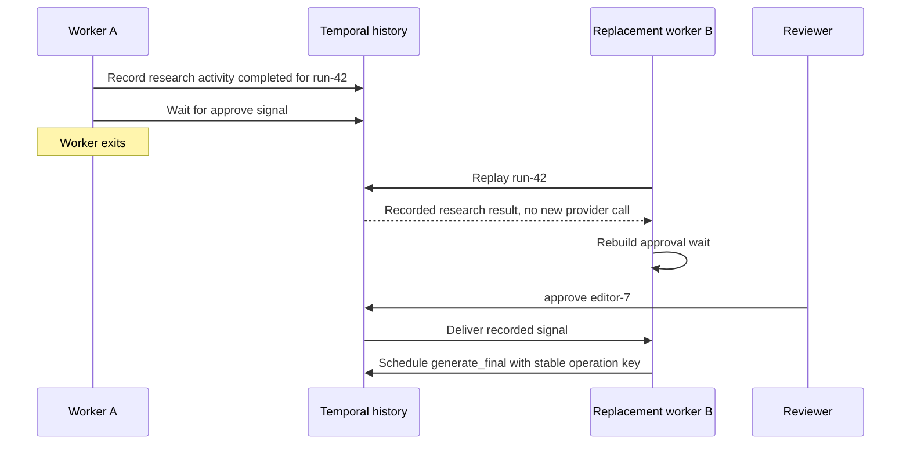

# Temporal-Class Engines Own Durable Coordination

> **Who this is for**: Backend engineers deciding whether a durable workflow engine should replace custom timer, signal, retry, and recovery code.

Before reading this, compare persistence and execution axes in **[State-Machine Design](../../workflows/01_state_machine_design.md)**.

---

## 1. Coordination becomes a runtime when waits and recovery dominate

A service stores workflow state, builds a timer table, routes approval signals, retries steps, reconstructs crash progress, and maintains compatibility for year-long runs. The team is no longer adding business behavior; it is building a workflow engine.

A Temporal-class engine persists an event history and replays workflow code to reconstruct coordination. **Workflows** decide the sequence; **activities** perform non-deterministic I/O such as database, provider, and LLM calls. Durable timers and signals become history-backed runtime operations.

```text
client command/signal
  → workflow event history
       ├── deterministic workflow decisions
       ├── durable timer
       └── activity task ──► activity worker ──► external system
```

Temporal's official documentation requires workflow code to emit the same command sequence during replay and directs non-deterministic API/database/LLM work into activities: [Workflow Definition](https://docs.temporal.io/workflow-definition). Activities may start again from their initial state after failure, so the documentation recommends idempotency: [Activities](https://docs.temporal.io/activities). Checked 2026-08-03.

> **The near-miss**: durable replay sounds like every line executes exactly once. Workflow decisions replay deterministically; activities and external effects may be attempted again and still need stable operation keys.

---

## 2. Workflow and activity boundaries replace several custom tables

| Custom database responsibility | Engine-owned equivalent | Still application-owned |
|---|---|---|
| Current orchestration position/history | Workflow event history and replay | Domain entities and business evidence |
| Retry schedule | Activity retry policy | Error classification and idempotency |
| Approval wait | Signal/update plus durable workflow condition | Authentication and reviewer evidence |
| Deadline/timer row | Durable timer | Business deadline policy |
| Worker claim/heartbeat | Activity task and heartbeat runtime | Checkpoint payload and safe effect boundary |
| Reconciler for missing next step | History replay and runtime recovery | Reconciliation with external providers |

Do not mirror every workflow state into a mutable database state machine. Project read models when APIs need domain-friendly status, but define which engine history or domain row owns each transition.

> **Key insight**: A durable engine removes coordination plumbing, not business correctness. Activity boundaries are where idempotency, authorization, and external evidence re-enter the design.

---

## 3. The editorial workflow becomes deterministic orchestration

This complete Python example runs against a local Temporal service. Install `temporalio`, start the service, run the file with `worker`, then run it with `start` in another terminal.

```python
import asyncio
from datetime import timedelta
import sys

from temporalio import activity, workflow
from temporalio.client import Client
from temporalio.common import RetryPolicy
from temporalio.worker import Worker


@activity.defn
async def research(run_id: str) -> str:
    return f"research:{run_id}"


@activity.defn
async def generate_final(arguments: tuple[str, str]) -> str:
    run_id, operation_key = arguments
    # A real provider receives operation_key as its idempotency key.
    return f"artifact:{run_id}:{operation_key}"


@workflow.defn
class EditorialWorkflow:
    def __init__(self) -> None:
        self.reviewer_id: str | None = None

    @workflow.run
    async def run(self, run_id: str) -> str:
        await workflow.execute_activity(
            research,
            run_id,
            start_to_close_timeout=timedelta(seconds=30),
            retry_policy=RetryPolicy(maximum_attempts=3),
        )

        await workflow.wait_condition(lambda: self.reviewer_id is not None)

        operation_key = f"{run_id}:generate_final:v3"
        return await workflow.execute_activity(
            generate_final,
            args=[(run_id, operation_key)],
            start_to_close_timeout=timedelta(seconds=30),
            retry_policy=RetryPolicy(maximum_attempts=3),
        )

    @workflow.signal
    async def approve(self, reviewer_id: str) -> None:
        if not reviewer_id:
            raise ValueError("reviewer_id is required")
        self.reviewer_id = reviewer_id

    @workflow.query
    def waiting_for_reviewer(self) -> bool:
        return self.reviewer_id is None


async def run_worker() -> None:
    client = await Client.connect("localhost:7233")
    worker = Worker(
        client,
        task_queue="editorial",
        workflows=[EditorialWorkflow],
        activities=[research, generate_final],
    )
    await worker.run()


async def start_workflow() -> None:
    client = await Client.connect("localhost:7233")
    handle = await client.start_workflow(
        EditorialWorkflow.run,
        "run-42",
        id="editorial-run-42",
        task_queue="editorial",
    )
    assert await handle.query(EditorialWorkflow.waiting_for_reviewer)
    await handle.signal(EditorialWorkflow.approve, "editor-7")
    print(await handle.result())


if __name__ == "__main__":
    if len(sys.argv) != 2 or sys.argv[1] not in {"worker", "start"}:
        raise SystemExit("usage: python editorial_temporal.py [worker|start]")
    asyncio.run(run_worker() if sys.argv[1] == "worker" else start_workflow())
```

The worker can disappear during approval because the service has the history needed to rebuild the wait.



The recorded activity result avoids another provider call during replay. If the provider succeeded but activity completion never reached history, an activity retry may call it again; that is why the key is stable across attempts. The signal also belongs to history, so losing the waiting worker does not lose the review decision.

The result contains `artifact:run-42:run-42:generate_final:v3`. Stopping and restarting the worker while the workflow waits for approval does not lose the wait; the service history owns it.

The example is minimal. Production activities also need provider timeouts, stable request hashes, heartbeat/checkpoint policy for long work, sanitized errors, and application-level evidence around external effects.

---

## 4. Replay constrains workflow code changes

Workflow code cannot branch on local clock, ordinary randomness, direct database reads, or network responses. Use SDK-provided deterministic operations or activities. Reordering a timer and activity can make old history incompatible with new code.

Temporal currently documents two workflow-version strategies: Worker Versioning, which routes executions to compatible code revisions, and patching, which keeps explicit compatible paths in workflow code. The current docs recommend Worker Versioning for the general deployment strategy: [Workflow versioning](https://docs.temporal.io/workflow-definition#versioning-workflows). Checked 2026-08-03.

Before deployment:

- Replay representative production histories against the candidate code.
- Keep activity input/output schemas backward compatible or version them.
- Do not rename activity/workflow types used by in-flight history without a migration plan.
- Bound history growth with the engine's continuation mechanism for very long/high-event workflows.

⚠️ A workflow that calls a provider directly can call it again during replay and may also fail determinism checks.

⚠️ Changing command-producing workflow code without versioning can strand old executions in a non-determinism failure.

---

## 5. Choose an engine only when its semantics are product requirements

Use a Temporal-class engine when durable timers, external signals, long pauses, compensation, child workflows, replay, and workflow-version operations are central and numerous. It is especially useful when custom coordination tables and reconcilers are becoming a platform.

Do not use it for one independent task, a simple nightly firing, or a low-volume fixed workflow that a domain row plus jobs can express clearly. Do not use it as the authoritative store for unrelated domain entities; activities still transact with domain databases.

**How you know it is working**: kill workflow and activity workers at each activity boundary, resume them, and observe one explainable workflow history plus one business effect per operation key. Monitor workflow-task failures, activity retries/timeouts, stuck executions, task-queue age, and version compatibility.

---

## Recap and check yourself

- The service records history while workers execute workflow decisions and activities.
- Replay rebuilds state from recorded results; an unrecorded activity completion can execute again.
- Workflow changes must preserve replay compatibility and activities need stable effect identity.

**The worker restarts after research completion was recorded but before approve arrives. Must research call its provider again?**

<details><summary>Answer</summary>

No. Replay uses the activity result in history and reconstructs the wait. If completion was never recorded, the activity may run again and needs idempotency.

</details>

**A workflow uses a fresh random business operation key each time an activity retries. Is history sufficient to prevent double charging?**

<details><summary>Answer</summary>

No. Retries can repeat an unrecorded effect. Keep the business operation key stable independently of execution attempt identity.

</details>

**Try it:** Pause after recorded research completion, restart the worker, then send approval. Fill an expected event trace: research completed → ... → generation scheduled.

<details><summary>Hint and worked solution</summary>

Replay reconstructs the wait from history; it is not a second research invocation. The middle step is replayed approval wait followed by the recorded approval signal. Assert one recorded research result; separately test an activity whose completion was not recorded, which may be attempted again.

</details>


**Next**: [LangGraph for Checkpointed Agent Workflows](../langgraph/overview.md)
