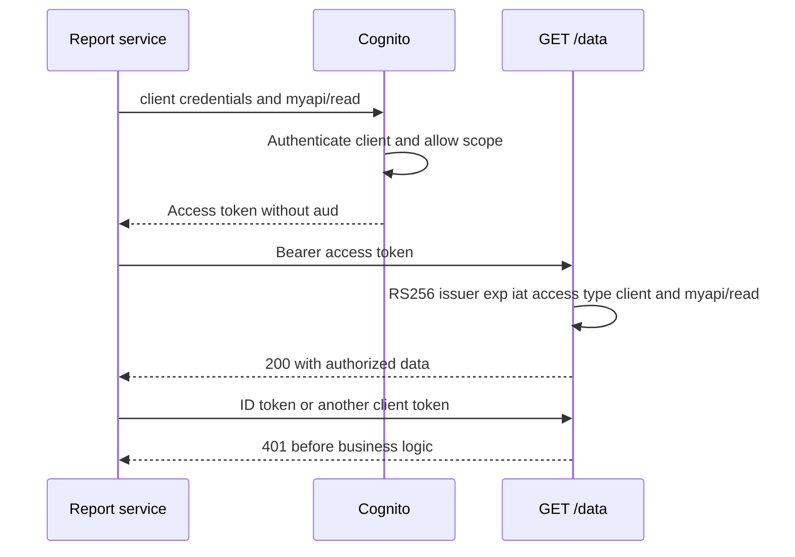

# OAuth and JWT with Cognito — a working authorization boundary

> **Who this is for:** Python API engineers who have read [JWT](../jwt.md), [OAuth](../oauth2.md),
> and the [Cognito token profiles](tokens.md). Baseline checked 2026-10-30: PyJWT 2.15.1,
> FastAPI 0.162.0, HTTPX 0.28.1 and boto3/botocore 1.43.122.
>
> **Outcome:** issue a machine token with `myapi/read`, validate the matching policy at `/data`,
> and distinguish authentication failure from insufficient scope. User login is a separate branch.

## First result: exercise the API boundary locally

The [complete access policy](examples/access_policy.py) includes a FastAPI app factory and a bounded,
cached JWKS resolver. The [tests](examples/test_access_policy.py) generate an RSA key and signed
Cognito-shaped fixtures, then call the real HTTP dependency in process. They require no AWS account,
create no cloud resources, and never print credentials. From the repository root:

```bash
python3 -m venv /tmp/cognito-notes-venv
/tmp/cognito-notes-venv/bin/python -m pip install 'PyJWT[crypto]==2.15.1' 'fastapi==0.162.0' 'httpx==0.28.1' 'pytest==9.2.0' 'boto3==1.43.122'
/tmp/cognito-notes-venv/bin/python -m pytest -q fundamentals/auth/cognito/examples
# 15 passed (the exact warning/timing line depends on the environment)
```

The successful fixture contains `token_use=access`, the configured `client_id`, and `scope=myapi/read`.
It has no `aud`: that is Cognito's unbound M2M profile. ID tokens, another client, bad issuer,
missing/expired `exp`, malformed scope, or a tampered signature produce 401. A valid access token
without the required scope produces 403. The separate bound-user test requires the exact URL `aud`.
The config tests check AWS request schemas with `Stubber`, not a live AWS integration.

## Pattern A: machine-to-machine, from issuance to `/data`

This continuation requires an existing disposable User Pool, an authorized administrative AWS
profile, a unique domain prefix, and permission to create a resource server and app client. These
are **cloud configuration excerpts**, not part of the local test command. Store secrets in your
secret manager, and manage the resulting resources with your normal infrastructure lifecycle.

A resource server registers valid scope names. It does not automatically add an audience claim:

```python
import boto3

cognito = boto3.client("cognito-idp", region_name="us-east-1")
# pool_id comes from your deployed User Pool.
cognito.create_resource_server(
    UserPoolId=pool_id, Identifier="myapi", Name="Example API",
    Scopes=[{"ScopeName": "read", "ScopeDescription": "Read example data"}],
)
client = cognito.create_user_pool_client(
    UserPoolId=pool_id, ClientName="report-service", GenerateSecret=True,
    ExplicitAuthFlows=[],
    AllowedOAuthFlows=["client_credentials"],
    AllowedOAuthScopes=["myapi/read"],
    AllowedOAuthFlowsUserPoolClient=True,
    AccessTokenValidity=15, TokenValidityUnits={"AccessToken": "minutes"},
)["UserPoolClient"]
client_id, client_secret = client["ClientId"], client["ClientSecret"]
cognito.create_user_pool_domain(UserPoolId=pool_id, Domain=unique_domain_prefix)
```

Use this dedicated confidential client only on a trusted backend. The client-credentials grant
returns an access token, without an ID token or refresh token. It represents the service rather than
a human. A public browser cannot protect this secret.

```python
import requests

url = f"https://{unique_domain_prefix}.auth.us-east-1.amazoncognito.com/oauth2/token"
response = requests.post(
    url, auth=(client_id, client_secret),
    data={"grant_type": "client_credentials", "scope": "myapi/read"}, timeout=10,
)
response.raise_for_status()
result = response.json()
access_token = result["access_token"]
print(response.status_code, result["token_type"], result["expires_in"])
# 200 Bearer 900 for this configured client
```

Now deploy the **same profile** at the API. Copy [access_policy.py](examples/access_policy.py)
beside the following app module. The client ID and issuer are deployed configuration, not values
selected from an unverified token:

```python
from access_policy import AccessPolicy, create_app, jwks_key_resolver

ISSUER = "https://cognito-idp.us-east-1.amazonaws.com/us-east-1_EXAMPLE"
policy = AccessPolicy(ISSUER, configured_service_client_id, frozenset({"myapi/read"}))
app = create_app(policy, jwks_key_resolver(ISSUER))
```

Call the deployed API:

```python
response = requests.get(
    "https://api.example.com/data",
    headers={"Authorization": f"Bearer {access_token}"}, timeout=10,
)
response.raise_for_status()
assert response.json()["client"] == client_id
```

The trace explains which boundary owns each decision:



Do not set `resource_audience="myapi"` here. Custom-scope registration and OAuth resource binding
are different mechanisms. [Cognito supports resource binding only for OAuth user grants](https://docs.aws.amazon.com/cognito/latest/developerguide/cognito-user-pools-define-resource-servers.html).

Cache the machine token until shortly before expiry using a monotonic deadline derived from the
trusted token endpoint's `expires_in`, with jitter and one refresh in flight per client/scope set.
Do not request a new token on every business call. Never reuse a cache entry across clients or scope
sets. Retry transient issuance failures within a bounded deadline; an `invalid_client` or
`invalid_scope` response requires configuration repair. Monitor issuance latency, 429s, cache hit
rate, and 401/403 categories without logging the bearer or secret.

### Current alternative: domainless M2M issuance

As checked 2026-10-30, `GetClientToken` supports SDK-based M2M issuance without a User Pool domain.
Create a **separate** confidential client with `ExplicitAuthFlows=['ALLOW_CLIENT_TOKEN_AUTH']` as
its only explicit flow and allowed custom scopes. Then:

```python
result = cognito.get_client_token(
    ClientId=sdk_m2m_client_id, Secret=sdk_m2m_client_secret, Scopes=["myapi/read"],
)["ClientAuthenticationResult"]
access_token = result["AccessToken"]
# Configure the API policy for sdk_m2m_client_id; do not silently accept every pool client.
```

This call authenticates with the app secret, not IAM credentials. Treat `Scopes` as explicit least
privilege; omission requests the configured scope set. This is an alternative issuance transport,
not an audience-binding feature. [GetClientToken API](https://docs.aws.amazon.com/cognito-user-identity-pools/latest/APIReference/API_GetClientToken.html).

## Pattern B: user Authorization Code with PKCE

Use Managed Login and a public app client with no secret for browser/mobile login. Configure the
exact callback URL, `AllowedOAuthFlows=['code']`, and allowed scopes `openid` and `myapi/read`.
A domain serves the authorize/token endpoints. The [generic OAuth lesson](../oauth2.md) owns the
complete challenge/verifier and one-time session-state exchange; this branch changes its Cognito
parameters:

```python
from urllib.parse import urlencode

parameters = {
    "response_type": "code", "client_id": user_client_id,
    "redirect_uri": "https://app.example.com/callback",
    "scope": "openid myapi/read", "state": state,
    "code_challenge": code_challenge, "code_challenge_method": "S256",
    "resource": "https://api.example.com",
}
authorize_url = cognito_domain + "/oauth2/authorize?" + urlencode(parameters)
```

Here `resource` explicitly requests the URL audience. After checking one-time `state`, exchange the
code with the original verifier and exact redirect URI. Configure a **separate user API policy**
with that user client ID and `resource_audience="https://api.example.com"`. The access token must
also contain `myapi/read`. Validate any OIDC ID token in the login handler, including its client
audience and transaction nonce if requested; send only the access token to `/data`.

`InitiateAuth(USER_PASSWORD_AUTH)` is a Cognito SDK login, not the OAuth password grant. Its normal
access token has `aws.cognito.signin.user.admin`; it is not a shortcut for testing a custom-scope
OAuth API. SDK flows also lack resource binding. Use a test browser/IdP harness for live user
integration, and the local signed negative fixtures for deterministic API-policy checks. Password,
MFA, sign-up and administration examples live in [User Pool configuration](user-pool.md).

### Refresh without a nonexistent helper module

Schedule refresh from the token endpoint's `expires_in`; do not treat an unverified decoded JWT as
authorization. For a rotating Cognito client, the SDK exchange is:

```python
result = cognito.get_tokens_from_refresh_token(
    ClientId=user_client_id, RefreshToken=stored_refresh_token,
)["AuthenticationResult"]
# Under the session's refresh lock, atomically persist result["RefreshToken"]
# together with result["AccessToken"] and its expiry metadata.
```

This is a storage-integration excerpt, not a complete session store. The [token lifecycle lesson](tokens.md#refresh-token-rotation-opt-in-since-april-2025)
owns the config-preserving update, legacy-flow removal, grace window, lost-response behavior, and
revocation boundary. A public OAuth client can instead refresh at the token endpoint; resource-bound
refresh retains the original audience. Do not return only the new access token and discard a rotated
refresh token, or the next refresh will use an invalid predecessor.

## Gateway and deployment boundary

API Gateway REST Cognito authorizers and AgentCore Gateway custom JWT authorizers are different
products with different configuration schemas. Use the [REST authorizer example](tokens.md#api-gateway-integration-skip-manual-validation)
for REST API Gateway; configure explicit method scopes. For AgentCore, use its own discovery,
allowed-client and scope policy. Do not copy one product's `customJWTAuthorizer` object to the other.
The origin may rely on either only when direct bypass is blocked or the gateway-to-origin hop is
authenticated. Do not forward the incoming bearer to an unrelated downstream audience: acquire a
credential for that downstream service's policy.

Before release, prove the following in the target environment:

- The real issuer produces the expected profile and the deployed API accepts it, while wrong
  clients, audiences, scopes and token types fail as in the local fixture.
- JWKS rotation and outage handling are bounded; origin routing prevents authorizer bypass.
- Refresh/revocation behavior matches the required cutoff latency and session storage is atomic.
- Secret rotation, token-cache partitioning, logs and metrics do not expose credentials.

The local tests do not verify AWS provisioning, Managed Login callbacks, live JWKS rotation,
gateway enforcement or regional failover. Those are explicit deployment rehearsals, not inferred
from a passing unit test.

## Retention and transfer

**Recap:** begin with an issuance profile, configure the API for that exact profile, and test both
acceptance and rejection. Machine credentials, OAuth user login, and SDK user login differ even
when their access tokens all use JWT serialization.

**Check yourself:** the local M2M fixture passes, but real login receives 401 after the issuer was
migrated to the updated multi-Region format. What should change?
<details><summary>Answer</summary>Deploy the explicitly trusted new issuer and its JWKS endpoint;
plan overlap for old unexpired tokens if required. Do not accept arbitrary issuers from tokens or
turn off issuer checks.</details>

**Try it:** add a write endpoint requiring `myapi/write`. Predict whether the read token should
receive 401 or 403, then create a separate policy/test for that operation.
<details><summary>Answer</summary>403: the existing token is authenticated but lacks write authority.
Register/allow/request the additional scope only for authorized clients; do not reinterpret read as
write or bypass the check for an otherwise valid signature.</details>
