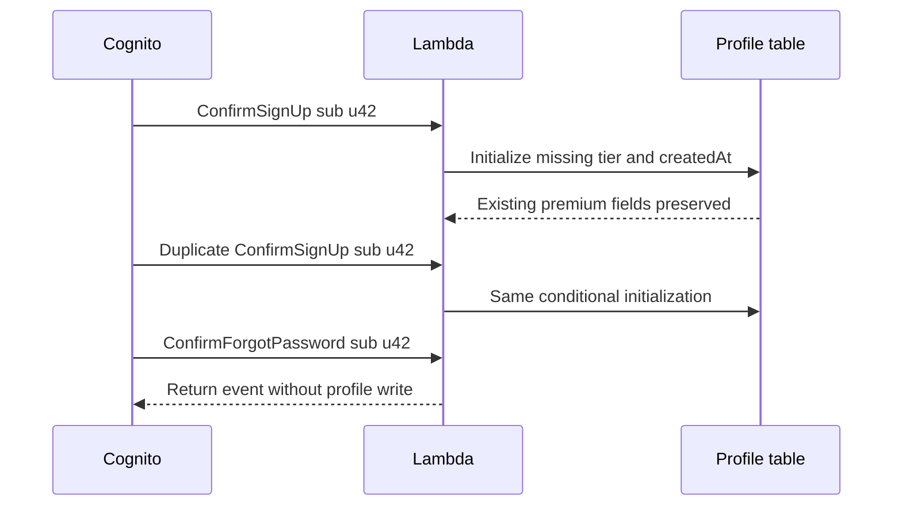

# User Pool — Deep Dive

<!-- length-justification: This is the canonical Cognito User Pool configuration reference; pool policy, app-client policy, user operations, and triggers remain together because their compatibility constraints are reviewed as one deployed directory contract. -->

> **Who this is for**: Backend engineers configuring one Cognito User Pool and its application-client
> policies.

> **Key insight**: App clients are policy profiles over one shared user directory, not separate user
> stores.

## Creating a User Pool

A User Pool is configured once and rarely changed (some settings are immutable after creation — read the notes below carefully).

```python
import boto3
import json

cognito = boto3.client('cognito-idp', region_name='us-east-1')

response = cognito.create_user_pool(
    PoolName='myapp-users',

    # How users sign in — IMMUTABLE after creation
    UsernameAttributes=['email'],           # users log in with email (not a separate username)
    # Alternative: don't set this if you want a username + optionally allow email as alias:
    # AliasAttributes=['email', 'phone_number', 'preferred_username']

    # Case sensitivity for usernames — IMMUTABLE
    UsernameConfiguration={'CaseSensitive': False},

    # Password rules
    Policies={
        'PasswordPolicy': {
            'MinimumLength': 12,
            'RequireUppercase': True,
            'RequireLowercase': True,
            'RequireNumbers': True,
            'RequireSymbols': True,
            'TemporaryPasswordValidityDays': 7,
        }
    },

    # Auto-verify email (sends verification code on sign-up)
    AutoVerifiedAttributes=['email'],

    # Multi-factor authentication (MFA) policy — mutable, but sign-in-impacting
    MfaConfiguration='OPTIONAL',           # 'OFF' | 'OPTIONAL' | 'ON'

    # Account recovery
    AccountRecoverySetting={
        'RecoveryMechanisms': [
            {'Priority': 1, 'Name': 'verified_email'},
        ]
    },

    # User attribute schema — attributes added here are PERMANENT (can't be removed)
    Schema=[
        {
            'Name': 'email',
            'AttributeDataType': 'String',
            'Required': True,
            'Mutable': False,
        },
        {
            'Name': 'department',           # will be accessible as custom:department
            'AttributeDataType': 'String',
            'Mutable': True,
            'StringAttributeConstraints': {'MinLength': '1', 'MaxLength': '100'},
        },
        {
            'Name': 'account_tier',
            'AttributeDataType': 'String',  # 'String' | 'Number' | 'DateTime' | 'Boolean'
            'Mutable': True,
        },
    ],

    # Email configuration (use SES for production — default has low send limits)
    EmailConfiguration={
        'EmailSendingAccount': 'DEVELOPER',                         # use your SES
        'SourceArn': 'arn:aws:ses:us-east-1:123456789012:identity/noreply@yourapp.com',
        'From': 'noreply@yourapp.com',
    },

    # Email verification content
    VerificationMessageTemplate={
        'DefaultEmailOption': 'CONFIRM_WITH_CODE',
        'EmailSubject': 'Your verification code',
        'EmailMessage': 'Your verification code is {####}',
    },
)

pool_id = response['UserPool']['Id']
# MFA factors use their dedicated API; EnabledMfas is not a CreateUserPool parameter.
cognito.set_user_pool_mfa_config(
    UserPoolId=pool_id, MfaConfiguration='OPTIONAL',
    SoftwareTokenMfaConfiguration={'Enabled': True},
)
described = cognito.describe_user_pool(UserPoolId=pool_id)['UserPool']
assert described['Id'] == pool_id
print(described['Id'], described['Status'])  # us-east-1_..., Enabled
```

If `describe_user_pool` returns the same ID and `Enabled`, creation is observable. A frequent first
failure is `InvalidParameterException` from an incompatible sign-in/schema choice; fix the request
rather than retrying it unchanged.

### Immutable Settings (decide before creating)
- `UsernameAttributes` or `AliasAttributes` — how users sign in
- `UsernameConfiguration.CaseSensitive`
- Required attributes in `Schema`
- Custom attributes can be added later but **never removed**

`MfaConfiguration` is operational policy, not an immutable schema choice: Cognito exposes it
through `UpdateUserPool`. Changing it can still disrupt sign-in flows, so stage and test the
change, but do not treat pool recreation as required.

---

## App Clients

A public browser/mobile client cannot keep a secret, so it uses redirect-bound flows such as
Authorization Code with PKCE. A confidential service client can protect a secret and use client
credentials. An OAuth user client adds redirect URIs and allowed scopes. These are distinct trust
profiles over the same directory: the settings constrain how each caller proves identity and which
tokens it may request; they do not create separate users.

### Creating an App Client

```python
response = cognito.create_user_pool_client(
    UserPoolId=pool_id,
    ClientName='web-app',

    # Server-side apps: set True and store the secret securely
    # Browser/mobile apps: ALWAYS False — secret would be exposed
    GenerateSecret=False,

    # Which auth flows this client supports
    ExplicitAuthFlows=[
        'ALLOW_USER_SRP_AUTH',          # secure password auth (recommended)
        'ALLOW_REFRESH_TOKEN_AUTH',     # required for token refresh
        # 'ALLOW_USER_PASSWORD_AUTH',   # plain password — only add if needed (server-side)
        # 'ALLOW_CUSTOM_AUTH',          # custom Lambda-driven auth flows
    ],

    # Token lifetimes
    AccessTokenValidity=60,
    IdTokenValidity=60,
    RefreshTokenValidity=30,
    TokenValidityUnits={
        'AccessToken': 'minutes',
        'IdToken': 'minutes',
        'RefreshToken': 'days',
    },

    # Which user attributes this app can read/write
    # Omit to grant access to all attributes (default for new clients)
    ReadAttributes=['email', 'name', 'custom:department'],
    WriteAttributes=['email', 'name', 'custom:department'],

    # OAuth 2.0 settings (needed if using hosted UI / authorization code flow)
    AllowedOAuthFlows=['code'],                         # authorization code flow
    AllowedOAuthScopes=['openid', 'email', 'profile'],
    AllowedOAuthFlowsUserPoolClient=True,
    CallbackURLs=['https://yourapp.com/callback'],
    LogoutURLs=['https://yourapp.com/logout'],
    SupportedIdentityProviders=['COGNITO'],             # add 'Google', 'Facebook' etc.

    # Prevent user existence errors (don't reveal whether email exists)
    PreventUserExistenceErrors='ENABLED',

    # Auth session duration for multi-step flows (in minutes, default 3)
    AuthSessionValidity=3,
)

client_id     = response['UserPoolClient']['ClientId']
client_secret = response['UserPoolClient'].get('ClientSecret')  # None if GenerateSecret=False
described = cognito.describe_user_pool_client(
    UserPoolId=pool_id, ClientId=client_id
)['UserPoolClient']
assert described['ClientId'] == client_id
print(described['ClientName'], bool(described.get('ClientSecret')))
# web-app False
```

### Multiple Clients — Common Pattern

```python
# Web app — social login, code flow, short tokens
web_client = cognito.create_user_pool_client(
    UserPoolId=pool_id,
    ClientName='web-app',
    GenerateSecret=False,
    ExplicitAuthFlows=['ALLOW_USER_SRP_AUTH', 'ALLOW_REFRESH_TOKEN_AUTH'],
    AllowedOAuthFlows=['code'],
    AllowedOAuthScopes=['openid', 'email', 'profile'],
    AllowedOAuthFlowsUserPoolClient=True,
    CallbackURLs=['https://yourapp.com/callback'],
    SupportedIdentityProviders=['COGNITO', 'Google'],
    AccessTokenValidity=60,
    RefreshTokenValidity=30,
    TokenValidityUnits={'AccessToken': 'minutes', 'RefreshToken': 'days'},
)

# Mobile app — SRP only, longer refresh token
mobile_client = cognito.create_user_pool_client(
    UserPoolId=pool_id,
    ClientName='mobile-app',
    GenerateSecret=False,
    ExplicitAuthFlows=['ALLOW_USER_SRP_AUTH', 'ALLOW_REFRESH_TOKEN_AUTH'],
    AccessTokenValidity=60,
    RefreshTokenValidity=90,    # 90 days — mobile apps stay logged in longer
    TokenValidityUnits={'AccessToken': 'minutes', 'RefreshToken': 'days'},
)

# Backend service — client credentials (machine-to-machine, no user login)
server_client = cognito.create_user_pool_client(
    UserPoolId=pool_id,
    ClientName='backend-service',
    GenerateSecret=True,        # server-side only, secret is safe here
    ExplicitAuthFlows=[],       # no user auth flows needed
    AllowedOAuthFlows=['client_credentials'],
    AllowedOAuthScopes=['myapi/read', 'myapi/write'],
    AllowedOAuthFlowsUserPoolClient=True,
)
```

---

## Authentication Flows

### SRP (Secure Remote Password) — Recommended

The password never travels over the wire in plaintext. The client and server do a cryptographic handshake to prove the client knows the password without sending it. Use the `warrant` or `boto3-cognito-auth` library which handles the SRP math.

```
App → Cognito: InitiateAuth (AuthFlow=USER_SRP_AUTH, USERNAME, SRP_A value)
Cognito → App: Challenge (PASSWORD_VERIFIER) with SRP_B, salt, secret block
App → Cognito: RespondToAuthChallenge with PASSWORD_CLAIM_SIGNATURE
Cognito → App: Tokens (if no MFA) OR next challenge (e.g. SMS_MFA)
```

### USER_PASSWORD_AUTH — Simple

Password sent in plaintext over HTTPS. Fine for server-side code, not recommended for client-side.

```python
response = cognito.initiate_auth(
    ClientId=password_test_client_id,  # test client without a secret; flow explicitly enabled
    AuthFlow='USER_PASSWORD_AUTH',
    AuthParameters={
        'USERNAME': 'jane@example.com',
        'PASSWORD': test_user_password,  # loaded from a test secret; never log it
    },
)

# Could return tokens immediately, or a challenge (e.g. MFA)
if 'AuthenticationResult' in response:
    tokens = response['AuthenticationResult']
    print(bool(tokens.get('AccessToken')), bool(tokens.get('IdToken')))
    # True True (token values remain redacted)
elif 'ChallengeName' in response:
    # Handle MFA or NEW_PASSWORD_REQUIRED challenge
    handle_challenge(response)
```

`NotAuthorizedException` is the common failure when the credentials are wrong or the app client
does not enable `ALLOW_USER_PASSWORD_AUTH`. A challenge is also a valid configured outcome; it must
advance through the supported challenge handler below rather than being treated as failure.
The example supports password-change and SMS/TOTP prompts only; it intentionally rejects passkey,
choice-based, and MFA-setup challenges until the application implements their full protocol.

### Handling Challenges

After `initiate_auth`, Cognito might not give you tokens immediately. It issues a challenge:

```python
def authenticate(username, password, client_id):
    response = cognito.initiate_auth(
        ClientId=client_id,
        AuthFlow='USER_PASSWORD_AUTH',
        AuthParameters={'USERNAME': username, 'PASSWORD': password},
    )

    # Keep responding until we get tokens
    while 'ChallengeName' in response:
        challenge = response['ChallengeName']
        session = response['Session']

        if challenge == 'NEW_PASSWORD_REQUIRED':
            from getpass import getpass
            new_password = getpass("Set a new password: ")
            response = cognito.respond_to_auth_challenge(
                ClientId=client_id,
                ChallengeName='NEW_PASSWORD_REQUIRED',
                Session=session,
                ChallengeResponses={
                    'USERNAME': username,
                    'NEW_PASSWORD': new_password,
                },
            )

        elif challenge == 'SMS_MFA':
            code = input("Enter SMS MFA code: ")
            response = cognito.respond_to_auth_challenge(
                ClientId=client_id,
                ChallengeName='SMS_MFA',
                Session=session,
                ChallengeResponses={
                    'USERNAME': username,
                    'SMS_MFA_CODE': code,
                },
            )

        elif challenge == 'SOFTWARE_TOKEN_MFA':
            code = input("Enter time-based one-time password (TOTP) code: ")
            response = cognito.respond_to_auth_challenge(
                ClientId=client_id,
                ChallengeName='SOFTWARE_TOKEN_MFA',
                Session=session,
                ChallengeResponses={
                    'USERNAME': username,
                    'SOFTWARE_TOKEN_MFA_CODE': code,
                },
            )

        else:
            raise RuntimeError(f"Unsupported Cognito challenge: {challenge}")

    return response['AuthenticationResult']
```

### Common Challenge Names

| Challenge | Means |
|-----------|-------|
| `NEW_PASSWORD_REQUIRED` | Admin created the user — they must set a new password |
| `SMS_MFA` | User has SMS MFA enabled — needs to enter SMS code |
| `SOFTWARE_TOKEN_MFA` | User has TOTP (Google Authenticator) — needs to enter code |
| `MFA_SETUP` | MFA is required but not yet configured for this user |
| `CUSTOM_CHALLENGE` | Lambda-driven custom auth challenge |

---

## User Management

### Self Sign-Up

These are administrative/user-flow excerpts for a disposable pool. Obtain the named password
variables from a test secret store and enforce the configured minimum of 12 characters plus the
character-class requirements. Do not put shared example passwords in a real account. The app
client needs write access to each supplied attribute, including required `email`; immutable email
can be supplied during initial registration, but not changed afterward.

```python
# User signs themselves up
response = cognito.sign_up(
    ClientId=client_id,
    Username='jane@example.com',
    Password=test_user_password,
    UserAttributes=[
        {'Name': 'email', 'Value': 'jane@example.com'},
        {'Name': 'name', 'Value': 'Jane Doe'},
        {'Name': 'custom:department', 'Value': 'engineering'},
    ],
)

user_sub = response['UserSub']           # the user's permanent UUID
confirmed = response['UserConfirmed']    # False — verification email sent

# User receives code → confirms
cognito.confirm_sign_up(
    ClientId=client_id,
    Username='jane@example.com',
    ConfirmationCode='123456',
)
```

### Admin Creates User

```python
# Admin provisions a user — no self-registration required
cognito.admin_create_user(
    UserPoolId=pool_id,
    Username='jane@example.com',
    UserAttributes=[
        {'Name': 'email', 'Value': 'jane@example.com'},
        {'Name': 'email_verified', 'Value': 'true'},
        {'Name': 'name', 'Value': 'Jane Doe'},
        {'Name': 'custom:department', 'Value': 'engineering'},
    ],
    TemporaryPassword=temporary_user_password,
    MessageAction='SUPPRESS',           # don't send welcome email
)
# User status: FORCE_CHANGE_PASSWORD
# On first login, Cognito will issue NEW_PASSWORD_REQUIRED challenge

# Skip forced password change — set permanent immediately
cognito.admin_set_user_password(
    UserPoolId=pool_id,
    Username='jane@example.com',
    Password=permanent_user_password,
    Permanent=True,
)
# User status: CONFIRMED
```

### Get, Update, Disable, Delete

```python
# Get user
user = cognito.admin_get_user(UserPoolId=pool_id, Username='jane@example.com')
print(user['UserStatus'])               # CONFIRMED
print({a['Name']: a['Value'] for a in user['UserAttributes']})

# Update attributes
cognito.admin_update_user_attributes(
    UserPoolId=pool_id,
    Username='jane@example.com',
    UserAttributes=[
        {'Name': 'custom:department', 'Value': 'platform'},
    ],
)

# Disable login (user still exists, just can't sign in)
cognito.admin_disable_user(UserPoolId=pool_id, Username='jane@example.com')

# Re-enable
cognito.admin_enable_user(UserPoolId=pool_id, Username='jane@example.com')

# Force sign-out at Cognito; offline API JWT verification still needs revocation state
cognito.admin_user_global_sign_out(UserPoolId=pool_id, Username='jane@example.com')
```

Deletion is irreversible: the directory record and attributes cannot be restored. Keep it outside
general administration snippets and require the operator to repeat the exact target:

```python
def permanently_delete_user(*, username: str, confirmation: str) -> None:
    if confirmation != f"delete:{username}":
        raise ValueError("confirmation must exactly match delete:<username>")
    cognito.admin_delete_user(UserPoolId=pool_id, Username=username)


permanently_delete_user(
    username="jane@example.com",
    confirmation="delete:jane@example.com",
)
# Success: no response body. A second call raises UserNotFoundException.
```

### List Users

```python
paginator = cognito.get_paginator('list_users')
for page in paginator.paginate(UserPoolId=pool_id):
    for user in page['Users']:
        attrs = {a['Name']: a['Value'] for a in user['UserAttributes']}
        print(user['Username'], user['UserStatus'], attrs.get('email'))

# Filter — find users by attribute
response = cognito.list_users(
    UserPoolId=pool_id,
    Filter='email = "jane@example.com"',    # exact match
    # Filter='email ^= "jane"',             # starts with
    # Filter='name = "Jane Doe"',
)
```

---

## Groups

Groups let you tag users with a role/tier. Membership is reflected in JWT tokens.

```python
# Create groups
cognito.create_group(
    UserPoolId=pool_id,
    GroupName='admins',
    Description='Admin users',
    Precedence=1,               # chooses preferred IAM role, not your app's permission merge
)
cognito.create_group(UserPoolId=pool_id, GroupName='premium', Precedence=10)
cognito.create_group(UserPoolId=pool_id, GroupName='free',    Precedence=20)

# Add user to group
cognito.admin_add_user_to_group(
    UserPoolId=pool_id,
    Username='jane@example.com',
    GroupName='admins',
)

# Remove user from group
cognito.admin_remove_user_from_group(
    UserPoolId=pool_id,
    Username='jane@example.com',
    GroupName='admins',
)

# List users in a group
response = cognito.list_users_in_group(UserPoolId=pool_id, GroupName='admins')
for user in response['Users']:
    print(user['Username'])

# List groups a user belongs to
response = cognito.admin_list_groups_for_user(
    UserPoolId=pool_id,
    Username='jane@example.com',
)
for group in response['Groups']:
    print(group['GroupName'])
```

In the JWT, group membership appears as:
```json
{
  "cognito:groups": ["admins", "premium"],
  "sub": "uuid-here",
  "email": "jane@example.com"
}
```

---

## Lambda Triggers

AWS Lambda triggers—functions invoked at Cognito lifecycle points—customize behavior. Most
applications start with the **bold rows** demonstrated here: post confirmation for provisioning and
pre-token generation for claims. The remaining triggers are conditional reference options.

| Trigger | When it fires | Common use |
|---------|--------------|-----------|
| Pre sign-up | Before a new user account is created | Validate email domain, auto-confirm, auto-verify |
| **Post confirmation** | After user confirms their account | Add user to default group, sync to your database (DB) |
| **Pre authentication** | Before credentials are checked | Block certain users, log attempts |
| **Post authentication** | After successful login | Audit logging, last-login tracking |
| **Pre token generation** | Before tokens are issued | Add custom claims to a JSON Web Token (JWT), modify group claims |
| **Custom message** | Before verification/welcome emails are sent | Customize email content and links |
| **User migration** | When a user doesn't exist in pool but tries to sign in | Migrate users from legacy auth system transparently |
| **Define auth challenge** | Start of a custom auth flow | Define what the next challenge is |
| **Create auth challenge** | Create the actual challenge | Generate OTP, captcha, etc. |
| **Verify auth challenge** | Validate the user's response | Check OTP, validate captcha |

### Example: Post Confirmation — idempotent profile initialization

```python
import boto3
from datetime import datetime, timezone


def initialize_profile(event, table):
    # Cognito also invokes post-confirmation after password-reset confirmation.
    if event.get("triggerSource") != "PostConfirmation_ConfirmSignUp":
        return event
    attributes = event["request"]["userAttributes"]
    table.update_item(
        Key={"userId": attributes["sub"]},
        UpdateExpression=("SET #email = if_not_exists(#email, :email), "
                          "#tier = if_not_exists(#tier, :free), "
                          "#created = if_not_exists(#created, :now)"),
        ExpressionAttributeNames={"#email": "email", "#tier": "tier", "#created": "createdAt"},
        ExpressionAttributeValues={":email": attributes.get("email", ""), ":free": "free",
                                   ":now": datetime.now(timezone.utc).isoformat()},
    )
    return event


def handler(event, context):
    table = boto3.resource("dynamodb").Table("users")
    return initialize_profile(event, table)
```

Each field is initialized only if absent. A duplicate confirmation cannot overwrite an existing
`premium` tier or move the creation time. A password-reset confirmation performs no profile write.
The default entitlement lives in this profile; avoid an unrelated default-group side effect in the
same trigger unless its retries and recovery are also defined. IAM must grant the Lambda only the
required table action. Surface failures and make the application tolerate/reconcile an absent
profile: authentication and an external database write are not one transaction.



The duplicate executes safely because the database conditions apply at write time. A prior
read followed by an unconditional `put_item` would still race a billing upgrade.

### Example: Pre Token Generation — Add Custom Claims

```python
def handler(event, context):
    """Add custom claims to JWT tokens before they're issued."""
    # Read user's tier from DynamoDB
    user_sub = event['request']['userAttributes']['sub']
    # ... fetch from DB ...

    event['response']['claimsOverrideDetails'] = {
        'claimsToAddOrOverride': {
            'app_tier': 'premium',
            'feature_flags': 'dark_mode,export,api_access',
        },
        'claimsToSuppress': [],  # remove claims from the token if needed
    }
    return event
```

Attach a trigger while preserving every returned updateable setting and existing trigger:

```python
from config_updates import pool_trigger_update_request

request = pool_trigger_update_request(
    cognito, pool_id,
    PostConfirmation="arn:aws:lambda:us-east-1:123456789012:function:PostConfirmation",
    PreTokenGeneration="arn:aws:lambda:us-east-1:123456789012:function:PreTokenGen",
)
cognito.update_user_pool(**request)
```

Copy [config_updates.py](examples/config_updates.py) beside the script. `UpdateUserPool` is a
replacement-style operation: omitted configuration can reset to defaults. This helper preserves
supported fields from `DescribeUserPool`, maps the pool name, and merges the trigger map. Review the
redacted diff, use one administrative writer, apply, then describe and compare; no optimistic lock
protects a concurrent administrator's update. New SDK/API fields require a fresh schema review.
The Lambda also needs a resource policy allowing this pool to invoke it; setting an ARN alone does
not create that permission. The pre-token example is the V1 identity-token event shape; access-token
customization uses the appropriate newer event version and response schema. See [UpdateUserPool](https://docs.aws.amazon.com/cognito-user-identity-pools/latest/APIReference/API_UpdateUserPool.html).

---

## Password Reset

```python
# User-initiated forgot password — sends code to email
cognito.forgot_password(
    ClientId=client_id,
    Username='jane@example.com',
)

# User enters code + new password
cognito.confirm_forgot_password(
    ClientId=client_id,
    Username='jane@example.com',
    ConfirmationCode='654321',
    Password=replacement_user_password,
)

# Admin force-reset: user enters RESET_REQUIRED and completes forgot-password confirmation
cognito.admin_reset_user_password(
    UserPoolId=pool_id,
    Username='jane@example.com',
)
```

---

## Token Refresh

```python
response = cognito.initiate_auth(
    ClientId=client_id,
    AuthFlow='REFRESH_TOKEN_AUTH',
    AuthParameters={'REFRESH_TOKEN': stored_refresh_token},
)

new_access_token = response['AuthenticationResult']['AccessToken']
new_id_token     = response['AuthenticationResult']['IdToken']
# Nonrotating client only. A rotating client uses GetTokensFromRefreshToken instead.
```

---

## User Pool Domain (for Hosted UI)

If you want Cognito to serve the login page for you (useful for prototyping or OAuth flows), you need to add a domain to the pool. (As of November 2024 the hosted UI was rebranded **Managed Login**, with a no-code branding editor; the classic hosted UI still works, but new pools default to Managed Login, which requires the Essentials tier for full branding.)

```python
# Custom AWS subdomain
cognito.create_user_pool_domain(
    Domain='myapp-auth',             # becomes: myapp-auth.auth.us-east-1.amazoncognito.com
    UserPoolId=pool_id,
)

# Or your own domain (requires an AWS Certificate Manager (ACM) TLS certificate)
cognito.create_user_pool_domain(
    Domain='auth.yourapp.com',
    UserPoolId=pool_id,
    CustomDomainConfig={
        'CertificateArn': 'arn:aws:acm:us-east-1:123456789012:certificate/...',
    }
)
```

OAuth Authorization Code flow URL (redirect user here to log in):
```
https://myapp-auth.auth.us-east-1.amazoncognito.com/oauth2/authorize
  ?response_type=code
  &client_id=<client_id>
  &redirect_uri=https://yourapp.com/callback
  &scope=openid+email+profile
```

---

## Related Docs

- [cognito.md](./cognito.md) — Mental model and overview
- [tokens.md](./tokens.md) — JWT structure, validation, refresh flow


## Client-secret rotation and recovery changes

As checked 2026-10-30, confidential clients can have two active secrets. Add the replacement with
`AddUserPoolClientSecret`, deploy it to callers, observe successful token issuance using it, then
remove the old secret by ID with `DeleteUserPoolClientSecret`. Keep the old secret during rollout
for rollback. This does not convert a public app client into a confidential one, and the only active
secret cannot be deleted. Store the returned value directly in a secret manager, never logs.
[AWS app-client secret lifecycle](https://docs.aws.amazon.com/cognito/latest/developerguide/user-pool-settings-client-apps.html).

Multi-Region replication changes the recovery contract, not just deployment topology. Essentials
or Plus and a multi-Region customer-managed KMS key are prerequisites. The secondary handles a
subset of authentication operations; signup, password reset and profile writes remain primary
operations, and TOTP MFA is not supported in the secondary. Replica configuration is eventually
consistent. Review email, SMS, Lambda, WAF and logs per Region, then rehearse actual failover with
existing users and each authentication method. [Cognito MRR limitations](https://docs.aws.amazon.com/cognito/latest/developerguide/user-pool-multi-region.html).

Changing to the updated issuer changes newly issued tokens, including those produced by existing
refresh tokens. Stage verifier support for explicitly trusted old/new issuers before switching,
retain overlap through old access/ID expiry, and remove the old policy afterward. Each issuer has
its own configured JWKS endpoint; never disable issuer validation during migration. Exercise key
retrieval when the primary is unavailable. [AWS issuer migration guidance](https://aws.amazon.com/blogs/security/architecting-resilient-authentication-with-amazon-cognito-multi-region-replication/).

## Operational checkpoint and retention

Before production, record the pool/client configuration, verify callback and attribute permissions,
rehearse every enabled MFA/challenge path, confirm SES/SMS delivery and throttling behavior, and
monitor signup/login/reset failures separately. Test both the denied permission and the allowed
one. Keep an administrator recovery path separate from user login. Configuration tests in the
[practical guide](oauth-jwt-guide.md) validate request shapes and preservation locally; they do not
prove cloud permissions, deliverability, triggers, or replication.

**Recap:** the pool owns the directory and policy, while clients constrain application-specific
flows. Administrative updates preserve complete configuration; repeated lifecycle events must
preserve business state.

**Check yourself:** a password reset fires post confirmation for a premium user. Should the handler
create a fresh free profile?
<details><summary>Answer</summary>No. Ignore the forgot-password trigger for initial provisioning;
even signup retries must only initialize missing fields atomically.</details>

**Try it:** enable rotation on a code-flow client with several callback URLs and SRP plus legacy
refresh enabled. Predict the complete request before applying it in a disposable environment.
<details><summary>Answer</summary>Preserve the URLs, OAuth scopes/flows and lifetimes; remove
`ALLOW_REFRESH_TOKEN_AUTH`, set rotation and its grace period, then verify via Describe. A patch
containing only the rotation field can reset unrelated configuration.</details>
