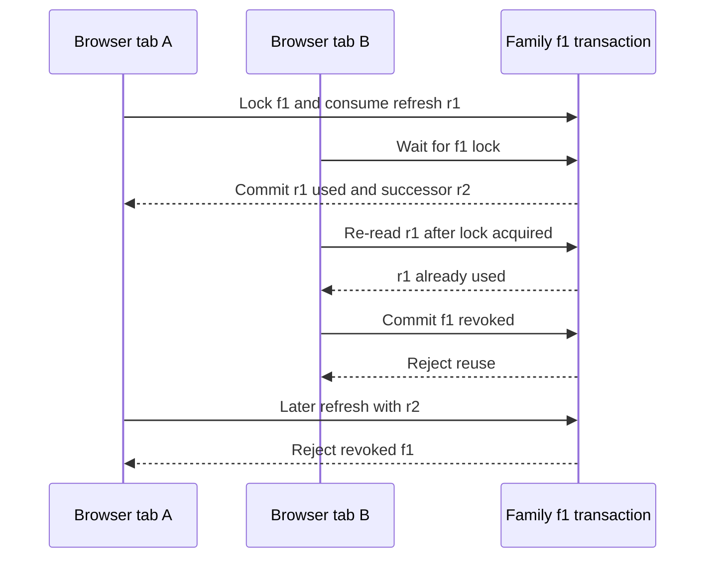
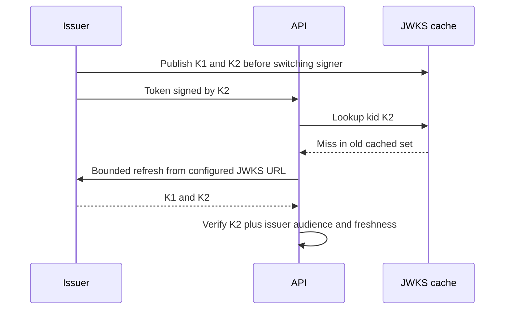

# JWT — JSON Web Tokens

<!-- length-justification: This note is the canonical JWT trust-boundary reference, keeping structure, validation, JWKS rotation, and library implementations together so security-critical checks do not drift across copies. -->

> **Who this is for**: Backend engineers validating issuer-signed tokens at an API boundary.

> **Key insight**: Cryptographic authenticity proves who signed a token; issuer, audience, freshness,
> and token-profile checks determine whether it is suitable for this endpoint.

> A self-contained, cryptographically signed token. The server signs it; anyone with the public key can verify it without calling the server again.

---

## The Problem JWT Solves

**Old way (sessions):** On login, store a session ID in a database. On every request, look it up. Problem: every server needs access to that database — it becomes a bottleneck and a single point of failure.

**JWT way:** Put the proof directly in the token. The token contains all the info your API needs (who the user is, what they can do, when it expires). Sign it with a private key so no one can tamper with it. Now your API can verify tokens **without calling any external service.**

A minimal access-token trust decision looks like this once the issuer's signing key has been selected
from its published key set:

```python
claims = jwt.decode(
    token,
    signing_key,
    algorithms=["RS256"],
    issuer="https://auth.example.com/",
    audience="https://api.orders.example.com",
    options={"require": ["exp", "iat", "iss", "aud", "sub"]},
)
if "orders:read" not in claims.get("scope", "").split():
    raise PermissionError("missing orders:read")

print(claims["sub"])  # user-123 for an accepted token
```

Changing `aud` to another API, expiring `exp`, changing the signature, or removing the required
scope produces rejection rather than an identity. Key discovery and the complete validator are
owned later in this note; this trace establishes the checks before rotation and library alternatives.

```
Session approach:     Request → lookup session_id in DB → get user info
JWT approach:         Request → verify token signature (local, fast) → read claims
```

---

## JWT Structure

The signed compact JWT (JWS) taught here has three base64url segments separated by dots.
The header and payload encode JSON; the third encodes signature bytes. Encrypted JWTs use
a different structure and are outside this example.

```
eyJhbGciOiJSUzI1NiIsImtpZCI6ImFiYzEyMyJ9  .  eyJzdWIiOiJ1c2VyLXV1aWQiLCJleHAiOjE3MDB9  .  <signature>
              HEADER                                          PAYLOAD                              SIGNATURE
```

### Header

```json
{
  "alg": "RS256",
  "kid": "abc123def456"
}
```

| Field | Meaning |
|-------|---------|
| `alg` | Signing algorithm — `RS256` (Rivest–Shamir–Adleman signatures with SHA-256) or `ES256` (elliptic-curve digital signatures) for asymmetric; `HS256` for symmetric (shared secret) |
| `kid` | Key ID — tells the verifier which public key was used to sign this token. Important because issuers rotate keys. |

The header is attacker-controlled until verification. In an algorithm-confusion attack, an attacker
changes `alg` and relies on a permissive verifier to choose a different verification method—possibly
misusing public key material as a shared secret. A configured `algorithms=["RS256"]` allowlist moves
that decision from the token into trusted verifier configuration; the token may identify a key, but
it never chooses the verification algorithm.

### Payload (Claims)

```json
{
  "sub":   "a1b2c3d4-uuid",
  "iss":   "https://auth.example.com/",
  "aud":   "my-api-client-id",
  "exp":   1700003600,
  "iat":   1700000000,
  "jti":   "unique-token-id",
  "scope": "read write",
  "email": "alice@example.com"
}
```

**Claims** are what the token asserts. The issuer puts them there; your API verifies the signature then reads them.

### Standard Claims Reference

| Claim | Full Name | Meaning |
|-------|-----------|---------|
| `sub` | Subject | Who the token is about — a user UUID or client ID |
| `iss` | Issuer | Who created the token — the auth server's URL |
| `aud` | Audience | Who the token is intended for — your API or client ID |
| `exp` | Expiration | Unix timestamp — token invalid after this time |
| `iat` | Issued At | Unix timestamp — when the token was created |
| `nbf` | Not Before | Unix timestamp — token invalid before this time |
| `jti` | JWT ID | Unique identifier for this token — used for revocation |

Everything else (email, name, scope, groups, etc.) is a custom claim specific to the issuer.

### Signature

Created by the issuer using its **private key**:

```
SIGNATURE = RSA_SIGN(
    private_key,
    base64url(header) + "." + base64url(payload)
)
```

Your API verifies using the corresponding **public key** (published by the issuer). If anyone modifies even one character of the header or payload, the signature won't match and validation fails.

The payload is **not encrypted** — base64url encoding is reversible. Anyone who gets the token can read the claims. Never put secrets in JWT claims.

---

## JWKS — JSON Web Key Set

The issuer publishes its public keys at a well-known URL called the **JWKS endpoint**. Your API fetches this to verify tokens.

```
https://auth.example.com/.well-known/jwks.json
```

The response is a set of public keys:

```json
{
  "keys": [
    {
      "kid": "abc123def456",
      "kty": "RSA",
      "alg": "RS256",
      "use": "sig",
      "n":   "very-long-base64url-number",
      "e":   "AQAB"
    },
    {
      "kid": "xyz789",
      "kty": "RSA",
      "alg": "RS256",
      "use": "sig",
      "n":   "another-long-base64url-number",
      "e":   "AQAB"
    }
  ]
}
```

### The Trust Chain

```
Issuer has:  PRIVATE key (secret, never shared)
Issuer publishes: PUBLIC keys at JWKS endpoint

Token creation: issuer signs with private key
Token verification: your API verifies with matching public key

If signature valid → issuer definitely created this token, nobody tampered
```

**Cache the JWKS.** It changes rarely (only when the issuer rotates keys). Fetching it per-request adds latency and creates a dependency on the auth server for every API call. Cache with a time to live (TTL)—an expiry for the cached value—of 15–60 minutes and refresh on `kid` miss.

### Key Rotation

Issuers rotate signing keys periodically. The `kid` in the token header tells you which key to use. When you see a `kid` not in your cache, refetch the JWKS. If it's still not there after a fresh fetch, the token is invalid.

---

## OpenID Connect Discovery

OpenID Connect (OIDC) is an identity layer built on top of OAuth 2.0. OIDC issuers publish a **discovery document** that tells clients everything they need:

```
https://auth.example.com/.well-known/openid-configuration
```

Response:

```json
{
  "issuer": "https://auth.example.com",
  "authorization_endpoint": "https://auth.example.com/oauth2/authorize",
  "token_endpoint": "https://auth.example.com/oauth2/token",
  "jwks_uri": "https://auth.example.com/.well-known/jwks.json",
  "userinfo_endpoint": "https://auth.example.com/oauth2/userinfo",
  "response_types_supported": ["code", "token"],
  "grant_types_supported": ["authorization_code", "client_credentials", "refresh_token"],
  "scopes_supported": ["openid", "email", "profile"],
  "token_endpoint_auth_methods_supported": ["client_secret_basic", "client_secret_post"]
}
```

Instead of hardcoding every URL, a client only needs the discovery URL. It fetches this document on startup and learns where to get tokens, where to find public keys, etc.

---

## Validation Algorithm

When your API receives `Authorization: Bearer <token>`, validate in this order:

```
1. Split the token into header.payload.signature
2. Base64url-decode the header → get kid and alg
3. Fetch the JWKS (from cache or jwks_uri) → find the key matching kid
4. Verify the signature using the public key
   → If invalid: reject (token is tampered or from wrong issuer)
5. Decode the payload (no verification needed after step 4)
6. Check exp > now() - leeway (see below)
   → If expired: reject with 401
7. Check iss == your expected issuer URL
   → If wrong: reject (token from a different auth server)
8. Check aud contains this receiving API for the RFC 9068 access-token profile
   → If wrong: reject (token not intended for your API)
9. Require the chosen token profile and the scopes/permissions needed by this operation
```

**Order matters.** Verify the signature before reading any claims. A tampered payload could have any exp or iss value.

`client_id` identifies the OAuth client, not the receiving resource. It cannot substitute for
`aud` in the [RFC 9068 profile](https://www.rfc-editor.org/rfc/rfc9068.html#section-4).
Provider-specific profiles such as [Cognito M2M](cognito/oauth-jwt-guide.md) must be configured
separately. Never fall back from a failed audience check to a client-ID check.

### Clock-Skew Leeway on `exp` / `nbf` / `iat`

Clocks drift. The issuer and your API do not share a wall clock, and even with Network Time
Protocol (NTP) synchronization the difference between two machines is often tens to hundreds of
milliseconds—worse across cloud regions or on poorly synchronized clients. Without leeway, a token
that is *just barely* issued or about to expire can fail validation on one side and succeed on the other.

RFC 7519 §4.1.4 explicitly allows implementers to accept **"some small leeway, usually no more than a few minutes"** on `exp` (and by symmetry `nbf`, `iat`). The conventional value is **0–60 seconds** — large enough to absorb typical NTP skew, small enough that an attacker re-using a just-expired token barely gets any extra window.

```python
# PyJWT: use the `leeway` argument
jwt.decode(
    token,
    signing_key.key,
    algorithms=["RS256"],
    issuer=ISSUER,
    audience=API_AUDIENCE,
    leeway=30,
)

# python-jose: same option
from jose import jwt as jose_jwt
jose_jwt.decode(
    token,
    key,
    algorithms=["RS256"],
    issuer=ISSUER,
    audience=API_AUDIENCE,
    options={"leeway": 30},
)
```

Pick a single value for your service (30s is a reasonable default), apply it to `exp`, `nbf`, and `iat` uniformly, and do not extend it further without a specific reason — every second of leeway is extra time a stolen token stays valid after its nominal expiry.

---

## Python Utilities

### Decode Without Verification (debugging only)

```python
import base64
import json


def decode_jwt_payload(token: str) -> dict:
    """Decode JWT payload without verifying. For debugging only — never trust the result."""
    payload = token.split(".")[1]
    # Restore base64 padding
    payload += "=" * (4 - len(payload) % 4)
    return json.loads(base64.urlsafe_b64decode(payload))


def decode_jwt_header(token: str) -> dict:
    header = token.split(".")[0]
    header += "=" * (4 - len(header) % 4)
    return json.loads(base64.urlsafe_b64decode(header))
```

### Check Expiry

```python
import time


def is_token_expired(token: str, buffer_seconds: int = 0) -> bool:
    """Return True if the token is expired (or will expire within buffer_seconds)."""
    claims = decode_jwt_payload(token)
    return claims["exp"] - time.time() < buffer_seconds


def seconds_until_expiry(token: str) -> float:
    claims = decode_jwt_payload(token)
    return claims["exp"] - time.time()
```

### Full Validation with PyJWT

```python
import jwt
from jwt import PyJWKClient

# Initialize once at startup — handles caching internally
jwks_client = PyJWKClient(
    "https://auth.example.com/.well-known/jwks.json",
    cache_jwk_set=True,
    lifespan=3600,  # refresh cache every hour
)


def validate_token(
    token: str,
    *,
    issuer: str,
    audience: str,
) -> dict:
    """
    Validate a JWT and return the decoded claims.
    Raises jwt.exceptions.InvalidTokenError on any validation failure.
    """
    signing_key = jwks_client.get_signing_key_from_jwt(token)

    return jwt.decode(
        token,
        signing_key.key,
        algorithms=["RS256"],
        issuer=issuer,
        audience=audience,
        options={
            "require": ["exp", "iat", "iss", "aud", "sub"],
            "verify_exp": True,
            "verify_iss": True,
            "verify_aud": True,
        },
    )
```

### Existing `python-jose` code should keep the same trust contract

`python-jose` released 3.4.0 and 3.5.0 after its earlier maintenance gap, so evaluate current
security advisories and API trade-offs rather than treating release age alone as the decision.
For new validation code, the PyJWT implementation above is the canonical owner because one library
call pins the algorithm and requires issuer, audience, and expiry. Existing `python-jose` code must
enforce that same non-optional contract plus the endpoint's token profile; do not copy a manual
signature-only verifier. For JSON Web Encryption (JWE), an encrypted JOSE token format, evaluate an
actively maintained encryption-capable library such as `joserfc` or `authlib`.

### FastAPI Dependency

```python
from fastapi import Depends, HTTPException, status
from fastapi.security import HTTPBearer, HTTPAuthorizationCredentials
import jwt
from jwt import PyJWKClient

bearer_scheme = HTTPBearer()
jwks_client = PyJWKClient("https://auth.example.com/.well-known/jwks.json")

ISSUER = "https://auth.example.com/"
AUDIENCE = "my-api"


def get_current_user(
    credentials: HTTPAuthorizationCredentials = Depends(bearer_scheme),
) -> dict:
    token = credentials.credentials
    try:
        signing_key = jwks_client.get_signing_key_from_jwt(token)
        claims = jwt.decode(
            token,
            signing_key.key,
            algorithms=["RS256"],
            issuer=ISSUER,
            audience=AUDIENCE,
            leeway=30,  # absorb clock skew on exp/nbf/iat — see "Clock-Skew Leeway"
        )
        return claims
    except jwt.ExpiredSignatureError:
        raise HTTPException(status_code=status.HTTP_401_UNAUTHORIZED, detail="Token expired")
    except jwt.InvalidTokenError as e:
        raise HTTPException(status_code=status.HTTP_401_UNAUTHORIZED, detail=str(e))


# Usage
@app.get("/me")
async def get_me(claims: dict = Depends(get_current_user)):
    return {"user_id": claims["sub"], "email": claims.get("email")}
```

---

## Revocation and Refresh Token Rotation

JWT access tokens are intentionally hard to revoke: if the signature, `iss`, `aud`, and `exp` are valid, the API can accept the token without calling the auth server. That statelessness is the feature and the tradeoff.

The usual production pattern, aligned with [RFC 9700 OAuth 2.0 Security BCP](https://www.rfc-editor.org/rfc/rfc9700.html#section-4.14.2):

1. Keep access tokens short-lived: 5-30 minutes.
2. Issue refresh tokens as long-lived, server-tracked credentials.
3. Store only a hash of the refresh token.
4. Rotate the refresh token on every refresh.
5. If an old refresh token is reused, revoke the whole token family.

Why the family? Reuse means either the legitimate client retried with an old token or an attacker has a stolen token. The server cannot reliably know which one. Revoking the family stops the replay and forces a fresh login.

Rotation is a **transaction**, not a read followed by two independent writes. Two requests can
both read `used_at=NULL`; without serialization each could mint a valid successor. Serialize by
family, re-read under that lock, consume the old token and insert exactly one successor, then commit.
On reuse, persist family revocation before reporting failure. Raising inside a transaction that
rolls back the revocation silently defeats the protection.



The strict policy deliberately logs out both tabs: after reuse the server cannot identify the
legitimate holder. Serialize refreshes in the client and atomically persist the replacement token.
A provider's documented grace period is a different policy; do not invent a grace window that
permits unrestricted parallel successors. Lost responses still need an explicit retry/re-login
policy. Family expiry is absolute here, so repeated rotation cannot extend a session forever.

Run the complete [SQLite concurrency fixture](examples/refresh_rotation.py) from the repository root:

```bash
python3 fundamentals/auth/examples/refresh_rotation.py
# PASS: one concurrent successor; reuse revocation persists; successor rejected
```

It races two real connections and checks durable revocation after reopening. SQLite serializes
writes for this local demonstration. A PostgreSQL implementation locks the **family row** with
`FOR UPDATE`, then reads/consumes the token and inserts its successor in that same transaction.
Keep token hashes unique and never store or log the raw refresh token. The fixture demonstrates
state transitions; it does not implement an authorization server, rate limiting, cookie security,
or a managed provider's exact rotation semantics. Prefer the provider's supported mechanism when
one is available.

---

## Common Mistakes

| Mistake | Problem | Fix |
|---------|---------|-----|
| Decoding without verifying | Anyone can forge claims | Always verify signature first |
| Not checking `exp` | Accepting expired tokens | Include expiry check |
| Not checking `iss` | Accepting tokens from a different auth server | Always validate issuer |
| Not checking `aud` | Accepting tokens intended for a different service | Validate audience |
| Fetching JWKS per-request | Latency + external dependency per request | Cache JWKS with TTL |
| Putting secrets in claims | JWT payload is readable by anyone | Claims are not encrypted |
| Using symmetric keys (HS256) in multi-service setup | All services share the secret — anyone can forge tokens | Use asymmetric (RS256/ES256) |

---

## Debugging

```python
# Offline inspection only. Use a deliberately fake token, never a real bearer credential.
import base64
import json

fake_token = "eyJhbGciOiJSUzI1NiJ9.eyJzdWIiOiJkZW1vIn0.signature"
payload = fake_token.split(".")[1]
payload += "=" * (-len(payload) % 4)
print(json.loads(base64.urlsafe_b64decode(payload)))
# {'sub': 'demo'}
```

Decoding does not validate a token. Never send a real bearer token to a third-party debugging site;
anyone who receives it can use it until it expires.


## Rotation diagnosis and retention

When key `K2` first appears, a cached `K1` cannot verify it. Fetch the configured issuer's JWKS once
on the unknown `kid`, retry lookup, and reject if absent. An unknown identifier is attacker input,
so coalesce/rate-limit misses and bound HTTP timeouts; do not let each random `kid` produce an
unlimited fetch. Keep the old published key until its valid tokens age out; never accept an
unverified token because key discovery is unavailable.



A successful key lookup supplies only the verification key. It does not establish the token's
intended recipient, type, scopes, or application permissions.

**Recap:** a decoded claim is input until signature and the complete endpoint policy succeed.
Rotation protects two separate lifecycles: issuer signing keys and server-tracked refresh families.

**Check yourself:** a signed token has the right issuer but another API's audience. Accept it?
<details><summary>Answer</summary>No. The issuer vouched for a token intended for another recipient;
your endpoint must reject it despite the valid signature.</details>

**Try it:** run the refresh fixture, then remove the commit before reporting reuse. Predict which
assertion must fail and why. Restore the code after the experiment.
<details><summary>Reasoned answer</summary>The family's revoked state would roll back, so its
successor could refresh again. Durable state must commit before the failure response.</details>
