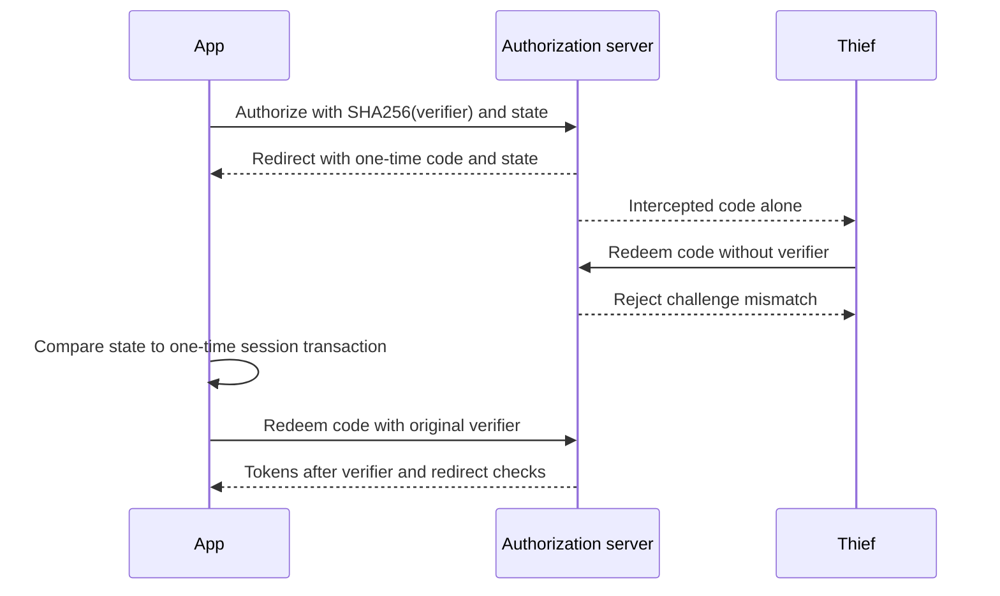

# OAuth 2.0 — The Authorization Framework

> **Who this is for**: Backend engineers choosing an OAuth flow and enforcing delegated access at a
> resource server.

> **Key insight**: OAuth delegates bounded authority; it does not by itself prove an API caller has
> every application-level permission the requested operation requires.

> OAuth 2.0 is a framework that lets a client obtain **limited access** to a resource on behalf of a user or itself — without sharing passwords.

---

## The Problem OAuth Solves

Before OAuth, if service B needed to access your data in service A, you gave service B your service A password. This is terrible:
- Service B has full access to everything, forever
- You can't revoke access to B without changing your password (which affects everything)
- If B is compromised, your password leaks

OAuth introduces **access tokens** — limited, scoped, expiring credentials. Service A (the authorization server) issues a token that says "this client can do X and Y, but not Z, until time T."

---

## Key Roles

| Role | What it is |
|------|-----------|
| **Resource Owner** | The entity that owns the data (usually a user) |
| **Client** | The application requesting access (your app or service) |
| **Authorization Server** | Issues tokens after authentication/authorization (Cognito, Auth0, Okta, etc.) |
| **Resource Server** | The API being protected (your API, or a third-party API) |

---

## Grant Types (Flows)

OAuth 2.0 defines several "grant types" — different ways for a client to get an access token. Use the right one for your situation.

### 1. Authorization Code (+ PKCE)

**Use for**: User-facing apps (web, mobile, single-page application or SPA) where a human logs in.

```
User → Browser → Your App → Auth Server login page
                              ↓ user consents
Auth Server → Your App (callback with ?code=xxx)
Your App → Auth Server: exchange code for tokens
Auth Server → Your App: access_token + id_token + refresh_token
```

PKCE (Proof Key for Code Exchange) prevents auth code interception attacks. Published OAuth
security guidance requires it for public clients and recommends it broadly. The current OAuth 2.1
**Internet-Draft** consolidates that direction and requires PKCE for authorization-code clients;
it is not yet a published RFC. Send `code_challenge` on the authorize request and `code_verifier`
on the token exchange for all clients unless a provider contract explicitly says otherwise.

```python
import secrets, hashlib, base64
from urllib.parse import urlencode
import requests

# Client generates before redirect
code_verifier = secrets.token_urlsafe(64)
code_challenge = base64.urlsafe_b64encode(
    hashlib.sha256(code_verifier.encode()).digest()
).rstrip(b"=").decode()
state = secrets.token_urlsafe(32)

# Store both values in the user's encrypted, HttpOnly server session. They are
# one-time transaction state and must survive the redirect to the callback.
session["oauth_transaction"] = {"state": state, "code_verifier": code_verifier}

# Include in authorization URL
auth_url = "https://auth.example.com/oauth2/authorize?" + urlencode({
    "response_type": "code", "client_id": client_id, "redirect_uri": redirect_uri,
    "scope": "openid email profile", "code_challenge": code_challenge,
    "code_challenge_method": "S256", "state": state,
})

# Callback: reject a forged or replayed authorization response before exchange.
transaction = session.pop("oauth_transaction", None)
if transaction is None or not secrets.compare_digest(received_state, transaction["state"]):
    raise ValueError("invalid OAuth state")

# Exchange code for tokens (include the session-bound verifier)
token_response = requests.post(token_url, data={
    "grant_type": "authorization_code",
    "code": received_code,
    "redirect_uri": redirect_uri,
    "client_id": client_id,
    "code_verifier": transaction["code_verifier"],
}, timeout=10)
token_response.raise_for_status()
```

Without `state`, an attacker can make a victim's browser complete the attacker's authorization
response, binding the wrong account or operation to the victim's session. The one-time comparison
binds the callback to the browser session that initiated it. In OpenID Connect (OIDC), the identity
layer built on OAuth, a correctly validated `nonce` can also bind identity responses where the
protocol profile permits it.

The snippets above are protocol excerpts: `session` is your protected server session and callback
values come from the HTTP request; they are not an executable browser application. Confidential
clients must also authenticate at the token endpoint according to the issuer's contract.

The verifier proves that the redeemer is the party that initiated this particular transaction:



The challenge is public; knowing it does not reveal the random verifier. State binds the callback
to the initiating browser session. Neither check authorizes arbitrary business operations after
login: the API must still enforce scopes and resource ownership.

### 2. Client Credentials

**Use for**: Machine-to-machine (M2M). No user is involved — your service authenticates directly to get a token.

```
Your service → Auth Server: POST with client_id + client_secret + scope
Auth Server → Your service: access_token (no refresh token)
Your service → Resource Server: Authorization: Bearer <access_token>
```

```python
import requests

token_response = requests.post(
    "https://auth.example.com/oauth2/token",
    headers={"Content-Type": "application/x-www-form-urlencoded"},
    data={
        "grant_type": "client_credentials",
        "client_id": client_id,
        "client_secret": client_secret,
        "scope": "myapi/read myapi/write",
    },
    timeout=10,
)
token_response.raise_for_status()
access_token = token_response.json()["access_token"]
```

Key facts:
- No user, no user context — the token represents the **client/service itself**
- A confidential client must authenticate. This example uses a shared secret; other issuer profiles use asymmetric credentials such as signed client assertions or mutual TLS.
- A refresh token normally should not be issued for this grant; request another access token with the client's configured authentication method.
- OAuth does not require JWT access tokens or a universal `sub` value. Use the issuer's documented machine-token profile; Cognito normally identifies the app client.

### 3. Refresh Token

**Use for**: Silently getting new access tokens without user re-authentication.

```
Your app stores refresh_token on login
Access token expires (typically 1 hour)
Your app → Auth Server: POST with refresh_token
Auth Server → Your app: new access_token (+ new id_token)
```

```python
token_response = requests.post(
    "https://auth.example.com/oauth2/token",
    data={
        "grant_type": "refresh_token",
        "refresh_token": stored_refresh_token,
        "client_id": client_id,
        # Confidential clients must also send client_secret (or use HTTP Basic auth).
        # Public clients (SPAs, mobile) omit it.
        # "client_secret": client_secret,
    },
    timeout=10,
)
token_response.raise_for_status()
new_access_token = token_response.json()["access_token"]
```

Refresh tokens have **no format defined by the spec** — treat them as opaque. Providers may issue random strings, encrypted blobs, or even JWTs internally, but clients should never try to parse them. They are long-lived (days to months) and must be stored securely.

### 4. Device Code (Device Authorization)

**Use for**: Devices without a browser or keyboard (smart TVs, CLIs, IoT).

```
Device → Auth Server: I need a code
Auth Server → Device: device_code, user_code, verification_uri
Device shows user: "Go to example.com/device and enter: ABCD-1234"
Device polls Auth Server every few seconds
User logs in on another device and enters the code
Auth Server → Device (on next poll): access_token
```

### 5. Resource Owner Password (deprecated; omitted by the OAuth 2.1 draft)

Sends username + password directly to the auth server. **Do not use** for new projects — it defeats the purpose of OAuth (in authorization code flow, the client never sees the password). The published OAuth Security Best Current Practice says this grant **must not** be used, and the current OAuth 2.1 draft omits it. It still appears in legacy systems and automated tests.

> **Implicit grant** (`response_type=token`, tokens returned in the URL fragment) is likewise
> discouraged by published security guidance and omitted by the OAuth 2.1 draft. SPAs that
> historically used Implicit should use **Authorization Code + PKCE** instead.

Note: Cognito's `USER_PASSWORD_AUTH` / `ADMIN_USER_PASSWORD_AUTH` are **not** the OAuth 2.0 ROPC grant. They are Cognito-native auth flows exposed via the `InitiateAuth` / `AdminInitiateAuth` APIs — Cognito's `/oauth2/token` endpoint does not support `grant_type=password`.

---

## Scopes — Defining Permissions

Scopes are labels attached to tokens that express what the token is allowed to do.

### How Scopes Work

1. **Define scopes** on the auth server — e.g., `read`, `write`, `admin`
2. **Client requests specific scopes** when asking for a token
3. **Auth server issues a token** with only the approved scopes
4. **Your API checks scopes** before performing an action

```python
# Token payload (decoded)
{
    "scope": "myapi/read myapi/write",   # space-separated list
    "sub": "user-uuid",
    "exp": 1700003600
}

# Your API checks
def require_scope(required: str, claims: dict):
    scopes = claims.get("scope", "").split()
    if required not in scopes:
        raise HTTPException(status_code=403, detail=f"Missing scope: {required}")
```

### Standard OIDC Scopes

Built-in, user-identity related:

| Scope | What it grants |
|-------|---------------|
| `openid` | Required for OIDC. Enables ID token. Returns `sub` claim. |
| `email` | Returns `email` and `email_verified` claims |
| `profile` | Returns `name`, `family_name`, `given_name`, `picture`, etc. |
| `phone` | Returns `phone_number` and `phone_number_verified` |
| `address` | Returns `address` claim |
| `offline_access` | Issues a refresh token (not needed in all flows) |

### Custom Scopes (Resource Servers)

For your own APIs, define custom scopes on the auth server. The naming convention below (`<resource-server-id>/<scope>`) is **Cognito-specific** — Auth0 uses URL-style identifiers (`https://api.example.com/charge`), Okta uses simple strings, etc. OAuth 2.0 itself (RFC 6749) treats scopes as opaque space-separated strings with no required format.

```
# Cognito style
Resource Server ID: "payments-api"
Scope name:        "charge"
Full scope:        "payments-api/charge"
```

Whatever convention your provider uses, the prefix/identifier makes scopes unambiguous when one auth server protects multiple APIs.

---

## Resource Servers — Registering Your API

In RFC 6749, the "resource server" is simply the API that accepts access tokens — there is no registration concept in the core spec. The idea of **registering** a resource server (with an identifier + a set of declared scopes) on the auth server is a **product convention** used by Cognito, Auth0, and similar managed providers. It defines:
- A unique identifier (often a URL, sometimes a short name)
- The scopes your API recognizes

Why register? So the auth server knows which scopes are valid for which APIs. Clients can only request scopes that belong to a registered resource server.

```
Auth Server knows:
  Resource Server "payments-api":
    - payments-api/charge
    - payments-api/refund
  Resource Server "users-api":
    - users-api/read
    - users-api/delete

Client requests scope: "payments-api/charge users-api/read"
Auth Server issues token with exactly those scopes (if client is allowed)
```

---

## The Two Core Patterns

### Machine-to-Machine (Client Credentials)

```
┌──────────────┐   client_id + secret   ┌──────────────┐
│  Service A   │ ─────────────────────▶ │ Auth Server  │
│  (caller)    │ ◀── access_token ───── │              │
└──────────────┘                        └──────────────┘
       │
       │  Authorization: Bearer <token>
       ▼
┌──────────────┐
│  Service B   │  validates token → checks scope → responds
│  (your API)  │
└──────────────┘
```

**When**: Backend ↔ backend, cron jobs, data pipelines, any service-to-service call.
**Token represents**: authority granted to the client, without a human resource owner. Its serialized format and claims are provider-specific.
**Refresh**: just request a new token with client_id + secret.

### User-Based (Authorization Code + PKCE)

```
┌───────────┐   login    ┌──────────────┐
│   User    │ ─────────▶ │ Auth Server  │
│ (browser) │ ◀─ tokens ─│              │
└───────────┘            └──────────────┘
      │
      │  Authorization: Bearer <access_token>
      ▼
┌───────────────┐
│  Your API     │  validates token → identifies user → responds
└───────────────┘
```

**When**: A human logs in and calls your API.
**Access token represents**: the authorized user/client and permitted API scopes according to the issuer profile. Profile attributes belong in an OIDC ID token or UserInfo response.
**Refresh**: use the refresh_token to silently get new tokens.

---

## Token Types

| Token | Format | Who reads it | Typical TTL |
|-------|--------|-------------|-------------|
| **Access Token** | JWT (Cognito, Auth0, Okta) or opaque (spec allows either) | Your API | 1-24 hours |
| **ID Token** | JWT (required by OIDC) | Your app (frontend/backend) | 1-24 hours |
| **Refresh Token** | No format defined by spec — treat as opaque | Auth server only | Days to months |

**Access token**: carry on every API request in `Authorization: Bearer <token>`. Your API validates it.

**ID token**: contains user profile information (name, email). For your app's UI layer to know who is logged in. **Don't use it to authorize API calls** — use the access token for that.

**Refresh token**: stored securely by your app. Used only to get new access/ID tokens. Never sent to your API.

---

## Comparison: Which Flow to Use

| Scenario | Flow | Notes |
|----------|------|-------|
| User logs into a web app | Authorization Code + PKCE | Standard for all user-facing apps |
| User logs into a mobile app | Authorization Code + PKCE | Same — PKCE is mandatory for mobile |
| Backend service calls another service | Client Credentials | No user context needed |
| CLI tool with no browser | Device Code | User authorizes on another device |
| Legacy password-grant migration | Replace with Authorization Code + PKCE | The Resource Owner Password grant must not be introduced or retained as test convenience |
| Automated service tests / scripts | Client Credentials | Use a dedicated non-production client and least-privilege scopes |
| Automated user-flow tests | Authorization Code + PKCE test browser/IdP harness | Exercise the same redirect and callback binding as production |

---

## Related

- [jwt.md](./jwt.md) — JWT structure, JWKS, validation algorithm, Python code
- [cognito/oauth-jwt-guide.md](./cognito/oauth-jwt-guide.md) — Applying OAuth with AWS Cognito


## Retention and transfer

**Recap:** choose the grant from whose authority the client needs, then apply the issuer's token
profile and the API's permissions. OAuth defines the exchange; OIDC supplies identity semantics.

**Check yourself:** can a nightly report service use a copied employee access token indefinitely?
<details><summary>Answer</summary>No. It inherits the employee's scope and lifecycle. Give the
service its own confidential client and least-privilege machine scope when it acts as itself.</details>

**Try it:** a browser receives a valid code but its original session cookie is missing. Decide
whether to exchange it, and which controls would still be missing even if PKCE succeeded.
<details><summary>Answer</summary>Reject and restart login: the callback has lost its browser-bound
transaction, including state and verifier. Accepting a pasted transaction risks account confusion;
a successful exchange also does not replace API scope and object-ownership checks.</details>

The client-authentication distinction follows [RFC 6749](https://www.rfc-editor.org/rfc/rfc6749.html)
and [OAuth Security BCP](https://www.rfc-editor.org/rfc/rfc9700.html), checked 2026-10-30.
