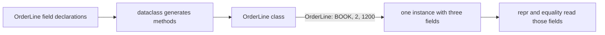

# Dataclasses: ordinary classes with generated methods

> **Role:** foundation. Read [classes and methods](../objects/classes_and_methods.md) and
> [names and mutability](../language/names_and_mutability.md) first. Python 3.11+.
> Each Python block is an independent program; run it as a script and check its assertions.

An internal order line needs a SKU, a quantity and a unit price. A handwritten class repeats
assignment code, a readable representation and equality logic. A dataclass generates those
ordinary methods from declared fields. It does not create a validation boundary or a database entity.

## Start with the class you would otherwise write

The annotation `sku: str` names a field and its intended type. The decorator reads those
declarations and generates methods such as `__init__`, `__repr__` and `__eq__`:

```python
from dataclasses import dataclass

@dataclass
class OrderLine:
    sku: str
    quantity: int
    unit_cents: int

line = OrderLine("BOOK", 2, 1200)
print(line)  # OrderLine(sku='BOOK', quantity=2, unit_cents=1200)
assert line == OrderLine("BOOK", 2, 1200)
assert line is not OrderLine("BOOK", 2, 1200)
```

Here the generated initializer behaves like assigning `self.sku = sku`, `self.quantity = quantity`
and `self.unit_cents = unit_cents`. Equality compares the fields in order and requires the same
concrete class. It is value equality, not the identity test `is`.

The decorator runs when the class is defined; initialization runs each time the resulting class
is called. Follow those two moments separately:



Generation changes what methods the class provides, while each constructor call creates and
initializes an instance. Methods you write yourself, such as `total_cents()`, work as they do on
an ordinary class. The general decorator transformation is explained in
[decorators](../language/decorators.md).

Annotations alone do not reject a string quantity:

```python
from dataclasses import dataclass

@dataclass
class OrderLine:
    quantity: int

line = OrderLine(quantity="2")
print(type(line.quantity).__name__)  # str
assert line.quantity == "2"
```

A type checker can diagnose that call, but ordinary Python executes it. If untrusted input needs
parsing and structured rejection, use [Pydantic](pydantic/README.md) or explicit boundary checks.
Dataclasses are useful after the input contract has already been established. The
[official dataclass reference](https://docs.python.org/3.14/library/dataclasses.html) defines the
generated-method behavior and its options.

## A field factory gives each instance its own default

An order line may have optional tags. `field(default_factory=list)` tells the generated
initializer how to create a value when the caller omits that argument:

```python
from dataclasses import dataclass, field

@dataclass
class OrderLine:
    sku: str
    tags: list[str] = field(default_factory=list)

first = OrderLine("BOOK")
second = OrderLine("PEN")
first.tags.append("gift")
print(first.tags, second.tags)  # ['gift'] []
assert first.tags is not second.tags

shared = ["new"]
third = OrderLine("BOOK", shared)
fourth = OrderLine("PEN", shared)
shared.append("express")
assert third.tags is fourth.tags is shared
```

The factory is the callable `list`, not an already-created `list()`. It runs separately for each
omitted field. When the caller supplies a list explicitly, the constructor stores that list;
the factory is not involved and no automatic copy separates it from the caller.

| Construction | Factory runs? | Who owns the tags object? |
|---|---|---|
| `OrderLine('BOOK')` | Yes | This instance receives a newly created list |
| Another call omitting tags | Yes, again | A different instance receives a different list |
| Two calls supplying `shared` | No | Both instances and the caller refer to the same list |

On the 3.11 baseline, an unhashable direct field default such as `tags: list[str] = []` is rejected
at class creation with `ValueError`. This catches common shared-default mistakes; it is not a
complete proof that all possible defaults are immutable. Use a factory for per-instance state
and explicitly decide whether supplied input should be copied. Pydantic has different default
handling, so the same-looking declaration can have different semantics there.

## Establish derived state after initialization

The generated initializer calls `__post_init__` after assigning the fields. This is a useful place
to check an internal invariant or compute a field the caller should not set:

```python
from dataclasses import dataclass, field

@dataclass
class OrderLine:
    quantity: int
    unit_cents: int
    total_cents: int = field(init=False)

    def __post_init__(self):
        if self.quantity < 1 or self.unit_cents < 0:
            raise ValueError("positive quantity and nonnegative price required")
        self.total_cents = self.quantity * self.unit_cents

line = OrderLine(2, 1200)
print(line.total_cents)  # 2400
assert line.total_cents == 2400
try:
    OrderLine(0, 1200)
except ValueError:
    print("rejected zero quantity")

line.quantity = 3
assert line.total_cents == 2400  # now stale: post-init does not run on assignment
```

`init=False` excludes `total_cents` from constructor arguments. It does not remove the field from
the representation or comparison by default. The last two lines expose an important limit:
`__post_init__` is an initialization step, not an invariant monitor.

If a total should always reflect current mutable fields, use a computed property as taught in
[classes](../objects/classes_and_methods.md). If the line is a value that should change by
replacement, use a frozen dataclass. The checks above validate value relationships, not arbitrary
input types; a string quantity would fail differently. Do not mistake a few internal checks for
a complete external parser. If you supply your own `__init__`, it must call `__post_init__` itself
when that is desired; the automatic call belongs to the generated initializer.

## Frozen values prevent field assignment, not all reachable mutation

`frozen=True` generates guards against ordinary attribute assignment/deletion. It works well with
immutable fields when a changed value should be represented by a new object:

```python
from dataclasses import FrozenInstanceError, dataclass, replace

@dataclass(frozen=True, slots=True, kw_only=True)
class OrderLine:
    sku: str
    quantity: int
    unit_cents: int
    tags: tuple[str, ...] = ()

    def __post_init__(self):
        if self.quantity < 1:
            raise ValueError("quantity must be positive")

line = OrderLine(sku="BOOK", quantity=2, unit_cents=1200)
updated = replace(line, quantity=3)
assert line.quantity == 2 and updated.quantity == 3
assert updated.tags is line.tags  # sharing immutable values is fine
print(updated.quantity)  # 3
try:
    line.quantity = 4
except FrozenInstanceError:
    print("replace the value instead of assigning")

try:
    replace(line, quantity=0)
except ValueError:
    print("replacement reruns initialization checks")
```

`replace` calls the initializer for the new instance, including `__post_init__`. Unchanged fields
are passed through; this is not a deep clone. Fields with `init=False` are initialized again by
the initialization logic rather than copied as constructor arguments. That is useful for derived
state, but matters when a field represents a cache or external resource.

The other two options change different contracts. `kw_only=True` requires fields by name, so
`OrderLine('BOOK', 2, 1200)` fails rather than letting a positional call obscure field meaning.
`slots=True` generates declared attribute storage; for this class it removes an ordinary instance
`__dict__` and rejects adding arbitrary new attributes. Slots do not validate field values or
make them immutable. They can reduce per-instance overhead, but measure a real workload before
choosing them solely for memory. Inherited instance dictionaries can still exist.

Changing the field to a list would keep that list mutable even in a frozen class:

```python
from dataclasses import dataclass, field

@dataclass(frozen=True)
class OrderLine:
    tags: list[str] = field(default_factory=list)

line = OrderLine()
line.tags.append("gift")
assert line.tags == ["gift"]
print(line.tags)  # ['gift']
try:
    hash(line)
except TypeError:
    print("the list field is unhashable")
```

Frozen is an ordinary programming guard, not a security boundary. The list mutation bypasses no
guard: it changes a separate object rather than assigning an attribute on the dataclass.

## Equality, hashing and representation express different policies

By default, two instances of the same dataclass compare their fields, and mutable dataclasses
with generated equality are unhashable. For `eq=True, frozen=True`, Python generates a hash, but
the participating values must still be hashable, as the previous example showed. Do not use
`unsafe_hash=True` to silence an error without reasoning about what happens when a key changes
after insertion into a dictionary.

A diagnostic cache or internal note may not be part of a value's identity:

```python
from dataclasses import dataclass, field

@dataclass
class OrderLine:
    sku: str
    quantity: int
    diagnostic_note: str = field(default="", compare=False, repr=False)

first = OrderLine("BOOK", 2, "computed by worker a")
second = OrderLine("BOOK", 2, "computed by worker b")
assert first == second
assert "worker" not in repr(first)
print(first)  # OrderLine(sku='BOOK', quantity=2)
```

`compare=False` excludes the field from generated comparison; `repr=False` only hides it from the
generated representation. Neither redacts it from serialization. `order=True` generates ordering
comparisons in field order, but that order should reflect a meaningful domain ordering. A separate
`sorted(lines, key=...)` is often clearer when callers need different sort criteria.

## Exporting and inheritance need explicit boundaries

`asdict` recursively converts dataclass instances into dictionaries and deep-copies other values
it traverses. It is convenient for ordinary nested data, but it is not a JSON encoder or a
field-redaction policy:

```python
from dataclasses import asdict, dataclass, field
from typing import ClassVar

@dataclass
class OrderLine:
    currency: ClassVar[str] = "EUR"
    sku: str = "BOOK"
    tags: list[str] = field(default_factory=list)
    internal_note: str = field(default="warehouse", repr=False)

line = OrderLine()
exported = asdict(line)
exported["tags"].append("gift")
assert line.tags == []
assert "currency" not in exported
assert exported["internal_note"] == "warehouse"
print(sorted(exported))  # ['internal_note', 'sku', 'tags']
```

`ClassVar` declares class-owned state to the dataclass machinery, so it is not an instance field.
`InitVar` is another special annotation: it declares an initialization-only argument forwarded to
`__post_init__`, excluded from the dataclass field inventory. Use it when construction needs a
temporary input; keep normal stored values as ordinary fields.

For external output, explicitly select public fields or use a serialization model. Objects such
as connections do not belong in a blindly deep-copied export. To inspect declared fields, use
`dataclasses.fields`, including on slotted instances; do not rely on `vars(instance)` always being
available.

Dataclass inheritance combines base and derived fields. A required field after a positional field
with a default raises `TypeError`, even when the default was inherited. Keyword-only fields can
avoid that positional ordering constraint. A generated dataclass initializer also does not call
an ordinary, non-dataclass base initializer automatically. These are reasons to inspect the full
constructor contract before extending a model hierarchy; prefer simple independent value objects
when inheritance adds no useful contract.

## Recap

- Dataclasses generate normal methods from fields; annotations do not validate runtime input.
- A default factory creates one value per omitted field, but supplied objects remain shared.
- Post-initialization checks run during construction; later mutation can invalidate derived state.
- Frozen fields, slots and keyword-only arguments control different aspects of a class.
- Equality/hash policy and output serialization must match the actual ownership boundary.

## Check yourself

**1. Two dataclass instances use a list factory but receive the same explicit list argument.
One appends a tag. What does the other see?**

<details><summary>Answer</summary>

The new tag. Supplying the argument skips the factory, and both fields refer to the supplied list.
Copy explicit input if each object must own an independent list, or use an immutable field when
sharing is intentional. The factory only fixes the omitted-default case.

</details>

**2. A frozen dataclass contains a list and is used as a dictionary key. Is frozen sufficient?**

<details><summary>Answer</summary>

No. The generated hash needs hashes of its participating fields, and a list is unhashable.
Freezing the enclosing object's assignments does not freeze the list. Choose hashable value
fields or keep the object out of keyed collections; forcing an unsafe hash does not create a
sound equality/hash contract.

</details>

**3. A derived `total_cents` field has `init=False` and is calculated in `__post_init__`.
What happens after `replace(line, quantity=3)` compared with `line.quantity = 3`?**

<details><summary>Answer</summary>

Replacement constructs a new object and reruns post-initialization, so its total is recalculated.
Direct assignment on a mutable instance does not run post-initialization and leaves a stored total
stale. A property or replacement-based immutable design makes the intended invariant explicit.

</details>

**Next:** [Enums and named tuples](enums_and_named_tuples.md), then [Pydantic](pydantic/README.md).
