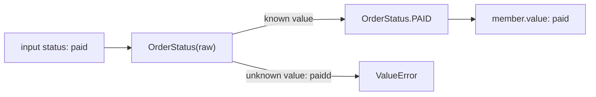

# Enums and named tuples: constrained values and lightweight records

> **Role:** foundation. Read [classes](../objects/classes_and_methods.md) and
> [names and mutability](../language/names_and_mutability.md). Python 3.11+.
> Each Python block is an independent program with assertions.

A dataclass groups the fields of one order. Two other declarations appear frequently in backend
code: an enum defines a finite vocabulary, and a named tuple gives names to positions in a record.
They solve different problems. Start with the value of an order's status, then the record returned
by a small calculation.

## Convert a raw status into a named domain value

Plain strings make misspellings easy to carry through the program. An `Enum` creates members with
both a Python name and a value. Calling the enum class looks up a member by value:

```python
from enum import Enum

class OrderStatus(Enum):
    PENDING = "pending"
    PAID = "paid"
    CANCELLED = "cancelled"

status = OrderStatus("paid")
print(status.name, status.value)  # PAID paid
assert status is OrderStatus.PAID
assert OrderStatus["PAID"] is status
assert status != "paid"
try:
    OrderStatus("paidd")
except ValueError:
    print("unknown status rejected")
```

`OrderStatus('paid')` searches values; `OrderStatus['PAID']` searches names. Repeated lookup returns
the same member object. Ordinary `Enum` keeps the member distinct from the raw string, so code
must deliberately cross the boundary by reading `.value`.

Follow the input-to-member decision:



The lookup validates membership in the vocabulary. It does not validate a legal transition: the
fact that `PAID` and `CANCELLED` are valid statuses does not mean every order can move between them.
That policy belongs to a transition function or a
[state machine](../../../background_work/workflows/state_machines/01_transition_modeling.md).

Nor does an annotation such as `status: OrderStatus` enforce conversion in an ordinary function
or dataclass. Explicitly call the enum at the input boundary or let a validation library do so.
An unknown external value needs a deliberate error or compatibility policy; silently mapping it
to `PENDING` can change business meaning. See the
[Enum reference](https://docs.python.org/3.14/library/enum.html).

## Choose StrEnum when string compatibility is part of the contract

`StrEnum`, introduced in Python 3.11, creates members that also behave as strings. This makes
interoperation convenient, but relaxes the separation from raw strings:

```python
from enum import StrEnum
import json

class OrderStatus(StrEnum):
    PENDING = "pending"
    PAID = "paid"

assert OrderStatus.PAID == "paid"
assert str(OrderStatus.PAID) == "paid"
assert isinstance(OrderStatus.PAID, str)
assert type(OrderStatus.PAID) is not str
print(json.dumps({"status": OrderStatus.PAID}))  # {"status": "paid"}

lookup = {OrderStatus.PAID: "member key"}
lookup["paid"] = "string key"
assert len(lookup) == 1
```

The dictionary has one entry because the member and raw string compare equal and have compatible
hashes. Choose ordinary `Enum` when that distinction is useful, and `StrEnum` when string behavior
is intended. Some libraries check `type(value) is str` instead of `isinstance`; pass `str(member)`
at those boundaries.

Use explicit values for persisted or public wire formats. Renaming a Python symbol should not
accidentally rewrite stored data. `auto()` supplies values automatically; for `StrEnum` it uses
the lowercased member name. That is convenient for local values but couples the wire value to the
symbol spelling. `IntEnum` similarly interoperates with integers; it is appropriate when the
integer protocol is intentional, not simply because statuses could be numbered.

## Duplicate values normally create aliases

Python permits two enum names for one member. Iteration includes canonical members rather than
repeating aliases. Use `@unique` when duplicate values indicate an error in your vocabulary:

```python
from enum import Enum, unique

class StatusWithAlias(Enum):
    PAID = "paid"
    SETTLED = "paid"

assert StatusWithAlias.SETTLED is StatusWithAlias.PAID
assert len(list(StatusWithAlias)) == 1
assert set(StatusWithAlias.__members__) == {"PAID", "SETTLED"}

try:
    @unique
    class Status(Enum):
        PAID = "paid"
        SETTLED = "paid"
except ValueError:
    print("duplicate value rejected at class definition")
```

The alias is not a second business state. It is another name for the same member, whose canonical
name remains `PAID`. This is useful for deliberate Python-level compatibility, but it does not
accept a new wire value `'settled'`; the values are still both `'paid'`.

When reading a `match` statement, `case OrderStatus.PAID:` compares against the qualified member.
A bare name such as `case PAID:` is a capture pattern, not an enum lookup. The
[idioms lesson](../language/idioms_and_collections.md) develops matching rules.

## A named tuple names the positions in a tuple contract

A function returning `(subtotal, shipping)` forces callers to remember what each position means.
`NamedTuple` creates a tuple subclass that supports both attribute access and ordinary unpacking:

```python
from typing import NamedTuple

class Quote(NamedTuple):
    subtotal_cents: int
    shipping_cents: int = 300

quote = Quote(1500)
subtotal, shipping = quote
assert subtotal == quote.subtotal_cents == quote[0] == 1500
assert shipping == 300
assert quote == (1500, 300)
updated = quote._replace(shipping_cents=0)
print(quote, updated)  # Quote(subtotal_cents=1500, shipping_cents=300) Quote(subtotal_cents=1500, shipping_cents=0)
assert quote.shipping_cents == 300 and updated.shipping_cents == 0
```

The tuple stores two slots. Generated attributes give names to those same slots; there is no
separate copy of the numbers behind each name. `_replace` constructs a new tuple with the chosen
field changed. Despite the leading underscore, `_replace`, `_asdict` and `_fields` are documented
named-tuple APIs. The underscore avoids collisions with ordinary user field names.

The important trade-off is tuple compatibility. A `Quote` compares equal to an ordinary tuple
with the same elements and can compare equal to another named-tuple type with matching values.
If distinct record types must compare differently, a dataclass's exact-class equality may better
fit the domain. Adding a third field also breaks callers that unpack exactly two positions;
named access does not eliminate the positional interface.

`collections.namedtuple('Quote', ['subtotal_cents', 'shipping_cents'])` is the older factory form
you will see in libraries. `typing.NamedTuple` adds the annotated class spelling; those annotations
help readers and type checkers but still do not validate values at runtime. See
[NamedTuple](https://docs.python.org/3.14/library/typing.html#typing.NamedTuple) and
[namedtuple](https://docs.python.org/3.14/library/collections.html#collections.namedtuple).

## Tuple immutability does not freeze a field's contents

The rule from the ownership lesson applies unchanged: tuple slots cannot be replaced in place,
but a list reached through one slot can mutate. Named-tuple defaults are ordinary retained values;
they do not provide a dataclass-style default factory:

```python
from typing import NamedTuple

class UnsafeQuote(NamedTuple):
    tags: list[str] = []  # deliberate shared-default example

first = UnsafeQuote()
second = UnsafeQuote()
first.tags.append("gift")
assert second.tags == ["gift"]
assert first.tags is second.tags

class Quote(NamedTuple):
    tags: tuple[str, ...] = ()

quote = Quote()
updated = quote._replace(tags=("gift",))
assert quote.tags == () and updated.tags == ("gift",)
print(updated.tags)  # ('gift',)
```

Use immutable fields/defaults for value records or supply independently created mutable values
explicitly. If mutation and factories are central to the design, a dataclass is usually clearer.
Neither `_replace` nor normal construction validates annotations; use a boundary validator for
external input rather than treating the name `NamedTuple` as a validation guarantee.

## Choose the representation from the public contract

| Need | Representation | What callers must understand |
|---|---|---|
| One member of a fixed vocabulary | `Enum` | Explicit conversion between member and wire value |
| Fixed vocabulary with string compatibility | `StrEnum` | Members compare like strings |
| Small record with tuple unpacking/index compatibility | `NamedTuple` | Position count/order is part of the API |
| Internal record with generated methods and configurable fields | Dataclass | Ordinary Python construction and ownership rules |
| Parse/reject external input and control serialized output | Pydantic | Validation and output are distinct boundary contracts |

This table is a decision aid after the examples. Start with the smallest contract your callers
need, and avoid changing a return type merely for appearance: tuple equality, unpacking, default
handling and JSON serialization can all be observable behavior.

## Recap

- An enum maps names and wire values to members; it does not enforce legal state transitions.
- StrEnum trades stronger separation for string interoperability and string-like equality.
- Duplicate enum values create aliases unless uniqueness is enforced.
- NamedTuple preserves tuple behavior while naming slots; that positional API affects evolution.
- Immutability of the record does not freeze nested values or enforce annotations.

## Check yourself

**1. `SETTLED = 'paid'` is added beside `PAID = 'paid'`. Will `Status('settled')` work?**

<details><summary>Answer</summary>

No. The new name aliases the existing value `'paid'`. Value lookup still has no `'settled'` value.
Name lookup `Status['SETTLED']` works. If the external vocabulary changes, design that conversion
and compatibility policy explicitly instead of relying on Python aliases.

</details>

**2. A function adds `tax_cents` as the third NamedTuple field. Existing callers only use
`quote.subtotal_cents`, but another caller unpacks two variables. Which caller breaks?**

<details><summary>Answer</summary>

The two-variable unpacking fails because the returned tuple now has three elements. Named access
to the retained field still works. The record's names do not remove its tuple shape from the
public contract. Coordinate the change or choose an API whose evolution does not rely on positions.

</details>

**3. Does a frozen dataclass or a NamedTuple containing `status: OrderStatus` reject `'paidd'`
automatically?**

<details><summary>Answer</summary>

No. Both declarations carry annotations without automatically validating them. Explicitly construct
`OrderStatus(raw)` or use a validation boundary. Preventing assignment and validating input types
are separate behaviors.

</details>

**Next:** [Pydantic](pydantic/README.md), then [Data model choices](data_model_choices.md).
