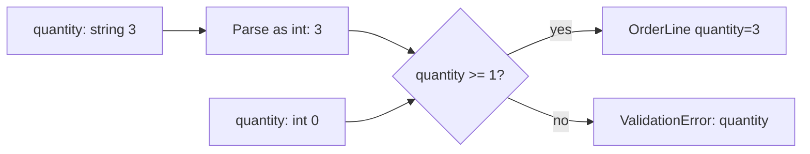

# Pydantic models and fields

> **Role:** foundation. **Prerequisites:** basic annotations from [typing](../../typing/typing.md),
> [classes and methods](../../objects/classes_and_methods.md), and [dataclasses](../dataclasses.md).
> **Baseline:** Python 3.11+ and Pydantic v2. Python 3.14 needs a compatible Pydantic release;
> initial support arrived in 2.12. Examples using 2.11+ options are marked.

A dataclass gives named fields to values your code already trusts. A Pydantic model adds a boundary:
it takes input, applies declared parsing and validation rules, and either produces a model or raises
`ValidationError`. This works in scripts, queue consumers, configuration loaders, and APIs; FastAPI
is one consumer of the library, not a prerequisite.

Use an isolated environment with `python -m pip install 'pydantic>=2.12,<3'` for these examples.
Each Python block below is self-contained. A successful run prints its documented result; an import
error means the interpreter running the block is not the one where Pydantic was installed.

## 1. The Mental Model

An order import receives quantity as the text `"3"`. The application wants an integer before it
calculates stock. Follow that one value through construction:

```python
from pydantic import BaseModel, Field, ValidationError

class OrderLine(BaseModel):
    sku: str
    quantity: int = Field(ge=1)

line = OrderLine.model_validate({"sku": "BOOK", "quantity": "3"})
print(line.quantity, type(line.quantity).__name__)
print(line.model_dump())
try:
    OrderLine.model_validate({"sku": "BOOK", "quantity": 0})
except ValidationError as exc:
    error = exc.errors()[0]
    print(error["loc"], error["type"])
# 3 int
# {'sku': 'BOOK', 'quantity': 3}
# ('quantity',) greater_than_equal
```

The annotation supplies the target type. `Field(ge=1)` adds a constraint on the parsed integer.
The first input can be converted to `3`, which satisfies the constraint; the second is already an
integer but violates the constraint. A hint alone would not perform either operation.

The diagram separates the two decisions, so you can locate a failure:



Changing `"3"` to `"many"` fails during integer parsing, before the range rule can run. This
distinction is useful when diagnosing errors: the field location identifies the input, while the
error type identifies the failed rule. Avoid logging raw `exc.errors()` indiscriminately: errors
can include the submitted value, including personal data or credentials.

**The guarantee belongs to the validation boundary.** It does not imply that the object remains
valid after arbitrary mutation, or that stock exists in a database. Pydantic validates the local
rules you supplied; authorization, transactions, and external facts need application logic.

## 2. BaseModel Basics

The model is a class; its instances expose validated fields as attributes. You can construct it
with keyword arguments, a mapping, or JSON. JSON validation is a separate entry point, not a call
to `str()` on a Python dictionary:

```python
from pydantic import BaseModel

class OrderLine(BaseModel):
    sku: str
    quantity: int
    gift: bool = False

first = OrderLine(sku="BOOK", quantity=3)
second = OrderLine.model_validate({"sku": "BOOK", "quantity": "3"})
third = OrderLine.model_validate_json('{"sku":"BOOK","quantity":3}')
print(first == second == third)
print(third.gift)
# True
# False
```

Field order follows declaration order and appears in errors and dumps. Unlike standard dataclasses,
Pydantic models do not require all required fields to precede fields with defaults. Runtime parsing
also does not erase the static contract: a type checker may reject passing `"3"` directly to an
`int` constructor parameter even though runtime parsing accepts it. `model_validate` makes the
untrusted-input boundary explicit.

### Optional vs Required vs Default

There are two independent questions: can the caller omit the field, and can its value be `None`?
A default answers the first; the annotation answers the second.

| Declaration | May omit? | Accepts `None`? |
|---|---|---|
| `note: str` | No | No |
| `note: str \| None` | No | Yes |
| `note: str = ""` | Yes | No |
| `note: str \| None = None` | Yes | Yes |

Try omission and explicit null separately:

```python
from pydantic import BaseModel, ValidationError

class Delivery(BaseModel):
    note: str | None
    instructions: str | None = None

try:
    Delivery.model_validate({})
except ValidationError as exc:
    print(exc.errors()[0]["loc"], exc.errors()[0]["type"])
delivery = Delivery(note=None)
print(delivery.model_fields_set)
# ('note',) missing
# {'note'}
```

Both attributes now have the value `None`, but only `note` was supplied. `model_fields_set` retains
that distinction for serialization and partial updates. `Optional[str]` means `str | None`; the
word “optional” in its name does not create a default in Pydantic v2.

## 3. Field Types and Constraints

Choose a type for the kind of value and a constraint for the valid range or shape. For the order,
the SKU is text, the quantity is a positive count, and a unit price can use `Decimal` when exact
decimal arithmetic is part of the application contract:

```python
from decimal import Decimal
from pydantic import BaseModel, Field

class OrderLine(BaseModel):
    sku: str = Field(pattern=r"^[A-Z]{2,12}$")
    quantity: int = Field(ge=1, le=100)
    unit_price: Decimal = Field(gt=0, max_digits=8, decimal_places=2)
    tags: list[str] = Field(default_factory=list, max_length=5)

line = OrderLine(sku="BOOK", quantity=2, unit_price="19.90")
print(line.unit_price * line.quantity)
# 39.80
```

`Decimal` does not select a currency or rounding policy. Those are separate domain choices. Types
such as `UUID`, `date`, `datetime`, `HttpUrl`, and `EmailStr` express other boundary expectations;
`EmailStr` additionally requires the `email-validator` package. A syntactically valid address does
not establish mailbox ownership, and a valid URL does not authorize your server to fetch it.

| Constraint | Useful for | Meaning |
|---|---|---|
| `gt`, `ge`, `lt`, `le` | Numbers | Exclusive/inclusive bounds |
| `min_length`, `max_length` | Strings, collections | Size limits |
| `pattern` | Strings | Regular-expression constraint; anchor it when the whole string must match |
| `multiple_of` | Numbers | Required step size |
| `default_factory` | Defaults | Call a function to obtain a value for each instance |
| `alias` | Input/output names | Alternative external field name; output still requires an alias policy |

### Defaults have their own validation policy

Pydantic does not validate defaults by default. A malformed default can therefore bypass a rule
that applies when the same value is explicitly submitted:

```python
from pydantic import BaseModel, Field, ValidationError

class Unchecked(BaseModel):
    quantity: int = Field(default=0, ge=1)

class Checked(BaseModel):
    quantity: int = Field(default=0, ge=1, validate_default=True)

print(Unchecked().quantity)
try:
    Checked()
except ValidationError as exc:
    print(exc.errors()[0]["type"])
# 0
# greater_than_equal
```

Use a valid default, and enable `validate_default` when it must traverse the same validation path
as supplied data. Model-wide `ConfigDict(validate_default=True)` applies that policy to all fields.

Pydantic also differs from function defaults: it deep-copies unhashable defaults such as `[]` and
`{}` for each model instance. `Field(default_factory=list)` is explicit and consistent with the
dataclass style, but `tags: list[str] = []` is **not** a shared-default bug in Pydantic. Input aliasing
is a different question: validated containers may be copied, while existing model instances can be
reused. Do not infer a deep-copy guarantee for every input. [Fields and defaults](https://docs.pydantic.dev/latest/concepts/fields/).

## 4. ConfigDict

Configuration applies a model-wide policy. Start with the policy the boundary needs, rather than
copying every setting into a universal base class:

```python
from pydantic import BaseModel, ConfigDict, ValidationError

class OrderLine(BaseModel):
    model_config = ConfigDict(extra="forbid", str_strip_whitespace=True)
    sku: str
    quantity: int

print(OrderLine(sku=" BOOK ", quantity=3).sku)
try:
    OrderLine.model_validate({"sku": "BOOK", "quantity": 3, "quantitty": 8})
except ValidationError as exc:
    print(exc.errors()[0]["loc"], exc.errors()[0]["type"])
# BOOK
# ('quantitty',) extra_forbidden
```

Ignoring an unknown field may be a deliberate compatibility policy for an evolving event format.
Rejecting it is often useful for commands where a misspelling should fail. Neither setting grants
permission to change a protected field; authorization remains separate.

| Setting | Default | Consequence |
|---|---|---|
| `extra` | `"ignore"` | Ignore unknown keys; `"forbid"` rejects and `"allow"` retains them |
| `str_strip_whitespace` | `False` | Normalize string whitespace |
| `str_min_length`, `str_max_length` | Unset | Model-wide string bounds |
| `strict` | `False` | Use strict rules rather than ordinary coercion |
| `validate_assignment` | `False` | Validate ordinary attribute replacement |
| `validate_default` | `False` | Validate defaults |
| `from_attributes` | `False` | Allow extraction from object attributes |
| `frozen` | `False` | Reject attribute assignment; generate hashing if field values support it |
| `use_enum_values` | `False` | Extract enum values during validation |

A base class can own a shared policy, and subclasses inherit it. Use separate bases when API commands
and stored events need different compatibility behavior; inheritance is not a reason to couple them.

### Type Coercion and strict mode

The import accepted `"3"` because ordinary validation permits that conversion. A stricter boundary
can reject it, either through `Field(strict=True)`, model configuration, or one validation call:

```python
from pydantic import BaseModel, ValidationError

class OrderLine(BaseModel):
    quantity: int

print(OrderLine.model_validate({"quantity": "3"}).quantity)
try:
    OrderLine.model_validate({"quantity": "3"}, strict=True)
except ValidationError as exc:
    print(exc.errors()[0]["type"])
# 3
# int_type
```

“Strict” is a set of type-specific rules, not a promise that every input must have identical Python
type identity. JSON has fewer native types than Python, so strict JSON validation can accept string
representations of types such as dates. Test the actual entry point your application uses.
[Strict-mode behavior](https://docs.pydantic.dev/latest/concepts/strict_mode/).

### ORM Mode (`from_attributes`)

Attribute extraction does not require an ORM. This small example makes the lookup visible without
a database:

```python
from dataclasses import dataclass
from pydantic import BaseModel, ConfigDict

@dataclass
class StoredLine:
    sku: str
    quantity: int

class OrderLine(BaseModel):
    model_config = ConfigDict(from_attributes=True)
    sku: str
    quantity: int

line = OrderLine.model_validate(StoredLine("BOOK", 3))
print(line.model_dump())
# {'sku': 'BOOK', 'quantity': 3}
```

An ORM entity works similarly, but reading its attributes may trigger database access or fail after
its session closes. Load the fields the response needs while resource ownership is clear; async
lazy loading is not made safe by `from_attributes`. See [async SQLAlchemy](../../../database/04_async_sqlalchemy.md).

### Alias Generator

Aliases connect external naming to Python naming. An input alias and an output alias need not be
the same. In Pydantic 2.11+, use explicit `validate_by_name` and `validate_by_alias` policies:

```python
# Pydantic 2.11+
from pydantic import BaseModel, ConfigDict
from pydantic.alias_generators import to_camel

class OrderLine(BaseModel):
    model_config = ConfigDict(
        alias_generator=to_camel, validate_by_name=True, validate_by_alias=True
    )
    product_code: str

line = OrderLine.model_validate({"productCode": "BOOK"})
print(line.product_code)
print(line.model_dump(by_alias=True))
# BOOK
# {'productCode': 'BOOK'}
```

Older v2 code commonly uses `populate_by_name=True` for the combined acceptance behavior. It is
discouraged for new 2.11+ code; do not silently use the newer options with an older dependency.
Dumping uses Python names unless you request aliases or configure serialization accordingly.
[Alias configuration](https://docs.pydantic.dev/latest/api/config/).

## 5. Nested Models and Complex Types

An order contains lines, so parsing has to descend into a collection. Use a model field when the
nested object has its own contract:

```python
from pydantic import BaseModel, Field, ValidationError

class OrderLine(BaseModel):
    sku: str
    quantity: int = Field(ge=1)

class Order(BaseModel):
    lines: list[OrderLine]

order = Order.model_validate({"lines": [{"sku": "BOOK", "quantity": "3"}]})
print(order.lines[0].quantity)
try:
    Order.model_validate({"lines": [{"sku": "BOOK", "quantity": 0}]})
except ValidationError as exc:
    print(exc.errors()[0]["loc"])
# 3
# ('lines', 0, 'quantity')
```

`lines`, index `0`, then `quantity` describes a path through the original input. The same principle
applies to `dict[str, OrderLine]`, `dict[str, list[str]]`, or `tuple[float, float]`. A set field can
deduplicate values, but it also discards order; choose the type for its semantics rather than as a
convenient validation trick.

If a boundary is a bare list rather than an object with a `lines` key, do not add a meaningless
wrapper solely to obtain validation. The next lesson teaches `TypeAdapter` and `RootModel`.

## 6. Mutation changes the contract

Ordinary construction validated `quantity`, but later assignment does not automatically revisit it.
Here the configured assignment check rejects replacement, while a nested list operation escapes
that check:

```python
from pydantic import BaseModel, ConfigDict, Field, ValidationError

class OrderLine(BaseModel):
    model_config = ConfigDict(validate_assignment=True)
    quantity: int = Field(ge=1)
    tags: list[str] = Field(default_factory=list)

line = OrderLine(quantity=3)
try:
    line.quantity = 0
except ValidationError as exc:
    print(exc.errors()[0]["type"])
line.tags.append(123)
print(line.tags)
copied = line.model_copy(update={"quantity": 0})
print(copied.quantity)
# greater_than_equal
# [123]
# 0
```

`append` changes the list itself; it does not assign the `tags` attribute. `model_copy(update=...)`
also trusts updates rather than validating them. For untrusted changes, construct validated data
again, for example `OrderLine.model_validate({**old.model_dump(), **changes})`. Passing an existing
instance to `model_validate` is not generally a forced revalidation: instance revalidation has its
own configuration.

`frozen=True` blocks ordinary field replacement with a `ValidationError`, but a frozen model can
still contain a mutable list. Deep immutability requires immutable field values as well. A frozen
model with an unhashable field is not usable as a dictionary key. `model_construct()` bypasses
validation entirely and is only for inputs whose validity is already established; it is not a
faster parser for untrusted payloads. [Model guarantees and copies](https://docs.pydantic.dev/latest/concepts/models/).

## Recap

- Construction parses input and checks declared rules; annotations alone do neither.
- Omission, nullability, defaults, and default validation are separate decisions.
- Nested models extend the validation path and produce errors located within the input.
- Configuration belongs to a boundary policy; aliases and attribute extraction change how input is read.
- Construction validity is not permanent validity: mutation, trusted copies, and bypass APIs need care.

## Check yourself

**An import sends `{"quantity": "3"}`. It works through ordinary validation but fails in strict mode.
Is the range constraint responsible?**

<details><summary>Answer</summary>

No. Ordinary validation first converts the text to integer `3`; strict integer validation rejects
the text at the type step. The positive-range rule has not caused the difference.

</details>

**A field is `note: str | None` and the payload is `{}`. Would `exclude_none=True` fix the error?**

<details><summary>Answer</summary>

No. Construction fails because the field is required. Serialization exclusions run only after a
model exists. Add an explicit default if omission is part of the intended input contract.

</details>

**A frozen order contains `tags: list[str]`. Can another function append an integer to that list?**

<details><summary>Answer</summary>

Yes. Freezing rejects attribute replacement; it does not intercept the list's methods. Use an
immutable field representation and validated replacement if that invariant must survive handoffs.

</details>

**Next:** [Validation pipelines and reusable contracts](02_validation.md).


Python 3.15 / Pydantic 2.14 migration: the stable public `MISSING` sentinel supplies an explicit absent value distinct from `None`; see the [worked serialization and PATCH contrast](03_serialization_and_schema.md#pydantic-214-an-explicit-absent-value). Existing required/nullable and `exclude_unset` contracts remain valid.
