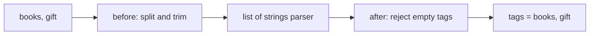

# Validation pipelines and reusable contracts

> **Role:** foundation with a conditional custom-type deep dive.
> **Prerequisite:** [models and fields](01_models_and_fields.md), including parsing, required fields,
> and construction versus mutation. Python 3.11+, Pydantic v2.

Field constraints describe common rules, but sometimes valid input needs normalization or multiple
fields must agree. A validator is a function inserted into the parsing pipeline. Its position
determines whether it receives raw input, a parsed field, or the constructed model.

Every Python block below is independently runnable after installing Pydantic as described in the
previous lesson. Validators return their accepted or normalized value. Raising `ValueError` signals
a validation failure; forgetting to return silently substitutes `None` for the intended result.

## 1. Validators

An order import accepts a comma-separated list of tags, while business code wants `list[str]`.
First turn the string into a list; then let the field's normal parser validate its elements:

```python
from typing import Any
from pydantic import BaseModel, field_validator

class OrderLine(BaseModel):
    tags: list[str]

    @field_validator("tags", mode="before")
    @classmethod
    def split_tags(cls, value: Any) -> Any:
        if isinstance(value, str):
            return [part.strip() for part in value.split(",")]
        return value

    @field_validator("tags")
    @classmethod
    def reject_empty_tags(cls, value: list[str]) -> list[str]:
        if any(not tag for tag in value):
            raise ValueError("tags must be nonempty")
        return value

line = OrderLine(tags="books, gift")
print(line.tags)
# ['books', 'gift']
```

The before validator receives anything the caller could supply: a string, a list, `None`, or an
unexpected object. Its annotation is therefore `Any`. When it receives a list it returns that list
without pretending to have validated it. Pydantic's `list[str]` parser still owns the element types.
The after validator can use list/string operations because parsing has already succeeded.

The handoff order explains which layer rejects each input:



For `"books,"`, splitting produces an empty second tag; parsing succeeds because `""` is a string,
and the after rule rejects it. For `[123]`, ordinary string validation fails before the after rule.
This division keeps normalization separate from proof of the final shape.

### Field Validators

The default mode is `"after"`. `@classmethod` makes the class argument explicit; put it below
`@field_validator` in the decorator stack. An after validator receives the parsed type unless a
custom pipeline deliberately replaces that behavior.

One validator can name several fields. That is useful when the same normalization rule genuinely
belongs to each field, rather than when the fields need to be compared:

```python
from pydantic import BaseModel, field_validator

class Recipient(BaseModel):
    name: str
    city: str

    @field_validator("name", "city")
    @classmethod
    def nonblank(cls, value: str) -> str:
        cleaned = value.strip()
        if not cleaned:
            raise ValueError("must contain visible text")
        return cleaned

print(Recipient(name=" Mina ", city=" Athens ").model_dump())
# {'name': 'Mina', 'city': 'Athens'}
```

Use `ValueError` for expected bad data. `AssertionError` can also become a validation error, but
Python can remove `assert` statements under optimization, so explicit checks are safer for input
contracts. In Pydantic v2, an accidental `TypeError` in a validator is not automatically converted
to `ValidationError`; treat it as a programming error, not as a client's invalid payload.

### Mode: Before vs After

| Mode | Receives | What happens next |
|---|---|---|
| `before` | Raw input | Returned value enters normal parsing |
| `after` | Parsed field | Returned value becomes the field value |
| `wrap` | Input and a handler | Your function decides whether/how to invoke the remaining pipeline |
| `plain` | Input | Replaces normal field validation; can bypass the annotation's checks |

Prefer `after` for business rules and `before` for deliberate input normalization. A plain validator
is not a shorter before validator: returning a value from it can skip the `int` or `list[str]`
checks you expected. Use it only when the custom function owns the complete contract.

### Model Validators

Two individually valid fields can form an invalid pair. An order discount has both a mode and a
value, so its rule belongs to the assembled model:

```python
from typing import Literal
from pydantic import BaseModel, Field, ValidationError, model_validator

class Discount(BaseModel):
    mode: Literal["percentage", "fixed"]
    value: float = Field(ge=0)

    @model_validator(mode="after")
    def percentage_has_a_ceiling(self) -> "Discount":
        if self.mode == "percentage" and self.value > 100:
            raise ValueError("percentage discount cannot exceed 100")
        return self

print(Discount(mode="fixed", value=150).value)
try:
    Discount(mode="percentage", value=150)
except ValidationError as exc:
    print(exc.errors()[0]["loc"], exc.errors()[0]["type"])
# 150.0
# () value_error
```

The fixed discount accepts `150`; the percentage version fails even though its `float` and nonnegative
checks pass. The empty error location means the model-level relationship failed. An after model
validator is an instance method and returns `self`; it is not a class method receiving a dictionary.

A before model validator instead receives the incoming object. Use it to reshape a legacy mapping
before field extraction, checking its kind first and copying rather than mutating caller-owned data:

```python
from typing import Any
from pydantic import BaseModel, ValidationError, model_validator

class OrderLine(BaseModel):
    sku: str
    quantity: int

    @model_validator(mode="before")
    @classmethod
    def accept_legacy_count(cls, value: Any) -> Any:
        if isinstance(value, dict) and "count" in value:
            if "quantity" in value:
                raise ValueError("provide count or quantity, not both")
            value = dict(value)
            value["quantity"] = value.pop("count")
        return value

original = {"sku": "BOOK", "count": "3"}
print(OrderLine.model_validate(original).quantity)
print(original)
try:
    OrderLine.model_validate({"sku": "BOOK", "quantity": 3, "count": 999})
except ValidationError as exc:
    print(exc.errors()[0]["type"])
# 3
# {'sku': 'BOOK', 'count': '3'}
# value_error
```

This example deliberately permits one old key. When both spellings appear, the validator rejects
the input before field parsing, even if their values agree. That explicit policy prevents the
default unknown-field behavior from silently discarding `count` when `quantity` is already present.
For a long-lived migration, specify unknown-field and conflict policies explicitly and test both
old and new payloads.

### Validator Execution Order

Field validation proceeds in field declaration order. A field validator's `ValidationInfo.data`
contains earlier fields that validated successfully, not an unfinished complete model:

```python
from pydantic import BaseModel, ValidationInfo, field_validator

class PasswordPair(BaseModel):
    password: str
    confirmation: str

    @field_validator("confirmation")
    @classmethod
    def matches(cls, value: str, info: ValidationInfo) -> str:
        if "password" in info.data and value != info.data["password"]:
            raise ValueError("passwords do not match")
        return value

print(PasswordPair(password="example-only", confirmation="example-only").confirmation)
# example-only
```

If `password` appears later, it is unavailable at that point. If its own validation fails, it is
also unavailable. A model after validator often expresses a cross-field rule more clearly because
the dependencies are named together and field-order coupling disappears. Do not perform external
authentication or database writes inside a validator just because it sees a password.

## 2. Custom Types and Annotated

`Annotated[T, metadata...]` keeps a base type and associates metadata with it. Pydantic understands
specific metadata such as `Field` and `AfterValidator`; ordinary Python does not run that metadata
by itself. A reusable alias makes one rule apply to every occurrence, including collection items:

```python
from typing import Annotated
from pydantic import AfterValidator, BaseModel, Field

def currency_shape(value: str) -> str:
    if len(value) != 3 or not value.isascii() or not value.isalpha():
        raise ValueError("currency must be three ASCII letters")
    return value.upper()

CurrencyCode = Annotated[str, AfterValidator(currency_shape)]
PositiveAmount = Annotated[float, Field(gt=0)]
PageSize = Annotated[int, Field(ge=1, le=100)]

class Payment(BaseModel):
    amount: PositiveAmount
    currency: CurrencyCode
    page_size: PageSize = 20

print(Payment(amount=19.9, currency="eur").currency)
# EUR
```

This checks a three-letter shape; it does not claim membership in an authoritative currency list.
Keep defaults on the field declaration when callers and type checkers need to see them. Putting a
default inside an alias can obscure whether a particular model field is required.

Within `Annotated` metadata, before and wrap validators are entered from right to left, and after
validators run from left to right. Rather than memorizing that sentence alone, trace a wrapped
integer parser:

```python
from typing import Annotated, Any
from pydantic import AfterValidator, BeforeValidator, TypeAdapter, WrapValidator

events = []

def before(value: Any) -> Any:
    events.append("before")
    return value

def after(value: int) -> int:
    events.append("after")
    return value

def around(value: Any, handler):
    events.append("wrap enter")
    result = handler(value)
    events.append("wrap leave")
    return result

Number = Annotated[int, BeforeValidator(before), AfterValidator(after), WrapValidator(around)]
print(TypeAdapter(Number).validate_python("3"))
print(events)
# 3
# ['wrap enter', 'before', 'after', 'wrap leave']
```

The wrap function surrounds the rest of the work because it explicitly invokes `handler`. If it
returned without calling the handler, that remainder would not run. Prefer a simpler validator
when wrapping adds no needed behavior. [Validator modes and ordering](https://docs.pydantic.dev/latest/concepts/validators/).

## 3. Discriminated Unions

A notification can be email, SMS, or push. The sender needs a reliable way to select the matching
contract before examining fields specific to that channel:

```python
from typing import Annotated, Literal
from pydantic import BaseModel, Field, TypeAdapter, ValidationError

class EmailNotification(BaseModel):
    type: Literal["email"]
    email_address: str
    subject: str

class SMSNotification(BaseModel):
    type: Literal["sms"]
    phone_number: str

class PushNotification(BaseModel):
    type: Literal["push"]
    device_token: str

Notification = Annotated[
    EmailNotification | SMSNotification | PushNotification,
    Field(discriminator="type"),
]
adapter = TypeAdapter(Notification)
message = adapter.validate_python({"type": "sms", "phone_number": "+302100000000"})
print(type(message).__name__)
try:
    adapter.validate_python({"type": "fax", "phone_number": "+302100000000"})
except ValidationError as exc:
    print(exc.errors()[0]["type"])
# SMSNotification
# union_tag_invalid
```

The literal tag selects one branch; only that branch's remaining fields need validation. The example
checks notification structure, not real-world deliverability of a telephone number or email address.

Without a discriminator, Pydantic v2 normally uses **smart** union matching. It is not generally
“try each member and accept the first success.” The matching algorithm can evolve between minor
versions; use an explicit tag when the payload format can supply one, or intentionally select
`union_mode="left_to_right"` when order really is the contract. [Union matching](https://docs.pydantic.dev/latest/concepts/unions/).

## 4. TypeAdapter and RootModel

`TypeAdapter` exposes validation, serialization, and schema operations for a type expression without
requiring a new `BaseModel` class. In the previous example, `Notification` is a union alias, so an
adapter supplied the missing entry point. It also works for a list of models or a dataclass:

```python
from dataclasses import dataclass
from pydantic import TypeAdapter

@dataclass
class OrderLine:
    sku: str
    quantity: int

adapter = TypeAdapter(list[OrderLine])
lines = adapter.validate_python([{"sku": "BOOK", "quantity": "3"}])
print(lines[0].quantity)
print(adapter.dump_json(lines).decode())
# 3
# [{"sku":"BOOK","quantity":3}]
```

The standard dataclass still does not validate its own ordinary constructor. Validation here occurs
because the adapter owns this call. Reuse an adapter for a repeated boundary instead of rebuilding
its schema in a hot loop. `dump_json` returns bytes, unlike `BaseModel.model_dump_json`, which returns
a string. [Type adapters](https://docs.pydantic.dev/latest/concepts/type_adapter/).

`RootModel` is appropriate when the bare value itself needs a named model type and model methods:

```python
from pydantic import RootModel

class ProductCodes(RootModel[list[str]]):
    def first(self) -> str:
        return self.root[0]

codes = ProductCodes.model_validate(["BOOK", "PEN"])
print(codes.first())
print(codes.model_dump_json())
# BOOK
# ["BOOK","PEN"]
```

The JSON is an array, not `{"root": [...]}`. Choose an ordinary model if the wire format actually
has named fields such as `items` and `total`; choose an adapter if all you need is operations over
an existing type. Neither option adds a collection-size limit automatically.

## 5. Custom Types with `__get_pydantic_core_schema__`

This section is a conditional deep dive for reading library integrations. Most application rules
fit `Field`, `BeforeValidator`, or `AfterValidator`. A core-schema hook is useful when a reusable
Python type must describe how Pydantic constructs instances of that type.

Here an order code is a `str` subclass. Its hook first asks for the standard string schema and then
adds a check that returns an `OrderCode`, preserving both the runtime type and ordinary JSON output:

```python
from typing import Any
from pydantic import BaseModel, GetCoreSchemaHandler, GetJsonSchemaHandler
from pydantic.json_schema import JsonSchemaValue
from pydantic_core import CoreSchema, core_schema

class OrderCode(str):
    @classmethod
    def __get_pydantic_core_schema__(
        cls, source_type: Any, handler: GetCoreSchemaHandler
    ) -> CoreSchema:
        return core_schema.no_info_after_validator_function(cls.validate, handler(str))

    @classmethod
    def validate(cls, value: str) -> "OrderCode":
        if not value.startswith("ORD-") or not value[4:].isascii() or not value[4:].isdigit():
            raise ValueError("order code must be ORD- followed by digits")
        return cls(value)

    @classmethod
    def __get_pydantic_json_schema__(
        cls, schema: CoreSchema, handler: GetJsonSchemaHandler
    ) -> JsonSchemaValue:
        result = handler(schema)
        result["pattern"] = r"^ORD-[0-9]+$"
        return result

class Order(BaseModel):
    code: OrderCode

order = Order(code="ORD-42")
print(type(order.code).__name__)
print(order.model_dump_json())
print(Order.model_json_schema()["properties"]["code"]["type"])
# OrderCode
# {"code":"ORD-42"}
# string
```

The core schema is the executable parsing recipe; JSON Schema describes the externally visible
contract. Supplying one does not automatically make every custom operation expressible in the
other. In particular, a plain arbitrary validator can lack a JSON-schema representation. Preserve
a supported underlying schema, or explicitly supply the schema and serialization behavior the
integration needs. Prefer the high-level APIs when possible because low-level schema integrations
require more upgrade testing. [Custom types](https://docs.pydantic.dev/latest/concepts/types/#customizing-validation-with-__get_pydantic_core_schema__).

## First failures and boundaries

- A before validator calls string methods on a list: it assumed input was already parsed. Branch on
  the raw input type or move a suitable rule to after validation.
- A cross-field check sees a missing key: field order or an earlier validation failure means the key
  is not in `info.data`. Use a model validator when the rule belongs to the complete object.
- A validator raises `TypeError`: inspect its implementation; do not hide programming faults as
  expected invalid input.
- A custom type validates but schema generation fails: the executable recipe has no compatible
  JSON representation. Test both validation and schema generation before framework integration.

Keep validators deterministic and free of external writes. A schema can be applied in more than one
context, and validation/revalidation can occur more than once. A successful validator is not a
transaction or an exactly-once business operation.

## Recap

- Before validators normalize raw input; after validators check parsed values.
- Field order constrains `info.data`; model validators own relationships across the assembled object.
- A wrap validator controls a handoff to the remaining pipeline; skipping that handoff changes guarantees.
- Tagged unions choose a branch explicitly; adapters validate type expressions without inventing wrappers.
- Custom runtime types need compatible parsing, serialization, and schema behavior.

## Check yourself

**A before validator returns a list containing `123` for a `list[str]` field. Does returning from the
validator mean the list is accepted?**

<details><summary>Answer</summary>

No. The returned list still enters normal field parsing, which checks every element. A plain
validator would have different semantics because it replaces normal validation.

</details>

**A confirmation validator reads `info.data["password"]`, but the password field now appears after
confirmation. What changes?**

<details><summary>Answer</summary>

Password is not available yet. The relationship should either preserve an explicit order and handle
missing prior results, or move into an after model validator operating on the completed model.

</details>

**A provider sends a JSON array of order lines. Should you add an `items` field just to validate it?**

<details><summary>Answer</summary>

No. An adapter over `list[OrderLine]` validates that array as-is. A `RootModel` is useful if the array
needs a named model API. An `items` wrapper changes the wire format and only fits an actual object
contract.

</details>

**Next:** [Serialization, JSON Schema, and migration](03_serialization_and_schema.md).
