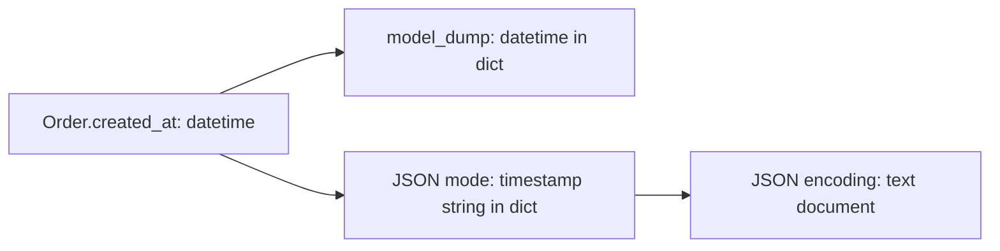

# Serialization, JSON Schema, and migration

> **Role:** foundation followed by a migration reference.
> **Prerequisites:** [models and fields](01_models_and_fields.md) and
> [validation pipelines](02_validation.md). Python 3.11+, Pydantic v2.

Validation determines what data becomes a model. Serialization determines what representation leaves
it. Those contracts can differ: a model may hold a `datetime`, but a JSON document needs a string;
an internal record may have a private field that an external representation must omit.

All Python blocks in this chapter are self-contained. Keep source data, the Python representation,
and the wire representation distinct when reading unfamiliar code.

## 1. Serialization

An order contains a timestamp and a decimal amount. Compare three output methods before selecting
one for a boundary:

```python
from datetime import datetime, timezone
from decimal import Decimal
from pydantic import BaseModel

class Order(BaseModel):
    created_at: datetime
    amount: Decimal

order = Order(created_at=datetime(2026, 1, 2, tzinfo=timezone.utc), amount=Decimal("19.90"))
python_data = order.model_dump()
json_data = order.model_dump(mode="json")
print(type(python_data["created_at"]).__name__, type(python_data["amount"]).__name__)
print(json_data)
print(order.model_dump_json())
# datetime Decimal
# {'created_at': '2026-01-02T00:00:00Z', 'amount': '19.90'}
# {"created_at":"2026-01-02T00:00:00Z","amount":"19.90"}
```

`model_dump()` defaults to Python mode. Its result is a dictionary but can contain values that
`json.dumps` cannot serialize directly. JSON mode produces compatible Python values; `model_dump_json`
encodes the document and returns a string. Do not JSON-encode that string again, or an API consumer
will receive a quoted JSON string instead of the intended object.

Follow the two output paths for the same timestamp:



The dictionary's existence does not identify its serialization mode. Inspect the types or request
the mode explicitly before handing it to another encoder.

### model_dump() — To Dict

Exclusion flags answer different questions. To see why, explicitly supply a value equal to its
default and another value equal to `None`:

```python
from pydantic import BaseModel

class OrderOptions(BaseModel):
    gift: bool = False
    note: str | None = None
    priority: int = 1

options = OrderOptions(gift=False, note=None)
print(options.model_dump(exclude_unset=True))
print(options.model_dump(exclude_defaults=True))
print(options.model_dump(exclude_none=True))
# {'gift': False, 'note': None}
# {}
# {'gift': False, 'priority': 1}
```

`exclude_unset` uses supplied-field information: gift and note were submitted, so both survive.
`exclude_defaults` compares values with defaults, so both disappear. `exclude_none` only tests the
current value against `None`, so the default priority remains. For a partial-update request, omitting
explicit null can accidentally turn “clear this field” into “leave it unchanged.”

| Parameter | Selection rule |
|---|---|
| `include={"sku"}` | Keep only the named fields |
| `exclude={"internal_note"}` | Remove the named fields |
| `exclude_unset=True` | Remove fields not explicitly supplied/set |
| `exclude_defaults=True` | Remove values equal to their defaults |
| `exclude_none=True` | Remove values equal to `None` |
| `by_alias=True` | Use configured external field names |
| `mode="json"` | Produce JSON-compatible values |

### Nested Serialization Control

Selection can descend into nested models. Sensitive fields can also be excluded in the field
declaration, so ordinary callers do not have to remember an exclusion set:

```python
from pydantic import BaseModel, Field

class Address(BaseModel):
    city: str
    postal_code: str

class Order(BaseModel):
    address: Address
    internal_note: str = Field(exclude=True)

order = Order(address=Address(city="Athens", postal_code="10558"), internal_note="internal only")
print(order.model_dump(exclude={"address": {"postal_code"}}))
# {'address': {'city': 'Athens'}}
```

Exclusion is not encryption or authorization. Any code with the model still has access to the field.
For public APIs, define an output model with the public fields and test the actual HTTP response;
the [FastAPI integration lesson](../../../fastapi/03_pydantic.md) demonstrates that boundary.

### Serialization with Aliases

Input and output contracts can evolve separately. Here old input calls the key `productCode`, while
the outgoing event calls it `sku`:

```python
from pydantic import BaseModel, Field

class OrderLine(BaseModel):
    product_code: str = Field(validation_alias="productCode", serialization_alias="sku")

line = OrderLine.model_validate({"productCode": "BOOK"})
print(line.model_dump())
print(line.model_dump(by_alias=True))
# {'product_code': 'BOOK'}
# {'sku': 'BOOK'}
```

An alias generator applies a naming convention across fields, as shown in
[model configuration](01_models_and_fields.md#alias-generator). Explicit per-field aliases are useful
when the change is a contract rename rather than a uniform snake_case/camelCase conversion.

### Custom Serializers

A field serializer changes the outgoing representation without changing the stored value. The
example formats a decimal for JSON only, preserving `Decimal` for internal calculations:

```python
from decimal import Decimal
from pydantic import BaseModel, field_serializer

class Invoice(BaseModel):
    amount: Decimal
    currency: str

    @field_serializer("amount", when_used="json")
    def serialize_amount(self, value: Decimal) -> str:
        return format(value, ".2f")

invoice = Invoice(amount=Decimal("19.9"), currency="EUR")
print(type(invoice.model_dump()["amount"]).__name__)
print(invoice.model_dump_json())
# Decimal
# {"amount":"19.90","currency":"EUR"}
```

Formatting a display value is not a settlement-rounding policy. If an amount must satisfy a fixed
precision, enforce that during validation too. `@model_serializer` can own a whole model's output
when field serializers cannot express the contract; it should be a deliberate representation
change, because downstream consumers then depend on its return shape.

### Computed fields

A computed field exposes a property during serialization. It derives an output from stored inputs;
it is not another required constructor input:

```python
from decimal import Decimal
from pydantic import BaseModel, computed_field

class OrderLine(BaseModel):
    quantity: int
    unit_price: Decimal

    @computed_field
    @property
    def subtotal(self) -> Decimal:
        return self.quantity * self.unit_price

line = OrderLine(quantity=2, unit_price=Decimal("19.90"))
print(line.model_dump_json())
print("subtotal" in OrderLine.model_json_schema(mode="serialization")["properties"])
# {"quantity":2,"unit_price":"19.90","subtotal":"39.80"}
# True
```

The property reads the current quantity and price whenever it runs. A cached property has a
different invalidation problem: changing an input does not automatically clear its cache. Keep
derived output inexpensive and side-effect-free; serialization should not unexpectedly perform
database writes or network calls. [Serialization](https://docs.pydantic.dev/latest/concepts/serialization/),
[computed fields](https://docs.pydantic.dev/latest/api/fields/#pydantic.fields.computed_field).

## 2. JSON Schema describes a contract

JSON Schema is a machine-readable description of allowed document shapes. It is useful for
documentation, client generation, and validating with other tools; generating it does not itself
validate any submitted document.

```python
from pydantic import BaseModel, Field

class OrderLine(BaseModel):
    sku: str
    quantity: int = Field(ge=1, description="Units requested")

schema = OrderLine.model_json_schema()
print(schema["required"])
print(schema["properties"]["quantity"]["minimum"])
# ['sku', 'quantity']
# 1
```

Input and output schema can differ, especially with serializers and computed fields. Select
`mode="validation"` or `mode="serialization"` deliberately. Arbitrary Python validator logic is not
automatically translated into portable JSON Schema; a custom cross-field rule can remain executable
only in your service. Test rejected examples against the actual runtime boundary, not only a
generated schema snapshot. [JSON Schema generation](https://docs.pydantic.dev/latest/concepts/json_schema/).

### Reusable response shapes with generics

A generic wrapper keeps pagination metadata consistent while retaining the item contract. On the
Python 3.11 baseline, the type parameter is declared separately:

```python
from typing import Generic, TypeVar
from pydantic import BaseModel, Field

T = TypeVar("T")

class Page(BaseModel, Generic[T]):
    items: list[T]
    total: int = Field(ge=0)
    page: int = Field(ge=1)
    page_size: int = Field(ge=1, le=100)

class Product(BaseModel):
    sku: str

result = Page[Product].model_validate({"items": [{"sku": "BOOK"}], "total": 1, "page": 1, "page_size": 20})
print(type(result.items[0]).__name__)
# Product
```

Parameterizing with `Product` tells Pydantic how to validate each item and gives type checkers the
same information. If an endpoint includes `total_pages`, calculate it from the same count/page-size
policy rather than accepting contradictory pagination metadata from a client.

## 3. Verify the boundary you expose

Before shipping a model change, test successful parsing, rejection of representative invalid input,
the exact public dump, and schema generation. If consumers run mixed versions, test old payloads
against the new reader and new payloads against the old reader where compatibility is promised.
[Schema compatibility](../../../data_validation/01_schema_compatibility.md) develops that deployment
problem after these mechanics.

The first failures are usually concrete: `TypeError` from handing Python-mode values to a generic
JSON encoder; a missing PATCH key because the wrong exclusion flag erased it; leaked fields because
internal and public shapes were conflated; or schema generation failing for an unsupported custom
type. Fix the representation boundary rather than adding ad hoc conversions at every caller.

## Appendix — Pydantic v1 → v2 Migration Cheatsheet

This is a reference for reading older code. It preserves the earlier chapter's migration coverage,
with behavior differences stated explicitly. Test migrations against the exact dependency versions
in the application's lockfile. The core-schema hooks are a low-level API, so test custom integrations
on upgrades even when ordinary models need no source changes.

### Method renames (model instance)

| Pydantic v1 | Pydantic v2 | Boundary to remember |
|---|---|---|
| `.dict()` | `.model_dump()` | Python mode may contain non-JSON values |
| `.json()` | `.model_dump_json()` | Returns a JSON string |
| `.copy()` | `.model_copy()` | Update values are not validated |
| `Model.parse_obj(data)` | `Model.model_validate(data)` | Existing instances have a separate revalidation policy |
| `Model.parse_raw(json_text)` | `Model.model_validate_json(json_text)` | For JSON; load other encodings separately |
| `Model.schema()` | `Model.model_json_schema()` | Choose input/output schema where needed |
| `Model.construct(...)` | `Model.model_construct(...)` | Bypasses validation |
| `Model.update_forward_refs()` | `Model.model_rebuild()` | Rebuild unresolved model schemas |

### Validators

| Pydantic v1 | Pydantic v2 |
|---|---|
| `@validator("x")` | `@field_validator("x")`, normally with explicit `@classmethod` |
| `@validator("x", pre=True)` | `@field_validator("x", mode="before")` |
| `@validator("x", always=True)` | Revisit defaults; `Field(validate_default=True)` runs validation on defaults |
| `@root_validator(pre=True)` | `@model_validator(mode="before")`, raw input may not be a dict |
| `@root_validator(pre=False)` | `@model_validator(mode="after")`, instance method returning `self` |
| `values` parameter | `ValidationInfo.data`, containing successfully validated earlier fields |

`always=True` is not equivalent to “handle missing in a before validator.” Missing required data,
defaults, and validation of defaults are separate policies. Also test accidental `TypeError`s:
v2 lets them propagate as programming errors rather than converting them to validation errors.

### Config, fields, and settings

| Older spelling | v2 spelling or migration |
|---|---|
| Nested `class Config` | `model_config = ConfigDict(...)` |
| `allow_population_by_field_name` | Older v2: `populate_by_name`; 2.11+: `validate_by_name` / `validate_by_alias` |
| `orm_mode` | `from_attributes` |
| `anystr_strip_whitespace` | `str_strip_whitespace` |
| `anystr_lower`, `anystr_upper` | `str_to_lower`, `str_to_upper` |
| `json_encoders` | Deprecated, retained for compatibility in v2; prefer field/model serializers |
| `Field(regex=...)` | `Field(pattern=...)` |
| `Field(const=...)` | `Literal[...]` annotation |
| `Field(allow_mutation=False)` | `Field(frozen=True)` |
| `pydantic.BaseSettings` | Separate `pydantic_settings.BaseSettings` package |

Settings source precedence, environment variables, and secrets belong to
[application configuration](../../runtime/configuration.md).

### Behavior changes that matter

- In v2, `Optional[T]` without a default is required but nullable. This **changed from v1**;
  an old model relying on an implicit `None` default needs review.
- Ordinary v2 validation still performs coercion. Strict mode is an explicit policy, not an
  automatic consequence of upgrading. Test JSON and Python entry points separately.
- Smart union matching replaces a simplistic first-success mental model. Prefer a discriminator
  when the external format can supply a stable tag.
- `__get_pydantic_core_schema__` and `__get_pydantic_json_schema__` are the v2 customization hooks.
  Older custom-type integrations require review rather than mechanical renaming.
- V2's default serialization of a subclass held in a base-model-typed field follows the annotated
  schema, which can omit subclass-only fields. Explicit duck-typed serialization changes that
  boundary and can expose fields such as secrets; test the exact public output.

Migration tools such as `bump-pydantic` can assist with mechanical changes, but run them on a reviewed
branch and inspect the diff. Test required/null/default behavior, validator errors, unions, custom
types, and serialized output. Python 3.14 is not a supported environment for Pydantic v1; do not use
v1 compatibility imports as a substitute for finishing that migration.
[Official migration guide](https://docs.pydantic.dev/latest/migration/),
[2.12 release notes](https://docs.pydantic.dev/latest/changelog/#v2120-2025-10-07).

## Recap

- Python-mode dumps, JSON-compatible dictionaries, and JSON text are different representations.
- Unset, default-valued, and null fields require different exclusion rules.
- Serializers and computed fields change output; they do not establish input validity.
- JSON Schema describes a contract but cannot automatically express all Python validation logic.
- Migration verification must include behavior, not only renamed methods.

## Check yourself

**A client explicitly sends `gift=False`, which equals the default. Which flag preserves that intent
in an update mapping?**

<details><summary>Answer</summary>

`exclude_unset=True` keeps explicitly supplied fields, even when their value equals a default.
`exclude_defaults=True` erases that distinction and would remove `gift`.

</details>

**An output serializer formats a decimal to two places. Does this prove that construction rejected
amounts with three decimal places?**

<details><summary>Answer</summary>

No. Serialization formats output after construction. A precision constraint belongs in validation
if rejecting excess precision is part of the input contract.

</details>

**A v1 model declared `note: Optional[str]` and accepted an omitted note. Will renaming `.dict()` to
`.model_dump()` preserve that behavior in v2?**

<details><summary>Answer</summary>

No. Method renaming affects output, while the omitted-field behavior changed at input validation.
Declare `note: str | None = None` if omission should remain valid, then test that case explicitly.

</details>

**Next:** [FastAPI request, response, and partial-update boundaries](../../../fastapi/03_pydantic.md).


## Pydantic 2.14: an explicit absent value

Checked 2026-10-30: `MISSING` is now a stable public sentinel, and 2.14 supports Python 3.15. The existing `exclude_unset` approach remains useful when field-set membership carries update intent. A sentinel makes absence part of the value's type:

```python
from pydantic import BaseModel, MISSING

class TitlePatch(BaseModel):
    title: str | None | MISSING = MISSING

assert TitlePatch().title is MISSING
assert TitlePatch().model_dump() == {}
assert TitlePatch(title=None).model_dump() == {"title": None}
assert TitlePatch(title="Ready").model_dump() == {"title": "Ready"}
```

Absence preserves the stored title; explicit null requests clearing it only if the application's patch contract permits that operation. The sentinel does not authorize the update. Pin `pydantic>=2.14,<3` for this optional example; earlier course examples retain their declared baseline. [Official changelog](https://pydantic.dev/docs/validation/latest/get-started/changelog/).
