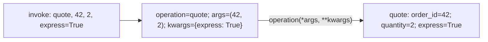

# Functions, call signatures, and scope

> **Role:** foundation. Read [names and mutability](names_and_mutability.md) first.
> Python 3.11+. Each Python block is independent and can be run as a small script.

A function call has two separate questions: which arguments bind to which parameters, and where
the function finds names used by its body. These explain many signatures and callbacks that look
complicated in a library but follow ordinary Python rules.

## Read a signature as a binding contract

Suppose callers can choose whether order 42 uses express shipping. Requiring the boolean's name
makes `quote(42, express=True)` clearer than `quote(42, True)`:

```python
def quote(order_id, /, quantity=1, *, express=False):
    return {"order_id": order_id, "quantity": quantity, "express": express}

print(quote(42, quantity=2, express=True))
# {'order_id': 42, 'quantity': 2, 'express': True}
assert quote(42)["quantity"] == 1

try:
    quote(order_id=42)
except TypeError:
    print("order_id must be positional")

try:
    quote(42, 2, True)
except TypeError:
    print("express must be named")
```

The **parameters** are names in the definition; the **arguments** are values supplied by a call.
Python binds arguments before it runs the body. The slash and star divide the binding rules:

| Part of the signature | Binding rule | Examples |
|---|---|---|
| Before `/`: `order_id` | Positional-only | `quote(42)` |
| Between `/` and `*`: `quantity` | Positional or keyword | `quote(42, 2)` or `quote(42, quantity=2)` |
| After `*`: `express` | Keyword-only | `quote(42, express=True)` |

Neither separator receives a value. A default lets the caller omit a parameter; it does not decide
whether positional or keyword syntax is allowed. If `express` had no default, it would be a required
keyword-only argument.

Use positional-only parameters when their names should not become part of a public calling API,
and keyword-only parameters when naming an option prevents an ambiguous call. Ordinary positional
or keyword parameters are a good default for simple application functions. There is no need to add
every separator to every function. The [Python tutorial](https://docs.python.org/3.11/tutorial/controlflow.html#special-parameters)
explains the same categories with their compatibility consequences.

## Collecting arguments and unpacking a call are opposite operations

A wrapper might need to accept a call and forward it. In a definition, `*args` collects remaining
positional arguments into a tuple, and `**kwargs` collects remaining keyword arguments into a
dictionary. The names `args` and `kwargs` are conventions; the stars provide the behavior.

```python
def collect(*args, **kwargs):
    print(args, kwargs)
    return args, kwargs

args, kwargs = collect(42, 2, express=True)
# (42, 2) {'express': True}
assert args == (42, 2)
assert kwargs == {"express": True}
```

At a call site, stars expand existing values into arguments. Trace this complete forwarding example:

```python
def quote(order_id, /, quantity=1, *, express=False):
    return order_id, quantity, express

def invoke(operation, *args, **kwargs):
    return operation(*args, **kwargs)

positional = (42, 2)
options = {"express": True}
result = invoke(quote, *positional, **options)
print(result)                          # (42, 2, True)
assert result == (42, 2, True)
```

The argument values follow this path:



The wrapper collects values once, then expands them. It does not copy their objects. Mutability
therefore follows the previous lesson. Nor does accepting arbitrary arguments guarantee the target
accepts them: the target still performs its own binding and can raise `TypeError`.

Call unpacking requires string keys for keyword names. Supplying the same parameter twice is an
error, including once explicitly and once through a mapping:

```python
def quote(order_id, *, express=False):
    return order_id, express

options = {"express": True}
try:
    quote(42, express=False, **options)
except TypeError:
    print("express was supplied twice")
```

This differs from `{**defaults, **overrides}`, a dictionary construction in which later keys win.
Keep that distinction in mind when reading configuration code. Prefer explicit application
signatures; `*args, **kwargs` are useful for forwarding, but can hide accepted options from readers
and type checkers. [Decorators](decorators.md) develop forwarding and signature preservation further.

## Function objects can be passed without running them

`quote` refers to the function object. `quote(42)` calls it and produces a result. A callback is just
a callable passed to some code that will invoke it later. No special declaration is involved:

```python
def normalize_id(raw):
    return raw.strip().upper()

def prepare_order(raw_id, normalize):
    return {"id": normalize(raw_id)}

alias = normalize_id
print(prepare_order(" ord-42 ", alias))  # {'id': 'ORD-42'}
assert alias is normalize_id
```

If `normalize_id(" ord-42 ")` were passed instead, `normalize` would receive a string, and trying to
call it would fail. Function values make dispatch tables, sorting keys, dependency injection, and
decorators possible. A `lambda` also creates a function object, restricted to a single expression:

```python
normalize = lambda raw: raw.strip().upper()
print(normalize(" ord-42 "))           # ORD-42
assert normalize(" ord-42 ") == "ORD-42"
```

Prefer `def` when a function needs a useful name, a docstring, multiple steps, or individual tests.
Short lambdas fit well as local arguments such as a sorting key. They obey the same scope rules as
functions written with `def`.

## Scope determines where a name is resolved

A **scope** is the part of execution in which a binding can be found directly by name. For ordinary
function bodies, the useful lookup order is **LEGB**: Local, Enclosing function, Global module,
then Built-ins such as `len`. Class-body scopes and comprehensions have additional rules; LEGB is
the starting model for the function cases here, not a universal rule for every Python construct.

Follow `prefix` and `region` through this example:

```python
region = "eu"

def make_order_labeler(prefix):
    def label(order_id):
        return f"{region}:{prefix}:{order_id}"
    return label

label = make_order_labeler("order")
print(label(42))                       # eu:order:42
assert label(42) == "eu:order:42"
```

`order_id` is local to the current `label` call. `prefix` belongs to the enclosing function call.
`region` is found in the module where the function was defined. The returned function retains access
to the enclosing binding even after `make_order_labeler` returns; this is a **closure**.

Here is the lookup path for this particular call, including where each search stops:

| Name used by `label(42)` | Local call | Enclosing call | Module | Result |
|---|---|---|---|---|
| `order_id` | `42` | Not searched | Not searched | `42` |
| `prefix` | Absent | `'order'` | Not searched | `'order'` |
| `region` | Absent | Absent | `'eu'` | `'eu'` |

A function's globals come from its defining module, not from the caller's local variables. Its
enclosing bindings come from lexical nesting in the source, not from whichever function called it
most recently. These rules make a function predictable when it is passed elsewhere.

## Assignment makes a local unless you declare otherwise

Reading a module variable works without a declaration. Assigning a bare name anywhere in an ordinary
function makes that name local throughout the function, unless declared `global` or `nonlocal`.
That can make a read fail before an assignment has executed:

```python
count = 0

def broken_increment():
    count += 1                         # deliberate failure: local read before binding

try:
    broken_increment()
except UnboundLocalError:
    print("the local count has no value yet")

assert count == 0
```

`count += 1` needs to read `count` before storing its replacement. Python has already classified it
as local, so it does not fall back to the module's `count`. `global count` would explicitly target
the module binding. It does not make a variable shared across processes or add synchronization.

A closure can instead own state private to one created function. `nonlocal` targets an existing
binding in an enclosing function:

```python
def make_counter():
    count = 0
    def next_number():
        nonlocal count
        count += 1
        return count
    return next_number

orders = make_counter()
invoices = make_counter()
print(orders(), orders(), invoices())   # 1 2 1
assert orders() == 3
assert invoices() == 2

module_count = 0
def increment_module_count():
    global module_count
    module_count += 1

increment_module_count()
assert module_count == 1
```

Each `make_counter()` call creates a different retained `count` binding. Calls to the same returned
function share that binding; calls to the other function do not. `nonlocal` is needed for rebinding,
not for mutating an object already reached through an enclosing name. A closure holding a list can
append to that list without declaring `nonlocal`, because the name continues to refer to the same
list. Neither form makes concurrent access safe; use the
[concurrency guide](../../concurrency/01_state_and_safety.md) when there are competing callers.

## Late binding explains the callback-in-a-loop trap

Suppose one callback should return each order ID. A closure retains a binding, not a frozen snapshot
of that binding's value. When callbacks run later, they see its value at that time:

In these examples, `[callback() for callback in callbacks]` calls each callback in order and collects
the results in a new list. The next lesson develops this comprehension syntax from an ordinary loop.

```python
def make_bad_callbacks():
    callbacks = []
    for order_id in (41, 42, 43):
        callbacks.append(lambda: order_id)
    return callbacks

callbacks = make_bad_callbacks()
results = [callback() for callback in callbacks]
print(results)                         # [43, 43, 43]
assert results == [43, 43, 43]
```

The loop reassigns one `order_id` binding three times. All three functions refer to that same
binding; by invocation time it contains `43`. This is **late binding**: lookup happens when the
function body runs.

A factory gives each callback its own enclosing call and binding:

```python
def make_callback(order_id):
    def callback():
        return order_id
    return callback

callbacks = [make_callback(order_id) for order_id in (41, 42, 43)]
print([callback() for callback in callbacks])  # [41, 42, 43]
assert [callback() for callback in callbacks] == [41, 42, 43]
```

Another common spelling is `lambda order_id=order_id: order_id`. The default expression is evaluated
when each lambda is created, so that function retains the current object as its default. This uses
the same default-evaluation rule that caused the shared-list bug in the previous lesson. It also
adds an argument to the callback's signature, which may be undesirable when a framework supplies
positional callback arguments. The factory keeps a zero-argument contract explicit.

```python
callbacks = []
for order_id in (41, 42, 43):
    callbacks.append(lambda order_id=order_id: order_id)
assert [callback() for callback in callbacks] == [41, 42, 43]
first_callback = callbacks[0]
print(first_callback(99))               # 99: callers can override that default
```

Capturing a mutable object through a default still captures that object, not an independent copy.
This is why names, object ownership, and closure behavior must be understood together.

## Read unfamiliar function code in a fixed order

First locate the definition and classify the accepted arguments. Then identify which values are
computed when the function is defined, such as defaults, and which are computed each time it is
called. Finally, trace names that are not local: are they module state, an enclosing binding, or a
built-in? This explains most callback and decorator surprises without guessing from function names.

If a call fails before any body logging appears, inspect binding errors such as a duplicate keyword
or a missing required argument. If callbacks all use the last loop value, inspect retained bindings.
If a callback keeps a large request object alive, its closure may be retaining more data than needed;
capture the specific identifier or value required by the operation.

## Recap

- A signature controls argument binding before the body executes; `/` and `*` restrict call syntax.
- Stars collect arguments in definitions and expand them in calls; duplicate keyword supply fails.
- Functions are values, so passing a function differs from passing the result of calling it.
- Closures retain access to enclosing bindings, while `global` and `nonlocal` choose rebinding scope.
- Late binding reads retained bindings at invocation time; a factory gives each callback separate state.

## Check yourself

**1. A wrapper accepts `**kwargs` and calls `operation(timeout=5, **kwargs)`. The caller supplied
`timeout=10`. Which value wins?**

<details><summary>Answer</summary>

Neither. The target receives the same keyword twice and Python raises `TypeError` before its body
runs. If override semantics are intended, construct one merged options dictionary first, then
expand it once. That is an explicit policy decision, not a property of function calls.

</details>

**2. A closure appends to an enclosing `events` list without `nonlocal`. It later changes to
`events = events + [event]` and fails. Why?**

<details><summary>Answer</summary>

Appending mutates the existing object without rebinding `events`. Assignment makes `events` local,
so the right-hand read occurs before that local has a value. Declare `nonlocal events` when rebinding
the enclosing variable is intended, or keep mutation explicit if shared state is the right contract.

</details>

**3. Each callback has a default `order=order`, but all callbacks change when the same dictionary is
mutated later. Did early default evaluation fail?**

<details><summary>Answer</summary>

No. The defaults captured the dictionary object at creation time. That does not freeze its contents
or copy it. Capture an immutable identifier if that is what the callback needs, or deliberately create
an independent snapshot using the ownership rules from the previous lesson.

</details>

**Next:** [Idioms and collections](idioms_and_collections.md), then
[modules and imports](modules_and_imports.md). Continue to [decorators](decorators.md) when functions
are transformed or registered at definition time.
