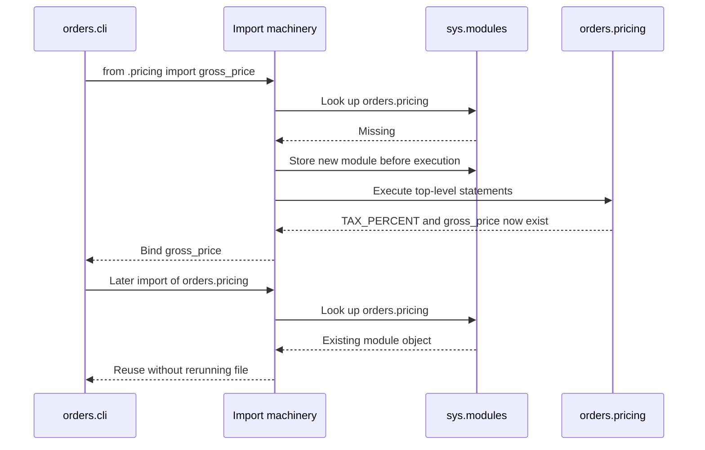

# Modules, imports, and execution boundaries

> **Role:** tutorial. Read [functions and scope](functions_and_scope.md) first.
> Python 3.11+. The first example uses three files in a new, disposable directory.
> Later blocks explicitly say whether they replace a file or run in that directory.

Importing a Python module is executable work. It finds or reuses a module object, may execute that
module's top-level code, and binds a name in the importer. This explains why decorators register
routes during import, why repeated imports usually do not repeat startup work, and why circular
imports can encounter names that do not exist yet.

## Build one package and run it as a module

Create a directory named `python_import_lab` with this layout. Run the commands below from inside
that directory, the parent of `orders/`:

```text
python_import_lab/
└── orders/
    ├── __init__.py
    ├── pricing.py
    └── cli.py
```

A **module** is an importable unit with its own namespace, commonly one `.py` file. A regular
**package** is a module that contains other modules and normally uses an `__init__.py` file. The
package initializer can be empty; this one only documents the package.

Save as `orders/__init__.py`:

```python
"""Small import-mechanics example; no startup work belongs here."""
```

Save as `orders/pricing.py`:

```python
print("loading orders.pricing")        # observable demonstration of import execution
TAX_PERCENT = 20

def gross_price(net_cents):
    return net_cents * (100 + TAX_PERCENT) // 100
```

Save as `orders/cli.py`:

```python
from .pricing import gross_price

def main():
    print(f"order 42: {gross_price(1000)} cents")

if __name__ == "__main__":
    main()
```

Run the package module:

```bash
python3 -m orders.cli
```

Expected output:

```text
loading orders.pricing
order 42: 1200 cents
```

The `-m` option locates `orders.cli` through the import system and executes it as the entry point.
`from .pricing` is a **relative import**: the leading dot means “within this package,” so the target
is `orders.pricing`. When pricing executes, it prints the loading message, binds `TAX_PERCENT`, and
creates the function object for `gross_price`. The CLI then calls that function from `main`.

This arithmetic is a compact import example, not a complete money-rounding policy. The print is
deliberate instrumentation; libraries ordinarily avoid printing just because they were imported.

If Python says `No module named 'orders'`, check that the working directory is `python_import_lab`
and the directory names match. If it reports `attempted relative import with no known parent
package`, the module was probably launched as `python3 orders/cli.py`. Use the documented `-m`
command so Python knows its package context.

## Trace the first import and the cached import separately

From the same directory, start a new interpreter and import pricing twice:

```bash
python3 -c "import orders.pricing; import orders.pricing"
```

Expected output is one line, not two:

```text
loading orders.pricing
```

Python keeps a process-local cache of module objects in `sys.modules`, a dictionary keyed by module
name. A successful first import normally puts the module there. Later imports of that name reuse
the object and do not execute the file again. A fresh interpreter has a fresh cache, which is why
each command above prints the loading line.

Follow where execution occurs in a fresh process:



The early cache insertion matters: another import can find the module while its body is still
executing. That prevents infinite recursive loading, but it means the module can be only partly
initialized. We will use that fact to explain a circular import below.

Save this separate probe as `cache_probe.py` next to the `orders/` directory and run
`python3 cache_probe.py`:

```python
import importlib
import sys

first = importlib.import_module("orders.pricing")
second = importlib.import_module("orders.pricing")
assert first is second
assert first is sys.modules["orders.pricing"]
print(first.gross_price(1000))          # 1200, after the one loading message
```

`importlib.import_module` is useful when the module name is known as a string, for example a trusted
plugin configuration. Ordinary static imports are easier to inspect for normal dependencies.
Treat dynamically imported code as executable code, not as passive data; do not let untrusted input
select arbitrary modules to load.

## Importing a name creates a binding, not a live alias to a module slot

Compare `import orders.pricing` with `from orders.pricing import TAX_PERCENT`. The first makes the
module accessible, so later attribute access reads its current value. The second binds the object
currently stored in the module's `TAX_PERCENT` slot to a local name.

Save as `binding_probe.py` beside `orders/` and run `python3 binding_probe.py`:

```python
import orders.pricing
from orders.pricing import TAX_PERCENT

orders.pricing.TAX_PERCENT = 25
print(TAX_PERCENT, orders.pricing.TAX_PERCENT)  # 20 25
print(orders.pricing.gross_price(1000))        # 1250
assert TAX_PERCENT == 20
assert orders.pricing.TAX_PERCENT == 25
assert orders.pricing.gross_price(1000) == 1250
```

The module attribute was rebound to `25`. The importing script's local name still refers to `20`.
Meanwhile, `gross_price` resolves its global `TAX_PERCENT` in the module where it was defined, so it
sees `25`. This is the name-binding and function-scope model from the earlier lessons, applied to
modules.

If both bindings referred to the same mutable list and code appended to it, both would observe the
mutation. Rebinding and mutation remain different operations. Avoid runtime mutation of module
configuration when a passed configuration object would make ownership clearer.

## `__name__` distinguishes import from entry-point execution

Every module has a `__name__`. Imported normally, `orders.cli` has the name `'orders.cli'`; when
executed as the entry point with `-m`, its executing namespace has the name `'__main__'`.

Run this command from the lab directory:

```bash
python3 -c "import orders.cli; print(orders.cli.__name__)"
```

Expected output:

```text
loading orders.pricing
orders.cli
```

The pricing import still executes. The CLI's `main()` does not, because its guard is false. A guard
protects only the statements inside the `if` body; it does not make every other top-level statement
lazy. Keep reusable behavior inside functions and make the entry point call them explicitly.

Do not rely on running a file as `__main__` and importing it under another name to share one module
identity. They can create distinct namespaces, duplicate global state, and even different class
objects from the same source. Keep entry modules thin and place reusable definitions in modules
that callers import under one stable package name.

## Circular imports fail when a needed name has not been created

A cycle is not automatically an error. The failure occurs when a module tries to use a name in a
partly initialized module before execution has reached its definition.

Add these two files to the same lab. They intentionally demonstrate the failure.

Save as `orders/bad_a.py`:

```python
from .bad_b import label

PREFIX = "order"

def show():
    return label(42)
```

Save as `orders/bad_b.py`:

```python
from .bad_a import PREFIX

def label(order_id):
    return f"{PREFIX}:{order_id}"
```

Save this probe as `circular_probe.py` beside `orders/`, then run `python3 circular_probe.py`:

```python
try:
    import orders.bad_a
except ImportError as exc:
    assert "partially initialized module" in str(exc)
    print("PREFIX was requested before bad_a defined it")
else:
    raise AssertionError("this deliberate circular import should fail")
```

Expected output:

```text
PREFIX was requested before bad_a defined it
```

Trace the cycle by the names that exist at each step:

| Step | Executing code | What already exists | Consequence |
|---|---|---|---|
| 1 | Begin `bad_a` | Module object in cache | `PREFIX` has not been bound |
| 2 | `bad_a` imports `bad_b` | `bad_a` is still executing | Begin executing `bad_b` |
| 3 | `bad_b` imports `bad_a.PREFIX` | Cached, partial `bad_a` | No `PREFIX` attribute yet; import fails |

Moving `PREFIX` above the first import may make this exact example work, but it preserves a cycle
whose behavior depends on initialization order. A clearer repair moves the shared definition into
a lower-level module that imports neither consumer.

Add `orders/constants.py`:

```python
PREFIX = "order"
```

Replace `orders/bad_b.py` with:

```python
from .constants import PREFIX

def label(order_id):
    return f"{PREFIX}:{order_id}"
```

Replace `orders/bad_a.py` with:

```python
from .bad_b import label

def show():
    return label(42)
```

Run a new interpreter so the repair is tested without stale module objects:

```bash
python3 -c "from orders.bad_a import show; print(show())"
```

Expected output is `order:42`. The dependency direction is now `bad_a → bad_b → constants`; nothing
imports back into `bad_a`. In a real service, names such as `service`, `formatting`, and `contracts`
would communicate these responsibilities better than the deliberately diagnostic `bad_a`/`bad_b`.

A local import inside a function can defer a dependency until call time. That is useful for an
optional dependency or costly feature, but it is not a substitute for understanding a cycle. The
function can still fail if called before initialization is complete.

## Keep imports predictable in an application

Python searches locations available through its import machinery, including entries in `sys.path`.
The launch method and environment affect those locations. A local file named `json.py`, for example,
can hide the standard-library `json` module. A missing `dumps` attribute may therefore indicate the
wrong module was imported rather than a Python API change. Inspect `module.__file__` when present to
see where a file-backed module came from; built-in and namespace modules do not always have a useful
file path.

Prefer package-aware execution and a properly installed project to scattered `sys.path` edits.
[Python packaging](../../python_packaging/README.md) owns environments, dependency locking, and
distribution artifacts. Namespace packages, which can span directories without one `__init__.py`,
are a deliberate packaging feature; they are not needed for this regular-package tutorial.

Top-level import side effects are especially relevant to services. Importing a module that opens
a connection or starts a thread makes resource ownership depend on import order. It can run again
in another worker process or a development reload. Keep connection acquisition and cleanup in
explicit startup/lifetime code; [context managers](../control_flow/context_managers.md) explain
that boundary. Definitions and lightweight registrations at import time are common; network calls,
database migrations, and background work need a clearer owner.

Do not delete entries from `sys.modules` as a routine fix. Existing references to old modules and
their objects can survive, creating two versions of the “same” state. `importlib.reload` also has
reference-retention subtleties. A fresh interpreter is the simplest reliable check after changing
an import graph in this lab; live reload mechanics are outside this foundation's promise.

## Try it: add a reusable summary without startup output

Add `orders/report.py` that imports `gross_price`, exposes `summary(order_id, net_cents)`, and returns
the string `'order 42: 1200 cents'` for `(42, 1000)`. Importing `orders.report` must not print that
summary. Running `python3 -m orders.report` should print it. The pricing demonstration's loading
message will still appear in either fresh process.

Hint: separate the reusable function from entry-point work. Decide which statement belongs inside
the `__main__` guard before writing it.

<details><summary>Worked solution and reasoning</summary>

Save as `orders/report.py`:

```python
from .pricing import gross_price

def summary(order_id, net_cents):
    return f"order {order_id}: {gross_price(net_cents)} cents"

if __name__ == "__main__":
    print(summary(42, 1000))
```

The import defines `summary` but does not call it. Entry-point execution satisfies the guard and
prints the returned value. Run `python3 -m orders.report` to see the loading message followed by
the summary. Run `python3 -c "import orders.report"` to see only the loading message. If both commands
print the summary, the print is outside the guard.

</details>

## Python 3.15 migration: import timing and text boundaries

Checked 2026-10-30, GA. Explicit lazy imports can defer module execution and registration until first use. Keep required startup registration explicit and test both import and first-use failure. UTF-8 becomes the default text encoding; specify an encoding when reading legacy files. These are migration checks, while the examples retain the Python 3.11+ baseline. [Python 3.15 changes](https://docs.python.org/3.15/whatsnew/3.15.html).

## Recap

- Imports create or reuse module objects, execute uncached module bodies, and bind names locally.
- `sys.modules` caches by module name within one process; fresh processes begin separately.
- `from module import name` binds an object now; later module rebinding does not update that local name.
- The `__main__` guard separates entry-point actions from reusable definitions, but other top-level code still runs.
- Circular imports expose partial initialization; one-direction dependencies remove that timing requirement.

## Check yourself

**1. Two workers each print the pricing loading message, but repeated imports inside one worker
print it once. Is the module cache broken?**

<details><summary>Answer</summary>

No. Each worker process has its own module objects and cache. Reusing an object inside one process
does not share that object with another. Import-time side effects can therefore occur once in each
worker even when they happen only once per module name inside a worker.

</details>

**2. A test imports `TAX_PERCENT` directly, then patches `orders.pricing.TAX_PERCENT`. Its local
assertion still sees the old value, but `gross_price` changes. Explain both observations.**

<details><summary>Answer</summary>

The direct import made a local binding to the old integer. The patch rebinds the module attribute,
not that local name. `gross_price` looks up the global in its defining module when called, so it
uses the patched value. Inspect or patch the namespace actually used by the code under test.

</details>

**3. A module has a `__main__` guard but opens a database connection above it. Does importing the
module avoid opening that connection?**

<details><summary>Answer</summary>

No. The guard controls only its own body. The top-level connection statement runs during the first
import. Move acquisition into an explicitly called function or application lifetime boundary so the
caller owns both startup and cleanup, rather than merely moving it into another imported file.

</details>

## Sources and continuation

Checked 2026-10-30 against the Python 3.11 baseline:
[import system](https://docs.python.org/3.11/reference/import.html),
[module tutorial](https://docs.python.org/3.11/tutorial/modules.html), and
[`__main__`](https://docs.python.org/3.11/library/__main__.html).

Continue with [classes and methods](../objects/classes_and_methods.md) to see how attribute access
extends the name-binding model, or [decorators](decorators.md) to understand definitions that perform
registration during import.
