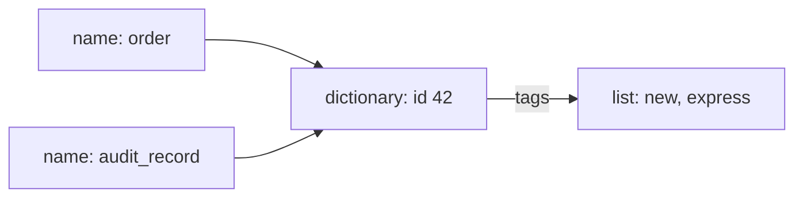

# Names, objects, and mutability

> **Role:** foundation. Assumes basic assignments, lists, dictionaries, functions, and `if` statements.
> Examples use Python 3.11+. Each Python block is a complete, independent program.

A service receives an order and gives it to two functions: one adds a shipping tag, and the other
logs the original request. The log unexpectedly contains the new tag. Understanding this does not
require threads or a framework. It starts with what assignment means.

## Assignment gives an object another name

Run this first. Both names see the added tag:

```python
order = {"id": 42, "tags": ["new"]}
audit_record = order
audit_record["tags"].append("express")

print(order["tags"])                  # ['new', 'express']
print(audit_record is order)           # True
assert order["tags"] == ["new", "express"]
assert audit_record is order
```

An **object** is a runtime value with an identity, a type, and a value. A **name binding** associates
a name such as `order` with an object. `audit_record = order` evaluates the right side, then binds
the left name to that same object. It creates no new dictionary. Two names referring to one object
are **aliases**.

The diagram follows the references, which are the connections that make the shared change visible:



There is one dictionary and one list, even though there are two top-level names. The append changes
the list; looking through either name reaches that list. This is the same ownership question that
later appears in cached objects, class attributes, and dataclass fields.

**Rebinding** changes which object a name refers to. **Mutation** changes an existing object's
contents. Compare them with the same order:

```python
order = {"id": 42, "tags": ["new"]}
audit_record = order
audit_record = {"id": 99, "tags": []}  # rebind only this name

print(order["id"], audit_record["id"])  # 42 99
assert order["id"] == 42
assert audit_record["id"] == 99
```

Nothing rewrites the original dictionary during this assignment. `audit_record` simply stops
referring to it. A function parameter is another local binding, so it follows the same rules:

```python
def tag_then_replace(record):
    record["tags"].append("express")  # changes the caller's object
    record = {"id": 99, "tags": []}   # changes only this local binding
    return record

order = {"id": 42, "tags": ["new"]}
replacement = tag_then_replace(order)
print(order)        # {'id': 42, 'tags': ['new', 'express']}
print(replacement)  # {'id': 99, 'tags': []}
assert order["id"] == 42 and order["tags"] == ["new", "express"]
```

The caller and parameter initially share an object. Assigning to the parameter does not assign to
the caller's variable. When reviewing a function, look for mutations of reachable objects as well
as its return value; either can be an observable effect.

## A shallow copy separates the outer container

Suppose the audit log must preserve the incoming order. Calling `dict.copy()` creates a new
dictionary, but its values still refer to the original objects:

```python
order = {"id": 42, "tags": ["new"]}
audit_record = order.copy()
order["id"] = 43
order["tags"].append("express")

print(audit_record)                    # {'id': 42, 'tags': ['new', 'express']}
assert audit_record is not order
assert audit_record["tags"] is order["tags"]
```

The copied dictionary owns separate slots for `id` and `tags`. Replacing the original `id` slot
does not replace the copy's slot. Appending through `tags`, however, follows either slot to the
same list. This is a **shallow copy**: a new outer container, with references to the existing
contained objects.

Follow the difference between replacing a slot and changing its target:

| Action | Original `order` | Shallow `audit_record` | Why |
|---|---|---|---|
| Copy | `id=42`, tags `['new']` | `id=42`, same tags list | Only the dictionary is new |
| Set `order['id'] = 43` | `id=43` | `id=42` | One dictionary slot is rebound |
| Append `express` | tags `['new', 'express']` | tags `['new', 'express']` | One shared list is mutated |

A **deep copy** recursively copies contained objects too. For ordinary nested data, it can make
the audit snapshot independent of future mutations:

```python
from copy import deepcopy

order = {"id": 42, "tags": ["new"]}
audit_record = deepcopy(order)
order["tags"].append("express")

print(audit_record["tags"])            # ['new']
assert audit_record["tags"] is not order["tags"]
```

Deep copying is not automatically the right service boundary. It costs work proportional to the
graph being copied, can copy data that should stay shared, and is not a meaningful way to duplicate
connections or locks. Prefer constructing the specific independent values a consumer needs. For
example, an audit event might store `order['id']` and `tuple(order['tags'])` rather than the entire
live request object. Custom classes can also customize copying behavior. The standard
[copy documentation](https://docs.python.org/3.11/library/copy.html) explains these limits.

## Immutable does not mean everything reachable is immutable

Lists and dictionaries are mutable; strings, integers, and tuples are immutable. For a tuple, the
fixed part is which objects its slots reference. A list stored in a tuple can still change:

```python
snapshot = (42, ["new"])
snapshot[1].append("express")
print(snapshot)                        # (42, ['new', 'express'])
assert snapshot == (42, ["new", "express"])

try:
    snapshot[0] = 99
except TypeError:
    print("tuple slots cannot be replaced")
```

The tuple still points to the same integer and the same list after the append. This distinction
matters later when `frozen=True` prevents field assignment without freezing every object in a field.

Augmented assignment such as `+=` also deserves attention: its behavior depends on the type.
For a list, it normally extends the existing list; for an integer, it computes a new integer and
rebinds the name:

```python
tags = ["new"]
other_tags = tags
tags += ["express"]

count = 1
other_count = count
count += 1

print(other_tags, other_count)          # ['new', 'express'] 1
assert other_tags is tags
assert other_count == 1 and count == 2
```

Read the operation together with the object type. “An assignment only changes my local variable”
is insufficient when the operation can mutate before rebinding.

## Identity, equality, and hashability answer different questions

`is` asks whether two references lead to the same object. `==` asks whether their values compare
equal. Two separately constructed orders can be equal without being the same dictionary:

```python
first = {"id": 42}
second = {"id": 42}
print(first == second, first is second)  # True False
assert first == second and first is not second
```

Use equality for ordinary values. Use identity for deliberate singletons such as `None` or a
unique sentinel, introduced below. Do not use `is` to compare strings or numbers: implementations
may reuse some objects, so a mistaken identity comparison can appear to work on small examples.

Dictionaries and sets locate keys using a **hash**, an integer used to narrow down where a value
belongs, then use equality to distinguish candidates. A **hashable** object supplies a hash that
stays stable over its lifetime, and objects that compare equal must have equal hashes. Built-in
lists and dictionaries are unhashable; allowing their contents to change would undermine using
those contents as a stable key.

```python
totals = {("tenant-a", 42): 1200}
print(totals[("tenant-a", 42)])          # 1200

try:
    totals[["tenant-a", 42]] = 1200
except TypeError:
    print("a list cannot be a dictionary key")

try:
    hash((42, ["new"]))
except TypeError:
    print("a tuple containing a list is unhashable too")
```

A tuple is hashable only when all its elements are hashable. Hashability is a contract rather than
a synonym for immutability: custom classes may use identity-based equality and hashing even while
some attributes change. The later object-model lessons explain custom `__eq__` and `__hash__`.
See Python's [object model](https://docs.python.org/3.11/reference/datamodel.html#objects-values-and-types).

## Defaults can accidentally own shared state

A default argument expression is evaluated when the `def` statement executes, not afresh for each
call. That makes a mutable default an object retained by the function:

```python
def add_tag(tag, tags=[]):              # deliberate failure example
    tags.append(tag)
    return tags

first = add_tag("new")
second = add_tag("express")
print(first, second)                   # ['new', 'express'] ['new', 'express']
assert first is second
```

The first call mutates the default list. The second call omits `tags` again, so it gets that same
list. Even the earlier return value changes because it is another alias. Create the per-call list
inside the body when the argument is omitted:

```python
def add_tag(tag, tags=None):
    if tags is None:
        tags = []
    tags.append(tag)
    return tags

first = add_tag("new")
second = add_tag("express")
print(first, second)                   # ['new'] ['express']
assert first is not second
```

This preserves an explicit caller-provided list and mutates it. If the function should never mutate
caller-owned data, copy the supplied list too and document that ownership contract. For dataclass
fields, use a factory; see [dataclasses](../data_models/dataclasses.md). Pydantic has its own default
handling, so do not transfer the ordinary function-default rule to a model without checking it.

## Missing and `None` can be distinct states

An update request may omit `note`, provide a new note, or explicitly clear it with `None`. A default
of `None` cannot distinguish the first and third cases. Use a **sentinel**, a unique object reserved
to represent a special state:

```python
MISSING = object()

def apply_note(order, *, note=MISSING):
    if note is not MISSING:
        order["note"] = note

order = {"id": 42, "note": "leave at door"}
apply_note(order)
assert order["note"] == "leave at door"
apply_note(order, note=None)
assert order["note"] is None
print(order)                          # {'id': 42, 'note': None}
```

The `*` requires `note` to be passed by name; the next lesson explains that signature syntax. Each
call to `object()` creates a distinct object, so `is MISSING` tests the reserved marker rather than
invoking user-defined equality. Keep the marker private to the API that understands it. It is not a
JSON value and should not accidentally become stored application data.

## Diagnose ownership before adding copies

If a value changes “by itself,” identify every owner of the object, then locate the mutation. Ask
whether a returned list is the cached list, whether two objects share a field, or whether the caller
expected a snapshot. A shallow copy that only moves the alias one level down will not repair nested
mutation. Nor does copying provide synchronization when multiple threads can change a source during
the copy; that belongs in the [state and safety guide](../../concurrency/01_state_and_safety.md).

These examples are correct when their assertions pass. If your code needs value isolation, test
both directions: mutating the input must not change the result, and mutating the result must not
change the input. Intentional sharing, by contrast, should be explicit in the function's contract.

## Recap

- Assignment binds a name to an object; aliases make mutations visible through multiple names.
- Rebinding one name does not replace the object reached through other names.
- A shallow copy separates one container; a deep copy recursively separates ordinary nested data.
- Immutable containers can refer to mutable objects, and hashability has its own contract.
- Defaults can retain state across calls; a sentinel distinguishes omission from a real `None`.

## Check yourself

**1. You make `backup = order.copy()`, then replace `order['tags']` with a new list rather than
appending to it. Does `backup['tags']` change?**

<details><summary>Answer</summary>

No. The two dictionaries have different slots. Replacing the original dictionary's `tags` slot
makes it point to a new list; the backup still points to the old list. Appending would instead
mutate the shared target and be visible through both dictionaries.

</details>

**2. A function creates `tags = []` inside its body, then returns it. Can two calls accidentally
share that list solely because the function returns it?**

<details><summary>Answer</summary>

No. Executing `[]` inside each call creates a different list. Sharing would require another action,
such as storing one list in a global/cache or passing the same list to both calls. A return exposes
the current object; it does not automatically cache it for later calls.

</details>

**3. A patch API uses `if note:` before updating. What happens for `None`, an empty string, and an
omitted field? How should the ownership decision be expressed?**

<details><summary>Answer</summary>

The truth test conflates values that are false in a condition. An empty string might be a legitimate
replacement and `None` might mean clear. Use a unique omission sentinel and test identity against
it, then apply the supplied value, including false-valued ones, according to the API's rules.

</details>

**Next:** [Functions and scope](functions_and_scope.md).
