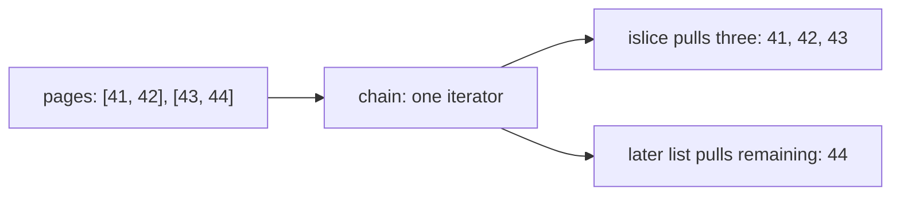

# Standard-library tools for everyday backend code

> **Role:** foundation continuation. Read [functions](functions_and_scope.md),
> [collection idioms](idioms_and_collections.md), [decorators](decorators.md) and
> [iterators](../control_flow/iterators_and_generators.md) first.
> Python 3.11+. Each Python block below is an independent, runnable program.

A batch of orders often needs grouping, counting, sorting and processing. These operations do
not require a framework. The standard library supplies small objects with explicit behavior;
understanding which ones retain values and which ones consume iterators makes unfamiliar code
much easier to follow.

## Group values with a factory, count them with a Counter

Suppose orders 41 and 43 belong to tenant `a`, while order 42 belongs to tenant `b`. A normal
dictionary needs a list created before the first append for each tenant. `defaultdict(list)`
owns that creation rule:

```python
from collections import Counter, defaultdict

orders = [(41, "a"), (42, "b"), (43, "a")]
by_tenant = defaultdict(list)
for order_id, tenant in orders:
    by_tenant[tenant].append(order_id)

counts = Counter(tenant for _, tenant in orders)
print(dict(by_tenant))  # {'a': [41, 43], 'b': [42]}
print(counts["a"], counts["missing"])  # 2 0
assert by_tenant["a"] == [41, 43]
assert counts["b"] == 1
```

`list` is passed as a callable, without parentheses. On the first missing `by_tenant['a']`,
the dictionary calls `list()`, stores that new list under `a`, then returns it for the append.
The second `a` access finds the stored list. A different missing key creates a different list.
Passing `list()` instead would supply a list object where a callable factory is required and
raise `TypeError` during construction.

The before/after state makes the difference between missing-key access and a read-only query clear:

| Operation | Mapping before | Result | Mapping after |
|---|---|---|---|
| `by_tenant.get('c')` | `a`, `b` present | `None` | Unchanged |
| `by_tenant['c']` | `a`, `b` present | New empty list | `c: []` added |
| `counts['c']` | Counts for `a`, `b` | `0` | No `c` inserted by the lookup |

The factory runs for missing subscripting, not for `get()` or membership checks. Reading through
`[]` can therefore mutate a `defaultdict`; use `get()` when inspection must not invent a group.
This matters when a diagnostic path accidentally creates thousands of empty entries.

```python
from collections import Counter, defaultdict

groups = defaultdict(list)
assert groups.get("a") is None and "a" not in groups
groups["a"].append(41)
groups["b"].append(42)
assert groups["a"] is not groups["b"]

counts = Counter(["paid", "paid", "pending"])
counts.subtract(["paid", "pending"])
print(counts)  # Counter({'paid': 1, 'pending': 0})
assert "pending" in counts and counts["pending"] == 0
assert "unknown" not in counts and counts["unknown"] == 0
```

A `Counter` stores numeric tallies; subtraction can leave zero or negative counts. Missing lookup
returning zero does not mean that membership tests or iteration ignore stored zero entries.
Choose `Counter` for totals, `defaultdict(list)` when you need the individual records, and a plain
dictionary when unexpected missing keys should fail. Neither container provides a multi-step
concurrency transaction. See the [official collections reference](https://docs.python.org/3.14/library/collections.html).

## Keep recent history with a bounded deque

A `deque` supports efficient appends and pops at both ends. A list is good for indexed access,
but removing its first element repeatedly shifts the remaining elements. A deque fits a local
FIFO buffer or a bounded history:

```python
from collections import deque

recent = deque(maxlen=2)
for order_id in (41, 42, 43):
    recent.append(order_id)
print(list(recent))  # [42, 43]
assert list(recent) == [42, 43]

pending = deque([41, 42])
assert pending.popleft() == 41
pending.append(43)
assert list(pending) == [42, 43]
```

Watch what `maxlen` means when the third order arrives:

| Append | Before | After | Discarded |
|---|---|---|---|
| `41` | `[]` | `[41]` | Nothing |
| `42` | `[41]` | `[41, 42]` | Nothing |
| `43` | `[41, 42]` | `[42, 43]` | `41` |

Bounded history deliberately discards old values. It is unsuitable for a work queue where every
order must be processed. `maxlen` does not apply backpressure: it does not wait for consumers.
Use `queue.Queue` or `asyncio.Queue` when callers need waiting, capacity coordination and worker
signaling; use a durable broker when losing the process must not lose the work. Those ownership
requirements belong in [concurrency](../../concurrency/README.md).

## Turn ordinary operations into callbacks

Sorting takes a callable that extracts a comparison key. `itemgetter('total')` expresses dictionary
or index lookup, while `attrgetter('total')` expresses attribute lookup. They are useful when the
equivalent lambda does nothing beyond that access:

```python
from operator import attrgetter, itemgetter
from types import SimpleNamespace

rows = [{"id": 41, "total": 900}, {"id": 42, "total": 300}]
ordered = sorted(rows, key=itemgetter("total"))
assert [row["id"] for row in ordered] == [42, 41]

# SimpleNamespace is a small object that stores the named attributes supplied here.
objects = [SimpleNamespace(**row) for row in rows]
assert [obj.id for obj in sorted(objects, key=attrgetter("total"))] == [42, 41]
print([row["id"] for row in ordered])  # [42, 41]
```

These getters do not make missing data valid: a missing dictionary key raises `KeyError`, and
an absent attribute normally raises `AttributeError`. `attrgetter` also follows properties and
other normal attribute behavior. Use an explicit function when a default, normalization or a
business rule is part of extracting the key. Multi-field keys, such as
`itemgetter('tenant', 'id')`, return tuples compared in order. See
[operator](https://docs.python.org/3.14/library/operator.html#operator.attrgetter).

`functools.partial` creates a callable with some arguments already supplied. This is useful when
a consumer accepts a one-argument callback but your function also needs configuration:

```python
from functools import partial

def label(order_id, *, tenant):
    return f"{tenant}:{order_id}"

label_for_a = partial(label, tenant="a")
print(label_for_a(42))  # a:42
assert label_for_a(42) == "a:42"
assert label_for_a(42, tenant="b") == "b:42"
```

The partial stores the function and supplied arguments, then combines them with later arguments
when called. Later keyword arguments can override stored keywords, as the second assertion shows.
This is configuration convenience, not enforcement of a tenant or authorization boundary. Stored
mutable arguments remain shared objects; partial does not snapshot them. Python 3.14 adds
`Placeholder` for filling positional gaps, but ordinary prefix/keyword binding above works on
the 3.11 baseline. [functools reference](https://docs.python.org/3.14/library/functools.html#functools.partial).

## Compose lazy work without silently discarding it

`chain.from_iterable` flattens one level of iterables. `islice` takes a bounded part of an iterator.
Neither needs to materialize the entire result:

```python
from itertools import chain, islice

pages = [[41, 42], [43, 44]]
orders = chain.from_iterable(pages)
first = list(islice(orders, 3))
remaining = list(orders)
print(first, remaining)  # [41, 42, 43] [44]
assert first == [41, 42, 43] and remaining == [44]
```

This diagram follows the pulls rather than implying all results exist at construction time:



Both consumers use the same iterator position. After the first consumer pulls three values,
the second continues at 44; it does not restart the input. If these pages came from a network
stream, slicing alone would not establish ownership of the underlying connection. Use the
cleanup rules in [iterators and generators](../control_flow/iterators_and_generators.md).

A short batching function for Python 3.11 can use that same consumption rule:

```python
from itertools import islice

def batches(values, size):
    if size < 1:
        raise ValueError("size must be positive")
    iterator = iter(values)
    while True:
        batch = tuple(islice(iterator, size))
        if not batch:
            return
        yield batch

assert list(batches([41, 42, 43], 2)) == [(41, 42), (43,)]
print(list(batches([41, 42, 43], 2)))  # [(41, 42), (43,)]
```

The final short batch is deliberate. In Python 3.12+ use `itertools.batched`; Python 3.13+ adds
`strict=True` to reject incomplete final batches. Choose strictness from the input contract,
not because a full batch looks tidier. [itertools reference](https://docs.python.org/3.14/library/itertools.html#itertools.batched).

`groupby` is another common source of surprise: it groups consecutive equal keys, not all equal
keys across the input. Compare it with the earlier dictionary grouping:

```python
from itertools import groupby
from operator import itemgetter

orders = [(41, "a"), (42, "b"), (43, "a")]
runs = [(tenant, list(group)) for tenant, group in groupby(orders, key=itemgetter(1))]
assert [tenant for tenant, _ in runs] == ["a", "b", "a"]

ordered = sorted(orders, key=itemgetter(1))
groups = [(tenant, list(group)) for tenant, group in groupby(ordered, key=itemgetter(1))]
print(groups)  # [('a', [(41, 'a'), (43, 'a')]), ('b', [(42, 'b')])]
assert len(groups) == 2
```

Sorting changes adjacency so both `a` records become one run, but sorting also materializes the
input and changes its order. Each `group` shares the underlying iterator; consume it before
advancing to the next group, or materialize it as above. Use `defaultdict` for arbitrary-order
aggregation; use `groupby` for already-ordered streams or when consecutive runs are meaningful.

## Cache results only when sharing the result is correct

`lru_cache(maxsize=...)` retains results keyed by hashable arguments. A hit returns the retained
object, which saves repeated computation but also creates shared ownership:

```python
from functools import lru_cache

@lru_cache(maxsize=2)
def tags_for(order_id):
    return ["new"]

tags_for(42).append("express")
assert tags_for(42) == ["new", "express"]
assert tags_for.cache_info().hits == 1
print(tags_for.cache_info())  # CacheInfo(hits=1, misses=1, maxsize=2, currsize=1)
tags_for.cache_clear()
assert tags_for(42) == ["new"]
```

The cache did exactly what it promised: reused the result. The bug is expecting each caller to
own a fresh list. Return an immutable value when practical, or explicitly copy at the consumer
boundary. Include all inputs that affect the answer in the cache key; a function that reads
changing tenant/global state can otherwise return an answer computed under different conditions.

`cache` is the unbounded version. `lru_cache` limits the number of entries, not their total bytes,
and neither implements time-based expiry. Inspect `cache_info()` to see whether the retained
objects are earning useful hits. Clearing or versioning a cache is an application policy.
The cache structure is thread-safe, but concurrent misses may execute the function more than
once. Do not use it as an exactly-once mechanism, or decorate an async function whose returned
coroutine cannot safely be awaited repeatedly.

`cached_property` instead stores a computed value on an instance. It requires suitable instance
storage, so a slots-only class without `__dict__` cannot use it directly. Python 3.12 removed its
old internal lock: concurrent first access can compute more than once. See the
[cache documentation](https://docs.python.org/3.14/library/functools.html) and
[attribute lesson](../objects/attributes_and_introspection.md). `wraps` and `singledispatch` are
developed in [decorators](decorators.md), their canonical owner.

## Recap

- A factory creates a missing group; counting and grouping retain different information.
- A bounded deque discards old history; it does not wait for space in a reliable work queue.
- Getters and partials are ordinary callables with explicit lookup/binding behavior.
- Iterator composition shares a consumption position; consecutive grouping is not global grouping.
- Caching shares retained results and requires a valid key, bounded retention and a freshness policy.

## Check yourself

**1. A monitoring loop reads `groups[tenant]` for every possible tenant, but most have no orders.
Why does memory grow even though no append runs?**

<details><summary>Answer</summary>

Missing subscripting on `defaultdict(list)` calls the factory and stores an empty list. The reads
create state. Use `get()` when observing absence should not create a group, and bound the tenant
set or remove stale groups if the application deliberately retains them.

</details>

**2. Two consumers each call `list(islice(stream, 2))` on the same four-element iterator.
Does each receive the first two records?**

<details><summary>Answer</summary>

No. The first advances the shared iterator twice. The second starts from that position and gets
the last two. A second view is not a second stream. If independent replay is needed, materialize
bounded data or design a replayable source and make the storage cost explicit.

</details>

**3. An LRU-cached function returns a list, and one caller appends. Would reducing `maxsize`
prevent another caller from seeing the change on a cache hit?**

<details><summary>Answer</summary>

No. Capacity changes eviction, not aliasing. A hit still returns the same retained list.
Use an immutable result or copy at the ownership boundary. Eviction might hide the symptom
intermittently, making the ownership error harder to diagnose.

</details>

[Back to Language](README.md)
