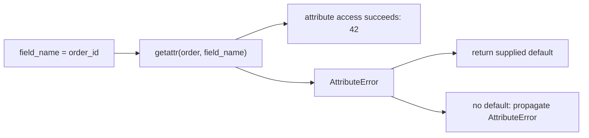

# Attributes and introspection

> **Role:** foundation. Read [classes and methods](classes_and_methods.md) first.
> Python 3.11+. Each Python block is an independent program.

A log formatter receives the field name `"order_id"` as data. Writing `order.field_name` would ask
for the literal attribute named `field_name`; it would not use the variable's contents. Python's
attribute tools let code inspect and access objects when the names are selected at runtime.
**Introspection** means examining a live object's structure or callable interface.

## Read a runtime-selected attribute with `getattr`

The built-in is `getattr`, without an underscore. Start by comparing three ways to read the order:

```python
class Order:
    def __init__(self):
        self.order_id = 42
        self.note = None

order = Order()
field_name = "order_id"
assert order.order_id == getattr(order, field_name) == 42
print(getattr(order, "note", "missing"))     # None
print(getattr(order, "tracking", "missing")) # missing

try:
    getattr(order, "tracking")
except AttributeError:
    print("tracking is absent")
```

`getattr(order, field_name)` performs attribute access using the string's value. With no third
argument, a missing attribute raises `AttributeError`, just like `order.tracking`. With a third
argument, it returns that default when lookup raises `AttributeError`. The default does not replace
a real `None`, empty string or zero.

This gives ordinary reads the following path; later sections explain why the lookup step can run
application code:



For `order_id`, the result is the stored integer. For `tracking`, the branch depends on whether the
caller supplied a default. `__getattr__` is different: it is a class hook used when normal attribute
lookup fails. You call the built-in `getattr`; a custom class may implement `__getattr__` to provide
fallback behavior. The [protocols lesson](protocols_and_descriptors.md) develops that hook.
See the [built-in reference](https://docs.python.org/3.11/library/functions.html#getattr).

An object attribute and a mapping key are separate interfaces:

```python
record = {"order_id": 42, "items": 3}
assert record["order_id"] == 42
assert record.get("tracking", "missing") == "missing"
assert record["items"] == 3
assert callable(getattr(record, "items"))  # the dictionary's items method
print(record["items"], list(record.items()))
# 3 [('order_id', 42), ('items', 3)]
```

`getattr(record, 'items')` asks about the dictionary object itself and finds its method. It does not
read the stored key. Choose `record[key]` or `record.get(key, default)` for mapping data; use attributes
for object interfaces. Similarly, `getattr(order, 'customer.name')` treats the dot as part of one
attribute name; it does not traverse two objects. Write explicit access steps when traversal matters.

## Preserve the difference between missing and explicitly empty

If `None` means “the customer cleared the note,” it cannot also be the fallback that means “no note
attribute exists.” The sentinel from the names lesson provides a distinct result:

```python
MISSING = object()

class Order:
    def __init__(self):
        self.note = None

order = Order()
value = getattr(order, "note", MISSING)
assert value is None
assert value is not MISSING
assert getattr(order, "tracking", MISSING) is MISSING
print("note exists and is explicitly None")
```

Check `value is MISSING`, not `if value`, when omission matters. Truth testing would also conflate
`0`, `False` and `''`. A sentinel default is useful at optional interfaces; repeatedly defaulting
required fields can hide spelling errors. If an order must have an ID, allowing
`getattr(order, 'oder_id', None)` to continue turns a local typo into a later missing-ID failure.
Use direct access for known required attributes so the failure occurs at the broken assumption.

## Write and remove attributes deliberately

`setattr(obj, name, value)` corresponds to an assignment using a dynamic name. `delattr(obj, name)`
corresponds to deletion. A regular user-defined object usually accepts new instance attributes:

```python
class Order:
    def __init__(self):
        self.note = None

order = Order()
setattr(order, "note", "leave at door")
assert order.note == "leave at door"
setattr(order, "tracking", "TRACK-42")
assert order.tracking == "TRACK-42"
delattr(order, "tracking")
assert not hasattr(order, "tracking")
print(order.note)                      # leave at door
```

These tools use the object's attribute machinery; a property setter or custom `__setattr__` can
validate or reject a write. Removing an instance attribute can reveal a class default again, as in
the preceding lesson. Deleting a name does not destroy an object that other references still retain.

Dynamic writes are appropriate for a known adapter interface. They are a poor default for applying
arbitrary input dictionaries: input keys could replace methods, internal state or fields that were
not intended to be writable. A small patch adapter makes its accepted names explicit:

```python
class Order:
    def __init__(self):
        self.note = None
        self.order_id = 42

def apply_patch(order, patch):
    allowed = {"note"}
    unknown = patch.keys() - allowed
    if unknown:
        raise ValueError(f"unsupported fields: {sorted(unknown)}")
    if "note" in patch:
        note = patch["note"]
        if note is not None and not isinstance(note, str):
            raise TypeError("note must be a string or None")
        setattr(order, "note", note)

order = Order()
apply_patch(order, {"note": "call first"})
assert order.note == "call first"
try:
    apply_patch(order, {"order_id": 99})
except ValueError:
    print("order_id is not writable through this adapter")
assert order.order_id == 42
```

This example owns both field names and allowed value types. For a larger external contract,
[Pydantic models](../data_models/pydantic/01_models_and_fields.md) can own structured input validation;
attribute assignment alone does not supply it.

## `hasattr` can execute the getter and hide an `AttributeError`

`hasattr(obj, name)` attempts attribute access and returns `False` if it raises `AttributeError`.
It is not a passive inspection of stored names. A property illustrates the consequence:

```python
class Order:
    @property
    def total_cents(self):
        print("getter ran")
        return sum(self._line_totals)  # deliberate bug: never initialized

order = Order()
print(hasattr(order, "total_cents"))                # getter ran; False
print(getattr(order, "total_cents", "unavailable")) # getter ran; unavailable
try:
    order.total_cents
except AttributeError as error:
    assert "_line_totals" in str(error)
    print("the getter failed on _line_totals")
```

The property is defined on the class. Its implementation fails while reading another attribute.
`hasattr` cannot tell that this was an internal bug rather than an absent `total_cents`, so it
returns `False`. The three-argument `getattr` masks the same `AttributeError` with a default.
Other exception types, such as `RuntimeError` or `ValueError`, propagate; these built-ins do not
catch every getter failure.

Avoid `if hasattr(obj, name): value = getattr(obj, name)` when reading the value is what you need.
It performs two accesses, so an expensive or changing getter can run twice. Read once and choose an
explicit missing-value policy. When diagnosing a broken getter, inspect the direct traceback and
fix its missing state rather than widening exception handling around it.

## Inspect definitions without evaluating descriptors

A debugger or documentation tool may need the property definition instead of its computed result.
`inspect.getattr_static` bypasses dynamic attribute lookup and descriptor execution:

```python
import inspect

class Order:
    @property
    def total_cents(self):
        raise RuntimeError("would fetch data")

order = Order()
definition = inspect.getattr_static(order, "total_cents")
assert isinstance(definition, property)
print(type(definition).__name__)       # property

try:
    getattr(order, "total_cents")
except RuntimeError:
    print("ordinary lookup executed the getter")
```

The result is a `property` object, not an integer. That is the point: static inspection answers what
is defined, while normal access asks the interface for its value. It may not find dynamically
synthesized attributes, and slotted or extension-type fields can return descriptor objects rather
than stored values. Do not substitute it blindly into business code that expects normal lookup.
The [inspect documentation](https://docs.python.org/3.11/library/inspect.html#fetching-attributes-statically)
states these limits.

## `vars`, `dir`, and slots show different views of an object

Many ordinary instances store their attributes in `obj.__dict__`. `vars(obj)` returns that mapping;
`vars(MyClass)` exposes the class namespace through a read-only mapping view. Neither is a complete
model of every possible attribute access. In particular, class attributes and computed properties
need not be entries in an instance dictionary.

```python
class Order:
    currency = "EUR"

    def __init__(self):
        self.order_id = 42

order = Order()
print(vars(order))                    # {'order_id': 42}
assert "currency" not in vars(order)
assert "currency" in dir(order)
assert vars(Order)["currency"] == "EUR"
```

`dir(obj)` is a discoverability aid: it lists names that are likely useful for the object, often
including inherited names. A class can customize it with `__dir__`. It is not a schema guarantee;
a name can have a getter that fails, and dynamic attributes may be missing from the list. Use a
library's documented model metadata for serialization, rather than serializing every name in `dir`.

A class can declare `__slots__` to reserve storage for selected attributes instead of giving each
instance a normal attribute dictionary:

```python
class CompactOrder:
    __slots__ = ("order_id", "note")

    def __init__(self):
        self.order_id = 42
        self.note = None

order = CompactOrder()
setattr(order, "note", "call first")
assert order.note == "call first"
try:
    order.tracking = "TRACK-42"
except AttributeError:
    print("tracking has no storage slot")
try:
    vars(order)
except TypeError:
    print("this instance has no __dict__")
```

Slots restrict new fields in this simple class, but do not make its declared fields immutable.
Inheritance matters: a base with an instance dictionary still supplies one, and a subclass normally
regains a dictionary unless it also declares slots. Slots can reduce per-instance storage for many
small objects, but are not input validation or a security boundary. Use `dataclasses.fields` for
dataclass field discovery, including slotted dataclasses; do not require every object to have
`__dict__`. The [data model](https://docs.python.org/3.11/reference/datamodel.html#slots) describes
these inheritance constraints.

## Inspect a callable's contract before trying a call

`type(obj)` returns its concrete type. `isinstance(obj, Order)` also accepts subclasses;
`issubclass(PriorityOrder, Order)` asks that relationship between classes. These answer a different
question from whether an object supports a particular behavior, which the next lesson explores.

```python
class Order:
    pass

class PriorityOrder(Order):
    pass

order = PriorityOrder()
assert type(order) is PriorityOrder
assert type(order) is not Order
assert isinstance(order, Order)
assert issubclass(PriorityOrder, Order)
print("a PriorityOrder is also an Order")
```

`inspect.signature` describes a callable's parameters. Its `bind` method checks argument binding
without running the function body:

```python
import inspect

def ship(order_id, /, *, express=False):
    raise RuntimeError("shipping must not run during inspection")

signature = inspect.signature(ship)
print(signature)                      # (order_id, /, *, express=False)
bound = signature.bind(42, express=True)
assert bound.arguments == {"order_id": 42, "express": True}
try:
    signature.bind(order_id=42)
except TypeError:
    print("signature rejected a keyword for the positional-only ID")
```

The syntax is the binding contract from the functions lesson. Binding can reject a wrong calling
shape; it does not validate arbitrary value types, check business rules or prove a real call will
succeed. Some built-ins cannot expose a signature, and callable objects can supply custom signature
metadata. Prefer a documented interface when one exists; introspection is a tool for exploration
and adaptation, not a replacement for a contract.

**Version bridge:** Python 3.14 defers annotation evaluation and adds `annotationlib`; Python
3.10–3.13 provide `inspect.get_annotations`. Frameworks may evaluate annotations to resolve types,
which can execute expressions. Inspect trusted application code, and do not treat introspection as
a sandbox for untrusted objects. See [annotation guidance](https://docs.python.org/3.14/howto/annotations.html)
and the [typing notes](../typing/typing.md) for the distinction between hints and runtime validation.

## Recap

- `getattr` uses a runtime attribute name; a dictionary key is a separate lookup operation.
- A default applies on `AttributeError`, not on `None` or other false-valued results.
- Attribute access and `hasattr` can run getters; static inspection returns definitions instead.
- `vars` shows a namespace and `dir` suggests names; neither is a universal serialization schema.
- Slots alter storage, while signatures describe argument binding; neither validates a whole model.

## Check yourself

**1. `getattr(order, 'note', None)` returns `None`. Can you conclude that the attribute is missing?**

<details><summary>Answer</summary>

No. A defined attribute can contain `None`, or its getter can return `None`. Use a distinct sentinel
when absence must differ from an explicit empty value. Even then, a getter's internal `AttributeError`
can be masked as absence, so optional lookup is not proof that the implementation is healthy.

</details>

**2. A debugger adds `hasattr(order, 'total_cents')` and a database query starts running twice.
What changed, and what should it use to inspect the property definition?**

<details><summary>Answer</summary>

`hasattr` performed real attribute access before the later read, running the getter each time.
For the definition, `inspect.getattr_static` avoids descriptor execution and returns the property
object. For the actual value, read once and reuse it instead of performing a separate existence check.

</details>

**3. A serializer uses `vars(obj)` successfully until an object becomes a slotted dataclass.
Does the failure mean its fields are inaccessible?**

<details><summary>Answer</summary>

No. Field values still support normal attribute access, but the object may have no instance dictionary.
Use the dataclass's documented field metadata and the desired serialization policy. Storage layout
and public attributes are distinct concerns; `vars` was an overly narrow assumption.

</details>

**Next:** [Dataclasses](../data_models/dataclasses.md) for ordinary value objects, or
[protocols and descriptors](protocols_and_descriptors.md) when reading framework internals.
