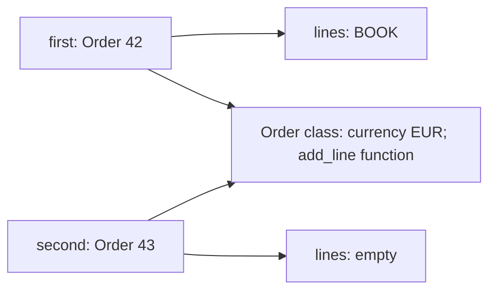

# Classes, methods, and shared behavior

> **Role:** foundation. Read [functions and scope](../language/functions_and_scope.md) first.
> Python 3.11+. Each Python block below is an independent program.

An order dictionary keeps values together. A class adds a place to define operations that use
those values. To read classes accurately, keep two owners separate: the **instance** owns one
order's state, while its **class** supplies behavior and shared defaults.

## Build two orders and follow their state

This class gives each order a new list while keeping the currency as a class attribute:

```python
class Order:
    currency = "EUR"

    def __init__(self, order_id):
        self.order_id = order_id
        self.lines = []

    def add_line(self, sku):
        self.lines.append(sku)

first = Order(42)
second = Order(43)
first.add_line("BOOK")
print(first.lines, second.lines)       # ['BOOK'] []
assert first.lines is not second.lines
assert first.currency == second.currency == "EUR"
```

Executing the `class` statement creates a class object and binds the name `Order` to it. Calling
`Order(42)` normally creates an instance and calls `__init__` to initialize it. `__init__` receives
that instance as its first argument; `self` is the conventional parameter name. Assigning
`self.lines = []` creates a new list each time initialization runs. `__init__` must return `None`,
usually implicitly. Allocation itself is handled by `__new__`; overriding allocation is a later,
specialist concern, not something ordinary data classes need.

The two order instances point to different lists and share the class that provides their method:



Sharing the function is useful; every instance uses the same operation with a different `self`.
Sharing a mutable list accidentally is different. If `lines = []` were placed directly in the class
body, a normal lookup from either instance would find that one class-owned list. Appending would
change it for both. The aliasing rule from the first lesson still applies; classes do not make
shared objects private.

## Reading a class default differs from assigning an instance value

For an ordinary attribute such as `currency`, Python first looks for an instance value, then for a
class value through the inheritance chain. Properties have different precedence, introduced later.
An assignment such as `first.currency = 'USD'` normally stores an instance attribute. It does not
change the class default:

```python
class Order:
    currency = "EUR"

first = Order()
second = Order()
first.currency = "USD"
Order.currency = "GBP"
print(first.currency, second.currency, Order.currency)  # USD GBP GBP
assert first.currency == "USD"
assert second.currency == "GBP"
del first.currency
assert first.currency == "GBP"
```

The lookup result changes because the instance either has or lacks its own binding:

| Step | `first` owns `currency`? | Class owns | `first.currency` | `second.currency` |
|---|---|---|---|---|
| Construct both | No | `EUR` | `EUR` | `EUR` |
| Assign on `first` | Yes: `USD` | `EUR` | `USD` | `EUR` |
| Assign on `Order` | Yes: `USD` | `GBP` | `USD` | `GBP` |
| Delete from `first` | No | `GBP` | `GBP` | `GBP` |

An instance value **shadows** the class value: it is found first for this ordinary attribute.
Deletion reveals the class value again. This is different from mutating a shared object found by
lookup. `first.tags.append(...)` reads an object then changes it; `first.tags = ...` writes an
instance binding. Use class attributes for intentional shared constants or behavior, and initialize
per-order mutable state on the instance. [Python's class tutorial](https://docs.python.org/3.11/tutorial/classes.html#class-and-instance-variables)
explains the distinction.

## A bound method carries its receiver

The `add_line` definition is a function stored on the class. Reading it through an instance creates
a **bound method**, an object that pairs the function with that instance:

```python
class Order:
    def __init__(self, order_id):
        self.order_id = order_id
        self.lines = []

    def add_line(self, sku):
        self.lines.append(sku)

order = Order(42)
callback = order.add_line
assert callback.__self__ is order
assert callback.__func__ is Order.add_line
callback("BOOK")
Order.add_line(order, "PEN")
print(order.lines)                     # ['BOOK', 'PEN']
assert order.lines == ["BOOK", "PEN"]
```

`callback('BOOK')` supplies the stored instance automatically. Calling `Order.add_line(order, 'PEN')`
supplies it explicitly. Both reach the same function with two arguments: an order and a SKU.
`self` is not a keyword and the function does not search for the current object globally.

This explains the familiar `TypeError` after forgetting `self`: method binding still supplies the
instance, so a definition with too few parameters receives too many arguments. It also explains why
a stored bound callback can keep an object alive: the callback retains its receiver. If an event
registry outlives a request, registering a request object's bound method can retain the whole request.
Use an explicit lifetime and unregister callbacks when the owner no longer needs them.

## Class methods construct a type; static methods receive no implicit argument

An alternative constructor needs the class being constructed, including a subclass. A helper that
uses neither instance state nor class identity needs no implicit argument. Python expresses these
choices with `@classmethod` and `@staticmethod`:

```python
class Order:
    def __init__(self, order_id):
        self.order_id = order_id

    @classmethod
    def from_text(cls, raw):
        return cls(int(raw))

    @staticmethod
    def normalize_sku(raw):
        return raw.strip().upper()

class PriorityOrder(Order):
    pass

order = PriorityOrder.from_text("42")
print(type(order).__name__, order.order_id)   # PriorityOrder 42
assert isinstance(order, PriorityOrder)
assert Order.normalize_sku(" book ") == "BOOK"
```

`@classmethod` changes binding so `cls` receives `PriorityOrder` in this call. Returning `cls(...)`
preserves the requested class; hard-coding `Order(...)` would always return the base class. `cls`,
like `self`, is a convention rather than a reserved word. `@staticmethod` disables the usual receiver
binding, so only the explicitly supplied `raw` argument is passed.

The `@` syntax transforms the function after its definition. You can use these two built-in forms
without yet implementing a decorator; [decorators](../language/decorators.md) teaches the general
transformation. A plain module-level helper is often clearer than a static method when the helper
has no useful relationship to the class. Keep the class namespace for meaningful operations, not
as a mandatory container for every function.

## A property keeps attribute syntax while computing a value

An order's total depends on its current lines. Storing both lines and total would require every
mutation to update both correctly. A property computes the total when it is read:

```python
class Order:
    def __init__(self):
        self.line_totals = [1200, 300]  # integer cents

    @property
    def total_cents(self):
        return sum(self.line_totals)

order = Order()
assert order.total_cents == 1500
order.line_totals.append(200)
print(order.total_cents)               # 1700
try:
    order.total_cents = 999
except AttributeError:
    print("total_cents has no setter")
```

There are no parentheses at the read site, but the getter function runs. That prevents a stale
stored total while keeping the public API `order.total_cents`. A property without a setter rejects
assignment; it does not make the whole object immutable. The list still changed successfully.
A property can also define a setter to validate assignments, but for this derived total there is no
independent value to set.

Attribute-looking syntax therefore does not guarantee cheap or side-effect-free work. A database
library may use it to load related rows. In application classes, keep properties predictable and
prefer explicit methods for expensive I/O or operations with important side effects. The next
lesson explores what dynamic lookup does with properties; the later descriptor lesson explains
how the mechanism works.

## Inheritance reuses a contract; `super()` follows the actual method order

A subclass can override one part of a base class's behavior. Python resolves methods through the
**method resolution order**, or **MRO**, an ordered sequence of classes. `super()` continues lookup
after the class where the current method was defined, in the actual receiver's MRO. With single
inheritance this usually looks like “call the parent”; multiple inheritance shows why that phrase
is incomplete.

This independent example deliberately makes every implementation cooperate with the next one:

```python
class BaseOrder:
    def route(self):
        return ["base"]

class AuditedOrder(BaseOrder):
    def route(self):
        return ["audit"] + super().route()

class TrackedOrder(BaseOrder):
    def route(self):
        return ["track"] + super().route()

class PriorityOrder(AuditedOrder, TrackedOrder):
    pass

order = PriorityOrder()
print([cls.__name__ for cls in PriorityOrder.__mro__])
# ['PriorityOrder', 'AuditedOrder', 'TrackedOrder', 'BaseOrder', 'object']
print(order.route())                   # ['audit', 'track', 'base']
assert order.route() == ["audit", "track", "base"]
```

Look at the actual lookup chain rather than the diagram of declared parents:


`AuditedOrder` names only `BaseOrder` as its direct parent, yet its `super().route()` reaches
`TrackedOrder` for this receiver. Python uses the complete MRO so shared ancestors are placed
consistently. If `AuditedOrder` directly called `BaseOrder.route(self)`, it would skip the tracking
step. If it omitted the call altogether, the cooperative chain would stop at audit.

When reading a framework mixin (a small class intended to add one behavior), inspect `type(obj).__mro__`
and check whether overrides call `super()` with compatible arguments. Do not add multiple inheritance
merely to reuse a helper; it couples method names and initialization conventions across classes.
The official [`super` reference](https://docs.python.org/3.11/library/functions.html#super) describes
this cooperative lookup contract.

## Composition gives a collaborator an explicit place

A shipping policy may change independently of what an order is. Instead of creating a new order
subclass for every policy, give the order a collaborator and call its operation:

```python
class FixedShipping:
    def __init__(self, cents):
        self.cents = cents

    def quote(self, subtotal):
        return self.cents

class Order:
    def __init__(self, subtotal, shipping):
        self.subtotal = subtotal
        self.shipping = shipping

    def total(self):
        return self.subtotal + self.shipping.quote(self.subtotal)

standard = Order(1500, FixedShipping(300))
express = Order(1500, FixedShipping(700))
print(standard.total(), express.total())  # 1800 2200
assert standard.total() == 1800
assert express.total() == 2200
```

This is **composition**: an order has a shipping policy, rather than being a kind of shipping policy.
The policy object owns its configuration; the order delegates the calculation. An instance can be
assembled with a different policy without changing its class hierarchy. Later, a structural
[`Protocol`](../typing/typing.md#7-protocol--structural-typing-duck-typing-for-type-checkers) can describe
the expected `quote` method for a type checker. Runtime dispatch here already works through ordinary
method calls.

Inheritance is useful when callers should treat the subclass as a specialized form of the base
contract. Composition is useful when a collaborator has its own variation or lifecycle. Neither
choice automatically makes mutable collaborators independent: two orders given the same policy
object still share it. Return to the ownership question before adding caching or mutation.

## Recap

- Classes supply shared behavior; instances should own their separate mutable state.
- An ordinary instance attribute can shadow a class default without changing the class.
- A bound method pairs a function with a receiver; `classmethod` binds a class and `staticmethod` does not bind one.
- A property runs code behind attribute syntax; a missing setter limits assignment, not all mutation.
- `super()` follows the receiver's MRO; composition makes an independently varying collaborator explicit.

## Check yourself

**1. A class defines `tags = []`. Two instances append a different tag through `self.tags`. Why do
both instances show both tags, and where should the list be created?**

<details><summary>Answer</summary>

Neither instance owns a `tags` attribute, so both reads reach the class's one list. Appending mutates
that shared object. Create `self.tags = []` in `__init__` to allocate a different list for each
initialization. Assigning a class list to `self.tags` would preserve the alias and would not fix it.

</details>

**2. `PriorityOrder.from_text` uses `return Order(int(raw))`. Which class does it return, and why does
`return cls(int(raw))` change that?**

<details><summary>Answer</summary>

The hard-coded call constructs `Order`, regardless of which class accessed the class method. Binding
supplies the actual class as `cls`, so constructing `cls` preserves `PriorityOrder` for this call.
That assumes the subclass supports the constructor contract used by the inherited factory.

</details>

**3. Swap the bases to `PriorityOrder(TrackedOrder, AuditedOrder)` in the cooperative example. What
result do you expect, and what breaks if tracking directly calls `BaseOrder.route(self)`?**

<details><summary>Answer</summary>

The MRO puts tracking before auditing, producing `['track', 'audit', 'base']`. A direct base call
skips the intervening audited implementation, giving `['track', 'base']`. `super()` expresses
continuation along the receiver's order; a named base call expresses a specific destination.

</details>

**Next:** [Attributes and introspection](attributes_and_introspection.md). For objects primarily
storing values, continue afterward to [dataclasses](../data_models/dataclasses.md).
