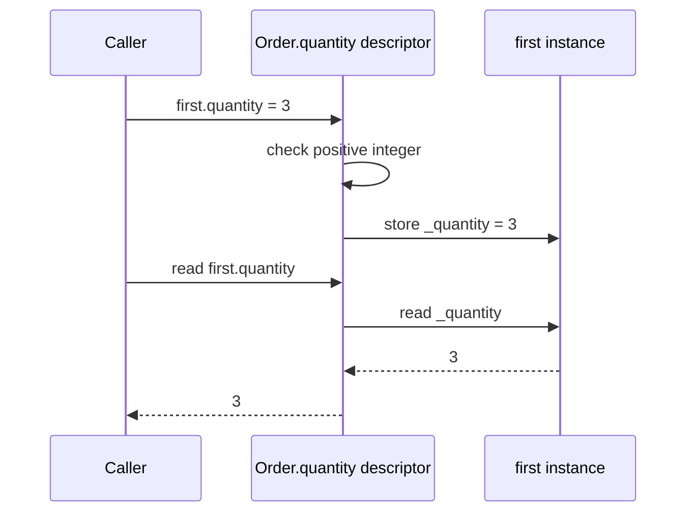
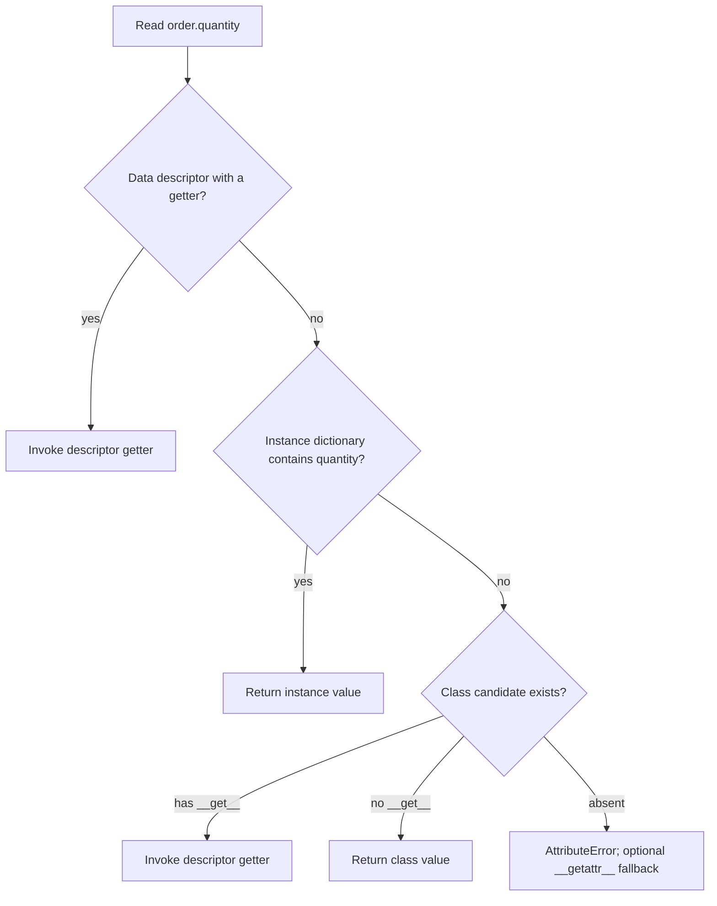

# Protocols, descriptors, and class hooks

> **Role:** deep dive. Read [attributes and introspection](attributes_and_introspection.md) first.
> Python 3.11+. Each Python block is an independent program. This lesson explains mechanisms
> encountered in library code; ordinary applications rarely need to implement every hook.

Python's familiar syntax asks objects to perform operations: `len(batch)`, `batch[0]`, `sku in batch`,
or `formatter(order)`. A **protocol** is the set of operations and behavioral rules expected for a
purpose. An object can support a protocol by implementing its methods, without inheriting from a
particular application base class.

## Special methods connect ordinary syntax to an object

Methods with double underscores on both sides, often called **dunder methods**, connect a class
to Python operations. The names are defined by Python; inventing `__whatever__` does not add syntax.
This batch stores an immutable tuple of SKU strings and exposes a small sequence-like interface:

```python
class Batch:
    def __init__(self, skus):
        self._skus = tuple(skus)

    def __repr__(self):
        return f"Batch({self._skus!r})"

    def __str__(self):
        return f"batch of {len(self)} SKUs"

    def __len__(self):
        return len(self._skus)

    def __getitem__(self, index):
        return self._skus[index]

    def __contains__(self, sku):
        return sku in self._skus

batch = Batch(["BOOK", "PEN"])
print(repr(batch))                     # Batch(('BOOK', 'PEN'))
print(str(batch))                      # batch of 2 SKUs
print(len(batch), batch[0], batch[:1])  # 2 BOOK ('BOOK',)
assert "PEN" in batch
assert bool(batch)
assert not Batch([])
```

`repr` is a diagnostic representation; it should identify the useful state without exposing secrets.
The `!r` in the f-string formats the tuple using its `repr`. `str` is a human-facing representation;
if a class lacks `__str__`, the inherited behavior uses its representation. Both methods must return
strings. A representation that looks like a constructor is convenient, but not required.

`len` calls the length implementation and requires a nonnegative integer. Indexing passes either an
integer or a `slice` object to `__getitem__`; delegating to the tuple preserves its bounds checks and
slice behavior. This example deliberately returns a tuple for a slice. A different batch API might
return another `Batch`, but callers must be able to predict that choice.

The visible expression and delegated operation line up as follows:

| Expression | Hook used here | Result or failure |
|---|---|---|
| `len(batch)` | `Batch.__len__` | `2` |
| `batch[0]` | `Batch.__getitem__` | `'BOOK'` |
| `batch[99]` | `Batch.__getitem__` delegates to tuple | `IndexError` |
| `'PEN' in batch` | `Batch.__contains__` | `True` |
| `bool(batch)` | No `__bool__`; falls back to length | `True` |
| `bool(Batch([]))` | Length is zero | `False` |

Truth testing first uses `__bool__` when present, then `__len__`; otherwise ordinary objects are
truthy. A custom `__bool__` must return a real boolean. It can express a different contract from
emptiness, but doing so should be obvious to callers:

```python
class Submission:
    def __init__(self, accepted):
        self.accepted = accepted

    def __bool__(self):
        return self.accepted

assert bool(Submission(True)) is True
assert bool(Submission(False)) is False
print("truth follows the acceptance flag")
```

This class assumes its internal `accepted` value is a boolean. Passing another type would violate
the hook contract; a public constructor should validate it if callers are not already trusted.
Often `if submission.accepted` is clearer than making the whole object mean success. Implement a
protocol when it expresses a stable interface, not merely because a hook is available.

## Implicit special-method lookup usually happens on the type

Ordinary attribute access can find a function assigned to one instance. Python's implicit lookup
for operations such as `len` bypasses that instance attribute and looks on the type:

```python
class Batch:
    def __len__(self):
        return 2

batch = Batch()
batch.__len__ = lambda: 99
assert batch.__len__() == 99
assert len(batch) == 2
print(batch.__len__(), len(batch))     # 99 2
```

This is why writing `len(x)` as “exactly `x.__len__()`” is an incomplete mental model. The expressions
can differ after instance-level customization. Put protocol methods on the class, and use the
normal operation at call sites. Python documents the lookup bypass under
[special method lookup](https://docs.python.org/3.11/reference/datamodel.html#special-method-lookup).
The same principle explains why a proxy that forwards ordinary attributes does not automatically
forward every operator.

Iteration has its own `__iter__`/`__next__` contract, and context management has `__enter__`/`__exit__`.
Their state and failure behavior are developed in [iterators and generators](../control_flow/iterators_and_generators.md)
and [context managers](../control_flow/context_managers.md). Supporting indexing alone does not
promise every sequence API; implement and document the capabilities callers actually use.

## Callable instances retain configuration without a closure

A callable object implements `__call__` on its class. It can carry inspectable state alongside the
operation, such as an order-label prefix:

```python
class Labeler:
    def __init__(self, prefix):
        self.prefix = prefix

    def __call__(self, order_id):
        return f"{self.prefix}:{order_id}"

label = Labeler("order")
assert callable(label)
print(label(42))                       # order:42
assert label(43) == "order:43"
```

`label(42)` dispatches to the class's call hook with `label` as `self`. It serves the same purpose as
the closure in the functions lesson, but stores configuration on an explicit instance. Use a function
or closure when that is simpler. A class is useful when callers need additional operations or a
clear state object. `callable(x)` reports whether calling is supported in principle; it does not
promise a particular argument list or guarantee the call succeeds.

## Equality and hashing must agree for the lifetime of a key

An order identifier consists of a tenant and a number. Different instances with the same components
should compare equal. Define `__eq__` for that value contract. Return `NotImplemented` when the other
type is outside the comparison you know how to perform; this lets Python try its comparison rules
rather than pretending every unknown type is definitely unequal.

A dictionary uses both hashing and equality. Equal keys must have equal hashes, and a key's hash
must remain stable while it is used. This read-only public interface derives both operations from
the same tuple of immutable components:

```python
class OrderKey:
    __slots__ = ("_parts",)

    def __init__(self, tenant, number):
        if not isinstance(tenant, str) or type(number) is not int:
            raise TypeError("expected a string tenant and integer number")
        self._parts = (tenant, number)

    @property
    def tenant(self):
        return self._parts[0]

    @property
    def number(self):
        return self._parts[1]

    def __eq__(self, other):
        if type(other) is not type(self):
            return NotImplemented
        return self._parts == other._parts

    def __hash__(self):
        return hash(self._parts)

first = OrderKey("tenant-a", 42)
second = OrderKey("tenant-a", 42)
assert first is not second and first == second
assert hash(first) == hash(second)
orders = {first: "paid"}
print(orders[second])                  # paid
assert first.__eq__(42) is NotImplemented
```

The second key can retrieve the first key's entry because the hashes agree and equality identifies
the same value. Python does not require different values to have different hashes; collisions are
resolved through equality. Never persist `hash(key)` as a stable external identifier: hash behavior
can vary between processes and implementations.

The underscore marks `_parts` as internal, not inaccessible. Reassigning it would violate this
class's read-only API and break the hash contract. For ordinary value classes, prefer the generated
behavior of a [frozen dataclass](../data_models/dataclasses.md), or a tuple-based record, rather than
hand-writing these methods. Even frozen objects require their equality components to be suitably
immutable.

A mutable value object that changes fields used in equality should normally be unhashable. Python
helps: defining `__eq__` without `__hash__` sets the class's hash hook to `None`:

```python
class DraftOrder:
    def __init__(self, number):
        self.number = number

    def __eq__(self, other):
        if type(other) is not type(self):
            return NotImplemented
        return self.number == other.number

order = DraftOrder(42)
assert order == DraftOrder(42)
assert DraftOrder.__hash__ is None
try:
    hash(order)
except TypeError:
    print("mutable value equality has no hash contract")
```

Restoring identity hashing while retaining value equality would be wrong: two equal objects could
have different hashes. Changing a hash-relevant field after insertion can make a dictionary fail to
find its own stored key because lookup searches using the new hash. Repair the ownership model;
`unsafe_hash=True` on a dataclass does not make mutation safe. See the
[equality and hashing contract](https://docs.python.org/3.11/reference/datamodel.html#object.__hash__).

## Descriptors give a class attribute control over instance access

A **descriptor** is an object whose type defines `__get__`, `__set__`, or `__delete__`. When such an
object is stored on a class, ordinary attribute access can invoke those methods. Properties and
method binding use this mechanism. A descriptor stored only in an instance dictionary does not
receive this automatic treatment.

Suppose several model fields need the same positive-integer check. The descriptor owns the access
policy; each order must still own its own quantity. This example stores the value under a separate
instance attribute and learns that name when the class is created:

```python
class PositiveInteger:
    def __set_name__(self, owner, name):
        self.storage_name = "_" + name

    def __get__(self, instance, owner=None):
        if instance is None:
            return self
        return getattr(instance, self.storage_name)

    def __set__(self, instance, value):
        if type(value) is not int or value <= 0:
            raise ValueError("quantity must be a positive integer")
        setattr(instance, self.storage_name, value)

class Order:
    quantity = PositiveInteger()

    def __init__(self, quantity):
        self.quantity = quantity

first = Order(2)
second = Order(5)
first.quantity = 3
assert first.quantity == 3 and second.quantity == 5
assert vars(first) == {"_quantity": 3}
assert isinstance(Order.quantity, PositiveInteger)
print(first.quantity, second.quantity) # 3 5
try:
    first.quantity = 0
except ValueError:
    print("rejected without replacing quantity")
assert first.quantity == 3
```

At class creation, Python calls `__set_name__(Order, 'quantity')`, so the descriptor remembers
`'_quantity'`. During initialization, `self.quantity = quantity` invokes `__set__`; it validates
before storing. A later read invokes `__get__` with the instance. Reading `Order.quantity` instead
passes `None` as the instance; returning the descriptor itself makes class-level inspection useful.

Follow a write and a subsequent read for the same order:



There is one descriptor on the class, but the value lives on `first`. Storing `self.value = value`
inside the descriptor would put every order's value on the shared descriptor instead, recreating the
shared-state bug from the first chapter. The example uses `'_quantity'` internally to avoid calling
the same descriptor recursively. An attribute that is not initialized still raises `AttributeError`;
the descriptor does not manufacture a default.

For one field, a property is often simpler. Use a reusable descriptor when the same attribute policy
belongs on many classes or fields. ORM fields use related machinery, but this small descriptor is
not an ORM: it has no persistence, transactions or query loading. The official
[descriptor guide](https://docs.python.org/3.11/howto/descriptor.html) develops those access rules.

## Lookup precedence explains properties, methods and cached properties

A descriptor defining `__set__` or `__delete__` is a **data descriptor**. A descriptor that only
provides read behavior through `__get__` is a **non-data descriptor**. These categories determine
whether an instance dictionary can shadow it.

Under ordinary instance lookup, Python first finds the class attribute through the MRO, then applies
these precedence rules:



A data descriptor with a getter wins over a same-named dictionary entry. A non-data descriptor can be shadowed.
A descriptor defining only `__set__` or `__delete__`, without `__get__`, does not have a read
operation to invoke: reading falls through to instance storage or returns the class candidate.
A property is a data descriptor even without a user-supplied setter: its assignment path raises
`AttributeError`. Functions stored on classes are non-data descriptors; their `__get__` constructs
the bound method explained earlier.

This controlled collision shows the precedence rather than relying on the names alone:

```python
class Hint:
    def __get__(self, instance, owner=None):
        return "class hint"

class Order:
    hint = Hint()

    @property
    def total_cents(self):
        return 1500

order = Order()
order.__dict__["hint"] = "instance hint"
order.__dict__["total_cents"] = 999
assert order.hint == "instance hint"
assert order.total_cents == 1500
print(order.hint, order.total_cents)    # instance hint 1500
```

Writing directly to `__dict__` here is a diagnostic demonstration, not how to set validated fields.
It bypasses ordinary assignment hooks. The property still wins on reading because its policy has
higher precedence than that dictionary entry.

`functools.cached_property` uses the other precedence deliberately. Its first read computes a value
and writes it into the instance dictionary under the property name. Later reads find that value
first, avoiding another computation:

```python
from functools import cached_property

class Order:
    def __init__(self):
        self.line_totals = [1200, 300]

    @cached_property
    def total_cents(self):
        print("computed")
        return sum(self.line_totals)

order = Order()
assert order.total_cents == 1500        # prints computed
order.line_totals.append(200)
assert order.total_cents == 1500        # cached result is stale
assert vars(order)["total_cents"] == 1500
del order.total_cents
assert order.total_cents == 1700        # prints computed again
print(order.total_cents)               # 1700
```

The cache does not watch dependencies; mutating `line_totals` does not invalidate it. Use a normal
property when the current state must always be reflected, or define a reliable invalidation policy.
A normal `cached_property` also needs an instance dictionary, so a slots-only class needs a different
cache design. Python 3.12 removed its internal getter lock; do not rely on exactly one computation
under concurrent access. The [functools reference](https://docs.python.org/3.14/library/functools.html#functools.cached_property)
documents that version change.

## `__getattr__` supplies a fallback; `__getattribute__` controls the main lookup

`__getattr__` runs only after the main lookup raises `AttributeError`. It is useful for a narrowly
specified compatibility alias or lazy interface. It must raise `AttributeError` for names it does
not support, so misspellings and introspection still behave correctly:

```python
class Order:
    def __init__(self):
        self.order_id = 42

    def __getattr__(self, name):
        if name == "legacy_id":
            return self.order_id
        raise AttributeError(name)

order = Order()
assert order.order_id == order.legacy_id == 42
assert getattr(order, "unknown", "missing") == "missing"
assert not hasattr(order, "unknown")
print(order.legacy_id)                 # 42
```

Returning `None` for every unknown name would make `hasattr` report that arbitrary attributes exist,
masking bugs. Also remember the previous lesson's property failure: an `AttributeError` raised
inside a getter can trigger this fallback too. Keep fallback names narrow and do not use it to hide
an unhealthy object's state.

`__getattribute__` participates in the main access path, including reads of attributes that exist.
Overriding it is rarely needed in application code. If you encounter it in a proxy or tracing class,
look for delegation to the normal implementation:

```python
class TracedOrder:
    def __init__(self):
        self.order_id = 42

    def __getattribute__(self, name):
        if name == "order_id":
            print("reading order_id")
        return object.__getattribute__(self, name)

order = TracedOrder()
assert order.order_id == 42            # reading order_id
```

Using `self.order_id` inside this override would invoke the same override again. Using
`self.__dict__` to implement every read has the same recursion problem unless obtained through an
appropriate base operation, and it would also bypass descriptors, inheritance and binding if treated
as a complete replacement. Delegate rather than rebuilding Python's lookup casually.
Calling `object.__getattribute__` directly does not itself call `__getattr__`; the normal dot/getattr
machinery supplies the fallback after an `AttributeError`.

## Class creation hooks explain registration before any instance exists

Libraries sometimes collect subclasses automatically. `__init_subclass__` runs when a subclass is
created, not each time an instance is constructed. Its first argument is the new subclass; Python
provides class-method behavior automatically for this hook:

```python
class Exporter:
    registry = {}

    def __init_subclass__(cls, *, format_name, **kwargs):
        super().__init_subclass__(**kwargs)
        if format_name in Exporter.registry:
            raise ValueError(f"duplicate format: {format_name}")
        Exporter.registry[format_name] = cls

class JsonExporter(Exporter, format_name="json"):
    pass

assert Exporter.registry["json"] is JsonExporter
assert type(JsonExporter) is type
print(sorted(Exporter.registry))       # ['json']
```

The hook consumes its own `format_name` option and passes remaining class keywords along the
cooperative chain. The registry is intentionally class-shared state; a duplicate is rejected rather
than silently replacing a handler. No exporter instance exists when registration happens. If a
plugin's module is never imported, its class body never runs and its registry entry never appears;
[modules and imports](../language/modules_and_imports.md) explains that execution boundary.

Registration happens before the new class name is bound in the surrounding module. Follow the
actual example's class-creation path:


The registry receives the newly created class object during the subclass hook; it does not need
the module's `JsonExporter` name to be bound yet. With ordinary class creation, descriptor name
hooks run before the parent's subclass hook; class decorators run afterward. This ordering helps when reading a framework that collects field objects
and then registers the resulting class. `__set_name__` is automatic for attributes present at class
creation, not for descriptors attached later with assignment.

A **metaclass** is the class of a class. Ordinary classes have `type` as their metaclass, as the
assertion above shows; ordinary instances have the application class as their type. Syntax such as
`class Model(metaclass=ModelMeta)` asks a metaclass to customize class creation. Frameworks can inherit
that choice through a base class, so the keyword need not appear on every model. This is a recognition
boundary: use a class decorator or `__init_subclass__` for a simple customization before considering
a metaclass, and consult the [class creation reference](https://docs.python.org/3.11/reference/datamodel.html#customizing-class-creation)
when implementing a framework. Metaclass authoring is outside this lesson's scope.

## Recap

- Python operations dispatch through class-defined special methods with concrete return contracts.
- Equality and hashing describe the same stable value; mutable value equality normally means unhashable objects.
- Descriptors keep access policy on a class while storing per-instance values separately.
- Lookup precedence lets properties override instance dictionary entries and lets cached properties be shadowed.
- Fallback access and class creation hooks run at specific times; identify that timing before reasoning about framework side effects.

## Check yourself

**1. An instance has `obj.__len__ = lambda: 10`, but `len(obj)` still reports the old class-defined
length. Is the assignment ignored?**

<details><summary>Answer</summary>

No. Ordinary `obj.__len__()` can find the instance attribute. Implicit special-method lookup for
`len(obj)` uses the type's implementation instead. Put supported protocol behavior on the class;
instance attribute assignment is not a general operator override mechanism.

</details>

**2. A descriptor's setter writes `self.value = value`. The last order's quantity appears on every
order. Where is the incorrect owner, and how should the value be stored?**

<details><summary>Answer</summary>

`self` is the shared descriptor object on the class. Every order uses that same descriptor, so each
write replaces shared state. Store the value on the `instance` passed to the setter, under a separate
private storage name learned through `__set_name__`. The descriptor owns policy, not each order's data.

</details>

**3. A cached property depends on a mutable list. Can changing it into a read-only property fix stale
reads without making the list immutable?**

<details><summary>Answer</summary>

Yes. A normal property recomputes on each read, so it sees the current list. Read-only means there is
no property setter; it does not prevent list mutation. The trade-off is repeated computation. A cache
needs explicit invalidation or stable dependencies to preserve the same result contract.

</details>

**4. An exporter registry is empty before a plugin module is imported. Will constructing another
instance of an already registered exporter discover that plugin?**

<details><summary>Answer</summary>

No. The hook runs when a subclass is created by executing its class statement. Constructing existing
instances does not execute missing modules or create their classes. Import/discovery wiring must
load the plugin module before its registration can occur.

</details>

**Continue:** [Decorators](../language/decorators.md) connects binding and descriptors to wrappers,
registration and decorated methods. Return to [the object index](README.md) to choose a shorter path.
