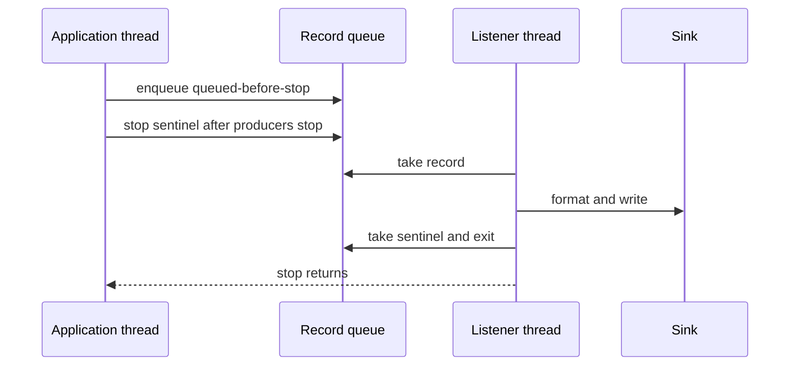

# Handlers, Formatters, Filters, and Queues

> **Who this is for**: Python developers who understand logger names and need to
> route records to consoles, files, or background logging threads without
> blocking async code or losing important context.

> **Key insight**: Loggers name events, handlers own destinations, formatters render records, and queues move destination work off latency-sensitive threads.

A logger expresses an event. A handler owns a destination. A formatter owns its
presentation. A filter applies policy that levels alone cannot express.

---

## 1. The Complete Record Pipeline

```text
logger.info("order completed", extra={...})
       │
       ├── originating logger effective level + filters
       │
       ▼
   LogRecord
       │
       ├── handler A level + filters ──► formatter A ──► stdout
       ├── handler B level + filters ──► formatter B ──► errors.log
       └── propagate to ancestor handlers
```

A record can reach multiple handlers. Each handler independently decides whether
to emit it and how to format it.

| Component | Primary question |
|-----------|------------------|
| Logger | Is this call enabled, and where does it enter the hierarchy? |
| `LogRecord` | What happened and where did the call originate? |
| Handler | Which destination receives it? |
| Handler level/filter | Does this destination want it? |
| Formatter | How is it rendered? |

---

## 2. `LogRecord` Carries the Event

Python creates a `LogRecord` after the originating logger admits the call.
Common attributes include:

| Attribute | Format key | Example |
|-----------|------------|---------|
| Final message | `%(message)s` | `order 1042 completed` |
| Original template | `%(msg)s` | `order %s completed` |
| Logger name | `%(name)s` | `myapp.orders.service` |
| Level | `%(levelname)s` | `INFO` |
| Time | `%(asctime)s` | Formatter-generated timestamp |
| Function | `%(funcName)s` | `complete_order` |
| Source line | `%(lineno)d` | `87` |
| Process | `%(process)d` | OS process ID |
| Thread | `%(threadName)s` | `MainThread` |

Add application context with `extra`:

```python
logger.info(
    "order completed",
    extra={"order_id": "ord-1042", "tenant_id": "tenant-7"},
)
```

`extra` keys become attributes on the record. They must not overwrite reserved
attributes such as `name`, `message`, or `levelname`; doing so raises `KeyError`.
Every formatter that references a custom key must receive that key on every
record, or formatting fails. This fragility is one reason structured logging
libraries use a dedicated event dictionary.

---

## 3. Formatters Render a Record

```python
import logging

formatter = logging.Formatter(
    fmt="%(asctime)s %(levelname)s %(name)s %(message)s",
    datefmt="%Y-%m-%dT%H:%M:%S",
)

handler = logging.StreamHandler()
handler.setFormatter(formatter)
```

Useful text formats:

```python
# Compact local output
"%(levelname)s %(name)s %(message)s"

# General service output
"%(asctime)s %(levelname)s %(name)s %(message)s"

# Diagnostic call-site output
"%(asctime)s %(levelname)s %(name)s %(filename)s:%(lineno)d %(message)s"
```

A formatter does not select levels or destinations. It receives a record that
has already passed those decisions.

For machine ingestion, one JSON object per line is preferable to a hand-parsed
text format. A robust JSON formatter must handle custom fields, exceptions,
timestamps, and non-JSON values. Prefer the
[structlog guide](structlog_guide.md) or another maintained formatter instead
of growing a custom serializer unnoticed.

---

## 4. Stream and File Handlers

### `StreamHandler`

```python
import logging
import sys

console = logging.StreamHandler(sys.stdout)
console.setLevel(logging.INFO)
console.setFormatter(formatter)
```

With no argument, `StreamHandler()` uses `sys.stderr`. The separation matters
for command-line tools:

```bash
python export.py > records.json        # stdout data goes to the file
python export.py 2> export.log         # stderr logs go to another file
```

Container platforms often collect both streams, but may label or route them
differently. Choose deliberately.

### `FileHandler`

```python
file_handler = logging.FileHandler(
    "app.log",
    mode="a",
    encoding="utf-8",
)
file_handler.setFormatter(formatter)
```

The parent directory must already exist. Relative paths are resolved from the
process working directory, which may differ between a shell, systemd, tests, and
a container.

### Rotating handlers

```python
from logging.handlers import RotatingFileHandler, TimedRotatingFileHandler

size_rotated = RotatingFileHandler(
    "app.log",
    maxBytes=5_000_000,
    backupCount=5,
    encoding="utf-8",
)

daily = TimedRotatingFileHandler(
    "app.log",
    when="midnight",
    backupCount=7,
    encoding="utf-8",
    utc=True,
)
```

Standard rotating file handlers are designed around one process owning the file.
Multiple worker processes can race during rollover. Prefer platform collection,
one file per process, an external rotation strategy compatible with the handler,
or a dedicated log collector.

---

## 5. Buffering: What Logging Actually Flushes

Python's standard streams can be line-buffered or block-buffered depending on
whether they are interactive and how Python was started. `PYTHONUNBUFFERED=1`
(or `python -u`) changes stdout/stderr buffering for direct writes and `print()`.

However, `logging.StreamHandler.emit()` writes the formatted record and then
calls `flush()`. Ordinary one-record-per-call logging is therefore already
flushed by the handler. `PYTHONUNBUFFERED=1` is still a reasonable container
setting when the process also uses `print()` or direct stream writes, but it is
not the mechanism that makes `StreamHandler` flush each record.

Nothing can flush Python buffers after `SIGKILL`, a node loss, or a runtime
crash. Do not treat stream settings as a durability guarantee.

---

## 6. Handler Levels and Filters Route Records

Set a permissive logger level, then let each handler select its threshold:

```python
import logging

root = logging.getLogger()
root.setLevel(logging.DEBUG)

console = logging.StreamHandler()
console.setLevel(logging.INFO)

errors = logging.FileHandler("errors.log", encoding="utf-8")
errors.setLevel(logging.ERROR)

root.addHandler(console)
root.addHandler(errors)
```

Result:

| Record | Console | `errors.log` |
|--------|---------|--------------|
| `DEBUG` | No | No |
| `INFO` | Yes | No |
| `ERROR` | Yes | Yes |

A filter handles policy not expressible as a severity threshold:

```python
import logging


class ExcludeHealthChecks(logging.Filter):
    def filter(self, record: logging.LogRecord) -> bool:
        return getattr(record, "path", None) != "/health"


console.addFilter(ExcludeHealthChecks())
```

The filter returns truthy to keep the record and falsy to drop it for that
handler. Filtering health checks at the console does not remove them from other
handlers.

---

## 7. Async Applications Need a Queue for Slow Handlers

Logging calls are synchronous. A slow file, socket, email, or HTTP handler inside
`async def` blocks the event-loop thread.

`QueueHandler` makes the request path enqueue records; `QueueListener` runs the
slow handlers on a dedicated thread:

```python
import logging
import queue
from logging.handlers import QueueHandler, QueueListener


def start_logging_listener() -> QueueListener:
    records: queue.SimpleQueue[logging.LogRecord] = queue.SimpleQueue()

    console = logging.StreamHandler()
    console.setLevel(logging.INFO)
    console.setFormatter(
        logging.Formatter("%(asctime)s %(levelname)s %(name)s %(message)s")
    )

    root = logging.getLogger()
    root.setLevel(logging.INFO)
    for existing in root.handlers[:]:
        root.removeHandler(existing)
        existing.close()
    root.addHandler(QueueHandler(records))

    listener = QueueListener(
        records,
        console,
        respect_handler_level=True,
    )
    listener.start()
    return listener
```

Own its lifecycle at application startup and shutdown:

```python
listener = start_logging_listener()
try:
    run_application()
finally:
    # stop() waits for the listener and processes records queued before its
    # sentinel. Without it, the process can exit with records still pending.
    listener.stop()
```

Emit `logging.getLogger("demo").info("queued before stop")` immediately before leaving the `try`.
The console must show that record before process exit. If intermittent final records disappear,
`listener.stop()` is missing or shutdown bypasses this owner; the queue itself is not durable.

The trade-off moves rather than disappears:

- an unbounded queue avoids blocking producers but can consume unbounded memory
  if output remains slower than log production;
- a bounded queue needs an explicit overflow policy—block, sample, drop with a
  metric, or use an emergency fallback;
- `QueueHandler.prepare()` changes records to make them safely queueable,
  including merging message arguments and removing some exception data; custom
  downstream exception rendering may require a `QueueHandler` subclass;
- process queues need different design from a same-process thread queue.

Queue logging protects event-loop latency. It does not make delivery durable.

---

Queue shutdown is an ordering boundary:



Records enqueued after the sentinel may be lost. An unbounded SimpleQueue can grow behind a slow sink, and ordinary listener stop can wait indefinitely. Capacity and deadline policy must be explicit.

### Saturate a bounded queue and measure its drain

Run the complete [bounded_logging.py](../examples/bounded_logging.py):

```bash
python3 fundamentals/core_concepts/runtime/examples/bounded_logging.py
```

Its queue holds two waiting records and the listener owns one active write. A test gate pauses the first write while ten events arrive: three are accepted and seven are **dropped at admission**. The application increments the drop counter without trying to log that counter through the same saturated queue. This policy preserves producer latency at the cost of diagnostic loss; it is unsuitable for an audit obligation that must be durably accepted.

The first run uses a one-second drain budget and a 20ms bounded sink. All three accepted records finish. The second allows only 10ms with a 100ms sink: it reports `drain_complete=False` and counts records written by that deadline. A timed-out join does not stop the listener or prove delivery. The fixture later waits for its known-bounded local sink to finish so it leaves no thread behind; a real service needs a sink timeout and an outer exit policy, with accepted-but-unwritten loss recorded honestly.

Admission is stopped under the handler lock before the drain Event is set; this custom listener needs no sentinel insertion into an already-full queue. Observe queue depth, accepted/dropped counts, sink latency, written count and deadline overruns. Persistent transport is required when crash loss is unacceptable.

## 8. A Complete Two-Destination Setup

```python
import logging
import sys


def configure_logging() -> None:
    root = logging.getLogger()
    root.setLevel(logging.DEBUG)

    # This function owns root configuration and is called once at startup.
    for existing in root.handlers[:]:
        root.removeHandler(existing)
        existing.close()

    formatter = logging.Formatter(
        "%(asctime)s %(levelname)s %(name)s %(message)s"
    )

    console = logging.StreamHandler(sys.stdout)
    console.setLevel(logging.INFO)
    console.setFormatter(formatter)

    errors = logging.FileHandler("errors.log", encoding="utf-8")
    errors.setLevel(logging.ERROR)
    errors.setFormatter(formatter)

    root.addHandler(console)
    root.addHandler(errors)
```

Verify both routes before shipping:

```python
configure_logging()
logger = logging.getLogger("demo")
logger.info("console only")
logger.error("console and file")

with open("errors.log", encoding="utf-8") as log_file:
    print([line.rstrip().split(" ")[-3:] for line in log_file])
# console: ... INFO demo console only
# console: ... ERROR demo console and file
# file-derived output contains: [['console', 'and', 'file']]
```

If the console works but `errors.log` is empty, the file handler was not attached, its threshold is
too high, or the process did not flush/close it during shutdown.

Clearing handlers is appropriate only because this application function
explicitly owns root configuration. A library must never clear handlers from its
host, and an application running under Uvicorn or another framework must decide
whether to preserve or intentionally replace the framework's configuration.

> **Mental model**: the handler is the operational boundary. It owns destination,
> threshold, filtering, formatting, I/O latency, and shutdown behavior.

---

**Next**: [Logging Configuration Patterns](04_patterns.md)
