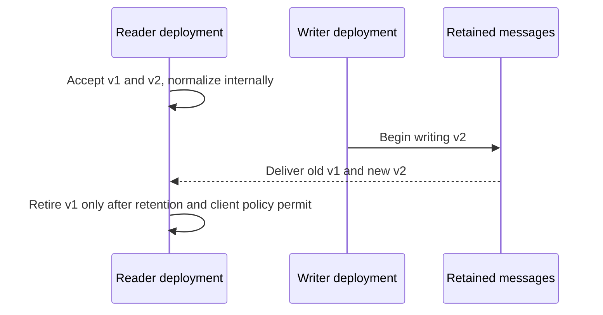

# Treat schemas as contracts between independently changing readers and writers

Role: deep dive. Prerequisite: [Pydantic v2](../core_concepts/data_models/pydantic/README.md).
That chapter owns model construction, validators and serialization. This chapter adds the contract
upgrade question: will old persisted data and old clients still work after a model changes?

## “Optional” and “nullable” solve different problems

Document 42 currently has a required `title`. A new producer adds `language`. An old reader that
rejects extra fields refuses the new message. A new reader that requires `language` refuses old
stored records. Calling the change “additive” does not establish either direction of compatibility.

The acceptance matrix is the first artifact to review:

| Payload | Old strict reader: title only | New reader: title plus language default |
|---|---|---|
| `{"title":"Retention"}` | Accept | Accept, language defaults to `unknown` |
| `{"title":"Retention","language":"en"}` | Reject extra field | Accept |
| `{"title":null}` | Reject null title | Reject null title |

In Pydantic v2, `language: str | None` permits null but still requires the field unless a default
is supplied. `language: str | None = None` also permits omission. Defaults are product decisions:
`unknown` is honest when the language was never measured; `en` would silently invent a fact.
[Pydantic migration guide](https://docs.pydantic.dev/latest/migration/), checked 2026-10-30.

## Expand the reader before changing the writer

Use a versioned envelope when consumers or retained data outlive a deployment:

```json
{"schema_version":2,"document_id":42,"title":"Retention","language":"en"}
```

The dispatcher selects a known version and validates it with the corresponding model. The
application translates both versions into one internal representation. Unknown versions should
produce an explicit unsupported-version outcome, not a best-effort interpretation of security
or billing fields.

This order preserves the interval with mixed versions:



Rolling back the writer does not delete v2 records already emitted. Keep the expanded reader during
rollback. For messages under long retention, an upcaster transforms historical shapes to the current
internal form; it must be deterministic and must not fabricate information that did not exist.

## Put each invariant at the layer that can enforce it

A boundary model validates shape, length and relationships within one payload. A database unique
constraint arbitrates concurrent writers. Authorization compares the authenticated principal with
the resource. None substitutes for the others. For example, a valid tenant ID is not evidence that
the caller belongs to that tenant, and two individually valid “reserve final slot” requests can
still conflict at commit.

Use discriminated unions when a field has distinct variants, such as `status=ready` requiring an
object reference and `status=failed` requiring a reason. This makes impossible combinations explicit.
For example, this Pydantic v2 explanatory excerpt selects a model using `status`:

```python
from typing import Annotated, Literal
from pydantic import BaseModel, Field, TypeAdapter

class Ready(BaseModel):
    status: Literal["ready"]
    object_ref: str

class Failed(BaseModel):
    status: Literal["failed"]
    reason: str

Outcome = Annotated[Ready | Failed, Field(discriminator="status")]
adapter = TypeAdapter(Outcome)
```

Validating `{"status":"ready","object_ref":"objects/7/42/v3"}` selects `Ready` and
accepts its required reference. `{"status":"ready","reason":"scanner failed"}` selects
that same branch and fails because `object_ref` is missing; the presence of `reason` does not
turn a declared success into a failure. The reference still needs ownership and existence checks
outside shape validation. This excerpt is not an executed Pydantic integration test here.

Keep input and output models separate when internal fields must not be serialized; a response
schema is part of the disclosure boundary. Validate before logging, and sanitize validation errors
that might include submitted secrets.

Strict mode prevents many unwanted coercions but depends on the exact Python-versus-JSON input path.
For example, JSON represents dates as strings, so strict JSON validation can accept representations
that strict Python-object validation rejects. Test the production entry method directly.
[Strict-mode semantics](https://docs.pydantic.dev/latest/concepts/strict_mode/).

For a release, keep fixtures for every supported writer version and assert the acceptance matrix
against old and new readers. Add unknown fields, missing keys, nulls, out-of-range values and unknown
version tests. Monitor validation failures by schema version, without raw payloads. If failures rise
after a writer rollout, pause that writer and retain the expanded reader while repairing or replaying
rejected records through the [message contract path](../../infrastructure/messaging/05_message_contracts_and_outbox.md).

**Transfer exercise:** v2 adds a required `retention_days` field. Historical records never stored it.
Can an upcaster insert today's tenant setting and call it the original value?

<details><summary>Answer</summary>

No. Today's configuration may differ from the policy applied when the record was created. Represent
the historical value as unknown, obtain an authoritative historical value, or explicitly perform a
new business decision with its own provenance. Schema migration cannot recover information that
was never retained.

</details>
