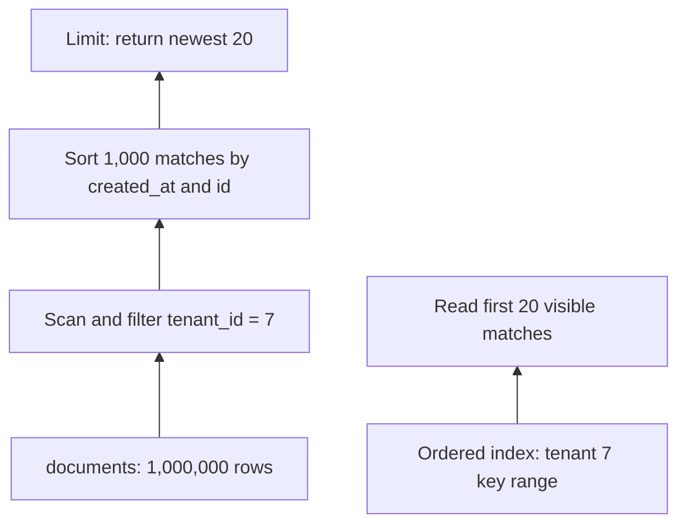

# Make a slow query explain its work

**Role: deep dive.** Read [SQL and transactions](01_databases_and_schemas.md), [ORM relationships](03_sqlalchemy_orm.md), and [pooling](05_connection_pooling.md) first. This chapter uses PostgreSQL 15+ and SQLAlchemy 2.x conventions. It teaches plan interpretation and safe experiments; a particular plan or latency is never guaranteed across data sets and server versions.

Tenant 7 opens its document list. The endpoint returns only 20 rows, yet gets slower as the company grows. `LIMIT 20` limits the result, not necessarily the work: the database might inspect a million rows, discard other tenants, and sort the survivors before returning those 20. Start by discovering which of those steps dominates.

## Trace the rows before choosing an index

Suppose `documents` has 1,000,000 rows, tenant 7 owns 1,000, and the API requests the newest 20. A sequential scan reads the table's pages and tests every row. A B-tree index keeps keys ordered, allowing a search to jump to a narrower key range. An index on `(tenant_id, created_at DESC, id DESC)` can locate tenant 7's range and read in the requested order. It avoids both searching unrelated tenants and sorting the matching rows.

This plan tree shows why a small response can still require a large input:



Read the first branch from bottom to top as work flowing toward the result. The alternative branch already has the required order. If tenant 7 owns most of the table, the benefit of excluding other tenants shrinks; if the query requests every column and every matching row, many table-page visits may still make a sequential scan cheaper. An index is a candidate access path, not a command to the planner.

## Run a bounded plan experiment

The complete [query lab](examples/query_performance.sql) creates a temporary table, loads 100,000 deterministic rows, compares plans before and after an index, and rolls back. Use a disposable PostgreSQL database and a role allowed to create temporary objects; pass your normal verified connection configuration through `PGSERVICE`, not credentials in a command history:

```bash
psql service=notes_lab -X -v ON_ERROR_STOP=1 -f fundamentals/database/examples/query_performance.sql
```

Run from the repository root. The final result should contain IDs `99907, 99807, …, 98007` in descending order. Before the index, expect a table scan with filtering and a sort; afterward, expect the planner to consider the ordered index. Do not fail the lab merely because your planner makes another choice. Compare inspected rows, buffer accesses, and sorting work. `relation ... does not exist` means you ran only a later statement: temporary tables live in the creating connection.

The lab's central query is:

```sql
EXPLAIN (ANALYZE, BUFFERS, TIMING OFF)
SELECT id, created_at
FROM perf_documents
WHERE tenant_id = 7
ORDER BY created_at DESC, id DESC
LIMIT 20;
```

`EXPLAIN` alone estimates the plan. `ANALYZE` actually executes it and attaches measurements. Here the statement is a read; using `EXPLAIN ANALYZE` on an UPDATE performs that update. A rollback can undo transactional table changes, but cannot undo every external effect or sequence advance. Diagnose writes in a disposable environment. [PostgreSQL EXPLAIN](https://www.postgresql.org/docs/18/using-explain.html) documents the measurements and caveats; checked 2026-10-30.

Consider this **illustrative plan excerpt**, not captured benchmark output:

```text
Nested Loop (... rows=20 ...) (actual rows=20 loops=1)
  -> Index Scan ... (actual rows=20 loops=1)
  -> Index Scan ... (actual rows=1 loops=20)
```

The second scan returned one row per invocation, twenty times. A node's `actual rows` and timing are averages per loop; multiply by loops when estimating repeated work, and do not sum inclusive parent timings as though each were independent. Estimated `cost` is the planner's relative cost model, not milliseconds. A predicted one-row join that actually returns 10,000 rows can make a nested loop repeatedly perform work the planner expected to be tiny. Ask whether statistics are stale, values are skewed, or columns are correlated before forcing a different join.

A bitmap scan is the middle ground: index matches produce a bitmap of table locations, then a bitmap heap scan fetches table pages together. This can beat scattered individual row fetches for a moderate match set. It generally loses the index's order, so a sort may remain. `Rows Removed by Filter` means candidates were fetched and rejected; an `Index Cond` narrows index traversal. A filter appearing after an index scan is not necessarily using that index to exclude those rows.

## Match the index to the actual question

For the document list, the equality filter comes first and the ordering keys follow:

```sql
CREATE INDEX ON perf_documents (tenant_id, created_at DESC, id DESC);
```

`id` breaks ties when two uploads share a timestamp. Without a deterministic tie-breaker, page boundaries can skip or repeat rows. A composite index orders tuples: tenant 7's keys are adjacent, then their timestamps are ordered. An index beginning with `created_at` cannot generally isolate one tenant as directly. PostgreSQL 18 can use **skip scans**, repeated searches over missing leading-key values, for some distributions; this does not make column order irrelevant. [Multicolumn index behavior](https://www.postgresql.org/docs/18/indexes-multicolumn.html).

Two additional shapes solve different questions. These are **explanatory excerpts** for a schema containing `deleted_at` and `title`:

```sql
CREATE INDEX live_documents_by_tenant
ON documents (tenant_id, created_at DESC, id DESC)
WHERE deleted_at IS NULL;

CREATE INDEX documents_lower_title
ON documents (tenant_id, lower(title));
```

The partial index excludes archived rows, so it remains useful when only a small live fraction matters. The query must imply its predicate; generic parameterized conditions can prevent the planner proving that implication. The expression index stores a derived search key; a query using `lower(title) = ...` can use it, while arbitrary substring search is a different access problem. Both add storage and write maintenance. See [partial indexes](https://www.postgresql.org/docs/18/indexes-partial.html) and [expression indexes](https://www.postgresql.org/docs/18/indexes-expressional.html).

Do not add every example index. First identify the route, its filter and order, the expected selectivity (fraction of rows matched), and the write cost you can afford. Extra indexes consume cache and make every insert/update more expensive. Index-only scans can avoid some table visits when the index contains all requested data, but visibility checks can still require table access; a freshly updated table behaves differently from an old, vacuumed one. [Index-only scan conditions](https://www.postgresql.org/docs/18/indexes-index-only-scans.html).

## Pagination should advance a boundary

`OFFSET 100000 LIMIT 20` still asks the database to find and pass over 100,000 earlier matches. A keyset cursor stores the last ordering tuple from the previous page instead. For descending order, the next page selects smaller tuples:

```sql
SELECT id, created_at
FROM perf_documents
WHERE tenant_id = 7
  AND (created_at, id) < (TIMESTAMPTZ '2026-01-01 20:00:00+00', 72000)
ORDER BY created_at DESC, id DESC
LIMIT 20;
```

Here the timestamp and ID form one lexicographic boundary. In application code bind both as parameters, derive the tenant from authenticated context, and validate or authenticate the cursor's filter/order context. A cursor is not authority to read a tenant. Use non-null ordering columns or define and implement null ordering explicitly.

Keyset pagination avoids offset growth, but it does not promise a frozen snapshot across requests. A row whose ordering key changes may move across the boundary. Prefer immutable creation order for append-like lists; for exports requiring a consistent snapshot, use a deliberate export job/snapshot strategy with a bounded lifetime. Avoid holding an interactive transaction open while a user clicks through pages.

## A fast query repeated 100 times can still be the bottleneck

Suppose the route lists 20 documents and reads each document's owner. One query loads documents and 20 more lazily load owners: the **N+1** problem, one initial query plus one for each relationship access. Optimizing each owner lookup cannot remove the network round trips.

This **SQLAlchemy excerpt** assumes the mapped `Document.owner` relationship from the application's schema and an `AsyncSession` owned by this request:

```python
from sqlalchemy import select
from sqlalchemy.orm import selectinload

statement = (
    select(Document)
    .where(Document.tenant_id == tenant_id)
    .options(selectinload(Document.owner))
    .order_by(Document.created_at.desc(), Document.id.desc())
    .limit(20)
)
documents = (await session.scalars(statement)).all()
```

Select-in loading collects parent identifiers and fetches related rows in batches. For this small single relationship page, that normally means two queries instead of 21. Joined loading can use one query but multiplies result rows for collections; collection joined loads require `.unique()` on the ORM result, and loading two collections can amplify rows dramatically. Choose using query count **and** transferred row volume. Configure `lazy="raise"` on relationships that must never perform accidental I/O. Async lazy-loading failures and complete session ownership live in [async SQLAlchemy](04_async_sqlalchemy.md); [loader documentation](https://docs.sqlalchemy.org/en/20/orm/queryguide/relationships.html) covers the alternatives.

## Distinguish expensive execution from waiting

An UPDATE on document 42 can take five seconds while using almost no CPU because another transaction owns its row lock. The fastest access plan cannot bypass that ownership. A common trigger is a transaction that changes document status, calls an external model, and only then commits: the model's latency becomes lock duration.

Move external work outside the transaction using a durable job/outbox boundary. Keep the final guarded state transition short. Before intervening, inspect `pg_stat_activity` wait events and `pg_blocking_pids(pid)`; identify the blocking transaction and its business action. Canceling or terminating a session can roll back work and trigger retries, so use the database incident procedure rather than killing arbitrary blockers. The [locking rules](https://www.postgresql.org/docs/18/explicit-locking.html) and [PostgreSQL operations chapter](09_postgresql_operations.md) explain the retained-state consequences.

To find workload-level offenders, use `pg_stat_statements`, which groups normalized statement shapes and tracks aggregate execution. It requires server setup, usually `shared_preload_libraries` and a restart before extension creation; managed services expose provider-specific controls. An illustrative diagnostic query after an operator has enabled it is:

```sql
SELECT queryid, calls, total_exec_time, mean_exec_time, rows
FROM pg_stat_statements
ORDER BY total_exec_time DESC
LIMIT 10;
```

A 2 ms query called one million times may cost more than a rare 2 s query. Compare interval deltas rather than interpreting lifetime counters as current traffic. Slow-query logging is complementary: `log_min_duration_statement` captures individual slow statements, but SQL and parameters can expose sensitive data. Restrict access, retention, sampling and parameter logging. See [statement statistics](https://www.postgresql.org/docs/18/pgstatstatements.html) and [logging controls](https://www.postgresql.org/docs/18/runtime-config-logging.html).

## Change one thing, measure the consequence, keep a rollback

A useful benchmark holds query parameters, data distribution, concurrency and hardware stable. Include a large tenant and a small tenant, realistic row width, common and rare filters, warm-cache repeats and separately labeled cold-cache runs. Do not clear shared production caches for a benchmark. Record p50/p95 route latency, statement count, buffer reads, rows examined, lock waits, CPU and write throughput. `EXPLAIN ANALYZE` excludes ordinary result delivery and adds measurement overhead, so compare real requests too.

Before adding an index in production:

- Confirm a measured route/statement problem and inspect its actual plan with representative parameters.
- Check existing indexes and verify the proposed leading keys, predicate, order and storage budget.
- Rehearse creation on representative data and include concurrent write impact.
- Use the [migration procedure](06_alembic.md); `CREATE INDEX CONCURRENTLY` avoids blocking normal writes but performs more work, waits on transactions, and cannot run inside an ordinary transaction block.
- Inspect validity after failure. A failed concurrent build can leave an invalid index consuming maintenance/storage; investigate and remove/rebuild it deliberately.
- Compare before/after workload behavior, then retain a reviewed drop plan if the index harms writes.

The exact concurrent-build restrictions are in [CREATE INDEX](https://www.postgresql.org/docs/18/sql-createindex.html). Never remove an index backing a constraint as a casual performance rollback.

If the optimized query still recomputes a costly aggregate for every request, choose the next layer by its freshness requirement. A cache reuses a result until expiry/invalidation; a precomputed table stores a refreshable aggregate; a read model maintains a projection as source changes arrive; denormalization copies a specific field into a read-friendly shape. For a dashboard allowed to lag one minute, a refreshed per-tenant count may be sufficient. For an authorization decision, a stale cached membership is a correctness problem. Each copy needs an explicit owner, repair path and freshness signal; start with [Redis caching](../../infrastructure/redis/03_caching_patterns.md) or [event contracts and outbox](../../infrastructure/kafka/reliability/04_transactional_outbox_and_cdc.md) when that trade-off is justified.

## What's changing

Checked 2026-10-30. **GA:** PostgreSQL 18 adds B-tree skip scans and asynchronous I/O capabilities, so remeasure plans after a major upgrade instead of preserving a historical scan assumption. **PREVIEW:** PostgreSQL 19 RC1 is for compatibility rehearsal, not this chapter's production baseline. **GA migration context:** SQLAlchemy 2.1 is the current release line; these examples deliberately retain the existing collection's 2.x API style, and upgrades need the 2.1 migration review. Sources: [PostgreSQL 18 release](https://www.postgresql.org/docs/18/release-18.html), [PostgreSQL 19 RC1](https://www.postgresql.org/about/news/postgresql-19-rc-1-released-3409/), [SQLAlchemy release status](https://www.sqlalchemy.org/download.html), [2.1 migration guide](https://docs.sqlalchemy.org/en/21/changelog/migration_21.html).

## Recap

- A small result can hide a large scan, sort, repeated join or sequence of ORM queries.
- An index helps when its key order removes work needed by the actual filter and ordering.
- Plans measure database execution; request latency also includes waiting, round trips and serialization.
- Optimize with representative workloads and retain an operational rollback, not a preferred plan shape.

## Check yourself

**The new index works for tenant 7, but a tenant owning 70% of rows still gets a sequential scan. Is the index broken?**

<details><summary>Answer</summary>

Not necessarily. Fetching most of the table through scattered index lookups can cost more than scanning it. Inspect the actual filter, ordering, LIMIT, buffer work and latency. The small tenant experiment did not establish the large tenant's selectivity or costs.

</details>

**Route latency doubles, query plans are unchanged, and traces show 41 SQL spans instead of 21. Which experiment comes first?**

<details><summary>Answer</summary>

Inspect the new relationship accesses and measure an eager-loading version. Another N-per-row lookup can add round trips without changing any individual plan. A new index does not remove those calls.

</details>

**A keyset page is correct in isolation, but rows repeat after their timestamps are edited. Why?**

<details><summary>Answer</summary>

The cursor bounds ordering values, not a permanent membership snapshot. Editing a timestamp can move a row across a previously observed boundary. Use an immutable ordering key or an explicitly designed snapshot/export contract when stable membership is required.

</details>
