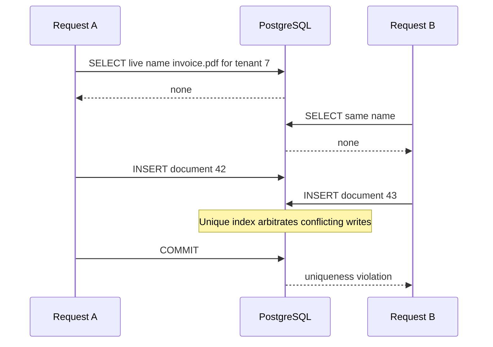
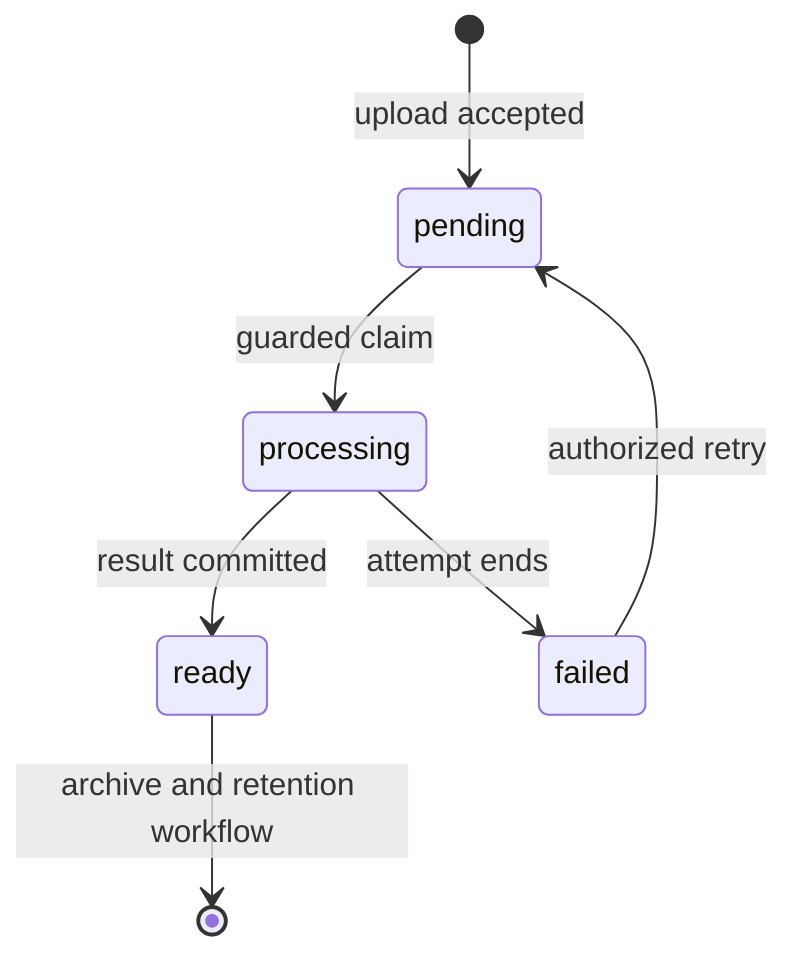

# Put invariants beside the data

**Role: deep dive.** Prerequisites: [SQL transactions and keys](01_databases_and_schemas.md) and [compatible migrations](06_alembic.md). The baseline is PostgreSQL 15+. This chapter develops the schema for a tenant's document-processing system; row access isolation is the next chapter.

Two requests upload `invoice.pdf` for tenant 7. Both ask whether the name is available, both see no row, and both insert. Each request followed the application's rule. Together they violated it because checking and writing were separate decisions that could overlap. A database constraint makes the invariant part of accepting the write, including writes from workers, migrations and future endpoints.

## Watch the race, then move the decision

The two requests can perform the same check before either commits:



With a unique index, the second write cannot successfully commit the same indexed key. It may wait for the competing transaction before succeeding or failing, depending on that transaction's outcome. The earlier SELECT remains useful for a friendly preview, but the write result is authoritative. After an error in a PostgreSQL transaction, roll back before continuing; catch it at the unit-of-work boundary, not halfway through a transaction you then reuse.

## A small schema should express the business identity

The complete [modeling lab](examples/data_modeling.sql) creates temporary tables and rolls back. Run it with the disposable database service used in [query performance](11_query_performance.md):

```bash
psql service=notes_lab -X -v ON_ERROR_STOP=1 -f fundamentals/database/examples/data_modeling.sql
```

The script inserts tenant 7 and document 42, rejects a duplicate live name inside a handled savepoint, archives 42, creates replacement 43, and rejects an illegal state. Its final live list contains only `43 | invoice.pdf`. Notices state which rejection occurred. The script deliberately handles expected constraint exceptions so `ON_ERROR_STOP` can still catch unexpected failures.

The core definition is short enough to inspect before the operational additions:

```sql
CREATE TEMP TABLE model_tenants (
    id bigint PRIMARY KEY,
    name text NOT NULL
);
CREATE TEMP TABLE model_documents (
    tenant_id bigint NOT NULL REFERENCES model_tenants(id),
    id bigint NOT NULL,
    name text NOT NULL,
    state text NOT NULL DEFAULT 'pending',
    deleted_at timestamptz,
    PRIMARY KEY (tenant_id, id),
    CHECK (state IN ('pending', 'processing', 'ready', 'failed'))
);
CREATE UNIQUE INDEX model_live_document_name
ON model_documents (tenant_id, name)
WHERE deleted_at IS NULL;
```

The primary key identifies a document **within** a tenant. The foreign key requires that tenant to exist. `NOT NULL` matters independently: a CHECK normally accepts SQL's unknown result from null expressions, so `CHECK (size_bytes >= 0)` alone does not prohibit null sizes. The partial unique index permits historical rows to reuse a name while forbidding two live documents with that name in one tenant. It does not make names case-insensitive; choose that product rule explicitly before using an expression such as `lower(name)`. [PostgreSQL constraints](https://www.postgresql.org/docs/18/ddl-constraints.html) and [partial indexes](https://www.postgresql.org/docs/18/indexes-partial.html), checked 2026-10-30.

A multi-column foreign key preserves the same ownership boundary in dependent tables. This **explanatory excerpt** assumes the model above:

```sql
CREATE TEMP TABLE model_chunks (
    tenant_id bigint NOT NULL,
    document_id bigint NOT NULL,
    ordinal integer NOT NULL CHECK (ordinal >= 0),
    body text NOT NULL,
    PRIMARY KEY (tenant_id, document_id, ordinal),
    FOREIGN KEY (tenant_id, document_id)
        REFERENCES model_documents (tenant_id, id)
);
```

A chunk for `(tenant=8, document=42)` cannot accidentally refer to tenant 7's document 42. A foreign key on document ID alone would lose that proof. A primary/unique key is backed by an index, but PostgreSQL does not automatically create every useful index on referencing columns. Here the chunk primary key already begins with the foreign-key columns; other schemas may need a separate index for parent deletion checks and joins.

## Valid states and valid transitions are different promises

The CHECK above allows `ready` as a stored value. It does not stop a writer moving from `failed` directly to `ready`. A transition rule compares the previous state to the proposed next state. For ordinary service writes, express that comparison in the update itself:

```sql
UPDATE model_documents
SET state = 'processing'
WHERE tenant_id = 7 AND id = 42 AND state = 'pending'
RETURNING id, state;
```

One returned row means this statement won the transition; zero rows means the row was missing, inaccessible or no longer pending. Do not assume zero means success. If two workers race, only the one whose predicate still matches claims the pending state. A database trigger or narrowly granted stored procedure can enforce transitions against every writer when that is required. If the runtime can issue arbitrary UPDATE statements, an application convention alone is not an enforced transition policy.

The permitted lifecycle makes the recovery choice visible:



A retry returns to `pending`; it does not invent a successful result. This is a simplified business state machine, not a complete worker lease protocol. A process may crash in `processing`, so use the existing [durable task model](../../background_work/foundations/03_minimal_durable_task.md) for ownership, attempt IDs and recovery. Store result data and the `ready` transition in one transaction so users cannot see success without the result.

## Normalize facts whose owners can change independently

If every document stores the tenant's display name, renaming tenant 7 requires updating every document. A partially completed rename produces contradictory current names. Keeping that name in `tenants` gives it one owner; joining retrieves the current value. This is **normalization**: represent a fact once according to what it depends on, rather than copy it wherever convenient.

There are legitimate copies. An invoice needs the billing name at issuance, even after the account changes its name. Name that field `billing_name_at_issue`, write it when issuing the invoice, and make the history semantics explicit. That is a historical fact, not an accidentally stale copy of current profile data. A reporting projection may also denormalize names for speed, but then it needs an update/rebuild process and an accepted freshness lag. See [query performance](11_query_performance.md) before introducing a copy to solve an unmeasured join problem.

## Soft deletion creates another uniqueness and recovery problem

A `deleted_at` timestamp hides a row from ordinary reads without deleting its relationships. It therefore needs consistent live-row predicates in lists, counts, joins, search and authorization. The partial index above treats archived names as reusable. If document 43 now owns `invoice.pdf`, restoring document 42 fails the live-name uniqueness check. The product must choose rename, conflict resolution or refusing restoration; silent renaming in an unrelated query is not a database strategy.

Soft deletion also retains sensitive bytes. Archival moves old data to a different operational tier; hard deletion removes it according to the retention policy. These are distinct actions. A deletion workflow should enumerate rows, object versions, search entries, projections, caches and eventual backup expiration. A retained backup does not become selectively edited just because the live row is deleted. The [backup chapter](08_backup_and_recovery.md) owns restore behavior; [uploads](../fastapi/12_file_uploads_and_object_storage.md) owns object lifecycle.

For auditability, record actor, action, tenant, document, old/new state, request or event ID and the event time. Write the audit row in the same database transaction as the change. A separate fire-and-forget log can be lost after the business transaction commits. Restrict audit UPDATE/DELETE independently of ordinary runtime writes. An append-only table is not tamper-proof against its owner or a database administrator; stronger immutability requires a separate authority/storage boundary.

## Time intervals need a rule about overlap

Suppose document 42 has one assigned reviewer at any instant. Rows with `valid_from`/`valid_to` alone permit overlapping assignments. PostgreSQL range values represent intervals; an **exclusion constraint** can reject pairs whose document identity is equal and whose intervals overlap. This **explanatory excerpt** requires an operator-approved `btree_gist` extension in a disposable lab:

```sql
CREATE TABLE review_assignments (
    tenant_id bigint NOT NULL,
    document_id bigint NOT NULL,
    reviewer_id bigint NOT NULL,
    valid_during tstzrange NOT NULL,
    CHECK (NOT isempty(valid_during)),
    EXCLUDE USING gist (
        tenant_id WITH =,
        document_id WITH =,
        valid_during WITH &&
    )
);
```

Use half-open ranges such as `[10:00,11:00)` and `[11:00,12:00)` when adjacent assignments should be allowed: the first excludes 11:00, so the intervals do not overlap. If assignments must have finite ends or a bounded duration, add those explicit constraints; the example does not impose them. Effective time (when the assignment applies) differs from recording time (when the database learned it). Corrections may need both. [Range types and exclusion constraints](https://www.postgresql.org/docs/18/rangetypes.html) provide the interval semantics.

**What's changing — GA:** PostgreSQL 18 adds temporal `WITHOUT OVERLAPS` and `PERIOD` constraints. They can express related temporal relationships more directly, but are not available on this chapter's PostgreSQL 15 baseline. Evaluate their exact restrictions during a versioned schema migration; do not paste PostgreSQL 18 syntax into a PostgreSQL 15 migration. [PostgreSQL 18 release notes](https://www.postgresql.org/docs/18/release-18.html), checked 2026-10-30.

## Keep variable metadata flexible without hiding identity

A document may have provider-specific extraction metadata whose keys evolve. `jsonb` stores queryable structured data and can suit those optional attributes. Tenant ID, document ID, ownership references, state and uniqueness keys should remain ordinary constrained columns. If identity lives only in JSON, every query must reproduce casting, existence and consistency rules.

This **explanatory excerpt** adds a constrained object-shaped extension field:

```sql
ALTER TABLE model_documents
ADD COLUMN metadata jsonb NOT NULL DEFAULT '{}'::jsonb
CHECK (jsonb_typeof(metadata) = 'object');
```

That check accepts `{"confidence":0.93}` and rejects a JSON array; it does not validate the meaning or range of `confidence`. Validate the producer schema and add database checks for invariants that must survive every writer. Index the actual JSON access pattern when measurements justify it; large JSON updates can still lock and rewrite the containing row. See [JSONB design and indexing](https://www.postgresql.org/docs/18/datatype-json.html).

## Operate changes as data migrations

Before adding a constraint, query the old data for violations and decide how to repair them. A new unique index can fail because historical duplicates exist. Automatically deleting the duplicates may discard the wrong business record. Produce a reviewed conflict report, choose the surviving identity, reattach dependent records and verify counts before enforcing the rule.

CHECK and foreign-key constraints support staged validation patterns: add an eligible constraint `NOT VALID`, enforce it for new changes, repair existing data, then validate. UNIQUE constraints do not use that same `NOT VALID` path. [ALTER TABLE validation semantics](https://www.postgresql.org/docs/18/sql-altertable.html). Review lock behavior and choose a compatible index/build sequence in [Alembic migrations](06_alembic.md). Adding a constraint to a large busy table is an operational event, not a harmless model annotation.

Test constraints against the real PostgreSQL version using two connections for races. Verify duplicate live names fail, different tenants can reuse a name, cross-tenant child references fail, illegal states fail, allowed transitions return exactly one row, and restoration conflicts are explicit. SQLite tests can prove application branching but cannot substitute for PostgreSQL exclusion constraints, locking or row policies.

Production readiness:

- Every business identity and uniqueness rule has a named database constraint or an explicit reason it cannot.
- API conflict responses map specific constraint failures without exposing another tenant's rows or raw SQL.
- State transitions, audit writes and results share the intended transaction boundary.
- Backfills, lock timeouts, validation queries and rollback limits are rehearsed.
- Integrity violation metrics are grouped by safe constraint/error categories; spikes have an owner.
- Restore, archive and deletion exercises cover dependent rows and external storage.

## Recap

- An application pre-check cannot arbitrate concurrent writes; constraints can.
- Composite tenant keys preserve identity across relationships, while row policies govern access.
- A valid state value does not prove a valid transition or a complete result.
- Copies, history and JSON metadata are useful when each has an explicit meaning and owner.
- Constraint deployment needs data repair and lock planning as well as correct SQL.

## Check yourself

**Tenant 7 archives document 42, creates 43 with the same name, then tries to restore 42. What should happen?**

<details><summary>Answer</summary>

Restoring 42 would put two rows into the partial unique index with the same `(tenant_id, name)`. PostgreSQL rejects it. Resolve the product conflict explicitly by renaming, declining restoration or another authorized workflow; soft deletion did not reserve the name.

</details>

**A CHECK permits only pending, processing, ready and failed. Can a buggy writer mark a pending document ready without a result?**

<details><summary>Answer</summary>

Yes. That CHECK validates a single stored state value. A guarded transition and atomic result write are separate obligations; use restricted writes or a database-enforced transition interface if all writers must be constrained.

</details>

**An invoice keeps the old customer name after the profile changes. Is this a normalization defect?**

<details><summary>Answer</summary>

It depends on the field's meaning. A declared immutable name-at-issuance records historical fact and should remain old. A field intended to show the current profile name is an inconsistent duplicate unless maintained deliberately.

</details>
