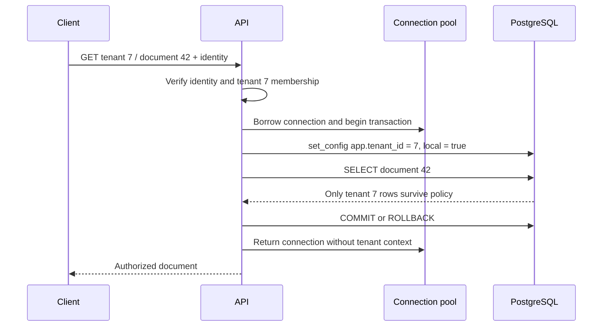
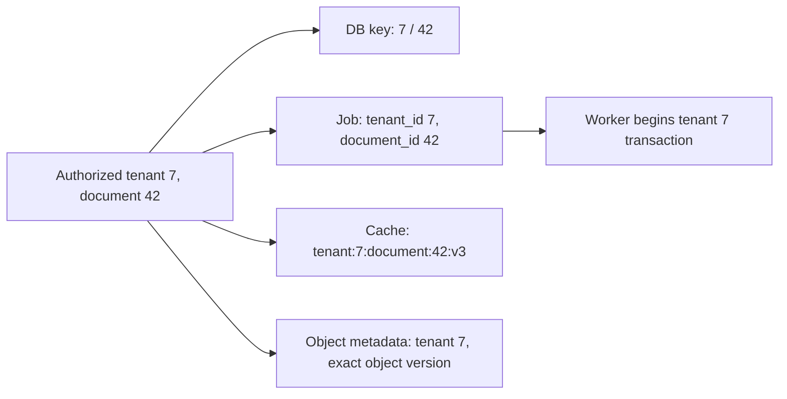

# Keep tenant identity attached to every operation

**Role: implementation.** Read [SQL foundations](01_databases_and_schemas.md), [runtime database privileges](10_database_access_security.md), and [composite data constraints](12_data_modeling_and_constraints.md) first. This chapter uses PostgreSQL 15+ row-level security and an application that authenticates tenant membership before opening a transaction. It does not make hostile arbitrary SQL safe to run under a shared application identity.

Tenant 7 and tenant 8 both have a document numbered 42. A route with `WHERE id = 42` has omitted the most important part of that identifier. The same mistake can occur in a worker, cache lookup, object key or export. A tenant is an ownership boundary spanning all those operations, not merely a column on the first table.

## Prove one database boundary before building a platform

Run the complete [tenant isolation lab](examples/multi_tenancy.sql) in a fresh disposable PostgreSQL database as a lab administrator allowed to create roles/schemas and `SET ROLE tenant_lab_runtime` (typically the disposable cluster's superuser). It creates one schema and one NOLOGIN runtime role inside a transaction, exercises that role, then rolls everything back. The role/schema names must not already exist:

```bash
psql service=notes_lab -X -v ON_ERROR_STOP=1 -f fundamentals/database/examples/multi_tenancy.sql
```

Run from the repository root. The script emits `tenant 7 sees only its document`, `tenant 7 cannot write tenant 8`, `tenant 8 sees only its document`, and `empty tenant context sees zero rows`. Any failed assertion aborts the script. `permission denied to create role` means the selected lab identity lacks the declared setup authority; do not grant role administration to the production application to make this lab work.

Here is the policy from that lab; this is an **explanatory excerpt**, with object creation and grants in the complete script:

```sql
ALTER TABLE tenant_lab.documents ENABLE ROW LEVEL SECURITY;
ALTER TABLE tenant_lab.documents FORCE ROW LEVEL SECURITY;
CREATE POLICY tenant_documents ON tenant_lab.documents
TO tenant_lab_runtime
USING (
    tenant_id = NULLIF(current_setting('app.tenant_id', true), '')::bigint
)
WITH CHECK (
    tenant_id = NULLIF(current_setting('app.tenant_id', true), '')::bigint
);
```

**Row-level security (RLS)** adds a per-row access condition to ordinary table operations. `USING` governs visible/targetable rows; `WITH CHECK` governs proposed new row values. The transaction's trusted context holds tenant 7, so a SELECT lacking an explicit tenant predicate still excludes tenant 8. An attempted insert with `tenant_id=8` fails. Missing or empty context evaluates to null and matches no row; an invalid numeric value errors instead of selecting another tenant.

The runtime role has only schema usage and table CRUD grants, owns no tables, and has neither superuser nor `BYPASSRLS`. `FORCE ROW LEVEL SECURITY` also subjects the owner to policies in ordinary access, but superusers and bypass roles remain privileged. RLS does not govern table-wide operations such as TRUNCATE; the lab deliberately grants no TRUNCATE. Constraints can also reveal existence through success/failure, so tenant-scoped keys and nonrevealing error responses still matter. [PostgreSQL row-security rules](https://www.postgresql.org/docs/18/ddl-rowsecurity.html), checked 2026-10-30.

This lab proves policy behavior, not authentication, connection-pool reuse or application authorization. Those boundaries are added next.

## Establish context from membership, then keep it transaction-local

The attacker-controlled input is a path like `/tenants/8/documents/42`. If the server copies `8` directly into its database context, the RLS policy faithfully grants tenant 8's rows. The policy cannot discover that the authenticated user belongs only to tenant 7. Resolve the requested tenant against authenticated membership first, then pass the authorized tenant to data access.

The request path makes the responsibility of each layer explicit:



The context exists for the transaction, so the next borrower must set its own. A session-level `SET app.tenant_id` can leak across pooled requests. `set_config(..., true)` makes the setting local to the current transaction. Every transaction must establish it before any tenant query; a background task does not inherit a past HTTP transaction. Keep the explicit tenant predicate in normal queries as well, for clear intent and portable query reasoning.

This **SQLAlchemy excerpt** assumes the async session factory from [async SQLAlchemy](04_async_sqlalchemy.md), a mapped document with the composite identity, and `authorized_tenant_id` already established by membership authorization:

```python
from sqlalchemy import select, text

async with Session.begin() as session:
    await session.execute(
        text("SELECT set_config('app.tenant_id', :tenant, true)"),
        {"tenant": str(authorized_tenant_id)},
    )
    document = await session.scalar(
        select(Document).where(
            Document.tenant_id == authorized_tenant_id,
            Document.id == requested_document_id,
        )
    )
```

Bound parameters separate data from SQL syntax. A request-owned session separates concurrent transactions. Neither replaces membership authorization. A shared runtime role can normally change this custom setting, so an attacker able to execute arbitrary SQL under that role can change the asserted tenant too. This RLS design catches missing predicates and accidental cross-tenant writes; stronger isolation against compromised runtime identities requires distinct roles/credentials or databases and a trusted routing boundary.

## Choose isolation by the failure you must contain

Start with the two-tenants example and change the requirement:

| Requirement | Reasonable starting model | Cost or boundary to accept |
|---|---|---|
| Many small tenants, same schema and release schedule | Shared tables with tenant keys, authorization and RLS | Shared capacity and backup image; policy mistakes have broad impact |
| Tenant-specific object namespaces or limited schema customization | Separate schemas with controlled routing | Same database resources; search-path mistakes and many migrations |
| Contractual isolation, separate restore windows or large noisy tenants | Separate databases, possibly separate instances | More pools, migrations, monitoring and placement/routing work |

Separate schemas are namespaces, not automatic authorization. A credential with access to every schema can still read across them. Use controlled identifiers, explicit qualified names and appropriate grants; do not interpolate an untrusted tenant name into SQL or `search_path`. Separate databases improve operational separation, but databases on one server still share CPU, storage and failure fate. A dedicated instance or cell may be necessary for the actual isolation promise.

For 10,000 small tenants, separate connection pools per tenant can exhaust the server long before queries become expensive. A shared pool with transaction-local context makes aggregate capacity easier to bound. For a tenant requiring independent point-in-time recovery, a shared-table layout makes restore harder: recovering the whole database to repair one tenant would roll back everyone. Use [pool budgeting](05_connection_pooling.md) and [backup/recovery](08_backup_and_recovery.md) to evaluate that requirement before choosing the layout.

## Carry tenant identity across asynchronous and cached work

A job payload should carry the authorized tenant and stable document ID, and its worker must re-establish the access context. For long-lived jobs, decide whether revocation suspends previously accepted work; acceptance-time permission and execution-time permission are different product contracts. Never accept an arbitrary tenant from an unauthenticated broker publisher.

A cache entry named `document:42` can return tenant 7's result to tenant 8 even when every SQL query is correct. Name it with the complete identity, such as `tenant:7:document:42:v3`, and include any authorization-sensitive representation variant. A tenant prefix is useful partitioning, but does not authorize the caller: the same trusted membership boundary must select the prefix.

The identity must survive each handoff:



A missing tenant on any edge creates a second path around the database's correct policy. Exports, search queries, vector retrieval and download signing need the same ownership check. Bulk support/admin workflows should use an explicitly privileged audited path rather than disabling policies for ordinary requests.

## Isolate resources as well as rows

Tenant 7 can legitimately submit 10,000 documents and consume all worker slots. Row isolation prevents reading tenant 8's data but does not reserve tenant 8's service capacity. Apply admission quotas and bounded per-tenant work concurrency, then also enforce a global cap so many tenants cannot collectively overload the dependency.

For example, if the database budget supports 40 concurrent application queries, allowing 40 per tenant is not a global budget. Reserve operational headroom, bound total active work, and use fair scheduling or separate queues for large tenants. Enforce quotas at a trusted shared boundary when multiple API replicas can accept work; a process-local counter cannot enforce a fleet-wide allowance. Track queue age and latency by bounded tenant tiers or sampled high-volume tenants rather than putting every tenant ID into every metrics label.

A slow tenant query can still hold shared locks or fill temporary disk. Use query timeouts, measured per-workload pool/concurrency limits and an escalation path to move an exceptional tenant to a separate cell/database. The signal is sustained interference with other tenants' latency or recovery objectives, not merely that one tenant has more rows.

## Tenant lifecycle is a recoverable workflow

Provisioning establishes the tenant record, policy/role mapping, quota defaults and storage namespace before declaring the tenant active. Deletion first denies new work, then drains or cancels accepted jobs under the stated policy, removes dependent data, and records completion evidence. If workers can still publish results after deletion, the tenant can reappear in projections or object storage.

For shared tables, migration runs once against the shared schema, but backfills must be bounded and resumable across tenant IDs. For separate schemas/databases, record each tenant's schema version and upgrade state. Canary a small cohort; make application code tolerate the compatibility window; stop on a failed cohort instead of silently leaving some tenants on an unknown version.

A per-tenant restore in shared tables typically restores the backup into an isolated database, extracts the tenant's related records, reconciles conflicts and external object versions, then imports reviewed changes. That is a data repair operation, not a direct PITR of one row group. Test relationship closure: documents without chunks, memberships or exact object versions may be an unusable restore. Exports require the same dependency map, consistent-cut semantics, encryption and authenticated download authorization.

## Failure symptoms should lead to a specific check

| Symptom | First check | Safe recovery direction |
|---|---|---|
| Every query returns zero rows | Runtime role and transaction-local tenant setting | Fix missing context; do not disable RLS |
| Integration tests see all tenants | Tests connected as owner, superuser or bypass role | Repeat with the actual runtime identity |
| Cross-tenant errors appear after pool reuse | Session-level settings or a query before context setup | Roll back/clear affected connections; fix transaction boundaries and test reuse |
| Inserts fail policy checks | Authorized tenant versus submitted row tenant | Reject mismatched input; investigate context provenance |
| Tenant 8 is slow during tenant 7 batch | Global worker/connection limits and queue fairness | Reduce tenant 7 admission; preserve capacity for existing work |
| Deleted data returns in search | Worker/projection replay without deletion state | Stop the producer, apply deletion tombstones and rebuild/reconcile |

Production readiness and test strategy:

- Use two tenants sharing document ID 42 and verify list, detail, update, delete, joins and aggregates under the real runtime role.
- Attempt a cross-tenant insert/update and an unscoped SELECT; verify policies reject or filter as intended.
- Reuse one pooled connection sequentially for tenant 7, tenant 8 and missing context; test rollback and exception paths too.
- Verify authentication rejects a nonmember before database context is established.
- Test worker, cache, object download and search paths independently; database isolation cannot prove them.
- Rehearse tenant export/delete/restore and a failed migration cohort, recording recovery time and evidence.
- Audit owner/bypass role use, policy changes and administrative data access. Keep migration authority out of the runtime.

## Recap

- Tenant identity is part of each resource key and must survive every boundary.
- RLS can catch omitted predicates only when the runtime role and trusted context are correctly established.
- Transaction-local context prevents normal pool reuse from inheriting the previous tenant.
- Separate schemas or databases change operational isolation and cost; neither removes authorization work.
- Row isolation, resource fairness and tenant recovery are separate capabilities to verify.

## Check yourself

**The API validates JWT signatures, then accepts any `X-Tenant-ID` as its RLS context. Is this isolated?**

<details><summary>Answer</summary>

No. Authentication identifies the caller but does not establish membership in the requested tenant. The caller chooses the setting the policy trusts. Authorize the tenant selection against trusted membership before setting context.

</details>

**A test passes as a database administrator and fails as the runtime role. Which result is relevant?**

<details><summary>Answer</summary>

The runtime result tests the application boundary. An administrator may bypass policies and therefore cannot establish row isolation. Use elevated authority only for lab setup, then assert behavior after switching to the actual restricted role.

</details>

## Try it: prove a worker cannot inherit a previous tenant

Use the lab's schema and runtime grants as a scaffold, but run setup in an explicitly disposable database that persists for your integration test. Borrow the same connection for two **separate** transactions: first tenant 7, then no context. Add a third transaction for tenant 8. The key step is where context is set and where it ends.

<details><summary>Worked solution</summary>

Begin transaction A, call `set_config('app.tenant_id', '7', true)`, and assert only tenant 7's title appears. Commit. Begin B without setting context and assert zero rows, then roll back. Begin C, set tenant 8 locally, and assert only tenant 8's title appears. Repeat A with a raised exception and rollback before B. If B sees tenant 7, the setup used session scope or left a transaction open. A single-transaction test that merely changes values cannot prove cleanup across pooled borrowers.

</details>
