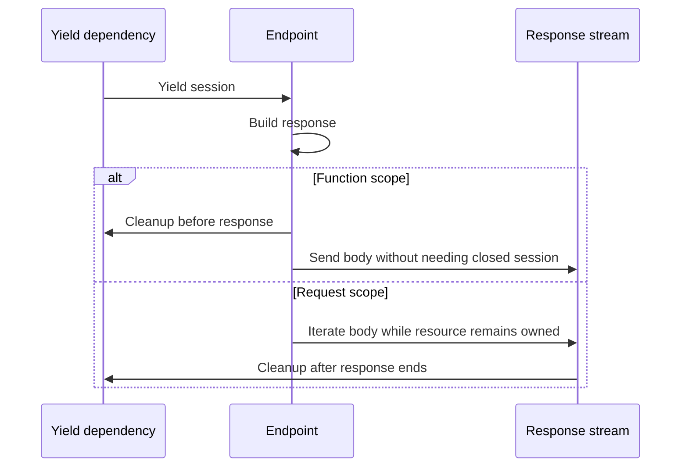

# FastAPI Dependency Injection

<!-- length-justification: This is the canonical FastAPI dependency-resolution reference; callable graphs, caching, yield cleanup, class dependencies, overrides, and testing remain together because they share one per-request resolver and lifetime model. -->

> **Who this is for**: FastAPI engineers who can write routes and want to share request-scoped logic and resources without obscuring ownership or cleanup.

A complete guide to FastAPI's built-in dependency injection system — from mental model to production patterns.

> **Key insight**: `Depends` declares a per-request callable graph; it does not replace arbitrary Python objects or create a general-purpose service container.

---

## 1. What Is Dependency Injection?

FastAPI has **built-in dependency injection (DI)** that allows you to:

- Share logic across endpoints
- Manage resources (DB sessions, auth, configs)
- Keep endpoints clean and testable

Dependencies are **callables** (functions or classes) declared using `Depends`.

---

## 2. The Mental Model

### What `Depends` Actually Means

`Depends` does **not** mean "take data from the request."

`Depends` means:

> **"Call this callable and inject its return value."**

That's it. Where the data comes from depends on the callable's signature — the same parameter resolution rules apply.

### The Core Rule

> **Every function parameter — endpoint or dependency — is resolved using the same rules.**

There are no special rules for dependencies. A dependency's parameters follow the exact same mapping:

- A route-placeholder name → required path value; otherwise an unmarked scalar → query
- Has default, and is not a route placeholder → optional query
- An unmarked Pydantic model → body; `Depends(Model)` instead constructs a dependency from its callable signature
- Explicit annotation → that supported source; conflicting path/query declarations are invalid

---

## 3. Basic Dependency Injection

### Simple Function Dependency

```python
from fastapi import Depends, FastAPI

app = FastAPI()

def get_user():
    return {"username": "alice"}

@app.get("/profile")
def profile(user=Depends(get_user)):
    return user
```

FastAPI:

1. Calls `get_user()`
2. Injects its return value into `user`
3. Handles execution order automatically

### Dependency with Query Parameters

```python
def pagination_params(page: int = 1, limit: int = 20):
    return {"page": page, "limit": limit}

@app.get("/items")
def list_items(pagination=Depends(pagination_params)):
    return pagination
```

Request:

```
GET /items?page=3
```

Result:

```python
{"page": 3, "limit": 20}
```

The dependency's scalar parameters (`page`, `limit`) are not route placeholders, so they bind query values. Defaults make those inputs optional.

---

## 4. `Depends()` with Pydantic Models

You can use a Pydantic model as a dependency:

```python
from pydantic import BaseModel

class Pagination(BaseModel):
    page: int = 1
    limit: int = 20

@app.get("/items")
def endpoint(p: Pagination = Depends()):
    return p
```

FastAPI interprets this as:

```text
Pagination(page=<resolved query value>, limit=<resolved query value>)
```

These scalar constructor parameters do not match route placeholders, so they are query inputs; their defaults make them optional.

Request:

```
GET /items?page=2
```

Result:

```python
Pagination(page=2, limit=20)
```

### Important Distinction

| Signature                  | Meaning         | Value Source   |
| -------------------------- | --------------- | -------------- |
| `x: Model`                 | Body parameter  | Request body   |
| `x: Model = Depends()`     | Call `Model()`  | Based on fields (usually query) |

The same model with `Depends()` behaves completely differently than without.

**Validation has two boundaries.** FastAPI first extracts and validates declared request parameters: an absent required scalar or invalid scalar type normally produces 422. A scalar whose name is not a path placeholder is ordinarily a required query parameter, not an unresolvable startup dependency. Unsupported declarations can fail during route registration, but lack of a default alone is valid.

FastAPI then calls the dependency, including a model constructor used through `Depends(Model)`. A `pydantic.ValidationError` raised inside that callable by a model validator is not automatically the same as a `RequestValidationError` from extraction; without an explicit mapping it can become a server error. Prefer an explicit query-parameter model for request validation, or a small dependency function that validates and translates expected client errors deliberately. Do not expose every internal model failure as client fault. The [runtime tests](./examples/test_runtime_contracts.py) distinguish missing query input from a validator failure inside a constructor.

---

## 5. Dependencies with Path and Headers

Dependencies can pull from any request source:

```python
from fastapi import Header

def get_context(
    user_id: int,                    # path parameter (if in route)
    token: str = Header(..., alias="Authorization")  # extraction, not authentication
):
    return {"user_id": user_id, "token": token}

@app.get("/users/{user_id}")
def endpoint(ctx=Depends(get_context)):
    return ctx
```

Request:

```
GET /users/42
Authorization: Bearer abc123
```

Result:

```python
{"user_id": 42, "token": "Bearer abc123"}
```

---

## 6. Dependency Hierarchies

Dependencies can depend on other dependencies.

```python
def get_db():
    return "db_connection"

def get_user(db=Depends(get_db), user_id: int = 1):
    return f"user {user_id} from {db}"

@app.get("/user")
def endpoint(user=Depends(get_user)):
    return user
```

Resolution order:

```
get_db() → get_user(db, user_id) → endpoint(user)
```

FastAPI builds a **dependency graph**, not a flat list.

---

## 7. Class-Based Dependencies

Classes work as dependencies — useful for services and configs:

```python
class Settings:
    def __init__(self):
        self.debug = True
        self.api_key = "secret"

def get_settings():
    return Settings()

@app.get("/debug")
def debug(settings=Depends(get_settings)):
    return {"debug": settings.debug}
```

Or use the class directly (FastAPI calls `__init__`):

```python
class CommonParams:
    def __init__(self, q: str = None, skip: int = 0, limit: int = 10):
        self.q = q
        self.skip = skip
        self.limit = limit

@app.get("/items")
def read_items(commons: CommonParams = Depends()):
    return commons
```

---

## 7b. Lifespan: Resources That Outlive a Single Request

Dependencies run **per request**. Some resources — an HTTP client, a database connection pool, a loaded ML model, a Redis client — are expensive to build and cheap to share. Creating them inside a `Depends()` makes every request pay the setup/teardown cost, and on high traffic you end up opening thousands of pools a second.

FastAPI's **lifespan** context manager is the canonical place for those. It runs once when the app starts, once when it shuts down, and holds long-lived objects on `app.state`. Dependencies then **read** from `app.state` instead of constructing the resource themselves.

```python
from contextlib import asynccontextmanager

import httpx
from fastapi import FastAPI, Depends, Request
from sqlalchemy.ext.asyncio import async_sessionmaker, create_async_engine


@asynccontextmanager
async def lifespan(app: FastAPI):
    # --- startup: build shared resources ---
    app.state.http = httpx.AsyncClient(
        timeout=httpx.Timeout(connect=5.0, read=30.0, write=10.0, pool=5.0),
        limits=httpx.Limits(max_connections=100, max_keepalive_connections=50),
    )
    engine = create_async_engine(DATABASE_URL, pool_size=20, max_overflow=10)
    app.state.db_sessionmaker = async_sessionmaker(engine, expire_on_commit=False)
    app.state.engine = engine

    yield  # --- app runs here ---

    # --- shutdown: release resources ---
    await app.state.http.aclose()
    await app.state.engine.dispose()


app = FastAPI(lifespan=lifespan)


# Dependencies READ from app.state — they do not own the resource
def get_http(request: Request) -> httpx.AsyncClient:
    return request.app.state.http


async def get_db(request: Request):
    async with request.app.state.db_sessionmaker() as session:
        yield session


@app.get("/upstream")
async def call_upstream(http: httpx.AsyncClient = Depends(get_http)):
    r = await http.get("https://api.example.com/thing")
    return r.json()
```

### Why not `@app.on_event("startup")` / `@app.on_event("shutdown")`?

Those decorators are **deprecated** since FastAPI 0.93 / Starlette 0.26 (2023). They still work but will not get new features, and they do not integrate with async context managers cleanly — a `try/finally` pair of decorated functions cannot express "open this thing, yield, close it" as safely as `asynccontextmanager` does. New apps should use `lifespan=`.

### Lifespan mental model

| Where the resource lives | Use | Example |
|--------------------------|-----|---------|
| Entire process lifetime | **Lifespan** → `app.state` | HTTP client, DB engine/pool, ML model, Redis client |
| Single request | **`Depends()` with `yield`** | DB *session* (checked out of the pool), auth context, transaction |
| Per call | Plain function | Request ID, pagination params |

**Rule of thumb:** if the resource is expensive to construct or holds a pool/socket/open file, put it in lifespan. If it has request-scoped state, put it in a dependency. If it is a pure value, put it in a plain function.

### Testing

`lifespan` runs under `TestClient` too:

```python
from fastapi.testclient import TestClient

with TestClient(app) as client:     # runs startup
    r = client.get("/upstream")
    assert r.status_code == 200
# runs shutdown on exit
```

Use `app.dependency_overrides[get_http] = lambda: fake_client` to swap in a fake without touching lifespan.

---

## 8. Database Session Pattern

The most common dependency pattern — setup and teardown with `yield`:

```python
def get_db():
    db = SessionLocal()
    try:
        yield db
    finally:
        db.close()

@app.get("/users")
def get_users(db=Depends(get_db)):
    return db.query(User).all()
```

Key points:

- `yield` enables **setup + teardown**
- FastAPI guarantees cleanup (even on exceptions)
- One session per request

---

## 9. Authentication Pattern

```python
from fastapi import HTTPException
from fastapi.security import OAuth2PasswordBearer

oauth2_scheme = OAuth2PasswordBearer(tokenUrl="token")

def get_current_user(token: str = Depends(oauth2_scheme)):
    user = decode_token(token)
    if not user:
        raise HTTPException(status_code=401, detail="Invalid token")
    return user

@app.get("/me")
def me(user=Depends(get_current_user)):
    return user
```

Authentication becomes:

- Reusable across endpoints
- Centralized logic
- Automatically enforced

---

## 10. Async Dependencies

FastAPI handles async dependencies naturally:

```python
async def get_redis():
    redis = await create_redis_pool()
    try:
        yield redis
    finally:
        await redis.close()

@app.get("/cache")
async def get_cached(redis=Depends(get_redis)):
    return await redis.get("key")
```

FastAPI ensures:

- Proper awaiting
- Correct async cleanup
- No event-loop issues

---

## 11. Dependency Caching

By default, dependencies are **cached per request**:

```python
def get_settings():
    print("Called!")  # Only prints once per request
    return Settings()

@app.get("/test")
def test(
    s1=Depends(get_settings),
    s2=Depends(get_settings)
):
    return s1 is s2  # True
```

To disable caching:

```python
Depends(get_settings, use_cache=False)
```

Useful when:

- You need fresh data each time
- The dependency is stateful

---

## 12. Global Dependencies

Apply dependencies to an entire app or router:

```python
import secrets

from fastapi import Header, HTTPException

EXPECTED_API_KEY = settings.api_key  # loaded from trusted configuration; never log it


def verify_api_key(api_key: str = Header(...)):
    if not secrets.compare_digest(api_key, EXPECTED_API_KEY):
        raise HTTPException(status_code=403)

# App-level
app = FastAPI(dependencies=[Depends(verify_api_key)])

# Router-level
router = APIRouter(dependencies=[Depends(verify_api_key)])
```

Perfect for:

- Authentication
- Rate limiting
- Request logging
- API key validation

---

## 13. Testing with Dependency Overrides

Override dependencies in tests:

```python
def fake_get_db():
    return FakeDB()

# Override
app.dependency_overrides[get_db] = fake_get_db

# Test runs with FakeDB instead of real DB

# Clean up
app.dependency_overrides.clear()
```

Benefits:

- No real database needed
- No external services
- Fast, isolated tests

---

## 14. Resolution Summary Table

| Signature                  | Meaning           | Value Source                     |
| -------------------------- | ----------------- | -------------------------------- |
| `x: Model`                 | Body parameter    | Request body                     |
| `x: Model = Depends()`     | Call `Model()`    | Based on fields (usually query)  |
| `x = Depends(fn)`          | Call `fn()`       | Based on `fn` signature          |
| `fn(x: int)`               | Path or query     | Request                          |
| `fn(x: int = 1)`           | Query             | Request                          |
| `fn(x = Header(...))`      | Header            | Request                          |
| `fn()`                     | No inputs         | Nothing                          |

---

## 15. Anti-Patterns

Avoid these common mistakes:

- Creating resources inside endpoints instead of dependencies
- Using globals instead of injected dependencies
- Putting business logic directly in routes
- Overusing dependencies for trivial values
- Not using `yield` for resources that need cleanup

---

## 16. Best Practices

- **Keep endpoints thin** — they should orchestrate, not implement
- **Move logic into dependencies or services**
- **Use `yield` for resource management** — DB sessions, connections, files
- **Depend on abstractions** — makes testing easier
- **Compose dependencies at router/app level** — don't repeat yourself
- **Use caching wisely** — understand when you need fresh instances

---

## 17. The Key Insight

> **FastAPI does not inject data — it injects the result of function calls.**

Where the data comes from depends **only** on the callable's signature. Once you understand this, dependency injection in FastAPI becomes completely predictable.

Think of dependencies as **request-scoped wiring**:

- Each request builds a dependency graph
- FastAPI resolves it top-down
- Cleanup happens automatically

You describe *what you need* — FastAPI handles *how and when* it's provided.

## Choose the cleanup boundary explicitly

A dependency that yields a database session has two possible cleanup boundaries in current FastAPI. `Depends(get_db, scope="function")` exits after the path operation returns, before response transmission. `scope="request"` exits after the response finishes. Request scope is the default for yield dependencies; function scope is useful when the endpoint has fully materialized its result and no later response code needs the resource. See [dependencies with yield](https://fastapi.tiangolo.com/tutorial/dependencies/dependencies-with-yield/) (checked 2026-10-30).

For a CSV stream, closing the cursor immediately after constructing `StreamingResponse` would break later iteration. Keep request scope or make the response own a dedicated cursor. For a fully materialized JSON result, function scope can return a scarce connection before a slow client finishes downloading. Never defer a transaction commit that must affect the public success status until after response start.



The [runtime tests](./examples/test_runtime_contracts.py) record `open, endpoint, close, body` for function scope and `open, endpoint, body, close` for request scope. This is a resource lifetime choice, not a way to make background work durable. Subdependencies must have a lifetime compatible with the dependent cleanup that still uses them.

## Check your understanding

Dependencies form one request graph. Per-request result caching and lifespan-owned pools solve different ownership problems.

**Prediction:** Two dependencies require get_db in one request, then another request starts. How many sessions are created with normal dependency caching?

<details><summary>Answer</summary>
One shared result within the first graph, then a new result in the second request. A global engine/pool is separate; use_cache=False changes repeated dependency evaluation.
</details>

**Diagnosis:** Can function-scoped cleanup close a cursor that a response generator still needs?

<details><summary>Answer</summary>
No. Function scope exits before response transmission. Use request scope or make the response explicitly own that resource until the stream ends.
</details>
